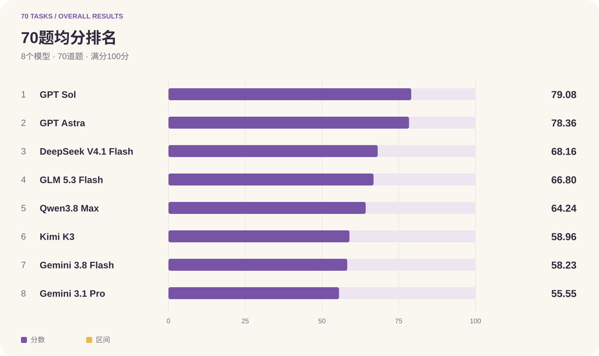
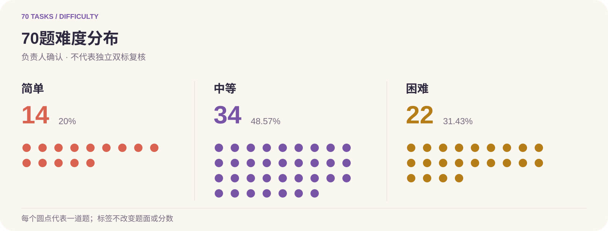
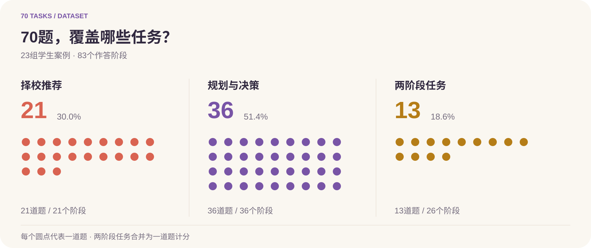
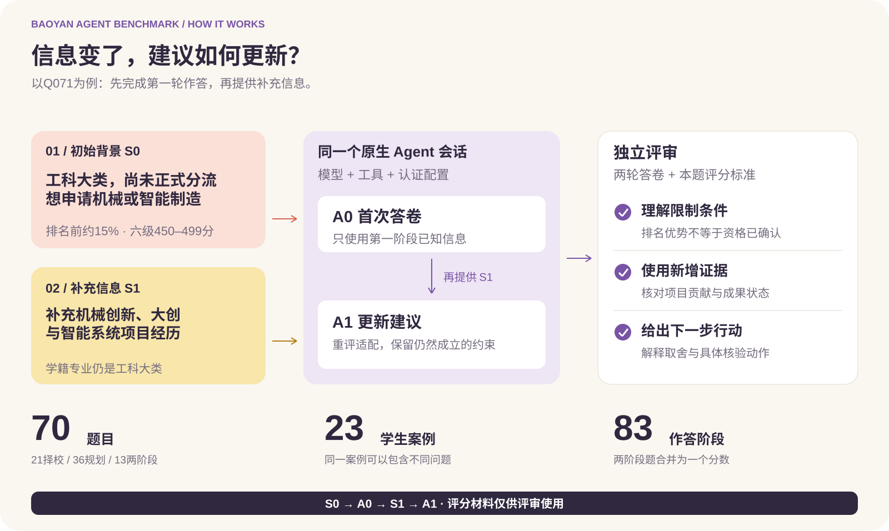
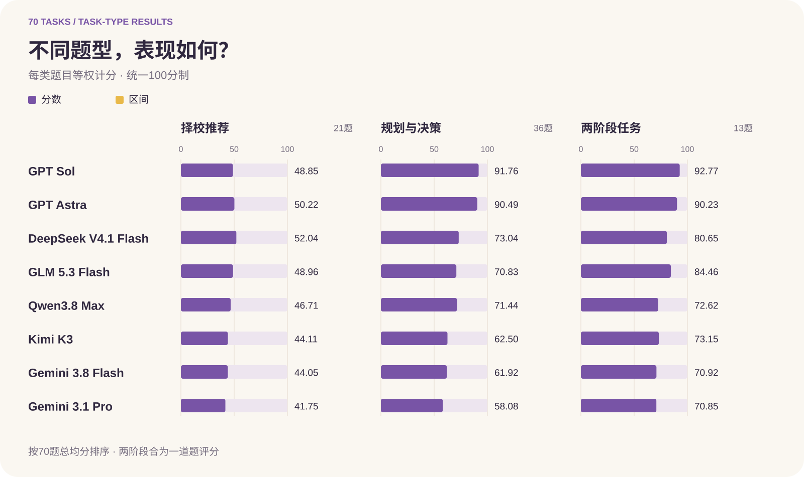

# 保研 Agent Benchmark

本项目是屿智同行的保研 Agent 评测项目，评测完整 Agent 产品在保研择校、申请规划与建议更新中的表现。

题库包含70道中文任务、23组案例和83个作答阶段，配套逐题评分标准与参考项目。公开数据无需申请访问；评分资料虽可下载，但评测时不得提供给被测 Agent。

[English](README.md) · [评测结果](#评测结果) · [快速开始](#快速开始) · [题目与评分](data/questions-and-scoring.md) · [Hugging Face 数据集](https://huggingface.co/datasets/yuxin7778/baoyan-agent-benchmark) · [评测方法](docs/result-methodology.md)

## 评测结果

本榜单基于70道公开题的评测记录汇总，展示各模型的平均得分与完成率。评测设置和评分说明见[文档](docs/result-methodology.md)。

| 排名 | Agent配置 | 题数 | 完成率 | 均分 / 100 |
| ---: | --- | ---: | ---: | ---: |
| 1 | [GPT Sol](experiments/records70/models/gpt-6-1-sol/README.md) | 70 | 70/70 (100.0%) | 79.08 |
| 2 | [GPT Astra](experiments/records70/models/gpt-6-astra/README.md) | 70 | 70/70 (100.0%) | 78.36 |
| 3 | [DeepSeek V4.1 Flash](experiments/records70/models/deepseek-v4-1-flash/README.md) | 70 | 70/70 (100.0%) | 68.16 |
| 4 | [GLM 5.3 Flash](experiments/records70/models/ark-glm-5-3-flash-260828/README.md) | 70 | 70/70 (100.0%) | 66.80 |
| 5 | [Qwen3.8 Max](experiments/records70/models/qwen3-8-max-0902/README.md) | 70 | 70/70 (100.0%) | 64.24 |
| 6 | [Kimi K3](experiments/records70/models/kimi-k3/README.md) | 70 | 70/70 (100.0%) | 58.96 |
| 7 | [Gemini 3.8 Flash](experiments/records70/models/antigravity-gemini-3-8-flash-high/README.md) | 70 | 70/70 (100.0%) | 58.23 |
| 8 | [Gemini 3.1 Pro](experiments/records70/models/antigravity-gemini-3-1-pro-high/README.md) | 70 | 70/70 (100.0%) | 55.55 |

8个模型各完成70题；当前共0题超时。

当前70题及评分标准均已由维护者确认完成教师校准。难度标签经负责人确认：简单14题（20%）、中等34题（48.57%）、困难22题（31.43%）；不代表独立双标复核。逐题评分记录仍保留生成时的 `scored_draft` 与 `teacher_calibration` 标签；`official=false` 是独立的结果认证标记。





[评分数据](experiments/records70/score-summary-70.json) · [逐题得分](experiments/records70/score-details-70.json) · [按模型查阅答卷与评分](experiments/records70/README.md)

## 快速开始

在仓库根目录执行。原生自动运行需要macOS Seatbelt、Python 3.10+（Kimi订阅配置需要3.11+）；框架只用标准库，无需`pip install`。先安装相应官方客户端，并准备自己的订阅登录或API Key。

按当前[Agent注册表](config/agents-cli.example.json)选择配置；表内ID用于`--agent`，不是客户端模型参数：

| 产品 / 模型 | Agent ID | 客户端 | 模板认证 |
| --- | --- | --- | --- |
| GPT Astra | `gpt-6-astra` | Codex / `codex` | ChatGPT订阅 |
| GPT Sol | `gpt-6-1-sol` | Codex / `codex` | ChatGPT订阅 |
| Claude Opus | `claude-opus-5-5` | Claude Code / `claude` | 订阅OAuth |
| Claude Sonnet | `claude-sonnet-5-5` | Claude Code / `claude` | 订阅OAuth |
| Gemini Flash | `antigravity-gemini-3-8-flash-high` | Antigravity / `agy` | 订阅 |
| DeepSeek Flash | `deepseek-v4-1-flash` | DeepSeek Harness / `dsh` | API |
| Qwen Max | `qwen3-8-max-0902` | Qwen Code / `qwen` | DashScope API |
| Kimi K3 | `kimi-k3` | Kimi Code / `kimi` | 订阅OAuth |

所有配置共用以下流程。将`AGENT`换成上表ID，运行时沿用所选认证方式：

```sh
AGENT=gpt-6-1-sol
python3 -m benchmark setup --agent "$AGENT"
python3 -m benchmark cli-check --agent "$AGENT"
python3 -m benchmark cli-batch \
  --selection config/selections/current.json \
  --agent "$AGENT" --out "./runs/current-$AGENT"
```

`setup`保存本机配置；`cli-check`返回`ready_for_trial`后先试跑一道题。批跑默认只预览70题、83阶段，不调用模型；添加`--execute`才使用所选账号额度。多模型时，对每项完成配置和检查，再在批跑命令中重复`--agent`，例如`--agent gpt-6-1-sol --agent claude-opus-5-5`，并使用新输出目录。

评分可用独立Codex订阅会话审阅导出的材料；可选API自动评审需另行配置。单题试跑、订阅评审、API评审与报告步骤见[快速开始](docs/quick-start.md)，安装、认证和多阶段细节见[原生CLI指南](docs/native-cli.md)。

## 数据与评分

- **21道择校推荐题**：比较推荐项目与学生条件的匹配度。
- **36道规划与决策题**：评估准备路径、风险判断和可执行建议。
- **13道两阶段题**：在同一会话补充信息，观察Agent是否更新建议；两阶段合为一道题评分。



每题100分。完整择校题的参考项目匹配占70分、推荐质量占30分；独立评审读取完整答卷，评分材料与答题进程隔离。



[全部题目与评分条件](data/questions-and-scoring.md) · [题库索引](config/selections/current.json) · [数据结构](docs/dataset.md) · [评分通则](docs/scoring.md)


### 分题型表现



逐题状态、计分区间和完整答卷见[逐题结果](experiments/records70/score-details-70.json)与[按模型查阅答卷与评分](experiments/records70/README.md)。

## 方法与复现

[评测口径与运行记录](docs/result-methodology.md)说明本次结果的组成与限制；[评审流程](docs/review-protocol.md)说明如何独立评分。[复现指南](docs/reproduction.md)涵盖冻结输入、交卷与成绩复核，数据导出见[本地导出说明](docs/publication.md)。

## 关于项目

本项目是**屿智同行**的保研 Agent 评测项目。

### 团队

**Yonghao Zhang**为CEO、清华大学计算机科学硕士；**Yichen Wang**为CTO及Sprix AI项目负责人。

## 参与贡献与引用

欢迎通过 Issue 或 Pull Request 改进题目、评分标准、评测工具和文档。引用代码或工具请用 [MIT 软件引用](CITATION.cff)；引用题目或评分资料请用 [CC BY 4.0 数据集引用](https://huggingface.co/datasets/yuxin7778/baoyan-agent-benchmark/blob/main/CITATION.cff)。注明版本、内容哈希及 Agent 配置。

## 致谢

感谢保研岛为本评测提供数据支持。

## 许可

代码及软件文档采用 [MIT](LICENSE) 许可；原创公开题目、评分标准等数据材料采用 [CC BY 4.0](LICENSE-DATA) 许可，具体范围以许可文件为准。第三方资料保留各自权利。
