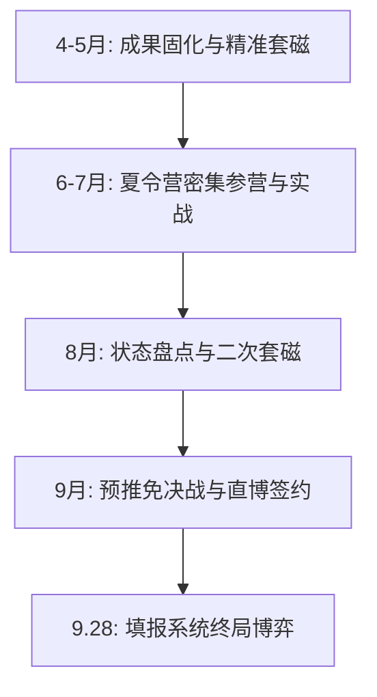

# 郑州大学生物信息学专业保研择校与定位规划方案

---

## 一、 个人画像深度诊断与核心竞争力评估

根据提供的信息，你的保研基础画像可量化与定性诊断如下：

### 1. 优势维度（核心筹码）
1. **专业血统纯正（生物信息学本专业）**：
   - 相比于从纯生物（湿实验）转生信缺乏编程和数理统计基础的同学，或者从计算机/软件转生信缺乏生物学机制理解的同学，你具备完整的 Linux/Shell、Python/R 脚本编写、高通量测序数据流处理（NGS Pipeline）与生物统计知识体系，具备直接进组干活的“即战力”。
2. **学业成绩稳健（专业 前约10%，约前 约10%）**：
   - 郑州大学作为国家“211工程”及世界一流大学建设高校（B类），生命科学/基础医学/农学相关学科体量庞大。通常专业排名前 12%~15% 即可稳获校内推免资格，前约10% 在校内拿到推免指标基本稳妥，消除了保研资格的后顾之忧。
3. **科研经历闭环完整（SCI一作在投 + 湿实验背景 + 大创）**：
   - **SCI一作（在投）**：虽然处于 Under Review 阶段，尚未正式录用，在夏令营机筛打分中加分受限，但这意味着你完整走过“科学问题提出 $\rightarrow$ 公共/自测数据清洗 $\rightarrow$ 分析流程搭建 $\rightarrow$ 统计显著性检验 $\rightarrow$ 机制图表绘制 $\rightarrow$ 英文论文全篇撰写 $\rightarrow$ 选刊投稿”的全流程。这是证明你具备博士/硕士独立科研潜力的最核心材料。
   - **湿实验与大创经历**：这是极为宝贵的“反向加分项”。许多干实验导师最忌讳学生盲目“跑包、调参、玩弄数字游戏”，而完全脱离真实的生物学物理意义。做过湿实验意味着你深刻理解建库测序原理、阴阳性对照、技术批次效应（Batch Effect）以及实验误差来源，在与湿实验课题组合作时沟通成本极低。

### 2. 劣势维度（致命短板与潜在风险）
1. **英语六级 425–449 分（最核心的系统性短板）**：
   - **及格线边缘**：425–449 分刚好压过全国大学英语六级及格线（425分）。在国内保研选拔中，生信干实验因高强度阅读顶级英文文献和全英文代码文档，对英语要求极高。
   - **硬性卡人门槛**：部分华五院校和中九医学院在简章中明文硬卡六级成绩（例如：**浙江大学生命科学研究院/生命科学学院直博通常硬性要求六级 $\ge$ 460 分**，西湖大学硬卡 450–499 分，部分高校医学院硬卡 450 分）。若盲目填报此类项目，会在教务初筛阶段直接被机筛排除。
   - **机筛打分劣势**：在采取“背景打分制”（GPA 占比 + 六级折算 + 科研打分）的顶尖高校中，425–449 分在六级单项处于最低档得分，必须依靠突出的科研产出和导师直接推荐来补足。
2. **本科院校为 211（非 985）且排名前 10% 处在敏感带**：
   - 清华、北大、华五生科院在夏令营机筛时，对 211 高校通常优先筛选前 1%~3%（甚至专业第 1 名）。郑大前 10% 冲刺清北华五直博，纯走教务盲审入营难度极大，必须走“提前学术套磁、导师强保”路径。
3. **SCI 处于“在投”状态**：
   - 多数高校夏令营初审系统只认可“已见刊检索（Indexed）”或“已录用接收（Accepted，附官方录用函）”的成果。在投论文无法在硬性加分表格中计分，必须以“预印本（BioRxiv/Research Square）/ Manuscript 附录 / GitHub 开源代码库”的形式在个人陈述中展现。

### 3. 总体定位与战略博弈方针
- **研究方向坚守**：坚决贯彻“纯生信干实验”路线，锁定计算生物学、生物信息学、AI for Life Sciences、空间与单细胞多组学算法、生物医学大数据挖掘等方向，坚决回避“名义招收生物学、入学后强制安排大量湿实验”的课题组。
- **直博与硕士梯队配置**：
  - **华五及顶尖平台冲刺直博**：直博报名人数通常少于硕士，且导师对能潜心做 5 年干实验代码开发的学生需求迫切，只要导师认可你的代码与科研经历，导师的决定权能有效抵消初审学校与英语的劣势。
  - **中科院国家级科研院所核心主攻（黄金破局点）**：中科院（国家生物信息中心/上海营养健康所等）生信算力雄厚、补贴极高、招生名额多，且普遍仅要求六级过线（$\ge 425$分）或更看重实际代码水平，是郑大学子录取胜率最高、培养质量顶尖的选择。
  - **中九顶尖工科/生科硕士稳妥承托**：选择同济、华科、中南、哈工大等生信传统强校，兼顾学硕与专硕，筑牢底线。

---

## 二、 33 个国内学校、科研院所与专业（项目）组合推荐表

以下组合严格契合“**纯生信干实验**”诉求，深度结合郑大前 10%、六级 425–449、在投一作及湿实验复合背景，覆盖“冲刺、核心、稳妥、保底”四层立体梯队。

---

### 第一梯队：华五及清北冲刺平台（直博为主，共 9 个组合）

#### 1. 清华大学
- **学院/研究院**：自动化系（智能与生物医学交叉研究方向 / 生物信息学研究室）
- **专业与学位**：控制科学与工程（081100）/ 智能科学与技术 —— **直博**
- **干实验方向与团队**：生物信息学与系统生物学、单细胞多组学机器学习算法、空间转录组图神经网络。代表团队如张学工教授团队（数字生命与计算医学）、江瑞教授团队（生物计算与人工智能、基因调控网络建模）。
- **门槛与六级427风险**：清华自动化系博士实行“申请-审核制”，外语为综合评价参考（无六级单项硬卡 450–499 的死线），但对郑大 211 前 10% 而言，教务盲筛初审极难通过。
- **报考与突围建议**：必须在 5 月前进行强套磁，邮件附上在投论文预印本和 Python/PyTorch 代码仓库，若导师有意向安排线上学术面谈且愿意给出推荐名额，方可获得初审豁免权。

#### 2. 北京大学
- **学院/研究院**：前沿交叉学科研究院 / 定量生物学中心（Center for Quantitative Biology, CQB）
- **专业与学位**：定量生物学 / 生物信息学与生物物理学 —— **直博**
- **干实验方向与团队**：定量生物学、复杂生物网络动力学、单细胞转录动力学、转录组学计算模型。代表导师如高歌教授（系统生物学与演化基因组学，深耕表观遗传与长非编码RNA干实验分析）、李程教授团队（三维基因组学计算）。
- **门槛与六级427风险**：CQB 极其偏爱数理和计算背景强的学生，简章通常要求“英语良好”，425–449 分刚好压过 425 线，在材料评定中处于弱势，需依靠计算算法能力自证。
- **报考与突围建议**：夏令营报名时提交详尽的科研报告，高歌等老师极重算法落地能力，建议在个人陈述中将在投 SCI 中的统计模型与生信分析流作为 CQB 定量思想的佐证。

#### 3. 清华-北大生命科学联合中心（CLS 项目）
- **学院/研究院**：清华大学侧 / 北京大学侧 CLS 联合培养项目
- **专业与学位**：生物学（生物信息学与计算生物学方向）—— **直博**
- **干实验方向与团队**：单细胞组学分析、基因组表观遗传计算、计算蛋白质设计。CLS 实行“轮转机制（Rotations）”，进校后确定实验室，干实验顶尖导师涵盖高军涛、张奇伟、汪小我（兼）等。
- **门槛与六级427风险**：CLS 每年夏令营海投人数破数千，对 211 高校通常卡前 1%~3%，六级 425–449 分在机筛打分池中极容易被筛除，属于“买彩票式”顶冲项目。
- **报考与突围建议**：材料务必把在投一作 SCI 包装至最高规格，突出跨学科干湿结合的思考，做好被初筛拒绝的心理准备，重点放在后续院所。

#### 4. 上海交通大学
- **学院/研究院**：生命科学技术学院（生物信息学与生物统计学系）
- **专业与学位**：生物学（071000）生物信息学方向 —— **直博**
- **干实验方向与团队**：计算结构生物学、高通量组学数据分析、群体遗传学与生物统计模型。代表导师如魏冬青教授（计算机辅助药物设计与分子模拟）、李婧教授（复杂疾病组学与生物统计算法）。
- **门槛与六级427风险**：**重大政策利好**——上交生科院接收推免生明确要求“全国大学英语六级 CET-6 $\ge$ 425分”！你的 425–449 分**完全合规，不被硬卡**！但由于上交竞争激烈，机筛需导师有力支持。
- **报考与突围建议**：直博名额相对学硕宽裕，上交生信系对纯生信本专业极度渴求。必须提前联系李婧、魏冬青等团队，直博招生意向明确时，入营概率大增。

#### 5. 上海交通大学
- **学院/研究院**：生物医学工程学院（医疗健康大数据与系统生物学实验室）
- **专业与学位**：生物医学工程（083100）医学信息与生物信息学 —— **直博**
- **干实验方向与团队**：医疗健康大数据挖掘、医学影像与基因组多模态融合、单细胞免疫组学分析。代表团队如钱大宏教授团队、丁显廷教授课题组干实验分析平台。
- **门槛与六级427风险**：生医工学院推免要求 CET-6 $\ge$ 425分，郑大 211 工科/医科交叉背景契合度高。六级 425–449 分通过门槛审查。
- **报考与突围建议**：强调生信数据与医学临床队列分析的关联，在投论文若与肿瘤/疾病组学相关，将与生医工学院高度吻合。

#### 6. 复旦大学
- **学院/研究院**：生命科学学院（生物信息学系 / 计算生物学平台）
- **专业与学位**：生物学（071000）生物信息学方向 —— **直博**
- **干实验方向与团队**：转录后调控与可变剪接组学计算、进化发育基因组学、单细胞表观遗传学分析。代表导师如倪挺教授（RNA 调控与衰老基因组学计算）、李栋教授等。
- **门槛与六级427风险**：复旦生科院未对六级设定全国统一硬性淘汰线（原则上要求良好，425及以上可报），但复旦对 211 院校排名非常敏感，通常偏爱 211 前 3% 以内。
- **报考与突围建议**：复旦生科院直博考核注重英文学术文献现场朗读与翻译。必须强化专业文献翻译能力，弥补 425–449 分带来的英语印象分扣减。

#### 7. 复旦大学
- **学院/研究院**：类脑智能科学与技术研究院（ISTBI）/ 复杂体系多尺度研究院
- **专业与学位**：计算机科学与技术 / 生物物理学（计算系统生物学）—— **直博**
- **干实验方向与团队**：生物医药多尺度建模、AI 辅助蛋白质结构预测与药物设计、生物医学大数据跨尺度计算。代表导师如马剑鹏教授（计算生物学多尺度模拟）、类脑院生物信息中心团队。
- **门槛与六级427风险**：类脑院与复杂体系研究院计算资源充沛，重视 Python/C++ 算法功底，六级 425 分以上符合报名条件，但算法考核深度极大。
- **报考与突围建议**：在个人自述中重点强调算法实现、矩阵运算及在投 SCI 中的复杂代码逻辑，避开与纯生物生竞争，主打“交叉算法开发”。

#### 8. 中国科学技术大学
- **学院/研究院**：生命科学与医学部（计算生物学与生物物理学系）
- **专业与学位**：生物物理学（071011）/ 生物信息学 —— **直博**
- **干实验方向与团队**：蛋白质从头设计与计算模拟、单细胞多组学算法与免疫浸润分析、AI 制药。代表导师如刘海燕教授（蛋白质设计与计算生物学）、瞿昆教授团队（单细胞多组学与生物信息学）。
- **门槛与六级427风险**：中科大生医部推免无全校统一硬性六级高分门槛，425–449 分符合报名条件。中科大以学风硬核著称，导师看重推免生的高数、线性代数与代码基础。
- **报考与突围建议**：中科大瞿昆教授团队常年产出顶刊生信成果，极其欢迎纯生信且能写代码的直博生。提前发邮件联系瞿昆、刘海燕教授，附件附上自己的分析 pipeline 脚本。

#### 9. 南京大学
- **学院/研究院**：生命科学学院（医药生物技术全国重点实验室 / 计算生物学组）
- **专业与学位**：生物学（071000）生物信息学与系统生物学 —— **直博**
- **干实验方向与团队**：非编码 RNA 调控网络计算、植物多组学算法、疾病靶点计算筛选。代表导师如陈迪俊教授（植物系统生物学与组学大数据分析）、张辰宇团队干实验计算组。
- **门槛与六级427风险**：南大生科院明确规定申请直博生“原则上应通过英语六级（$\ge 425–449$分）”，你的 **425–449 分恰好以 1 分优势越过红线**！合规但极其惊险，任何机筛材料绝不能出现其他瑕疵。
- **报考与突围建议**：南大直博报名必须在系统中明确填报意向导师。务必在 8 月底预推免前与陈迪俊等生信导师取得沟通，获得导师面试推荐承诺。

---

### 第二梯队：国家级科研院所与科教融合平台（核心主攻，共 9 个组合）

> **战略重点**：国家级科研院所（尤其是中科院系统）是生信干实验的真正国家队，平台算力雄厚，科研经费充裕，无湿实验强推杂务，且普遍对六级成绩采取“$\ge 425$ 即可通过”政策，高度重视频道代码与科研即战力，是你斩获顶级直博/学硕的“黄金主战场”。

#### 10. 中国科学院北京基因组研究所（国家生物信息中心 CNCB / BIG）
- **学院/研究院**：中国科学院北京基因组研究所 / 国科大生命科学学院
- **专业与学位**：生物信息学（0710J1）—— **直博**
- **干实验方向与团队**：国家生物信息数据库构建、人类基因组学多组学挖掘、单细胞表观组学算法开发、非编码元件深度解析。代表导师如章张研究员（生物信息数据库与大数据中心）、鲍一明研究员、方向东研究员、陈科研究员等。
- **门槛与六级427风险**：**重大政策优势**——北京基因组所官方推免规程未设立六级硬性淘汰分数线，425–449 分在初审环节不成为被拒理由！面试中设有 5 分钟专业英语考核（占 30%）。
- **报考与突围建议**：**第一核心志愿**！郑大生信排名前 10% 搭配在投一作，非常契合基因组所的选拔标准。提前研读国家生物信息中心开发的数据库工具（如 Genome Warehouse, BioCode），夏令营前发邮件联系意向研究员。

#### 11. 中国科学院北京基因组研究所（国家生物信息中心 CNCB / BIG）
- **学院/研究院**：中国科学院北京基因组研究所 / 国科大生命科学学院
- **专业与学位**：基因组学（0710Z1）/ 生物与医药（086000）—— **学硕 / 专硕**
- **干实验方向与团队**：生物医学大数据分析、临床多组学转化、生信自动化流程开发。
- **门槛与六级427风险**：硕士竞争烈度略高于直博，但六级门槛同样宽松。郑大 211 背景在硕士初审中完全处于可接受区间。
- **报考与突围建议**：若担心 5 年直博压力，可填报该所的生物与医药专硕或基因组学学硕，入所后同样从事纯干实验工作，毕业后去向极广（顶级大厂/测序公司算法岗）。

#### 12. 中国科学院上海营养与健康研究所（SINH）
- **学院/研究院**：原中国科学院-马普学会计算生物学伙伴研究所（CAS-MPG PICB，计算生物学殿堂级平台）
- **专业与学位**：计算生物学（0710J2）—— **直博**
- **干实验方向与团队**：全基因组关联分析（GWAS）与复杂疾病统计遗传学、RNA 剪接与单细胞计算生物学、群体遗传学与生物信息学。代表导师如王泽峰研究员（RNA计算生物学）、李亦学研究员（系统生物学大牛）、汪思佳研究员（计算表型组学）、张国庆研究员。
- **门槛与六级427风险**：**官方明确规定**——SINH 夏令营及推免简章白纸黑字注明“取得 CET-6 或 CET-4 证书，成绩 $\ge 425$ 分即可”！你的 425–449 分完全合规，初审资格 100% 具备。
- **报考与突围建议**：**极度推荐**！原 PICB 是国内公认计算生物学最高学府之一，师资力量纯正，全所基本全为干实验与定量分析。提前了解王泽峰或汪思佳团队，展示自己的高通量测序分析脚本，胜算极高。

#### 13. 中国科学院上海营养与健康研究所（SINH）
- **学院/研究院**：生物医学大数据中心 / 计算生物学实验室
- **专业与学位**：计算生物学（0710J2）/ 生物与医药（086000）—— **学硕**
- **干实验方向与团队**：生物大数据平台架构、多模态单细胞转录组分析、健康大数据挖掘。
- **门槛与六级427风险**：六级 425 线通过，学硕名额相对稀缺，需在面试中力拼专业技能。
- **报考与突围建议**：在推免报名系统开放前，直接通过邮件与生物医学大数据中心的导师建立联系，争取“先面试后入库”。

#### 14. 中国科学院计算技术研究所（中科院计算所）
- **学院/研究院**：计算机系统结构 / 智能信息处理重点实验室（生物信息课题组）
- **专业与学位**：计算机科学与技术（081200）生物计算方向 —— **直博 / 学硕**
- **干实验方向与团队**：基于深度学习的高通量基因组拼接算法、蛋白质冷冻电镜密度图三维重建、生物医学文本挖掘。
- **门槛与六级427风险**：计算所对代码与计算机体系结构要求极高。英语无硬卡，但考核包含严苛的机试（LeetCode 中等偏上难度）与算法理论。
- **报考与突围建议**：适合对算法开发（非单纯调用生信工具）感兴趣的方向。若自评算法与数据结构功底扎实（刷题量 150+），可作为工科生信跨越式平台。

#### 15. 中国科学院遗传与发育生物学研究所（中科院遗传所）
- **学院/研究院**：基因组生物学研究中心
- **专业与学位**：遗传学（071007）生物信息学方向 —— **直博 / 学硕**
- **干实验方向与团队**：作物/植物泛基因组学计算、三维基因组构象分析、单细胞表观组学演化。代表团队如钱韦研究员、田丰研究员团队生信计算组、韩敬东课题组。
- **门槛与六级427风险**：中科院遗传所推免对外语要求同样为常规审核，425–449 分满足基本申报条件。
- **报考与突围建议**：该所虽然很多组有湿实验，但每个大课题组均急缺专门挑大梁的“纯生信干实验分析手”。在套磁中明确声明“自身具备湿实验经历，深知实验逻辑，但立志在博士阶段全力从事纯干实验多组学算法与分析”，大牛导师会极其喜欢。

#### 16. 中国科学院动物研究所（中科院动物所）
- **学院/研究院**：膜生物学国家重点实验室 / 动物生态与保护生物学院重点实验室
- **专业与学位**：生态学 / 生物信息学（进化基因组学与计算生物学）—— **直博 / 学硕**
- **干实验方向与团队**：群体遗传学进化算法、非人灵长类单细胞时空组学图谱绘制、物种演化组学。代表导师如陈金锋研究员（计算基因组学与结构变异）、李伟研究员团队计算组。
- **门槛与六级427风险**：六级 425 通过即可，初审更关注科研课题深度。
- **报考与突围建议**：进化基因组学是生信干实验中最经典、最纯粹的领域之一，完全不需碰湿实验。陈金锋等课题组纯干实验实力极强，建议夏令营积极投递。

#### 17. 中国科学院深圳先进技术研究院（SIAT）
- **学院/研究院**：合成生物学研究所（合成所）/ 计算机辅助药物设计中心
- **专业与学位**：生物化学与分子生物学（生物信息学）/ 计算机科学与技术 —— **直博 / 学硕**
- **干实验方向与团队**：AI 辅助合成生物回路设计、单细胞时空多组学建模、计算生物学与抗体结构预测。代表导师如潘毅院士团队、陈劲松研究员等。
- **门槛与六级427风险**：SIAT 考核极其灵活，办学机制开放，经费与超级计算机算力极为充沛（依托深圳超算）。六级 425–449 毫无阻碍，郑大 211 前 10% 拿夏令营优营概率极高（$>80\%$）。
- **报考与突围建议**：重点考察项目实战能力。深圳补贴丰厚，产学研结合紧密，若未来考虑进入 AI 制药、大厂生物计算业务线，SIAT 是绝佳平台。

#### 18. 中国医学科学院基础医学研究所 / 北京协和医学院
- **学院/研究院**：基础医学院 生物医学信息学系 / 系统医学研究所（苏州系统所 ISM）
- **专业与学位**：生物信息学（0710J1）/ 生物医学工程 —— **直博 / 学硕**
- **干实验方向与团队**：人类重大疾病队列多组学分析、单细胞肿瘤免疫微环境解码、系统生物学建模。代表导师如蒋太交研究员（苏州系统所，生物信息与病原计算）、马超研究员等。
- **门槛与六级427风险**：协和系统各所要求 CET-6 $\ge 425$分，425–449 分达标。协和对医工交叉生信极度重视，科研平台连接协和医院顶尖临床样本资源。
- **报考与突围建议**：苏州系统所（ISM）由中国医学科学院与苏州市共建，硬件与生信算力条件国际一流，招生名额较多且竞争相比清北本部温和，是稳中求进的极高性价比选择。

---

### 第三梯队：“中坚九校”及传统 985 优势高校（硕士核心+特色直博，共 10 个组合）

#### 19. 华中科技大学
- **学院/研究院**：生命科学与技术学院（生物医学信息技术课题组）
- **专业与学位**：生物医学工程（083100）/ 生物学 —— **学硕 / 专硕**
- **干实验方向与团队**：翻译后修饰数据库与算法开发、计算系统生物学、单细胞多组学大数据整合。代表导师如薛宇教授团队（蛋白质修饰生物信息学领域全球权威）、郭安源教授（转录调控与生物信息学数据库）。
- **门槛与六级427风险**：华科生科院推免简章无强制六级高分要求（常规审查），郑大 211 前 10% 属于华科生科院非常青睐的优质生源梯队。
- **报考与突围建议**：**硕士梯队首选目标**！薛宇、郭安源教授团队是全国纯干实验生物信息学的标杆，常年开发知名在线算法平台与数据库（如 GPS 系列工具），完全不需要湿实验。夏令营前必套。

#### 20. 同济大学
- **学院/研究院**：生命科学与技术学院（生物信息学系）
- **专业与学位**：生物学（071000）生物信息学方向 —— **直博**
- **干实验方向与团队**：表观遗传多组学计算生物学、早期胚胎发育转录调控动力学、AI for Life Sciences。代表导师如张勇教授（表观遗传生信计算领军人物）、高绍荣院士团队干实验平台。
- **门槛与六级427风险**：**重大政策利好**——同济大学生命学院直博推免要求官方明确为“CET-6 $\ge$ 425 分”！你的 425–449 分**精准越线**，资格审核完全无虞。
- **报考与突围建议**：同济生信在国内生信界声誉极高，学术纯度极佳。张勇团队是干实验学生梦寐以求的课题组。直博申请竞争相对理性，建议全力冲刺。

#### 21. 同济大学
- **学院/研究院**：生命科学与技术学院 / 医学院
- **专业与学位**：生物与医药（086000）/ 生物信息学 —— **专硕 / 学硕**
- **干实验方向与团队**：人工智能辅助药物设计、肿瘤基因组大数据挖掘。代表导师如刘琦教授（AI for Science / 药物计算生物学团队）。
- **门槛与六级427风险**：刘琦教授组非常重视 Python/深度学习实战。硕士统招名额少，推免通常招收 1-2 名。
- **报考与突围建议**：刘琦教授的 AI 驱动制药算法在工业界认可度极高，若个人希望硕士毕业后进入科技大厂或 AI Biotech，该组合性价比极高。

#### 22. 中山大学
- **学院/研究院**：生命科学学院（进化与计算生物学团队）
- **专业与学位**：生物学（071000）生物信息学方向 —— **学硕 / 直博**
- **干实验方向与团队**：分子演化与群体遗传学算法、单细胞空间转录组学建模。代表导师如贺雄雷教授（演化生物学与计算生物学顶级学者）、施苏华教授团队。
- **门槛与六级427风险**：中大生科院六级要求 425 分过线，郑大排名符合初筛入营标准。
- **报考与突围建议**：贺雄雷教授团队科研极度硬核，曾发表多篇 Science/Nature 纯计算与演化大作。套磁时务必突出自己的数理逻辑和统计学思维。

#### 23. 东南大学
- **学院/研究院**：生物科学与医学工程学院（生医工全国顶尖 A+ 学科平台）
- **专业与学位**：生物医学工程（083100）/ 电子信息 —— **学硕 / 专硕**
- **干实验方向与团队**：生物信息技术、微阵列与测序大数据智能分析、神经信息学。代表团队如孙啸教授团队（生物信息学重点实验室）。
- **门槛与六级427风险**：生医学院推免要求六级达到国家线（425分），425–449 分符合标准。A+ 学科背景极强，但该专业工科属性浓，偏爱生信工具开发。
- **报考与突围建议**：突出生信编程能力、数据库搭建能力。东南大学夏令营给优营政策明确，是保底进名校 A+ 学科的优选。

#### 24. 哈尔滨工业大学
- **学院/研究院**：计算学部（计算机科学与技术学院 / 生物信息学研究室）
- **专业与学位**：计算机科学与技术（081200）生物计算方向 —— **学硕**
- **干实验方向与团队**：基因组序列模式识别、计算生物学图神经网络、高通量宏基因组算法。代表导师如王晓龙教授、刘洋教授团队。
- **门槛与六级427风险**：哈工大计算机生信起源早，底蕴极深，推免无六级硬性高分淘汰线。但生信本专业申请计算机学院学硕需展示不输计算机专业的数据结构与算法基础。
- **报考与突围建议**：展示在投 SCI 中的复杂分析逻辑和编程规范度，若有算法竞赛或全国大学生数学建模经历更佳。

#### 25. 西安交通大学
- **学院/研究院**：生命科学与技术学院（生物医学信息工程教育部重点实验室 / 信息生物学交叉中心）
- **专业与学位**：生物医学工程（083100）信息生物学方向 —— **直博 / 学硕**
- **干实验方向与团队**：AI for Genomics、基因组结构变异解析算法、生物医学大数据挖掘。代表导师为叶凯教授（国家杰青，国际知名变异检测工具 Pindel、MSIsensor 的开发者）。
- **门槛与六级427风险**：西交大生命学院考核流程规整，CET-6 $\ge 425$ 即可申报，425–449 分无制度障碍。
- **报考与突围建议**：叶凯教授是纯算法与生信工具开发的领军人物，实验室全为干实验环境。非常欢迎生信本专业、有志于深入开发测序分析工具的直博与硕士生。

#### 26. 武汉大学
- **学院/研究院**：生命科学学院 / 药学院
- **专业与学位**：生物学（071000）生物信息学方向 —— **学硕**
- **干实验方向与团队**：非编码 RNA 结构预测、高通量表观组数据分析、计算机辅助药物靶点发现。
- **门槛与六级427风险**：武大生科院六级要求常规过线（425分），郑大排名在武大初审安全范围内。
- **报考与突围建议**：武大生科院夏令营通常举办较早（6-7月），注意文书准备，将 SCI 在投作为主打材料。

#### 27. 中南大学
- **学院/研究院**：计算机学院（生物信息学湖南省重点实验室）
- **专业与学位**：计算机科学与技术（081200）/ 电子信息 —— **学硕 / 专硕**
- **干实验方向与团队**：复杂生物网络算法、微环境图表示学习、生物大数据并行计算。代表导师为王建新教授团队（ACM Sigbio China 主席，图算法与生信大牛）。
- **门槛与六级427风险**：中南大学计算机学院推免认可六级过线，郑大 211 计算机交叉背景在王建新团队招生中极具认可度。
- **报考与突围建议**：王建新团队科研经费极多，论文产出量大，干实验算法体系完整。直接向王建新教授发邮件（`[已脱敏邮箱]`）自荐，表达加入意向。

#### 28. 厦门大学
- **学院/研究院**：生命科学学院 / 信息学院（健康大数据中心）
- **专业与学位**：生物学（生物信息学）/ 计算机技术 —— **学硕**
- **干实验方向与团队**：单细胞转录组动力学分析、生物大分子相互作用计算网络。
- **门槛与六级427风险**：厦大生科院推免通常要求六级过线，425–449 分达标，初审对排名看重。
- **报考与突围建议**：气候环境宜人，科研平台稳定，作为中九梯队中极具吸引力的沿海选择。

---

### 第四梯队：高匹配度稳妥与保底优质项目（共 5 个组合）

#### 29. 山东大学
- **学院/研究院**：数学学院 / 计算机科学与技术学院（金融数学与交叉计算生物学团队）
- **专业与学位**：应用统计 / 计算机科学与技术（计算生物学方向）—— **学硕**
- **干实验方向与团队**：高通量测序数据统计推断、三维染色质拓扑结构数学建模、单细胞空间数据统计学习。代表导师如张世华教授（系统生物学与生物信息学知名学者，国家杰青/优青）。
- **门槛与六级427风险**：山大推免政策稳健，六级 425 分达标，郑大前 10% 拥有极高的入营和优营录取率。
- **报考与突围建议**：张世华教授组在生物信息统计建模领域极为扎实，科研作风严谨，纯干实验产出极高。

#### 30. 北京航空航天大学
- **学院/研究院**：生物与医学工程学院（生物力学与生物计算实验室）
- **专业与学位**：生物医学工程（083100）医学大数据挖掘方向 —— **学硕**
- **干实验方向与团队**：基于超算平台的生信分析流程、空间转录组学建模、生物医疗智能计算。
- **门槛与六级427风险**：北航工科要求严格，但生医学院相比计算机学院竞争温和，六级 425 分符合推免基本资格。
- **报考与突围建议**：北航在北京的区位优势与超算平台优势显著，是进京求学的稳妥 985 承接点。

#### 31. 四川大学
- **学院/研究院**：华西基础医学与法医学院 / 计算机学院（智能医学工程中心）
- **专业与学位**：生物医学工程 / 基础医学（医学信息学方向）—— **学硕**
- **干实验方向与团队**：依托华西医院超级临床队列的基因组大数据挖掘、法医物证 DNA 生信分析。
- **门槛与六级427风险**：华西本部临床和某些医学类卡六级较严，但基础医学院/交叉学科生信方向对六级 425 分通过者开放。
- **报考与突围建议**：华西临床样本与测序数据资源极其雄厚，纯生信分析手在组内地位极高，文章产出快。

#### 32. 上海科技大学
- **学院/研究院**：生命科学与技术学院（SLST）/ 信息科学与技术学院（SIST）
- **专业与学位**：生物学（计算生物学与系统生物学）—— **直博 / 硕士**（国科大/上科大双学籍）
- **干实验方向与团队**：AI 辅助合成生物学、RNA 结构深度学习预测、高通量功能基因组学算法。代表团队如汪小我教授（计算生物学顶尖学者）、杨贝课题组等。
- **门槛与六级427风险**：上科大推免全面采用国际化的“申请-审核制”，考核注重动手能力与 PPT 报告展示，无死板卡分，425–449 分完全满足条件。
- **报考与突围建议**：科研设施硬件全国顶尖，人均经费极高，全员轮转，学术视野极度开放。非常适合热爱科研、不拘泥于传统 985 标签的同学。

#### 33. 郑州大学（本校最终兜底）
- **学院/研究院**：计算机与人工智能学院 / 生命科学学院 / 基础医学院
- **专业与学位**：生物信息学 / 计算机科学与技术 —— **学硕**
- **干实验方向与团队**：本校生物医药大数据研究所、高通量测序分析中心各干实验课题组。
- **门槛与六级427风险**：本校保研前 10% 拥有天然优势，六级 425–449 分满足本校推免接收指标要求，**录取概率接近 100%**。
- **报考与突围建议**：**底线保障（Absolute Safety Net）**。在 9 月 28 日推免系统开放时，若外校所有冲刺/核心志愿出现不可预期的滑档，可在最后时刻直接填报本校学硕，确保保研不落空。

---

## 三、 六级 425–449 分专项“避坑指南”与破局对策

英语六级 425–449 分是本次保研全程中最大的隐患，必须采取**战术避坑**与**技术性破局**双轨并行策略：

### 1. 绝对雷区避坑（硬性指标红线，勿做无谓牺牲）
- **浙江大学生命科学研究院（生研院）及部分生科院直博**：浙大生研院直博在招生简章中常年硬卡：`CET-6 ≥ 460分`（或 TOEFL $\ge 80$，IELTS $\ge 5.5$）。你的 425–449 分会直接在学院材料教务初审中被自动过滤，除非有托福/雅思考试成绩替代，否则**切忌盲目主报**。
- **西湖大学生命科学学院直博**：全英文教学与科研环境，官方硬卡六级 450–499 分，无合格外语成绩不发面试通知。
- **部分高校中外合办及国际联培项目**：如清华-伯克利深圳研究院（TBSI）、昆山杜克等，通常要求托福 90+ 或六级 500+，一概绕行。

### 2. 规则允许但机筛劣势的应对方案（强导师套磁 + 预印本背书）
在大多数高校（同济、上交、南大、华科、中科院各大所），六级要求为 $\ge 425$ 分。你符合资格，但会在“机筛综合打分”中落后于 500+ 的竞争者。
- **解决核心：跳过教务机筛，获取导师“定向捞人”承诺**。
  - 生信干实验的导师深知：一个六级 550 分但不会写 Python、没跑过 RNA-seq 的学生，需要带教一整年才可能上手；而一个六级 425–449 分但能独立搭建 Nextflow/Snakemake 流程、已完成一篇三区 SCI 英文初稿的学生，进组第一天就能处理集群任务！
  - 导师对于真正具备干实验代码生产力的学生具有极强的挽留动机。一旦导师在学院招生委员会中表示“该生非常对口，我愿意使用我的个人名额招收并强保”，你的材料就会被直接指定入营。

### 3. 面试中的英语破局实战
夏令营与推免复试中，英语考核通常为 **文献朗读与即兴翻译（3-5分钟） + 日常/学术口语问答（2-3分钟）**：
- **提前背诵并脱口而出专业英文词汇**：
  - Differential Expression Analysis (差异表达分析), Batch Effect Correction (批次效应校正), False Discovery Rate (FDR / 假发现率), Dimensionality Reduction (降维 - PCA/t-SNE/UMAP), Cross-validation (交叉验证), Overfitting (过拟合)。
- **将弱势化为坦诚与进取**：
  - 若考官直接质疑六级成绩：“你的六级刚过线（425–449），能否适应阅读文献和英文写作？”
  - **应答话术模板**：
    > “老师，非常感谢您的关注。我的六级成绩（425–449分）确实是我在应试英语上的不足，这提醒我必须持续精进。但我想向各位老师汇报的是，在实际科研场景中，我的专业英语应用能力已经经过了全流程检验：我的第一作者 SCI 论文（在投）全篇数万字符均由我独立执笔撰写，深入阅读了 80 余篇近三年的顶刊英文文献，并熟练查阅 Bioconductor、GitHub 英文全套技术文档。我认为语言是服务于科研工具的，未来我会在听力口语上保持每日训练，同时我有充分信心在组内高质量完成英文论文撰写与国际前沿文献跟踪。”

---

## 四、 核心学术资产包装：在投 SCI 与湿实验复合背景最大化

### 1. “在投 SCI一作”的资产变现方案
由于文章处于 Under Review 阶段，绝不能只在简历中写一句“有一篇 SCI 在投”，这样会被考官视为空头支票。必须将其打造为**可查证、高透明度、工程级规范的硬核成果**：
1. **上线预印本（Preprint）平台**：
   - 在导师同意的前提下，将论文手稿上传至 **BioRxiv**、**Research Square** 或 **arXiv**，获取一个正式的 **DOI 链接**。在简历中列出 DOI，将“在投”升级为“已公开经同行可见的预印本成果”，可信度提升数倍。
2. **规范化开源代码仓库（GitHub / Gitee）**：
   - 创建一个整洁的代码仓库（例如 `github.com/yourname/project-analysis`）。
   - 包含：清晰的 `README.md`、环境依赖文件（`environment.yml` / `Dockerfile`）、分析流水线脚本（`.sh` / `.py` / `.R`）、每张图表对应的绘图脚本（ggplot2 脚本等）。
   - 在个人陈述和简历的科研经历项末尾，附上高亮超链接：`[Code & Pipeline: GitHub Repository]`。考官点开看到干净的代码、清晰的注释与模块化设计，会瞬间对你的编码水平确信无疑。
3. **在投论文的 PPT 答辩拆解逻辑（面试 5 分钟汇报）**：
   - **Slide 1（科学问题）**：背景是什么？现有公共数据集或算法存在什么未解决的痛点（GAP）？
   - **Slide 2（技术路线与质控）**：数据来源与清洗方案（如何处理缺失值、批次效应消除、质控标准设定）。
   - **Slide 3（核心分析与算法）**：使用了哪些生信模型？为什么要选用该统计检验模型（如负二项分布检验 vs Wilcoxon 检验）？
   - **Slide 4（生物学机制与结论）**：核心富集通路、靶点预测或调控网络，展示 1-2 张核心美观的热图/火山图/网络图。
   - **Slide 5（个人贡献与状态）**：明确标注“本人独立承担全部生信分析、代码编写及英文初稿撰写，已投递至 XX 期刊（Under Review）”。

### 2. “湿实验经历 + 大创”的差异化赋能
在纯生信干实验面试中，湿实验经历要作为你的**“战术滤镜”**来包装：
- **强调“懂数据本质的干实验人”**：
  - 阐述：“很多纯数学/计算机背景的同学分析高通量数据时，往往把基因表达矩阵看作抽象的数值矩阵。但我做过核酸提取、PCR、细胞培养和文库构建，我清楚地知道每一个数值背后经历了怎样的实验步骤，哪里的离群值是由于酶活波动引入的技术误差，哪里的信号是真实的生物学反应。这使我在设计质控（QC）标准与过滤异常样本时，具备更扎实的生物学洞察力。”
- **大创项目的提炼**：
  - 提炼出“项目管理与自驱力”：负责经费预算、申报书撰写、进度排期，证明自己具备独立推进科研课题的时间管理与承压能力。

---

## 五、 纯生信干实验导师精准套磁方略与邮件模板

### 1. 套磁时间节点与节奏
- **第一轮（4月下旬 - 5月中旬）**：锁定华五及中科院各大所（BIG、PICB/SINH）意向导师，主投夏令营营员名额沟通。
- **第二轮（7月下旬 - 8月中旬）**：夏令营结束后、九月预推免系统开放前，针对未拿到满意的优营或目标中九院校导师，主投预推免直博/学硕指标。
- **第三轮（9月中旬 - 9月25日）**：预推免考核通过后，最终确认录取名额与导师意向协议。

### 2. 邮件黄金三要素
- 邮件主题务必清晰且带有核心卖点，杜绝模板化。
- 正文必须控制在 400-500 字以内，手机一屏即可滑完。
- 附件附带两份 PDF：`个人简历_郑州大学_姓名.pdf`、`科研工作总结与在投论文初稿_姓名.pdf`。

### 3. 生信干实验定制套磁邮件模板

```text
主题：推免咨询-郑州大学生物信息专业[你的名字]-申请攻读[202X]年[直博生/硕士生]-附在投SCI及分析代码

尊敬的 [导师姓名] 教授/研究员：

您好！打扰您宝贵的时间。

我是郑州大学生物信息学专业 [202X] 届本科生 [你的姓名]，拟获得母校推免资格（专业综合排名 前约10%，前 约10%）。在研读了您课题组近期发表在《[期刊名称]》上关于 [老师团队研究关键词，如：单细胞多组学算法/表观遗传学调控] 的工作后，我深受启发，极其渴望加入您的团队深造，特此向您自荐申请 [直博生 / 硕士研究生]。

我本科立志于纯生物信息干实验研究，具备较强的编程实现与数据挖掘即战力：
1. 独立全流程科研经验：作为第一作者完成了一项题为《[在投论文简短英文标题]》的生信分析工作，系统完成了转录组数据清洗、批次校正、特征基因筛选与调控网络建模，全篇英文初稿已由我执笔完成，目前处于 [期刊名] 投稿审稿阶段（Under Review）。
2. 扎实的代码与工程基础：熟练掌握 Linux/Shell 高性能计算集群操作，精通 R/Python 进行组学数据分析、机器学习建模与数据可视化，本课题全部分析代码均已规范开源并模块化封装（项目链接见附件简历）。
3. 兼备湿实验认知：我曾参与大创项目并实际操作过分子生物学与测序建库实验，深刻理解高通量测序的实验噪声与数据特性，能够高效配合团队的交叉研究。

虽然我的英语六级成绩（425–449分）仅为通过线，但我已具备独立阅读全英文专业文献和高强度撰写英文科研论文的能力。我深知您团队在 [该导师具体研究领域] 的学术引领地位，深切希望能有幸接受您的指导。

附件随信呈上我的个人详细简历、在投论文手稿及个人陈述。如果您对我目前的学术基础感兴趣，我非常期待能有机会接受您的线上沟通或考核。

诚挚感谢您的审阅，祝您科研顺利、工作顺遂！

郑州大学 生物信息学专业 [你的姓名]
联系电话：1XX-XXXX-XXXX
电子邮箱：[已脱敏邮箱]
[个人 GitHub / 主页链接]
```

---

## 六、 生信干实验高频专业面试考点与技术攻坚清单

生信面试极度硬核，考官普遍是一线生信专家，会深度穿插提问**统计学底层原理、代码实操、分析 Pipeline 及生物学本质**。以下问题需提前准备答辩脚本：

### 1. 高频统计学与生信算法底层
- **Q1：转录组差异分析中，为什么通常假设 counts 矩阵服从负二项分布（Negative Binomial），而不是泊松分布（Poisson）？**
  - *答题要点*：泊松分布要求均值等于方差（Mean = Variance）。然而在实际 RNA-seq 生物学重复实验中，高通量数据存在显著的“过度离散（Overdispersion）”现象，即方差明显大于均值。负二项分布引入了额外的离散参数（Dispersion parameter），能更准确地建模生物学真实变异。
- **Q2：什么是多重假设检验校正（Multiple Testing Correction）？为什么做 RNA-seq 必须看 FDR / Adjusted P-value，而不是原始 P-value？**
  - *答题要点*：当同时对 20,000 个基因进行假设检验时，若设定 $\alpha = 0.05$，即使所有基因均无真实差异，单纯由于随机扰动也会产生 $20,000 \times 0.05 = 1,000$ 个假阳性基因（I 类错误累计）。因此必须采用 Benjamini-Hochberg (BH) 算法等方法控制错误发现率（FDR），校正后的 P-value 才能控制整体假阳性比例。
- **Q3：单细胞 RNA-seq 分析中，t-SNE 和 UMAP 的区别是什么？为什么现在更倾向于使用 UMAP？**
  - *答题要点*：两者均为非线性降维算法。t-SNE 基于高斯分布与 t 分布概率建模，倾向于保留局部邻域结构，但往往破坏全局拓扑关系（距离远的聚类间距无实际生物学距离意义），且计算效率随细胞数激增而变慢；UMAP 基于黎曼几何与代数拓扑，在保持局部相似性的同时更好地保留了全局宏观结构（Global Structure），且计算速度快，更适合几十万级细胞的连续发育轨迹分析。

### 2. Linux / Python / R 编程实操考点
- **Q4：在 Linux 服务器上，若一个处理 FASTQ 的任务内存占用过大被系统直接 Killed，你该如何排查与解决？**
  - *答题要点*：首先查看 `dmesg | grep -i oom` 或系统系统日志确认是否触发 OOM-killer；使用 `top`/`htop` 或 `free -h` 监控进程内存峰值；解决方法包括：调小分析软件的多线程数（线程过多导致并发内存溢出）、使用分块流式读取（Chunk size streaming）、切换为基于磁盘缓存的低内存模式（如使用 `samtools sort -m` 指定内存上限）或在 SLURM/SGE 集群调度系统中申请更高的独占内存节点。
- **Q5：在 Python 处理大规模表达矩阵时，如何避免内存爆炸（Memory Leak / Out of Memory）？**
  - *答题要点*：将常规密集矩阵（Dense Matrix）转换为稀疏矩阵存储（如 `scipy.sparse.csr_matrix`，对单细胞高稀疏数据可节省 90% 内存）；使用 Pandas/Polars 时指定合适的数据类型（如将 `float64` 降为 `float32`，类别型列转为 `category`）；利用生成器（Generator）进行批量流式迭代处理。

### 3. 针对在投文章的针对性追问防守
- **Q6：“你文章里使用的核心生信分析 Pipeline 是现成公开的，还是你自己写的？你的独创性贡献在哪里？”**
  - *防守策略*：坦诚承认基础预处理（如对齐比对、定量）采用了行业公认成熟工具（如 fastp + STAR/Salmon），强调这是保证可重复性的基石；随后重点阐述自己在**下游差异挖掘、特征基因网络构建、特定生物学表型关联建模**中所设计的特定统计筛选过滤算法、自定义代码逻辑，展示自己对数据流向的完全掌控力。

---

## 七、 保研实战行动时间表与博弈策略



### 1. 阶段推进路线图
- **第一阶段（4 月 - 5 月底）：材料封装与夏令营第一批投递**
  - 将在投论文手稿排版成正式 Manuscript 格式，代码全部规范推至 GitHub。
  - 针对**中科院北京基因组所、中科院上海营养健康所、上交生科院、同济生科院、华科生科院**发出第一批定制套磁信，锁定夏令营资格。
  - 每天坚持 30 分钟专业文献朗读与即兴口译练习，弥补英语反应迟钝问题。
- **第二阶段（6 月 - 7 月底）：夏令营密集考核期**
  - 重点保住 1-2 个核心入营所（如中科院北京基因组所、中科院上海营养健康所、中南大学、华科生科院），全力以赴斩获**“优秀营员（优营）”**。
  - 若在此阶段拿到中科院所的直博优营承诺，整个人事大局基本已定。
- **第三阶段（8 月 - 9 月上旬）：预推免窗口期与补漏**
  - 夏令营若有遗憾，绝不可气馁。9 月预推免各高校名额大量重新洗牌（由于部分清北华五顶尖大牛学生拿到多个录取后开始放弃）。
  - 全力冲刺同济生科院直博、西交大生命学院、东南大学生医工、华科硕士预推免。
- **第四阶段（9 月 28 日）：推免服务系统最终决胜日**
  - **志愿填报金字塔法则**：
    - **第 1 志愿（冲刺/核心意向）**：填报已获得优营或导师明确锁定接收意向的华五直博或中科院大所（如国家生物信息中心/上海营养健康所直博）。
    - **第 2 志愿（稳妥中九学硕/专硕）**：填报华科、同济、中南等已取得预录取资格的硕士专业。
    - **第 3 志愿（绝对保底）**：保留郑州大学本校生信/计算机学硕。确保系统开放 48 小时内稳稳上岸，彻底杜绝滑档可能。

---

## 八、 总结寄语

你拥有本专业纯正的干实验功底、完整的英文科研论文独立撰写经历以及理解数据本质的湿实验素养，这些是生信导师最为看重的“科研硬通货”。425–449 分的六级成绩固然是一道门槛，但只要你**严格规避浙江大学等六级硬卡 450–499 分的陷阱**，将主战场坚定锚定在**国家生物信息中心（BIG）、中科院上海营养与健康研究所（PICB/SINH）、同济大学、上海交通大学以及华中科技大学**等重视科研实战与代码即战力的高峰平台，借助强套磁与规范化开源代码建立差异化壁垒，你完全具备在华五及中科院顶级直博平台深造的绝对实力！祝保研顺利，科研长青！
