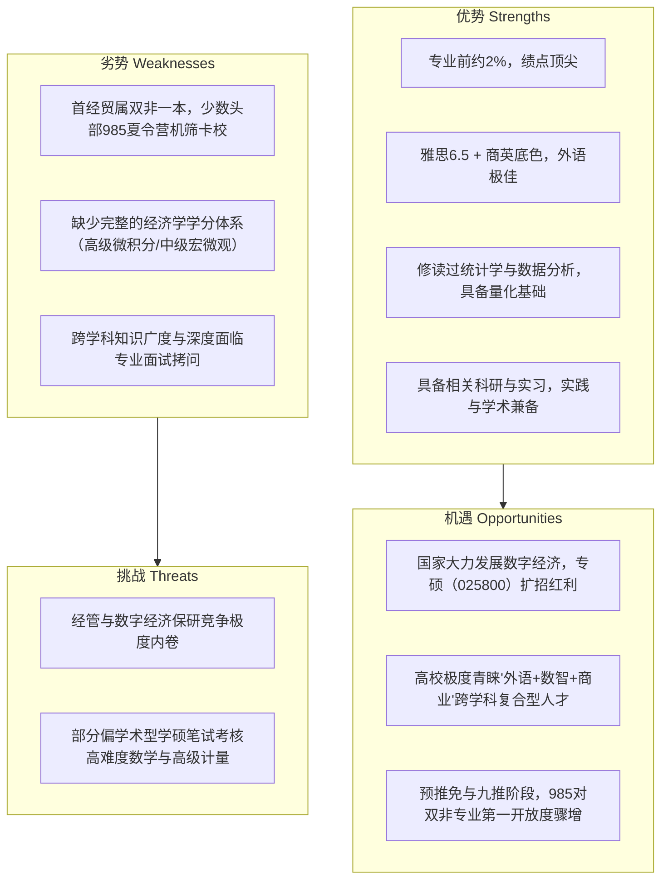

# 首都经济贸易大学商务英语跨保经管与数字经济推免全景规划与34个院校专业项目组合推荐指南

---

## 一、 申请人核心背景诊断与跨保竞争力 SWOT 剖析

### 1. 核心背景画像
* **本科院校**：首都经济贸易大学（北京重点市属财经高校，非“双一流”，但在北方财经金融界有较高知名度与校友网络）
* **本科专业**：商务英语（外语类文学学士背景，涉外经贸与商务沟通复合）
* **学业排名**：**前约2%（前约2%）**。极其坚实的硬性学业背书，已稳获首经贸推免资格，符合所有 985/211 高校“双非排名前 1%~3%”的初审硬门槛。
* **语言能力**：雅思 6.5（具备较强的英语听、说、读、写综合能力，满足 99% 的经管类夏令营/预推免外语门槛，在外语面试及全英文项目中具备天然优势）。
* **跨界潜质与硬核支撑**：修读过数据分析、统计学，具备量化基础；拥有经管/数据相关科研与实习经历，消除了传统文科跨经管“缺乏数理工具与学术实证能力”的刻板印象。

---

### 2. SWOT 竞争态势分析



* **优势（S）**：
  1. **Rank 1 的绝对壁垒**：无论是 985 还是 211 高校，夏令营和预推免机筛对双非高校的核心分水岭就是“是否为前约2%（Rank 1）”。前约2%是打破院校背景天花板的核心钥匙。
  2. **复合人设稀缺**：纯经管学生往往缺少地道的外语商务谈判与跨国规制理解能力；纯外语学生缺乏量化工具。你的“商英 + 数据分析 + 统计学 + 实习”完美契合当代**数字贸易（Digital Trade）**与**数字经济（Digital Economy）**对复合型人才的渴求。
* **劣势（W）**：
  1. **院校背景机筛壁垒**：清北、复交经管等极少数顶尖项目夏令营对本科非双一流较为严苛；
  2. **经济学系统理论基础**：在偏理论的学硕考核中，面对中级微观、中级宏观、高级计量的深层推导可能略有吃力。
* **对策（Strategy）**：
  * **主攻专硕与交叉型学硕**：以**数字经济专硕（025800）**、**国际商务专硕（025400）**、**金融专硕（025100，FinTech方向）**以及**管理科学与工程（大数据/商务分析方向）**为主战场，规避纯理论经济学学硕的硬核数学证明，最大化发挥应用分析、外语与实战优势。
  * **打造统一故事线（Storyline）**：将你的经历包装为“从全球商务沟通出发，意识到数据要素驱动现代经济变革，从而主动进阶量化分析技能，致力于研究数字经贸/平台治理的复合型研究者”。

---

## 二、 34 个学校、学院与具体专业（项目）全景梯度推荐清单

按照**高位冲刺层（8所）**、**核心主攻层（16所）**、**稳妥优选层（7所）**、**绝对保底层（3所）**四大梯度，为您严选 34 个最匹配的项目组合。

---

### 梯队一：高位冲刺层（8 个）
*特点：顶尖 985 或财经顶流王牌学院。利用专业第一、雅思 6.5 与数据科研跨界亮点冲击，夏令营与预推免敢报敢拼。*

| 序号 | 目标学校 | 院系全称 | 具体专业/项目（含专硕/学硕） | 核心研究方向 | 针对性推荐逻辑与匹配度 | 考核重点与建议 |
| :--- | :--- | :--- | :--- | :--- | :--- | :--- |
| **01** | **对外经济贸易大学** | 国际经济贸易学院 | **数字经济专业硕士** (专硕, 025800) | 全球数字贸易、平台反垄断、跨境数据流动规制 | 贸大国贸院是涉外经贸的全国最高殿堂。该项目注重全球数字贸易规则与涉外经贸，与商务英语背景100%契合；数据分析修读背景完美弥补量化需求。 | 英文口语面试、微观经济学基础概念、数字贸易壁垒与 DEPA 等前沿规则。 |
| **02** | **对外经济贸易大学** | 国际经济贸易学院 | **国际商务专业硕士 (MIB)** (专硕, 025400) | 跨国数字商务、跨境电商战略、跨国公司运营 | 全国顶尖 MIB 项目，商英同学跨保经管的最强对口项目。雅思 6.5 + Rank 1 极具初审竞争力，数据分析和实习经历能让你在商业案例面试中脱颖而出。 | 英语商务问答、国际商务热点案例分析、跨国战略思考。 |
| **03** | **对外经济贸易大学** | 信息学院 | **管理科学与工程** (学硕, 120100) | 商务智能与大数据决策、电子商务与平台运营 | 信息学院对文理兼修生源极为宽容，高度青睐掌握统计工具且外语优异的学生。考核更重综合素养，初审竞争比经院略平缓。 | 基础统计学推断、Python/R 数据处理思路、英文文献快速阅读。 |
| **04** | **中央财经大学** | 经济学院 | **数字经济学** (学硕, 交叉/二级学科) | 数据要素市场化配置、平台经济学、产业数字化 | 首经贸与央财同处北京，学界渊源极深。央财数字经济学硕聚焦前沿数字理论与实证计量，导师非常喜欢具有统计实战能力的专业第一学生。 | 中级微观、基础计量（回归与内生性）、数字要素定价逻辑。 |
| **05** | **中央财经大学** | 管理科学与工程学院 | **管理科学与工程** (学硕, 120100) | 大数据管理与智能决策、金融科技管理 | 央财管科为全国 A 类学科，重点孵化金融科技与大数据决策人才。夏令营注重科研潜力与量化分析能力，跨专业第一有加分优势。 | 运筹学/统计学思维、科研课题与实习数据挖掘陈述。 |
| **06** | **中国人民大学** | 交叉科学研究院 / 经济学院 | **数字经济专业硕士** (专硕, 025800) | 数据科学与经济治理、数字平台监管、数字金融 | 全国人文社科与经济学泰斗级殿堂。全国首批数字经济专硕，交叉科学研究院专设名额对复合背景包容度高，作为最高梦想彩票冲刺。 | 经济学原理综合素养、宏观视野、高水平英文深度问答。 |
| **07** | **北京航空航天大学** | 经济管理学院 | **金融专业硕士** (专硕, 025100) | 数字金融、金融大数据分析、量化风控 | 北航经管拥有顶尖工科背景，其金融专硕注重数智金融赋能。理工 985 对于外语出众且修过统计学分析的经管跨考生十分青睐。 | 统计学基础常识、金融学核心考点、英文自我展示与听说。 |
| **08** | **北京理工大学** | 管理学院 | **管理科学与工程** (学硕, 120100) | 数智化赋能管理、平台算法治理、数智供应链 | 北理工经管近年在数字化方向大力扩招推免生，夏令营初审对排名第一的复合背景有破格考察机制，预推免录取的机率很大。 | 管理学前沿、科研项目汇报、数据挖掘应用场景。 |

---

### 梯队二：核心主攻层（16 个）
*特点：主流 985 综合大学与头部 211 财经名校。初审认可首经贸 Rank 1 成绩，数字经济与经管交叉实力雄厚，为保研最关键的中坚抓手。*

| 序号 | 目标学校 | 院系全称 | 具体专业/项目（含专硕/学硕） | 核心研究方向 | 针对性推荐逻辑与匹配度 | 考核重点与建议 |
| :--- | :--- | :--- | :--- | :--- | :--- | :--- |
| **09** | **上海财经大学** | 数字经济系 / 经济学院 | **数字经济专业硕士** (专硕, 025800) | 数字资产评估、平台竞争政策、数据驱动型商业 | 上财全国首设独立数字经济系，地处上海金融中心。专硕侧重商业落地与实务，有数据分析实习与第一名成绩是极佳的背书。 | 经济学综合分析、Python/R 实践经验、商业英语口语。 |
| **10** | **西南财经大学** | 经济学院 / 数字经济实验室 | **数字经济专业硕士** (专硕, 025800) | 金融数据经济、实验经济与数字市场、产业数字化 | 西财对双非财经第一名认可度极高，夏令营入营概率大。西财数字经济项目兼具理论与产业赋能，就业面极广。 | 微观经济学原理、国家数字经济政策、英语问答。 |
| **11** | **西南财经大学** | 国际商学院 | **国际商务专业硕士 (MIB)** (专硕, 025400) | 数智经贸与全球商务、跨境数字营销、国际物流 | 西财国商院全英文教学资源丰富，商英第 1 + 雅思 6.5 与其高度契合。项目深度融合跨境电商与大数据，匹配度极高。 | 全英文专业面试、国际商务案例、跨文化商务沟通。 |
| **12** | **中南财经政法大学** | 经济学院 | **数字经济专业硕士** (专硕, 025800) | 数字产业化、数据资产确权、数字金融与法律监管 | 传统财经强校，法经交叉特色鲜明。生源政策务实，青睐具有数据分析实战能力的经管学生，综合面试重视逻辑思辨。 | 微观经济学、基础统计方法、数字治理热点问题。 |
| **13** | **厦门大学** | 王亚南经济研究院 (WISE) | **金融专业硕士 / 数字金融** (专硕, 025100) | 金融科技、大数据金融计量、量化资产定价 | WISE 是全国计量与国际化教学高地，全英文授课特色鲜明。极其看重英语听说能力与统计学基础，与你的复合优势直接挂钩。 | 全英文个人陈述与问答、统计学与计量直觉、数理逻辑。 |
| **14** | **武汉大学** | 经济与管理学院 | **国际商务专业硕士 (MIB)** (专硕, 025400) | 跨国企业数字战略、数字贸易治理、全球价值链 | 综合类顶尖 985，经管学院综合实力雄厚。MIB 极其注重外语流利度与综合商科思维，对首经贸 Rank 1 认可度较高。 | 国际商务实务、英语口语深度交流、商业热点案例。 |
| **15** | **南开大学** | 经济学院 | **数字经济专业硕士** (专硕, 025800) | 产业数字组织、算法规制、数字经济统计测算 | 京津冀地缘优势明显，南开经院对北京财经类生源非常熟悉。首批数字经济专硕，招生体量可观，性价比极佳。 | 微观经济学、产业组织理论前沿、数字经济现实案例。 |
| **16** | **山东大学** | 经济学院 | **数字经济专业硕士** (专硕, 025800) | 区域数字经济、数字普惠金融、产业数字化转型 | 山大经院学风扎实，初审对双非头部生源（前 2%）政策友好，夏令营优营通过率高，可作 985 核心稳进点。 | 微宏观经济学基础概念、统计学常识、英语综合面试。 |
| **17** | **湖南大学** | 经济与贸易学院 | **数字经济专业硕士** (专硕, 025800) | 数字贸易壁垒、全球数字价值链、跨境数据流动 | 湖大经贸院应用经济学实力顶尖（原外贸部重点高校），国际贸易底蕴深厚，在数字贸易学术圈声誉极佳，高度认可商英背景。 | 国际贸易理论、数字经济前沿文献理解、专业英语翻译。 |
| **18** | **中南大学** | 商学院 | **国际商务专业硕士 (MIB)** (专硕, 025400) | 跨国数智化运营、涉外经贸管理、数字化投融资 | 985 名校，商学院学风严谨务实。推免选拔重视综合素质与多学科交叉背景，对跨专业考生的学习潜力包容度极高。 | 国际商务基础、英语互动口试、逻辑思维与商业分析。 |
| **19** | **重庆大学** | 经济与工商管理学院 | **数字经济专业硕士** (专硕, 025800) | 工业互联网与数字经济、智能供应链、平台商业模式 | 西南 985 经管重镇，数字经济专硕密切结合产业数字化转型。初审规则对“专业第 1 名”有明确加分权重。 | 经济学综合原理、数据分析实际应用场景、英语面试。 |
| **20** | **大连理工大学** | 经济管理学院 | **管理科学与工程** (学硕, 120100) | 商务分析与大数据管理、智能信息系统决策 | 大工管科全国 A 类，商务分析方向完全依托大数据挖掘与统计分析。学生修读过统计学并有数据分析科研经历，是核心加分项。 | 统计推断、数据分析项目陈述、管理信息学前沿探讨。 |
| **21** | **吉林大学** | 商学与管理学院 | **数字经济专业硕士** (专硕, 025800) | 企业数智化转型、数字金融创新、数据要素运营 | 吉大经管两院合并后推免名额充裕，对双非排名前列优秀生源极其珍惜，是冲刺 985 专硕极具把握的优质阵地。 | 微观经济学常识、现代管理学认知、英语听说。 |
| **22** | **东南大学** | 经济管理学院 | **国际商务专业硕士 (MIB)** (专硕, 025400) | 跨境数字商务、跨国供应链数智化、数字经贸实务 | 华东顶尖 985，经管学院兼具工科严谨与商科敏锐。MIB 项目非常青睐语言出众、有量化工具基础的跨学科人才。 | 国际商务实务、专业英语听说问答、数字经济热点思辨。 |
| **23** | **中国农业大学** | 经济管理学院 | **国际商务专业硕士 (MIB)** (专硕, 025400) | 数字农产品贸易、跨国电商物流、大宗农产品经贸 | 北京本土 985，农林经管 A+。地处北京，对首经贸排名前约2%的学生极为认可。竞争烈度低于清北人航，是留在北京读 985 的极优策略。 | 涉外经贸基础、国际商务案例分析、英语口语表达。 |
| **24** | **中国社会科学院大学** | 应用经济学院 | **数字经济专业硕士** (专硕, 025800) | 国家数据要素战略、数字治理智库、平台垄断规制 | 依托社科院数量经济与技术经济研究所（数技经所）和经济所，拥有国家顶级经济智库资源，北京办学，师生比极高。 | 经济学分析逻辑、宏观政策视野、学术研究科研构想。 |

---

### 梯队三：稳妥优选层（7 个）
*特点：北京行业领军 211 高校与数字经贸特色极强高校。学科匹配度近乎 100%，初审通过率极高，确保稳稳斩获优质平台 Offer。*

| 序号 | 目标学校 | 院系全称 | 具体专业/项目（含专硕/学硕） | 核心研究方向 | 针对性推荐逻辑与匹配度 | 考核重点与建议 |
| :--- | :--- | :--- | :--- | :--- | :--- | :--- |
| **25** | **北京邮电大学** | 经济管理学院 | **管理科学与工程** (学硕, 120100) | 数字经济与平台治理、网络经济学、算法反垄断 | “信息黄埔”北邮在数字经济领域话语权极高。经管院聚焦互联网与数字生态治理，对兼备语言与量化能力的复合背景极具需求。 | 数据分析方法逻辑、平台经济前沿热点、专业英语文献。 |
| **26** | **北京邮电大学** | 经济管理学院 | **国际商务专业硕士 (MIB)** (专硕, 025400) | 跨境数字经贸、数字产品国际流动、出海平台运营 | 将信息科技与国际经贸深度融合，商英跨考的黄金赛道。毕业生直接输送至头部互联网大厂、跨境电商龙头及涉外机构。 | 国际商务综合、数字出海商业案例、英文商务口试。 |
| **27** | **北京交通大学** | 经济管理学院 | **应用经济学** (学硕, 020200) | 产业数字经济学、智慧物流与数字供应链转型 | 北交经管老牌强势，地处北京。产业数字化与数字供应链研究成果突出，对首经贸学生极度熟悉，面试给分客观友好。 | 西方经济学原理、统计学概念、专业英文口试。 |
| **28** | **北京科技大学** | 经济管理学院 | **金融专业硕士** (专硕, 025100) | 大数据金融、金融科技、供应链金融数字化 | 北京学院路 211 名校。金融专硕注重金融科技应用，数据分析+商务英语复合背景在综合面试中优势显著。 | 基础金融学知识、统计推断常识、英文问答。 |
| **29** | **华北电力大学** | 经济与管理学院 | **应用经济学** (学硕, 020200) | 能源数字经济、电力大数据经济、双碳数据要素 | 能源电力行业唯一 211 龙头，国家重点急需新兴方向。跨界竞争相对温和，毕业出路直通国家电网、能源央企总部及绿色金融机构。 | 微观经济学、能源转型与数字化认知、英语能力。 |
| **30** | **暨南大学** | 经济学院 | **数字经济专业硕士** (专硕, 025800) | 粤港澳大湾区数字经济、数字金融、跨境电商 | “始有暨南，便有商科”，经管积淀深厚。地处广州，深度融合大湾区数字产业集群，高度认可涉外语言与商业复合背景。 | 微观经济学、数字经贸实务、专业英语深度互动。 |
| **31** | **上海外国语大学** | 国际金融贸易学院 | **国际商务专业硕士 (MIB)** (专硕, 025400) | 数智贸易与全球金融、跨境数据合规、涉外商业 | 外语类顶尖 211，国金院在“外语+经管”复合培养上享有盛誉。商英第 1 名跨考该院具备天然专业亲和力，零跨考壁垒。 | 全英文综合面试、国际商务实务、量化数据分析潜质。 |

---

### 梯队四：绝对保底层（3 个）
*特点：本校核心顶尖学院项目与长三角数字高地优质 211。拥有无可撼动的主场优势或绝对生源偏好，100% 确保兜底无忧。*

| 序号 | 目标学校 | 院系全称 | 具体专业/项目（含专硕/学硕） | 核心研究方向 | 针对性推荐逻辑与匹配度 | 考核重点与建议 |
| :--- | :--- | :--- | :--- | :--- | :--- | :--- |
| **32** | **首都经济贸易大学** | 经济学院 | **数字经济专业硕士** (专硕, 025800) | 京津冀数字协同、平台经济规制、数字要素市场化 | **本校王牌，绝对兜底！** 首经贸是全国首批获批数字经济专硕高校，经济学院为其核心王牌。作为专业 前约2%，本校享有任选顶尖导师与最高奖学金特权。 | 本校推免面试，注重科研规划陈述与师生双选。 |
| **33** | **首都经济贸易大学** | 国际经济管理学院 | **理论经济学 / 应用经济学** (拔尖学硕项目) | 国际贸易理论、现代微观计量、宏观经济分析 | 首经贸国经管采用全英文教学与国际化师资，极其注重英文与数理分析。商英第 1 + 雅思 6.5 + 统计学是其最理想的本校生源。 | 英文学术面试、研究计划书陈述、计量与统计逻辑。 |
| **34** | **苏州大学** | 商学院 | **数字经济专业硕士** (专硕, 025800) | 长三角工业数字转型、数字金融科技、跨境数字电商 | 苏州作为长三角数字经济高地，产业资本雄厚。苏大商学院对双非前几名生源极度优待，长三角实习与高质量就业资源极为丰沛。 | 经济学通识、统计与数据处理思维、英语口语。 |

---

## 三、 跨专业申请的核心文书包装与故事线（Narrative Packaging）策略

面对夏令营/预推免考官，跨专业申请最忌讳的是“显得东拼西凑、缺乏主心骨”。你必须将**商务英语**、**数据分析/统计学**、**相关科研与实习**有机串联，打造坚不可摧的“三位一体”数智经贸学术人设：

```
                    【底层基座：国际化视野与语言工具】
                    商务英语专业前约2% + 雅思 6.5
                    具备全球经贸规制洞察、无障碍英文学术阅读与商务涉外沟通能力
                                    ▼
                    【中层引擎：现代经管研究的量化工具】
                    修读统计学 + 数据分析 (Python/R) + 统计建模
                    掌握因果推断、数据挖掘与量化分析技能，消除传统文科短板
                                    ▼
                    【顶层目标：数字经济与商业智能化实战】
                    数字经贸 / 平台经济 / 数字要素治理 / 智能决策
                    立志解决全球数字贸易壁垒、平台反垄断与商业数智化转型前沿问题
```

### 文书个人陈述（PS）核心叙事架构示例：
1. **破题（Origin）**：本科在商务英语的专业学习中，不仅积累了卓越的跨文化商务沟通与涉外规则理解，更在关注全球经贸新动向时敏锐发现：**全球商业正在从传统的实物贸易加速跃迁至以“数据要素”为核心驱动的数字经贸时代**。
2. **行动（Evolution）**：意识到传统商科语言工具的局限，主动跳出舒适区，系统修读了《统计学》、《数据分析》等核心量化课程，自学并熟练运用 Python/R 与计量工具，完成从“经验型商务理解”向“数据驱动型量化决策”的思维转型。
3. **沉淀（Validation）**：通过具体科研项目（如结合统计学与经济学模型研究具体产业问题）与企业实习（如数据清洗、商业分析与业务洞察），将理论与现实商业世界无缝联结，验证了自身的学术严谨性与实操能力。
4. **愿景（Destination）**：未来研究生阶段希望深耕数字经济/经管交叉领域，将外语的国际规则穿透力与数据科学的量化解析力深度结合，在数字贸易流动、平台治理或数字金融领域做出兼具学术深度与实践价值的研究。

---

## 四、 数字经济与经管跨保笔面试核心备考弹药库

在夏令营和预推免中，作为跨专业考生，面试官 100% 会考查你的“经济学理论直觉”与“数据统计扎实度”。请重点突击以下四大模块：

### 1. 数字经济专硕与学术前沿必考核心概念
* **数据要素特征**：非竞争性（Non-rivalry）、部分排他性（Partial excludability）、正外部性（Positive externalities）、规模报酬递增与范围经济（Increasing returns to scale & Economies of scope）。数据要素的确权（所有权、持有权、使用权、经营权“数据二十条”三权分置）、估值定价机制与交易流通障碍。
* **平台经济学与双边市场（Two-Sided Markets）**：交叉网络外部性（Cross-side network effects）、跨边网络效应、倾斜定价策略（一端补贴、一端收费，如滴滴/美团）、网络效应诱发的“赢家通吃”（Winner-takes-all）现象。
* **平台反垄断与算法治理**：自优待（Self-preferencing）、大数据“杀熟”（一阶/三阶价格歧视）、强制“二选一”、算法协同合谋（Algorithmic collusion）、数据孤岛与互联互通。
* **国际数字贸易规则**：美墨加协定（USMCA）、数字经济伙伴关系协定（DEPA）、CPTPP 中的数字章节（跨境数据自由流动、禁止数据本地化存储强制要求、源代码保护、电子传输暂免关税）。

### 2. 统计学与计量经济学高频考核问题
* **统计学核心基石**：
  * 中心极限定理（CLT）与大数定律（LLN）的直观含义及经济学应用；
  * P值的严谨定义（在原假设为真时，获得当前样本观察值或更极端结果的概率）；
  * 置信区间的正确理解（重复抽样下包含真实总体参数的频次比例，而非参数落入区间的概率）；
  * 第一类错误（拒真）与第二类错误（存伪）在商业/医疗决策中的权衡。
* **计量经济学因果推断（Casual Inference）“五大神器”**：
  * **内生性来源**：遗漏变量（Omitted variables）、反向因果（Reverse causality）、测量误差（Measurement error）；
  * **工具变量法（IV）**：相关性假设（Relevance）与外生性假设（Exogeneity）；
  * **双重差分法（DID）**：平行趋势假定（Parallel trends assumption）检验与政策评估；
  * **倾向得分匹配（PSM）**：缓解可观测变量的选择偏差，无法解决不可观测的内生性问题；
  * **断点回归（RDD）**：清晰断点（Sharp）与模糊断点（Fuzzy），局部随机化实验性质。

### 3. 微观与宏观经济学极速速成地图
* **微观**：消费者效用最大化（Lagrangian 条件）、替代效应与收入效应（Slutsky 方程）、外部性与科斯定理（产权界定与交易成本）、纳什均衡与囚徒困境。
* **宏观**：IS-LM 模型、AD-AS 模型传导机制、菲利普斯曲线长短期差异、索洛模型（Solow-Swan）核心结论（稳态、储蓄率影响、技术进步是持续增长的唯一源泉）。

### 4. 专业英语口语与即兴问答模板（发挥商英绝对优势）
* **常见专业英文问答**：
  * *Q: Why do you want to switch from Business English to Digital Economy?*
    * **核心话术**："Business English provided me with an international perspective and global trade literacy, but today's global commerce is deeply reshaped by data and algorithms. By studying statistics and data analysis, I found my passion lies in decoding economic patterns through quantitative lenses. Digital Economy is the perfect nexus where my linguistic competence, trade knowledge, and analytical capabilities converge."
  * *Q: How do you evaluate the anti-monopoly measures on platform giants?*
    * **核心话术**：从网络效应（Network effects）、进入壁垒（Barriers to entry）、保护中小创新主体与消费者福利（Consumer welfare）三个维度展开，展现平衡效率与公平的思辨视角。

---

## 五、 推免申请全周期作战时间表与动态博弈策略

```
2026年3月 - 4月              2026年5月 - 6月              2026年7月 - 8月              2026年8月下旬 - 9月中旬          2026年9月下旬
【夯实基础与文书准备】      【夏令营大规模投递】        【夏令营参营与攻坚】        【预推免全面反扑】            【九推系统锁Offer】
* 锁定排名第一官方证明      * 海投 20-30 所院校          * 线下/线上夏令营考核        * 双非第一的真正爆发期        * 国家推免系统开放
* 梳理数据分析科研论文      * 重点突破 211 与特色 985    * 斩获第 1-2 个兜底 Offer    * 大面积捡漏顶尖 985 预推免    * 动态博弈，最终录取
* 巩固微宏观与统计知识      * 建立申请台账追踪进度      * 针对弱项及时复盘迭代      * 争取拿下 985 拟录取资格
```

1. **3月 - 4月：弹药库全面盘点与物料定型**
   * 找学院教务开具前五学期绩点成绩单与官方排名证明（盖章注明 **前约2%**）；
   * 整理数据分析科研经历，形成一篇 15 页左右的代表作（Working Paper / 课程论文），准备好配套 PPT（10-15 页，含研究背景、数据来源、计量模型、回归结果与政策建议）；
   * 整理雅思 6.5 成绩单、统计学相关成绩证明、实习证明及各类获奖证书，形成规整的 PDF 证明材料包。

2. **5月 - 6月：夏令营海投期（以量取胜，打响战役）**
   * **投递策略**：严格按照本推荐方案的 34 个项目，**至少投递 25 所**！冲刺层敢报（人大、央财、贸大等），主攻层全报（西财、中南大、山大、湖大、大工等），稳妥层必报（北邮、北交、上外、首经贸本校等）。
   * 针对不同专业微调文书侧重点：报数字经济侧重“数据挖掘与产业经济”，报国际商务侧重“涉外贸易与数字出海”，报管科侧重“信息系统与大数据决策”。

3. **7月 - 8月：夏令营参营与心理底线锁定**
   * 积极参营，做好面试日程防冲突管理。
   * **战略核心**：在 7 月底前至少拿下 1 个 211 核心项目或首经贸本校的“优秀营员（Offer）”，彻底摆脱“保研失学”的心理压力。有保底在手后，答辩心态将发生质的飞跃。

4. **8月下旬 - 9月中旬：预推免反扑期（双非第一名的黄金主战场）**
   * **关键认知**：许多顶级 985 高校在夏令营阶段由于生源内卷卡双非，但在预推免阶段，很多夏令营拿了 Offer 的 985/211 尖子生会选择放弃，导致各大名校产生大量名额空缺。
   * **反扑战术**：全面冲刺北京航空航天大学、北京理工大学、南开大学、大连理工大学、东南大学、厦门大学等 985 院校的预推免。作为首经贸专业第 1 名，在预推免审核中极易被招生委员会捞起并给予面试资格。

5. **9月28日（推免系统开放）：终极博弈与决策闭环**
   * 系统开放当日，按照“预推免 985 > 顶级 211 核心专硕（贸大/央财） > 行业特色 211 > 首经贸本校”进行抉择。
   * 遇多 Offer 冲突时，遵循“**城市（首选北京/上海） > 学科实力与导师资源 > 院校层次（985/211）**”的原则，完成人生跃迁。

---
*祝愿你在 2026 年推免季乘风破浪，以榜首之姿成功实现跨界蜕变，斩获心仪高校经管与数字经济项目录取！*
