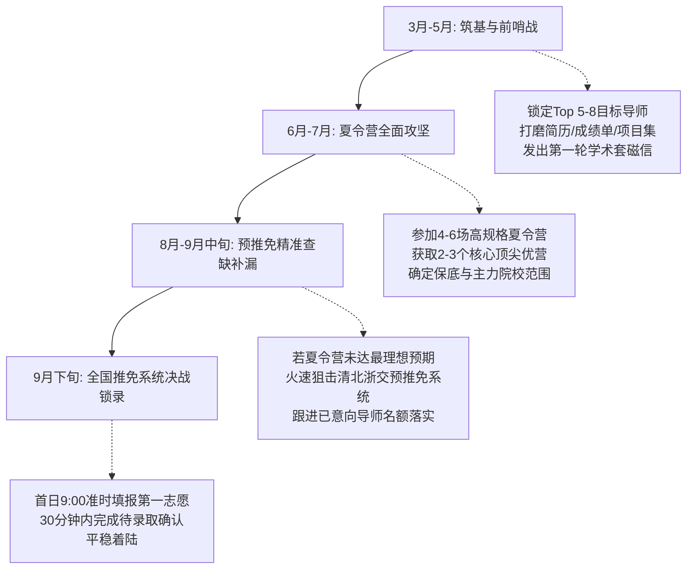

# 2026年推免申请季·哈工大（威海）机器人工程专业研究生推免规划与院校专业选择全景方案

---

## 目录
1. [考生背景画像与保研竞争力全景评估](#一考生背景画像与保研竞争力全景评估)
2. [十七个“学校+学院+具体专业（项目）”推荐组合深度解析](#二十七个学校学院具体专业项目推荐组合深度解析)
   - [第一梯队：顶尖学术与工程巅峰冲刺（4所）](#第一梯队顶尖学术与工程巅峰冲刺4所)
     - 1. 清华大学 | 机械工程系 | 机械工程（智能制造与具身机器人方向）
     - 2. 北京大学 | 工学院先进制造与机器人系 | 力学（系统与控制）/ 机械（智能制造与机器人）
     - 3. 上海交通大学 | 机械与动力工程学院 | 机械工程（机器人研究所）
     - 4. 浙江大学 | 控制科学与工程学院 | 控制科学与工程（自主智能移动机器人与感知控制）
   - [第二梯队：C9优势直通与国防/特色顶级重镇（7所）](#第二梯队c9优势直通与国防特色顶级重镇7所)
     - 5. 哈尔滨工业大学（本部） | 机电工程学院 | 机械工程（机器人技术与系统全国重点实验室专项）
     - 6. 哈尔滨工业大学（深圳） | 机电工程与自动化学院 | 机械工程 / 控制科学与工程（智能机器人系统方向）
     - 7. 中国科学院自动化研究所 | 多模态人工智能系统全国重点实验室 | 控制理论与控制工程（具身智能与仿生机器人方向）
     - 8. 中国科学院沈阳自动化研究所 | 机器人学国家重点实验室 | 机械电子工程 / 控制理论与控制工程（特种与水下机器人）
     - 9. 北京航空航天大学 | 机械工程及自动化学院 | 机械电子工程（仿生软体与医疗机器人方向）
     - 10. 北京理工大学 | 机电学院 | 机械工程（仿生人形机器人与无人系统方向）
     - 11. 华中科技大学 | 机械科学与工程学院 | 机械工程（智能制造与柔顺机器人加工方向）
   - [第三梯队：工科强校核心主选与特色平台（6所）](#第三梯队工科强校核心主选与特色平台6所)
     - 12. 西安交通大学 | 机械工程学院 / 人机所 | 机械工程（智能机器人与装备运维）/ 控制（人机所自主无人系统）
     - 13. 同济大学 | 电子与信息工程学院 | 控制科学与工程（自主智能无人系统全国重点实验室专项）
     - 14. 东南大学 | 仪器科学与工程学院 | 仪器科学与技术（人机交互与力触觉传感遥操作方向）
     - 15. 天津大学 | 机械工程学院 | 机械工程（机构理论与并联/微创医疗机器人方向）
     - 16. 中国科学院深圳先进技术研究院 | 集成技术研究所 | 计算机/电子信息/机械（智能机器人与外骨骼穿戴系统）
     - 17. 哈尔滨工业大学（威海） | 机电工程系 / 汽车工程学院 | 机械工程 / 控制工程（海洋智能装备与特种服务机器人）
3. [多维研究训练模式深度横向对比](#三多维研究训练模式深度横向对比)
4. [学位路径决策与学制发展指南](#四学位路径决策与学制发展指南)
5. [哈工大威海学子专属保研战术规划与时间表](#五哈工大威海学子专属保研战术规划与时间表)

---

## 一、考生背景画像与保研竞争力全景评估

### 1.1 核心软硬件条件剖析

| 评估维度 | 核心数据/经历 | 综合评级 | 竞争优势与潜在短板分析 |
| :--- | :--- | :---: | :--- |
| **本科出身** | 哈尔滨工业大学（威海） | **A+ (985 / C9)** | **优势**：哈工大属于九校联盟（C9）、老牌顶尖工科名校、国防七子之首。威海校区颁发与本部完全一致的哈工大学历学位证书，在全国绝大多数高校及中科院各大所初审中享有一致的“985/C9”第一梯队生源待遇。<br>**短板**：少数高校（如清华机电/北大工学、上交密院等）部分导师或招生办初审会对“分校区”设置单独考核细则或名额微调。 |
| **学业成绩** | 排名 [精确名次及专业人数已概括]（前 约2%） | **S (顶尖头部)** | **优势**：排名稳居专业前2.5%，属于年级顶尖头部尖子生，在母校能无悬念斩获A类推免指标。在各大名校夏令营材料初审（机筛与人工复核）中，前3%属于“免筛选直接推荐入营”或“优先打高分”序列。<br>**短板**：非绝对意义上的第1名（极个别清北院系仅限各校第1名直博申报），但前3名已经具备全国顶尖夏令营初审通关门槛。 |
| **外语水平** | CET-6 500–549 分 | **A (无短板过线)** | **优势**：远超清华（通常要求450/425）、交大机动（要求425）、北大（通常要求500/520）、浙大（要求460/480）等全国各大名校的初审英语硬性门槛，在理工科推免生中属于“稳妥不拖后腿”的坚实水平。 |
| **科研实践** | 机械与机器人相关科研 | **A+ (精准对口)** | **优势**：机器人工程为交叉融合学科，参与过机械与机器人科研，说明具备三维建模（SolidWorks/CATIA/Creo）、机构学、动力学仿真（Adams/Gazebo）、嵌入式软硬件（STM32/ROS）、控制算法或机器视觉（OpenCV/PyTorch）等复合积累。面试面对教授专家极具话语权。 |

### 1.2 目标定位矩阵建议
针对“哈工威 前约2% + 六级500–549 + 机器人科研”的复合优势，建议采取**金字塔式科学申报策略**：
- **冲刺层（20%~25%精力）**：瞄准清华大学、北京大学、上海交通大学、浙江大学等顶尖高校的学硕、前沿项目或直博生。利用直博名额相对充足且竞争侧重点在“科研持续性”的特点进行降维冲刺。
- **核心主力层（50%~60%精力）**：依托哈工大天然血缘优势直攻哈工大本部（机器人所）与哈工大深圳校区；同步深耕中科院顶尖院所（沈自所、CASIA）以及北航、北理工、华科、西交、同济等工科翘楚的优势实验室。
- **稳妥底盘层（15%~20%精力）**：东南大学、天津大学、中科院深圳先进院，以及以哈工大（威海）本校最高级别优生奖励作为兜底屏障，确保推免全程零风险。

---

## 二、十七个“学校+学院+具体专业（项目）”推荐组合深度解析

---

### 第一梯队：顶尖学术与工程巅峰冲刺（4所）

```
                     ┌── 1. 清华大学（机械工程系 / 具身机器人方向）
                     ├── 2. 北京大学（工学院先进制造与机器人系）
[第一梯队: 顶尖冲刺] ├── 3. 上海交通大学（机械与动力工程学院机器人所）
                     └── 4. 浙江大学（控制科学与工程学院智能系统所）
```

#### 1. 清华大学 | 机械工程系
- **具体专业/项目**：[机械工程（080200）](file:///path/to/tsinghua_me) 学术型硕士 / [机械（085500）](file:///path/to/tsinghua_me_pro) 智能制造与具身机器人卓越工程师专项 / 直博生
- **研究训练特征**：
  - **平台与团队**：依托摩擦学国家重点实验室（重组后为高端装备界面科学与技术全国重点实验室）、清华大学机械工程实验教学中心。重点团队包括高兴军、赵慧洁、温鹏以及具身智能与仿生机器人交叉团队。
  - **训练风格**：学术研究极其强调世界前沿与底层物理机制。大团队内分工精细，博士生以顶刊（Science Robotics, IEEE T-RO, IEEE/ASME T-MECH）为导向；专硕与卓越工程师专项则深入华为、国家电网、沈飞等国家战略工业场景。算力、硬件试制资源与加工中心全国一流。
- **学位路径与培养方案**：
  - **路径选择**：学硕（3年，名额极少）、直博（5年，名额相对充裕，对前3名同学极具吸引力）、工程硕博卓越工程师专项（3年，校企双导师制，企业驻留1年）。
  - **出口前景**：直博多进入顶尖高校任教或华为“天才少年”、大厂前沿AI实验室；硕士大量进入自动驾驶独角兽、头部量化机构、顶尖外企研发中心。
- **录取匹配度与投递策略**：
  - **定位**：**高难度冲刺档**。
  - **考核侧重**：初审对排名要求苛刻（前3名可过筛），复试重在数理力学基础（理论力学、材料力学、自动控制原理）、专业英语文献即席翻译及过往机器人课题的底层创新点挖掘。建议尽早联系意向导师沟通直博意向。

---

#### 2. 北京大学 | 工学院先进制造与机器人系
- **具体专业/项目**：[力学（系统与控制 080100）](file:///path/to/pku_coe) 学术型硕士 / [机械（085500）](file:///path/to/pku_coe_mech) 智能制造与仿生机器人方向 / 直博生
- **研究训练特征**：
  - **平台与团队**：依托湍流与复杂系统国家重点实验室、北京市智能机器人与系统高精尖创新中心。代表性导师如谢广明教授（仿生水下机器鱼、水下群智协同）、王启宁教授（仿生外骨骼、动力假肢与生机电交互）。
  - **训练风格**：北大工学院兼具北大理科深厚数理底蕴与工程落地，偏重数学建模、微分几何与非线性控制理论在仿生与生物力学系统中的应用。学术自由度高，鼓励发表高水平IEEE汇刊论文。
- **学位路径与培养方案**：
  - **路径选择**：学硕（3年）、直博（5年）。北大工学院招生政策中直博比例居高不下，学硕竞争异常白热化。
  - **出口前景**：海内外名校顶尖博士后、高校教职；国家高端医疗装备企业、航天科技集团科研院所。
- **录取匹配度与投递策略**：
  - **定位**：**高难度冲刺档**。
  - **考核侧重**：夏令营笔试注重高等数学、线性代数与力学综合；面试考察数学推导能力与逻辑思维。若具备扎实的力学建模与算法编程能力，争取谢广明或王启宁课题组直博考核是极佳策略。

---

#### 3. 上海交通大学 | 机械与动力工程学院（机动学院）
- **具体专业/项目**：[机械工程（080200）](file:///path/to/sjtu_me) 机器人研究所（机械电子工程方向） 学硕 / 直博 / 专业型硕士（临港专项/工程硕博）
- **研究训练特征**：
  - **平台与团队**：拥有中国最具统治力的机器人学科团队之一，依托机械系统与振动全国重点实验室。老一辈学科带头人如高峰教授（重载并联机器人、六足步行机器人）、朱向阳教授（生机电一体化、肌电假肢、脑机接口与软体机器人），以及盛鑫军、丁国鹏等中坚力量。
  - **训练风格**：工程底蕴极深，讲究“从机构创新到伺服驱动、再到底层控制”的全链条打通。学生代码量与画图量极大，实战动手能力极强，拥有国家级大型实验场与产业化支撑体系。
- **学位路径与培养方案**：
  - **路径选择**：学硕（2.5年，提前半年毕业，极具性价比）、直博（5年）、专硕（2.5年，含临港智能制造专项）。
  - **出口前景**：长三角高端制造业与机器人产业核心骨干（特斯拉、大疆、ABB、发那科、联影医疗、商汤机器人等），薪酬与认可度极高。
- **录取匹配度与投递策略**：
  - **定位**：**核心冲刺档（高度推荐）**。
  - **考核侧重**：机动学院夏令营规模大，哈工大作为C9盟校生源初审通过率高（前约2%稳入夏令营）。面试侧重工程实践综合面试与科研细节考核，需要对SolidWorks设计、电机选型及运动控制有扎实掌握。

---

#### 4. 浙江大学 | 控制科学与工程学院
- **具体专业/项目**：[控制科学与工程（081100）](file:///path/to/zju_control) 模式识别与智能系统 / 控制理论与控制工程（智能移动机器人方向）
- **研究训练特征**：
  - **平台与团队**：依托工业控制技术全国重点实验室，国家级A+顶尖学科。代表团队包括熊蓉教授团队（RoboCup机器人足球世界冠军团队、“绝影”四足机器人的核心孵化源泉）、王越教授等。
  - **训练风格**：侧重具身感知、SLAM导航建图、高动态运动控制、强化学习在腿足式机器人中的落地。实验室内从机械狗到轮足四足、人形机器人样机充裕，产学研与自主创业风气极为活跃。
- **学位路径与培养方案**：
  - **路径选择**：学硕（2.5年或3年）、直博（5年）、电子信息专硕（工程师学院联培，3年）。
  - **出口前景**：自主创业氛围全国第一，诞生了诸如云深处科技（DeepRobotics）等明星企业；毕业生遍布阿里达摩院、海康威视、字节跳动具身智能部门。
- **录取匹配度与投递策略**：
  - **定位**：**重点冲刺档**。
  - **考核侧重**：浙大控制对六级有严格硬指标（六级500–549完全无虞）；机考或编程能力考核（C++/Python算法、数据结构）在面试中权重较高，需提前刷LeetCode与熟悉ROS通信机制。

---

### 第二梯队：C9优势直通与国防/特色顶级重镇（7所）

```
                     ┌── 5. 哈尔滨工业大学本部（机电工程学院机器人研究所）
                     ├── 6. 哈尔滨工业大学深圳（机电工程与自动化学院）
                     ├── 7. 中科院自动化研究所（多模态AI全国重点实验室）
[第二梯队: 核心重镇] ├── 8. 中科院沈阳自动化研究所（机器人学国家重点实验室）
                     ├── 9. 北京航空航天大学（机械学院仿生与医疗机器人）
                     ├── 10. 北京理工大学（机电学院仿生人形机器人）
                     └── 11. 华中科技大学（机械学院数字制造与装备）
```

#### 5. 哈尔滨工业大学（本部） | 机电工程学院
- **具体专业/项目**：[机械工程（080200）](file:///path/to/hit_me) 机械电子工程 / 机器人研究所（机器人技术与系统全国重点实验室专项）
- **研究训练特征**：
  - **平台与团队**：**中国机器人的发祥地与国家战略重器**。蔡鹤皋院士、刘宏院士、孙立宁教授、荣伟彬教授、付宜利教授等汇聚于此。空间机械臂（天宫空间站问天/梦天舱核心机械臂）、灵巧仿生手、纳米级微纳操作机器人、腹腔镜手术机器人领跑全国。
  - **训练风格**：标准的“国家重大工程兵团作战”模式。承担军委科技委、载人航天工程、国家重点研发计划重大任务。项目体量庞大，研究生直接参与国家级重点型号研制，工程底蕴与攻坚精神无可匹敌。
- **学位路径与培养方案**：
  - **路径选择**：学硕（2年或2.5年，学制灵活）、专硕（2年或2.5年）、直博（4-5年）、硕博连读。
  - **出口前景**：航天科技、航天科工、中航工业等国家国防军工核心总体所；大疆、汇川技术、机器人骨干企业；留校及军工科研体系号召力极强。
- **录取匹配度与投递策略**：
  - **定位**：**核心主选（本校血缘无缝衔接）**。
  - **考核侧重**：威海校区专业前约2%在哈工大本部夏令营中享有极高礼遇与天然认可度。导师通常知晓威海校区培养质量，提前邮件联系蔡鹤皋院士/刘宏院士团队的大师兄或中青年骨干教授，基本能锁定顶级课题组录取。

---

#### 6. 哈尔滨工业大学（深圳） | 机电工程与自动化学院
- **具体专业/项目**：[机械工程（080200）](file:///path/to/hitsz_me) / [控制科学与工程（081100）](file:///path/to/hitsz_control) 智能机器人与微纳系统方向
- **研究训练特征**：
  - **平台与团队**：传承哈工大机电控制学科精髓，坐拥深圳南山大学城极佳地理优势。代表导师包括徐文福教授（空间机器人、捕获与自适应控制）、杜建军教授、楼云江教授等。
  - **训练风格**：小而精的国际化高水平研究模式。紧密链接大湾区产业供应链，从算法验证到硬件PCB打样、CNC加工极为高效，导师多具有海外名校背景，注重国际高水平顶刊发表与应用转化结合。
- **学位路径与培养方案**：
  - **路径选择**：学硕（2年，毕业快、节奏极紧凑）、专硕（2-2.5年）、直博（4-5年）。
  - **出口前景**：珠三角就业天花板。腾讯Robotics X、华为车BU/瓦特实验室、大疆创新、迈瑞医疗、速腾聚创等大湾区头部硬件科技企业首选生源基地。
- **录取匹配度与投递策略**：
  - **定位**：**核心主选档（近年极度热门）**。
  - **考核侧重**：由于地理位置优越，近年哈工深夏令营生源分极高。但作为本校一校三区前3名，具有极高优先录取顺位。面试侧重英语听说表达及前沿控制算法实现细节。

---

#### 7. 中国科学院自动化研究所（北京）
- **具体专业/项目**：[控制理论与控制工程（081101）](file:///path/to/casia_control) / [模式识别与智能系统（081104）](file:///path/to/casia_prai) 多模态人工智能系统全国重点实验室
- **研究训练特征**：
  - **平台与团队**：我国人工智能与自动化领域的“国家队”。拥有复杂系统认知与决策实验室、微创手术机器人工程中心。知名专家包括谭民研究员、侯增广研究员（康复与手术机器人）、乔红院士（具身人形机器人通用大模型与精密装配）。
  - **训练风格**：重度偏向算法、智能感知、决策大模型与神经控制。计算资源极其奢华，配备千万级GPU超算集群。学生学术训练极为硬核，以顶会（CVPR, ICCV, NeurIPS, ICRA, IROS）和高水平IEEE Trans为考核基准。
- **学位路径与培养方案**：
  - **路径选择**：学硕（3年，中科大/国科大双学籍联培或国科大直属）、直博（5年，推荐首选）、工程硕博。
  - **出口前景**：国内外AI高校教职、阿里/腾讯/百度顶尖科学家序列、自动驾驶与具身智能独角兽企业核心技术架构师。
- **录取匹配度与投递策略**：
  - **定位**：**核心冲刺档**。
  - **考核侧重**：对数学（矩阵论、概率统计）和编程算法（深度学习、数据结构）考察极其深入。机械背景学生若能在自控、强化学习或机器视觉结合点展现出动手能力，会非常受青睐。

---

#### 8. 中国科学院沈阳自动化研究所
- **具体专业/项目**：[机械电子工程（080202）](file:///path/to/sia_me) / [控制科学与工程（081100）](file:///path/to/sia_control) 机器人学国家重点实验室专项
- **研究训练特征**：
  - **平台与团队**：**中国机器人产业与特种机器人的“国家总成基地”**。蒋新松院士奠基之地，拥有机器人学国家重点实验室（中国第一个机器人领域国家重点实验室）。封锡盛院士、王天然院士、于海斌研究员、刘连庆研究员（微纳机器人与类生命机器人）。
  - **训练风格**：“潜龙”系列深海自主水下机器人、“海斗一号”全海深无人潜水器等国家大科学装置研制基地。工程与探索并重，拥有全国最完善的机器人水槽实验池、微纳制造洁净室和极端环境测试基地。津贴丰厚，科研体量惊人。
- **学位路径与培养方案**：
  - **路径选择**：学硕（3年）、专硕（3年）、直博（5年）。第一年在北京雁栖湖国科大集中上基础课，后两年回所全脱产科研。
  - **出口前景**：中科院各大科研所骨干、航天科工/中船重工总体所、新松机器人公司、国内外名校博士后。
- **录取匹配度与投递策略**：
  - **定位**：**高匹配核心主选档**。
  - **考核侧重**：沈自所极度青睐哈工大本科生，两家单位历史上渊源极深。威海校区前约2%报考沈自所，只要综合面试展现出吃苦耐劳的工科精神与扎实的机器人软硬件基础，通过率极高。

---

#### 9. 北京航空航天大学 | 机械工程及自动化学院
- **具体专业/项目**：[机械电子工程（080202）](file:///path/to/buaa_me) 仿生软体与医疗手术机器人方向 / 自动化科学与电气工程学院
- **研究训练特征**：
  - **平台与团队**：依托智能微纳公共创新平台、生物力学与力生物学教育部重点实验室。王田苗教授团队（中国机器人产业孵化标杆，孵化出天智航、甘中学智能等数十家企业）、文力教授团队（国际顶尖软体仿生机器人、触觉感知）。
  - **训练风格**：跨学科交叉极其鲜明（医工交叉、空天交叉、软体柔性机构）。注重前沿创新成果的产业化孵化，科研课题与临床医疗场景（天坛医院、协和医院合作）高度绑定。
- **学位路径与培养方案**：
  - **路径选择**：学硕（2.5年）、专硕（2-2.5年）、直博（4-5年）。
  - **出口前景**：高端医疗装备领军企业、航天科技/中航工业集团总体设计所、创业型独角兽企业合伙人。
- **录取匹配度与投递策略**：
  - **定位**：**核心主选档**。
  - **考核侧重**：北航机械夏令营考核规范严谨，专业课考查涉及机械设计、机电传动与微机原理。前3名初审无阻力，面试重点展示科研项目的自研硬件样机或软硬件联调经验。

---

#### 10. 北京理工大学 | 机电学院
- **具体专业/项目**：[机械工程（080200）](file:///path/to/bit_me) 仿生机器人与系统教育部重点实验室 / 人形机器人创新中心专项
- **研究训练特征**：
  - **平台与团队**：国内仿生双足人形机器人重镇。黄强教授团队研制的“汇童”系列仿生机器人享誉全国；复杂系统智能控制与决策国家级重点实验室。
  - **训练风格**：高动态运动控制、双足行走步态规划、特种防恐防暴排爆机器人。具有鲜明的国防与兵器工业特色，项目经费充沛，注重真实物理样机的跌落、抗扰动冲击与机动能力。
- **学位路径与培养方案**：
  - **路径选择**：学硕（3年）、专硕（2.5-3年）、直博（5年）、国家工程硕博专项。
  - **出口前景**：中国兵器工业集团各研究所（201所、203所等）、航天科工、人形机器人整机新兴企业。
- **录取匹配度与投递策略**：
  - **定位**：**核心主选档**。
  - **考核侧重**：北理工同属国防七子，对哈工大工科背景高度认同。面试强调动力学方程建模能力、四元数姿态解算及嵌入式底层驱动控制实现。

---

#### 11. 华中科技大学 | 机械科学与工程学院
- **具体专业/项目**：[机械工程（080200）](file:///path/to/hust_me) 数字制造装备与技术全国重点实验室 / 智能制造与柔顺机器人方向
- **研究训练特征**：
  - **平台与团队**：全国机械学科A+巨擘。熊有伦院士、丁汉院士、尹周平教授等坐镇。拥有智能制造装备与技术全国重点实验室。主攻大型复杂曲面机器人加工、生机电康复外骨骼系统、软体穿戴智能装备。
  - **训练风格**：作风极其扎实硬朗，治学严谨。兼顾高端五轴联动数控系统与工业机器人复杂动力学控制，在航空发动机叶片机器人智能磨抛等卡脖子领域具有国家主导地位。
- **学位路径与培养方案**：
  - **路径选择**：学硕（3年）、专硕（2.5-3年）、直博（5年）。
  - **出口前景**：高端工业母机与装备制造领军企业、各大中字头央企重工集团、华为制造技术研发部。
- **录取匹配度与投递策略**：
  - **定位**：**核心主选档**。
  - **考核侧重**：华科机械初审看重排名前5%与专业综合素养，前3名通过率极高。夏令营专业综合考核涵盖机械制造技术基础与控制理论，注重理论推导与工程设计规范。

---

### 第三梯队：工科强校核心主选与特色平台（6所）

```
                     ┌── 12. 西安交通大学（机械工程学院 / 人机所）
                     ├── 13. 同济大学（自主智能无人系统全国重点实验室）
[第三梯队: 优势平台] ├── 14. 东南大学（仪器科学与工程学院人机交互实验室）
                     ├── 15. 天津大学（机构理论与装备设计并联机器人）
                     ├── 16. 中科院深圳先进技术研究院（集成技术研究所）
                     └── 17. 哈尔滨工业大学（威海）（本校王牌实验室直通）
```

#### 12. 西安交通大学 | 机械工程学院 / 电信学部人机所
- **具体专业/项目**：[机械工程（080200）](file:///path/to/xjtu_me) 智能装备与微纳制造 / [控制科学与工程（081100）](file:///path/to/xjtu_aia) 人工智能与机器人研究所（人机所）
- **研究训练特征**：
  - **平台与团队**：机械学院依托现代设计及转子轴承系统教育部重点实验室；人机所由郑南宁院士领衔，是国内无人驾驶自主智能系统的殿堂级学术摇篮。
  - **训练风格**：人机所专注于计算机视觉、认知计算与自主驾驶车辆系统，发源最早，与产业界（广汽、华为等）联手深入；机械学院则侧重结构拓扑优化、故障诊断与增材制造机器人。
- **学位路径与培养方案**：
  - **路径选择**：学硕（3年）、专硕（2-3年）、直博（5年）。
  - **出口前景**：自动驾驶主干力量、知名算法工程师；机械工业各大科研院所及重工央企。
- **录取匹配度与投递策略**：
  - **定位**：**核心目标 / 稳健主攻档**。
  - **考核侧重**：C9名校间互认度极高。若想转向纯感知与算法侧推荐投报人机所；若保留机构设计强项建议申报机械学院机器人所。

---

#### 13. 同济大学 | 电子与信息工程学院
- **具体专业/项目**：[控制科学与工程（081100）](file:///path/to/tongji_ceie) 自主智能无人系统全国重点实验室专项
- **研究训练特征**：
  - **平台与团队**：由陈杰院士领衔，依托国家在上海张江布局建设的自主智能无人系统科学中心，获国家级超常规资源支持。
  - **训练风格**：聚焦无人车、无人机多智能体集群协同控制、具身智能环境认知。全天候真实场景测试平台与车路协同路测系统一流。
- **学位路径与培养方案**：
  - **路径选择**：学硕（2.5-3年）、专硕（2.5年）、直博（5年）、张江专项联培。
  - **出口前景**：上海及长三角智能汽车头部企业（上汽研发总院、蔚来、理想）、高端智能无人系统研究所。
- **录取匹配度与投递策略**：
  - **定位**：**核心目标档**。
  - **考核侧重**：同济控制学科处于快速上升期，极度渴望985顶尖优质生源。威海前3名具备极大概率拿优秀营员（优营）。

---

#### 14. 东南大学 | 仪器科学与工程学院
- **具体专业/项目**：[仪器科学与技术（080400）](file:///path/to/seu_ise) 人机交互与空间微操作实验室（力触觉传感与远程遥操作方向）
- **研究训练特征**：
  - **平台与团队**：宋爱国教授团队（国家杰青、全国知名空间机器人专家），在机器人力触觉传感技术、空间在轨维护遥操作、脑机接口控制及康复外骨骼领域国内首屈一指。
  - **训练风格**：将高精度传感、测控电路与机械结构深度结合。实验室内拥有多套自研空间机械臂地面微重力仿真平台与高敏触觉传感器阵列制造线。
- **学位路径与培养方案**：
  - **路径选择**：学硕（3年）、专硕（3年）、直博（5年）。
  - **出口前景**：航天科技空间技术研究院（501所、502所）、高端医疗康复设备企业、高端精密仪器企业。
- **录取匹配度与投递策略**：
  - **定位**：**稳健主攻档**。
  - **考核侧重**：测试与传感器原理、单片机/DSP系统、电路基础是考核重点。该方向极为看重机电跨学科动手能力，非常匹配机器人工程专业背景。

---

#### 15. 天津大学 | 机械工程学院
- **具体专业/项目**：[机械工程（080200）](file:///path/to/tju_me) 机构理论与装备设计教育部重点实验室（并联机器人与微创手术系统）
- **研究训练特征**：
  - **平台与团队**：黄田教授、王树新教授（中国工程院院士，微创手术机器人领域泰斗）。研发了具有完全自主知识产权的“妙手”微创手术机器人系统，并在多孔/单孔腹腔镜手术机器人领域取得重大突破。
  - **训练风格**：在空间机构学拓扑理论、机构自由度分析、连续体机构（Continuum Robots）及并联动力学领域理论功底极其厚实，属于国内机构学理论与医疗器械落地的执牛耳者。
- **学位路径与培养方案**：
  - **路径选择**：学硕（2.5年）、专硕（2.5年）、直博（5年）。
  - **出口前景**：医疗手术机器人创新企业、精密机床装备研发中心、国内外顶尖学术团队。
- **录取匹配度与投递策略**：
  - **定位**：**稳健目标档**。
  - **考核侧重**：重机构学（空间解析几何、旋量理论、连杆机构分析）。对于机械功底扎实、对微创医疗器械感兴趣的同学是极佳选择。

---

#### 16. 中国科学院深圳先进技术研究院（SIAT）
- **具体专业/项目**：[集成技术研究所 / 智能机器人研究中心](file:///path/to/siat_robot) 机械电子 / 控制工程 / 电子信息
- **研究训练特征**：
  - **平台与团队**：拥有人机协同智能系统重点实验室，汇集一批年轻海外顶尖学者。主攻外骨骼机器人助行系统、家庭陪护机器人、具身智能移动底盘。
  - **训练风格**：科研节奏极快，全面接轨产业需求。学生从研一开始即参与实际产品级样机开发，技术迭代速度全国第一，经费与实验条件极为优越。
- **学位路径与培养方案**：
  - **路径选择**：学硕（3年，国科大学籍）、工程硕士（3年）、联培博士。
  - **出口前景**：大湾区科技大厂（华为、大疆、优必选、普渡科技等）研发核心、海外顶级名校继续攻博。
- **录取匹配度与投递策略**：
  - **定位**：**稳妥高质量档**。
  - **考核侧重**：注重工程综合开发能力、代码实操能力与跨学科交流素养，威海前3名获评优秀营员概率极大。

---

#### 17. 哈尔滨工业大学（威海） | 机电工程系 / 汽车工程学院
- **具体专业/项目**：[机械工程（080200）](file:///path/to/hitwh_me) / [控制工程（085406）](file:///path/to/hitwh_control) 海洋智能装备与特种服务机器人研究所
- **研究训练特征**：
  - **平台与团队**：依托海洋工程与智能装备特色学科群，拥有山东省海洋特种装备重点实验室。团队深耕水下机器人（AUV/ROV）、智能无人测量船、履带式深海作业机构及车载作业机器人。
  - **训练风格**：深耕涉海特色场景，实机下海与岸基调试演练频繁，注重在恶劣海洋环境下的密封、防腐、深水耐压结构设计与声呐/水下视觉综合控制。
- **学位路径与培养方案**：
  - **路径选择**：学硕（2.5年）、专硕（2.5年）、与本部共享博士生招生指标。
  - **出口前景**：中船重工（701、702、710所）、海洋工程技术研究院、华为、中兴、一汽等主流大厂。
- **录取匹配度与投递策略**：
  - **定位**：**终极零风险保底底牌**。
  - **考核侧重**：专业前约2%属于本校保研金字塔尖，享有导师直接任选、全额一等奖学金、免除推免复试周折的最高礼遇。可以作为整个保研季全无后顾之忧的最强压舱石。

---

## 三、多维研究训练模式深度横向对比

为了让考生更清晰地洞悉不同学术机构在日常科研训练、导师指导风格、资源供给等方面的实质性差异，以下将全国主流科研院所与高校划分为三大代表性模式进行横向对比：

| 比较维度 | 模式 A：国家重大工程/大兵团作战型 | 模式 B：前沿理论与高水平学术探索型 | 模式 C：产学研快速转化与创新孵化型 |
| :--- | :--- | :--- | :--- |
| **代表院校** | **哈工大本部、沈自所、北理工、北航** | **清华大学、北京大学、CASIA、浙大控制** | **哈工大深圳、同济张江、SIAT、华中科技** |
| **核心科研来源** | 载人航天、空间站任务、深海探潜、军科委、国防装备重大专项型号任务。 | 国家自然科学基金重点项目、科技创新2030重大项目、国际顶级联合实验室。 | 地方政府重大创新转化专项、企业联合实验室（大疆/华为/腾讯）、孵化型项目。 |
| **课题组组织架构** | 院士/大总师带头的大型课题组（几十人乃至上百人），实行分系统/层级管理。 | 独立PI制或小型科研团队，导师亲自研讨指导，师生高频组会。 | 年轻海归PI与企业双导师，技术路线灵活敏捷，按产品迭代推进。 |
| **日常研究任务** | 复杂三维机构设计、机电一体化系统集成、严苛环境测试、可靠性保障、型号攻关交付。 | 数理推导、算法改进（强化学习、端到端具身大模型、非线性控制）、顶刊顶会论文撰写。 | 样机快速打样验证、ROS系统部署、工业场景或生活场景落地、专利技术布局与转化。 |
| **硬软件支撑条件** | 大型实装试验场（微重力、高压水槽、跌落冲击）、国家大型军工制造机加中心。 | 超高算力集群（A100/H800算力池）、国际顶尖生机电与微纳测量仪器。 | 珠三角/长三角柔性供应链、大湾区快速结构加工打样、高额企业联合津贴。 |
| **考核标准与出口** | 重大工程验收报告、型号奖项、国防科技成果。多流向国防骨干所、航天体系。 | 高水平学术论文（Science, T-RO, PAMI, ICRA）。多流向海内外高校学术界、AI顶级研究员。 | 工业落地产品、核心技术专利。多流向高科技独角兽企业、自主创业公司。 |

---

## 四、学位路径决策与学制发展指南

保研不仅是选学校，更是选未来5-10年的成长路径。目前国内推免体系中涵盖以下四种主要学位类型：

```
                    ┌── 1. 学术型硕士（学硕）：以学术科研为导向，学制2.5~3年，转博顺畅
                    ├── 2. 专业型硕士（专硕）：以工程实践为导向，学制2~3年，就业适配度高
[学位路径选择空间] ├── 3. 直博生（直接攻博）：本科直升博士，学制5年，冲刺顶尖名校绝佳路径
                    └── 4. 卓越工程师 / 工程硕博专项：校企联合培养，服务国家战略，企业补贴丰厚
```

### 4.1 四大主流学位路径深度权衡

#### 1. 学术型硕士（学硕）
- **学制**：通常为 2.5 年（如哈工大本部、交大机动、北航、天大）或 3 年（如清华、华科、中科院）。
- **培养侧重**：侧重扎实的学科基础理论与科学研究方法训练，通常要求发表 SCI 或高质量学术论文方可毕业。
- **优劣势剖析**：
  - *优势*：进可攻退可守。研二阶段可根据科研兴趣申请硕博连读/转博；毕业也可直接就业，体制内认可度极高。
  - *劣势*：近两年来各高校推免中“学硕名额极度收紧”，名额多被直博挤占，推免夏令营学硕入营与拿优营的竞争门槛最高。

#### 2. 专业型硕士（专硕，含电子信息、机械专业硕士）
- **学制**：通常为 2 年（如哈工深机械部分）或 2.5~3 年。
- **培养侧重**：面向行业工程实际需求，强调系统设计、工程实践及技术落地能力，多实行校内导师与企业行业导师“双导师制”。
- **优劣势剖析**：
  - *优势*：招生指标总量大幅扩容，夏令营优营通过概率显著高于学硕；培养内容紧贴企业技术栈，秋招求职竞争力极强。
  - *劣势*：直读博士较为繁琐（需通过“申请-考核制”考核攻博），极少数顶尖院所专硕奖学金覆盖面略低于学硕。

#### 3. 直博生（直接攻读博士学位）
- **学制**：标准学制 5 年（个别高校可延期至 6-7 年）。
- **培养侧重**：以培养独立从事前沿创新科学研究的高层次学术领军人才为目标，跳过硕士阶段，直奔博士学位论文。
- **优劣势剖析**：
  - *优势*：**名校“降维打击”最核心抓手**。顶尖名校（清华、北大、交大、中科院）对直博生名额倾斜极大，且导师对于拥有五年完整科研周期的直博生倾注的心血与资源远非硕士可比。哈工威前3名冲刺清北交大，直博成功率比学硕高出数倍。
  - *劣势*：机会成本极高，中途退出门槛严格（虽有“转硕分流”机制，但通常程序极其繁杂），需要对机器人科研有坚定的长期热爱与抗压心理准备。

#### 4. 国家卓越工程师学院专项 / 工程硕博联合培养专项
- **学制**：硕士 3 年（1年高校理论课程 + 2年入驻领军央企联合攻关）/ 博士 5 年。
- **合作企业**：中国航天科技集团、中国兵器工业集团、中航工业、华为、国家电网等。
- **培养侧重**：服务国家重大战略装备研制，在企业重大科研生产第一线攻克技术瓶颈，实行“高校+企业”双导师制。
- **优劣势剖析**：
  - *优势*：专项指标单列，不占用学院常规统招名额，上岸顶级名校的绝佳绿色通道；享受企业高额科研津贴与生活补贴；毕业深度对接央企总体所。
  - *劣势*：企业驻留时间长，必须依托具体工程项目完成学位论文，发表纯学术前沿文章的时间相对受限。

---

## 五、哈工大威海学子专属保研战术规划与时间表

对于哈工大威海校区专业前约2%的学子而言，整个推免季的作战策略应该兼具**进攻的锐度**与**防守的厚度**。以下为 2026 年推免申请季实战全流程时间轴与战术部署：



### 5.1 关键阶段攻坚指引

#### 阶段一：3月 — 5月【底盘盘点、资产包装与第一轮导师套磁】
1. **核心物料准备**：
   - **学术简历（CV）**：建议使用单页极简专业排版，重点突出“哈工大威海、机器人工程专业 前约2%、CET6 500–549”，将机械与机器人科研成果解构为“项目背景 - 承担核心模块（SolidWorks机构设计/控制代码编写/算法搭建） - 技术指标突破 - 产出（专利/论文/获奖）”。
   - **科研项目集（Portfolio）**：制作一份 3-5 页的科研作品集 PDF，附上自研机器人机构爆炸图、样机实物照片、控制算法架构图及运行视频链接（可附B站私密链接或二维码），这是打动顶尖导师的王牌利器。
2. **第一轮邮件套磁**：
   - 筛选出最心仪的 5-8 位教授（清华、交大、本部、深圳、沈自所），撰写专业严谨的学术套磁信。信中必须包含对其近2年代表作的阅读心得，表明愿意攻读直博或学硕的强烈愿望。

#### 阶段二：6月 — 7月【夏令营投递与实战考核】
1. **投递梯度布局**：
   - **冲刺组（必须全部投报）**：清华机械系、交大机动学院、北大工学院、浙大控制学院。
   - **核心组（精准深耕）**：哈工大本部机电（机器人所）、哈工大深圳机电、中科院沈自所、北航机械、北理工机电。
   - **稳健组（预留备选）**：同济智能无人系统、东南仪器。
2. **夏令营实操与参营准则**：
   - 由于各大高校夏令营时间可能发生冲突，务必做好入营确认与行程规划，通常保留 3-4 个含金量最高的优质夏令营参加现场答辩。
   - **优营锁定**：一旦斩获哈工大本部机器人所或哈工大深圳的“优秀营员”，相当于手握坚不可摧的保底王牌，后续可以毫无心理包袱地全心冲刺清北交大。

#### 阶段三：8月 — 9月中旬【预推免捡漏与offer精挑细选】
- 部分顶尖名校（如清华各交叉项目、北大、浙大）在 8 月下旬会开放预推免报名，补录夏令营放弃名额。
- 与前期已拿到优营的导师保持密切沟通，确认课题组实际推免录取名额（防止“鸽子”导师出现名额超发情况）。

#### 阶段四：9月下旬【教育部“全国推免服务系统”终局决战】
- 9 月 28 日系统开放当日，必须在系统填报前与第一意向导师及学院招生办进行最终书面或电话确认。
- 志愿填报后，密切关注后台状态，在规定时间内（通常为接收到待录取通知后的 2-6 小时内）点击确认接收，圆满完成 2026 推免大业。

---

## 六、总结寄语

作为哈尔滨工业大学（威海）机器人工程专业排名前 **[精确名次及专业人数已概括]** 的尖子生，你手握全国前 约2% 的硬核学积分数、完全过关的英语六级成绩（500–549分），以及精准契合当前国家智能制造战略的机械与机器人科研经历。

你的保研盘面总体呈现**“进可攻世界一流、退可守顶尖重镇”**的极优态势：
1. **如果追求学术卓越与最高平台**：全力以赴主攻清华大学机械系、上海交通大学机器人所或北京大学工学院的直博生项目，用你过硬的工程实践能力打动顶级导师；
2. **如果追求稳健成长与硬核军工传承**：哈工大本部机器人所与中科院沈阳自动化研究所机器人学国重室将是你的主场，能够最快融入国家重大科学工程；
3. **如果立足前沿产业与丰厚回报**：哈工大深圳校区机电学院与同济大学自主智能无人系统将直接带你领略中国最具活力的产业前沿脉搏。

预祝在 2026 年推免季斩获心仪 Offer，在机器人科技创新的征途上勇攀高峰！
