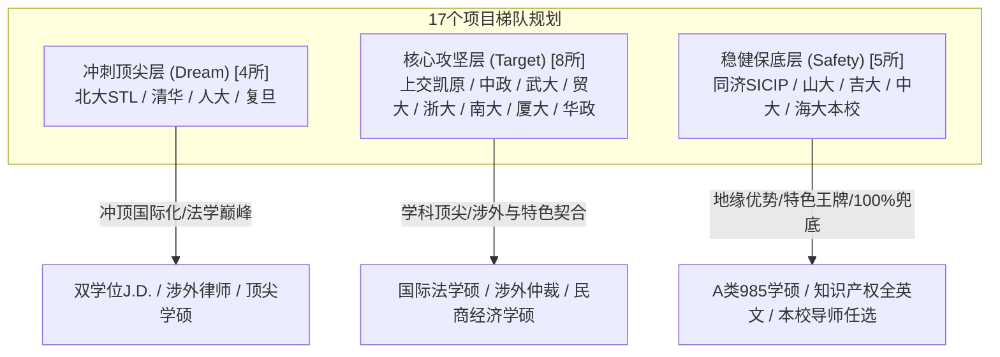
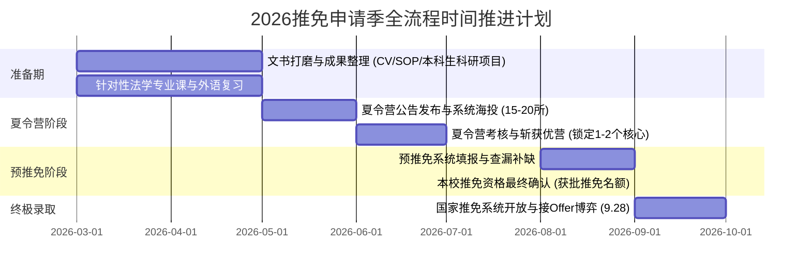

# 中国海洋大学法学专业2026年推免择校方案与全景适配分析报告

---

## 一、 申请人画像与核心竞争力诊断报告

### 1. 基础背景画像
* **本科院校**：中国海洋大学（985工程、世界一流大学建设高校A类）
* **本科专业**：法学（全日制法学本科）
* **学业排名**：**[精确名次及专业人数已概括]**（前 **约3%**，年级前3%顶尖梯队）
* **外语水平**：**雅思 7.5 分**（听说读写综合能力均衡，远超常规法学推免六级550-600分水准）
* **科研经历**：主持/参与 **本科生科研项目**（国家级/省级/校级大学生科研训练计划）项目
* **实践经历**：具备高水平 **法学学科竞赛** 经历（如模拟法庭、辩论赛、法学论文/案例分析大赛等）

---

### 2. 核心竞争力 SWOT 深度诊断

```mermaid
quadrantChart
    title 申请人综合竞争力定位象限
    x-axis 实践与应用能力 (低 --> 高)
    y-axis 学术与语言硬指标 (低 --> 高)
    quadrant-1 顶尖涉外与学硕攻坚区 (雅思7.5 + 前3% + 竞赛科研)
    quadrant-2 纯学术研究攻坚区
    quadrant-3 常规保研基准区
    quadrant-4 纯实务专硕应用区
    "申请人当前定位": [0.85, 0.92]
```

#### （1） 绝对优势（Strengths）
1. **排名优势达标顶尖门槛**：前约3%（前约3%）稳稳跨越了清华、北大、人大、中政、复旦、武大等顶尖法学院对外校985生源设定的“前5%”或“前10%”初审硬性筛选红线，材料初审通过率极高。
2. **雅思7.5构成降维打击**：在全国法学推免生多以大学英语六级（CET-6）500-600分作为主要语言证明的背景下，雅思7.5是极其亮眼的“核心王牌”。特别是在教育部、司法部重点支持的“涉外法治人才培养专项”（涉外律师、国际仲裁、双学位J.D.）中，具备压倒性优势。
3. **本科生科研项目科研经历赋能学硕（法学硕士）选拔**：本科生科研项目体现了完整的问题意识、学术文献检索与评述、规范实证分析及论文撰写训练，能够有效打消学硕导师对本科生“高分低能、缺乏学术潜质”的顾虑。
4. **竞赛经历强化面试表达与案例研判**：模拟法庭（如贸仲杯、理律、红十字、Jessup等）或法律论辩竞赛经历，证明了扎实的请求权基础分析能力、法律检索能力与抗辩表达能力，在法硕（涉外/法学）复试的高强度追问中具备从容应对的实操底蕴。

#### （2） 相对短板与申请挑战（Weaknesses & Challenges）
1. **学科声誉的相对制约**：海大法学在海洋法、环境法领域特色鲜明，但在传统法学二级学科（如民商法、刑法、经济法）的学科评估层级上，与“法学A类/A+院校”（如人大、中政、武大、华政、吉大等）存在一定差距。申请传统民商、刑法学硕时，需用极硬核的文书和学术代表作弥补学科背景劣势。
2. **学硕与专硕的备考分流精力管理**：学硕侧重理论渊源、法理逻辑与学术前沿追踪；专硕（尤其是涉外专项）侧重商事规则适用、涉外争议解决实务及全英文论辩。双线推进需合理分配夏令营复习精力。

#### （3） 外部机遇（Opportunities）
1. **国家涉外法治战略红利**：教育部与司法部持续扩大“法律硕士（涉外律师）”与“法律硕士（国际仲裁）”联合培养项目规模，顶尖高校涉外项目招生配额充裕，对高外语+985前列生源渴求度极高。
2. **“海洋强国”战略下的交叉学科红利**：在涉外海洋法、极地法律治理、国际环境与资源保护法领域，中国海洋大学在学界拥有极高的话语权与学缘网络，与武大、厦大、政法等名校在该领域的合作极为密切。

---

## 二、 推荐方案设计逻辑与梯队划分体系

本方案为申请人量身定制 **17个“学校 + 学院 + 具体专业/项目”** 组合，按照 **“冲刺顶尖层（4所）- 核心攻坚层（8所）- 稳健保底层（5所）”** 的 4:8:5 黄金梯度配置，既全力冲击国内法学殿堂与涉外顶级高地，又兼顾核心名校录取概率，并预留绝对可靠的安全兜底。



---

## 三、 17个院校与专业项目推荐汇总矩阵

| 序号 | 目标高校 | 院系全称 | 具体专业与方向（项目全称） | 学位类型 | 梯队层级 | 核心匹配关键词 |
| :---: | :--- | :--- | :--- | :---: | :---: | :--- |
| **01** | **北京大学** | 国际法学院 (STL) | 法律硕士（法学/非法学）+ 美国法法律博士（J.D.） | 双学位 | 冲刺顶尖层 | 雅思7.5降维适配 / 全球案例教学 / 涉外天花板 |
| **02** | **清华大学** | 法学院 | 法律硕士（涉外律师 / 国际仲裁项目） | 专业型硕士 | 冲刺顶尖层 | 985前3%硬指标通关 / 涉外拔尖计划 / 红圈所青睐 |
| **03** | **中国人民大学** | 法学院 | 法学硕士（国际法学 / 环境与资源保护法学方向） | 学术型硕士 | 冲刺顶尖层 | 法学A+巅峰 / 海洋环境法学缘契合 / 学术训练支撑 |
| **04** | **复旦大学** | 法学院 | 法律硕士（涉外涉港澳法治方向） | 专业型硕士 | 冲刺顶尖层 | 国际金融中心区位 / 高难度外语口试优势 / 涉外法治高地 |
| **05** | **上海交通大学** | 凯原法学院 | 法律硕士（法学）/ 法学硕士（民商法学方向） | 专硕/学硕 | 核心攻坚层 | 初审量化模型顶格赋分 / 交叉创新培养 / 模拟法庭赋能 |
| **06** | **中国政法大学** | 国际法学院 | 法学硕士（国际法学方向：公法/私法/经法） | 学术型硕士 | 核心攻坚层 | 五院四系领头羊 / 国际公法海洋法导师资源 / 985生源优待 |
| **07** | **武汉大学** | 法学院 | 法学硕士（国际法学 / 环境与资源保护法学方向） | 学术型硕士 | 核心攻坚层 | 国家级智库双王牌 / 海大法学学缘深厚 / 本科生科研项目成果对口 |
| **08** | **对外经济贸易大学**| 法学院 | 法律硕士（涉外律师 / 国际仲裁专项） | 专业型硕士 | 核心攻坚层 | 外语考核权重全国第一 / 涉外经贸法霸主 / 竞赛经历极度契合 |
| **09** | **浙江大学** | 光华法学院 | 法律硕士（涉外法治方向）/ 法学硕士（经济法学方向）| 专硕/学硕 | 核心攻坚层 | C9顶尖综合品牌 / 数字与涉外法治融合 / 之江精英小班 |
| **10** | **南京大学** | 法学院 | 法学硕士（经济法学 / 民商法学方向） | 学术型硕士 | 核心攻坚层 | 扎实理论法学与规范分析 / 华东985高度互认 / 学术规范考核 |
| **11** | **厦门大学** | 法学院 | 法学硕士（国际法学：国际海洋法与环境法方向） | 学术型硕士 | 核心攻坚层 | 国际经济法重镇 / 南海研究院涉海平台 / “双海联盟”无缝衔接 |
| **12** | **华东政法大学** | 国际法学院 / 涉外法治学院 | 法律硕士（涉外法治专项）/ 法学硕士（国际法学方向）| 专硕/学硕 | 核心攻坚层 | 985头部降维竞争 / 上海法律实务界极高号召力 / 锁定优营 |
| **13** | **同济大学** | 上海国际知识产权学院 (SICIP)| 法学硕士（国际知识产权法，WIPO/中德联合培养） | 学术型硕士 | 稳健保底层 | 联合国WIPO合作全英文项目 / 雅思7.5直接免试外语关 / 差异化竞争 |
| **14** | **山东大学** | 法学院（青岛） | 法学硕士（民商法学 / 诉讼法学方向）/ 法律硕士（法学）| 学硕/专硕 | 稳健保底层 | 省内法学最高峰A类 / 青岛同城地缘学缘绝对互认 / 稳拿优营 |
| **15** | **吉林大学** | 法学院 | 法学硕士（法学理论 / 刑法学方向）/ 法律硕士（法学）| 学硕/专硕 | 稳健保底层 | 五院四系老牌底蕴 / 招生体量大且优待985前列 / 理论学术大本营 |
| **16** | **中山大学** | 法学院 | 法律硕士（涉外律师 / 国际仲裁专项） | 专业型硕士 | 稳健保底层 | 粤港澳大湾区战略支点 / 涉外专项招生名额充裕 / 实务资源丰沛 |
| **17** | **中国海洋大学** | 法学院 | 法学硕士（环境与资源保护法学方向） | 学术型硕士 | 绝对兜底层 | 本校前3%绝对保底 / 博士点特色王牌学科 / 顶尖导师自主挑选 |

---

## 四、 17个院校专业组合深度剖析与逐项适配理由

### 梯度一：冲刺顶尖层（Dream / 冲顶院校，4所）

#### 01. 北京大学 | 国际法学院 (School of Transnational Law, STL)
* **具体专业与项目**：法律硕士（法学/非法学）+ 美国法法律博士（J.D.）双学位研究生项目
* **学位类型**：双硕士/博士学位（双学位联合培养）
* **梯队定位**：冲刺顶尖层（国际化涉外法治天花板）
* **深度适配理由**：
  1. **语言能力天然契合**：STL是中国乃至全球唯一全英文讲授美国法J.D.并与中国法J.M.融合的学院，采用高强度的英美法案例教学法（Case Method）与苏格拉底诘问式教学（Socratic Method）。申请人拥有**雅思 7.5 分**的卓越语言能力，在STL夏令营（SHP）的模拟法庭论辩、英文法律文书撰写以及英文面试中具有压倒性竞争优势，能无缝适应纯英文法学教育。
  2. **学业排名与背景过审**：STL夏令营筛选高度重视“985优质生源 + 英语极高分”，海大前3%（前约3%）的硬核排位稳超入营门槛。
  3. **竞赛经历赋能苏格拉底课堂**：模拟法庭与辩论赛经历使申请人具备快速构建法律论点、应对高压反问的心理素质，完美匹配STL在夏令营选拔营员时的行为观察指标。
  4. **职业发展前景**：毕业生同时斩获中国法学硕士与美国J.D.学历，在涉外跨国业务、国际仲裁机构以及英美外资所（Vault 100）、内资红圈所涉外业务部具备顶级溢价。

---

#### 02. 清华大学 | 法学院
* **具体专业与项目**：法律硕士（涉外律师 / 国际仲裁项目） 或 法学硕士（国际法学方向）
* **学位类型**：专业型硕士 / 学术型硕士
* **梯队定位**：冲刺顶尖层（综合名校巅峰）
* **深度适配理由**：
  1. **硬性指标精准达标**：清华法学院夏令营对外校申请者卡线极严，通常严卡“综合性985高校前5%甚至前3%”。申请人排名第前约3%（前约3%）恰好踩进清华初审的“黄金安全带”。
  2. **涉外专项的外语权重收益**：教育部与司法部联合推行的涉外律师与国际仲裁项目，在清华复试考核中将外语笔试与口语提升到了前所未有的权重。雅思7.5在面对多为六级成绩的竞争者时，能够形成显著的外语分数壁垒。
  3. **本科生科研项目与竞赛经历的综合佐证**：清华复试面试考官风格犀利，极其看重学生的逻辑推演自洽性。本科生科研项目研究经历证明了学术严谨性，而竞赛经历则保证了口头抗辩时的反应敏捷度，能有效应对考官的连环追问。

---

#### 03. 中国人民大学 | 法学院
* **具体专业与项目**：法学硕士（国际法学 / 环境与资源保护法学方向） 或 法律硕士（涉外律师专项）
* **学位类型**：学术型硕士 / 专业型硕士
* **梯队定位**：冲刺顶尖层（法学学科A+领军学府）
* **深度适配理由**：
  1. **学科渊源与特色方向互认**：人大学科评估为A+，是全国法学界公认的殿堂。人大的**环境与资源保护法学**与武汉大学并列全国顶峰。中国海洋大学在海洋资源法、海洋环境保护法、极地治理领域享有国家级学术地位。若申请人将本科生科研项目研究课题与海洋环境、国际公法资源管辖相结合，申报人大学硕，其选题特色将与传统民商、刑法形成差异化竞争，极易引起人大环境法与国际法导师组的高度关注。
  2. **排位竞争力坚挺**：人大夏令营对985生源前5%的硬性要求极其苛刻，前约3%确保了初审资格；雅思7.5则在人大涉外律师专项或国际法学硕的外语考核中提供坚实护航。
  3. **学术潜质的全面展现**：人大法学硕推免高度重视“工作论文（Working Paper）”与研究计划书。本科生科研项目的系统科研历练能直接转化为高质量申报材料。

---

#### 04. 复旦大学 | 法学院
* **具体专业与项目**：法律硕士（涉外涉港澳法治方向） 或 法学硕士（国际法学方向）
* **学位类型**：专业型硕士 / 学术型硕士
* **梯队定位**：冲刺顶尖层（华东法学与涉外高地）
* **深度适配理由**：
  1. **高标准专业外语考核契合度**：复旦大学法学院推免面试一贯以“专业外语考查深度大”著称，常设英文法律文献现场专业抽题英译汉/汉译英及英文即兴问答。雅思7.5保证了申请人在面对复杂英美法专业术语与长难句时具备极高的口语输出质量与学术理解力。
  2. **综合背景契合度极佳**：复旦偏爱“高绩点 + 高外语 + 综合学术/实践亮点”的综合型985学生，海大第6的成绩在复旦初审打分表中属于顶格档位。
  3. **上海国际化区位优势**：复旦法学院在跨国投资、涉港澳法律事务、涉外争端解决领域拥有广泛的国际合作网络，非常契合有志于在长三角顶尖外资所及高端涉外平台执业的发展诉求。

---

### 梯度二：核心攻坚层（Target / 稳健进取院校，8所）

#### 05. 上海交通大学 | 凯原法学院
* **具体专业与项目**：法律硕士（法学） 或 法学硕士（民商法学 / 经济法学方向）
* **学位类型**：专业型硕士 / 学术型硕士
* **梯队定位**：核心攻坚层（跨越式发展的A类985）
* **深度适配理由**：
  1. **初审量化计分机制极大受益**：凯原法学院夏令营初审以材料量化评分著称（院校层级+绩点排名+英语成绩+科研竞赛）。申请人的“985高校 + 专业前3% + 雅思7.5（在英语项拿满分） + 本科生科研项目项目 + 学科竞赛奖项”构成了一份近乎满分的量化履历，入营概率极高。
  2. **多学科交叉与实务考察偏好**：凯原法学院注重现代法学与实务能力的结合，模拟法庭和学科竞赛经历在凯原的多轮结构化面试中极具杀伤力。
  3. **高端法律市场品牌认可**：上交凯原法学院近年来在上海金融法律、涉外商事领域发展极为迅猛，就业指标直逼传统老牌名校。

---

#### 06. 中国政法大学 | 国际法学院
* **具体专业与项目**：法学硕士（国际法学方向，涵盖国际公法、国际私法、国际经济法）
* **学位类型**：学术型硕士
* **梯队定位**：核心攻坚层（政法黄埔王牌二级学科）
* **深度适配理由**：
  1. **生源政策对985极其友好**：中政大在推免招生中，对985高校专业排名前5%的学生给予高度倾斜政策，前约3%的位次在初审材料筛选中通过率极高。
  2. **国际法学师资与学术体量第一**：中政大国际法学院拥有全国规模最大、体系最完备的国际法学学者群体。雅思7.5在法学学硕面试中属于罕见的拔尖水平，国际法学导师对于高英文水平的学生尤为青睐。
  3. **海洋法学研究的学术共振**：中政大国际公法方向有专门研究领土与海洋争端、国际海洋法公约的前沿团队，与海大法学院的特色学科同频共振，申请人的学科背景在面试交流中极易引发考官共鸣。

---

#### 07. 武汉大学 | 法学院
* **具体专业与项目**：法学硕士（国际法学方向 / 环境与资源保护法学方向）
* **学位类型**：学术型硕士
* **梯队定位**：核心攻坚层（国家智库与王牌学科巅峰）
* **深度适配理由**：
  1. **学科绝对王牌**：武大法学院的国际法学（国家首批重点学科、教育部人文社科基地）和环境法学（全国环境资源法学发源地与最高学术重镇）是武大的“双子星”。
  2. **海大-武大深厚学缘血脉**：中国海洋大学法学院在学科建设历史上，多位学科带头人与中青年学术骨干均师从武大国际法学或环境法学名师，两校学缘交流密切、学术范式一致。申请人申报武大国际法学或环境法学学硕，天然具备学术亲和力。
  3. **科研成果的高度对应**：武大学硕复试极其看重考生的学术规范与科研论证能力。本科生科研项目的立项与研究历程，可直接提炼为优质的研究报告，契合武大导师选拔具有持续学术创新能力研究生的严苛标准。

---

#### 08. 对外经济贸易大学 | 法学院
* **具体专业与项目**：法律硕士（涉外律师 / 国际仲裁专项） 或 法学硕士（国际法学方向）
* **学位类型**：专业型硕士 / 学术型硕士
* **梯队定位**：核心攻坚层（涉外商事与国际经贸法霸主）
* **深度适配理由**：
  1. **外语权重的极致兑现**：贸大法学院是全国推免考核中将英语能力视作“生命线”的院校。夏令营及预推免设置高强度的英文专业面试与英文笔试，雅思7.5在贸大考核体系中属于绝对王牌，能够直接碾压常规六级考生。
  2. **竞赛履历高度对口**：贸大以模拟法庭文化闻名全国（Vis Moot、贸仲杯、Jessup战绩斐然），在涉外律师与国际仲裁招生中，极度偏爱拥有辩论、模拟法庭及案件实战经历的学生。申请人的竞赛背景能无缝融入贸大的选拔诉求。
  3. **超高红圈所就业率**：贸大法学院人均涉外资源丰沛，北京一线涉外律所及跨国企业法务就业转化率在全国位列前茅。

---

#### 09. 浙江大学 | 光华法学院
* **具体专业与项目**：法律硕士（涉外法治方向 / 法学） 或 法学硕士（经济法学方向）
* **学位类型**：专业型硕士 / 学术型硕士
* **梯队定位**：核心攻坚层（C9顶尖名校光环）
* **深度适配理由**：
  1. **初审门槛从容达标**：光华法学院夏令营对外校985高校的硬性排名要求一般在年前10%或前5%，前约3%（前约3%）让申请人在初审阶段毫无掉队风险。
  2. **数字法治与涉外法治融合平台**：浙大法学院立足杭州数字经济前沿，大力推行涉外法治与数字法学复合型培养。雅思7.5使申请人能够从容参与浙大的全英文国际学术交流与海外双学位项目。
  3. **精英化小班培养与地域资源**：之江校区环境优越、师生比高，毕业生在长三角公检法司、高端律所及头部互联网大厂法务中具备不可撼动的校友网络。

---

#### 10. 南京大学 | 法学院
* **具体专业与项目**：法学硕士（经济法学方向 / 民商法学方向） 或 法律硕士（法学）
* **学位类型**：学术型硕士 / 专业型硕士
* **梯队定位**：核心攻坚层（老牌华东985学术重镇）
* **深度适配理由**：
  1. **严谨学风与规范研究契合**：南大法学院以崇尚理论深度、注重法学方法论著称，其民商法、经济法及中德法学研究所享誉学界。
  2. **本科生科研项目学术训练成果变现**：南大法学硕考核注重考察学生对法学基础概念的规范理解与法学论证逻辑。本科生科研项目的完整学术训练，使申请人在提交研究设计与回答法理思辨题目时表现得极有条理，不落下风。
  3. **区域优质生源偏好**：南大历来对华东沿海重点985高校（包括海大）的优异生源认可度极高，复试风格公平纯粹，注重综合素质。

---

#### 11. 厦门大学 | 法学院
* **具体专业与项目**：法学硕士（国际法学：国际海洋法与环境法方向） 或 法律硕士（法学）
* **学位类型**：学术型硕士 / 专业型硕士
* **梯队定位**：核心攻坚层（涉海涉外与国际经济法国家高地）
* **深度适配理由**：
  1. **“海大学子”的专属学术共鸣**：厦大法学院在陈安先生等老一辈学者奠基下，国际经济法领跑全国；同时厦大依托南海研究院，在国际海洋法、海洋权益维护、深海治理领域承担国家重大战略研究。海大与厦大同为国家涉海研究的“学术盟友”，两校在涉海法学领域的学术交流与认可度极高。
  2. **针对性极强的研究方向对接**：申请人若利用本科生科研项目将科研重心落在海洋法律治理、国际海洋争端或涉海环境法领域，在厦大夏令营面试中将展现出极其稀缺的专业对口度。
  3. **国际化氛围与高雅思加持**：厦大国际法涉外交流活跃，全英文外语考核比重大，雅思7.5分在厦大复试中极易斩获高分。

---

#### 12. 华东政法大学 | 国际法学院 / 涉外法治学院
* **具体专业与项目**：法律硕士（涉外法治专项） 或 法学硕士（国际法学方向）
* **学位类型**：专业型硕士 / 学术型硕士
* **梯队定位**：核心攻坚层（上海法律实务界的“东方明珠”）
* **深度适配理由**：
  1. **985顶尖背景的降维优势**：华政虽为非985院校，但在法学实务界拥有超一流的影响力。对于综合性985高校前3%且雅思7.5的优质生源，华政涉外法治学院及国际法学院在夏令营初审与优营评定中极为青睐，基本能够稳操胜券锁定“优秀营员”。
  2. **上海实务界的绝对人脉网络**：华政毕业生垄断了上海及周边地区法院、检察院、司法行政机关以及各大内外资顶尖律所的大量岗位，就业落地能力极强。
  3. **竞赛应用型人才的极高契合**：华政考核重实操、重案例、重论辩，申请人的法学学科竞赛履历能完美匹配华政导师对实战型法律英才的期待。

---

### 梯度三：稳健保底层（Safety / 稳妥托底院校，5所）

#### 13. 同济大学 | 上海国际知识产权学院 (SICIP)
* **具体专业与项目**：法学硕士（知识产权法，联合国WIPO与中德联合培养项目）
* **学位类型**：学术型硕士
* **梯队定位**：稳健保底层（高外语门槛的差异化宝藏项目）
* **深度适配理由**：
  1. **纯正全英文国际平台**：SICIP是联合国世界知识产权组织（WIPO）与中国国家知识产权局、同济大学联合共建的国家级国际化学院，提供双学位或联合硕士培养，全英文授课、全英文答辩。
  2. **高语言门槛天然阻绝内卷**：绝大多数法学保研生因六级虽过但无法进行流畅的专业外语学术表达，不敢轻易报考SICIP；而申请人**雅思 7.5 分**恰恰精准契合该项目对外语的严苛要求，在初审与英文面试中几乎无竞争阻力。
  3. **前沿紧缺领域的职业前景**：涉外知识产权纠纷（跨境专利诉讼、跨国技术转让、商标与数据合规）是未来十年极具爆发力的法律蓝海，兼具985名校Title与极佳的就业性价比。

---

#### 14. 山东大学 | 法学院（青岛校区）
* **具体专业与项目**：法学硕士（民商法学 / 诉讼法学方向） 或 法律硕士（法学）
* **学位类型**：学术型硕士 / 专业型硕士
* **梯队定位**：稳健保底层（同省同城最高学府，学科评估A类）
* **深度适配理由**：
  1. **学科实力强劲（法学A类）**：山大法学院在第五轮学科评估中跃升至A类，理论法、民商法、诉讼法、检察学实力极为雄厚。
  2. **同城地缘与学缘互信顶格**：山大法学院整体坐落于青岛校区（即墨），与中国海洋大学同在一座城市。两校学者交往极为密切，山大法学院对海大法学的课程体系、成绩含金量及学生基本功了如指掌。
  3. **确定性极高的985保底选择**：以海大第前约3%（前约3%）的成绩申报山大法学院夏令营或预推免，几乎可以稳拿优秀营员资格，是整个推免季兼具“985名校Title + 法学A类学科 + 确定性极高”的最坚实盾牌。

---

#### 15. 吉林大学 | 法学院
* **具体专业与项目**：法学硕士（法学理论 / 刑法学方向） 或 法律硕士（法学）
* **学位类型**：学术型硕士 / 专业型硕士
* **梯队定位**：稳健保底层（法学老牌“五院四系”宏大学术基石）
* **深度适配理由**：
  1. **老牌法学传统豪门**：吉大法学院是全国公认的“法学重镇”，张文显先生等开创的当代中国法哲学研究位居全国第一梯队，刑法、民商法底蕴醇厚。
  2. **招生体量宏大且对985极度包容**：吉大法学院每年的推免招生名额非常充裕，在夏令营和预推免中对综合性985高校前列的同学极为友好，优营发放比例高。
  3. **学术型硕士的从容选择**：对于有志于扎扎实实深耕法学理论、刑法学并打算未来攻读博士学位的同学而言，吉大是能够100%提供学术底气与声誉托底的理想选择。

---

#### 16. 中山大学 | 法学院
* **具体专业与项目**：法律硕士（国际仲裁 / 涉外律师专项） 或 法学硕士（国际法学方向）
* **学位类型**：专业型硕士 / 学术型硕士
* **梯队定位**：稳健保底层（华南985龙头与大湾区涉外枢纽）
* **深度适配理由**：
  1. **大湾区涉外法治发展红利**：中大法学院位于广州，深度参与大湾区涉外法治、跨境规则衔接与国际商事仲裁（如华南国际仲裁院SCIA合作）创新，涉外专项名额指标充足。
  2. **生源与外语匹配度高**：中大重视985生源背景，且对具备较好外语能力和实务潜能的学生格外青睐。雅思7.5在华南地区高校的面试竞争中属于天花板水平。
  3. **辐射华南与港澳的高质量就业**：对于未来有意愿前往广深大湾区顶级律所、金融机构执业的同学，中大提供了强大的品牌号召力与校友资源网络。

---

#### 17. 中国海洋大学 | 法学院（本校）
* **具体专业与项目**：法学硕士（环境与资源保护法学方向 / 经济法学方向）
* **学位类型**：学术型硕士
* **梯队定位**：绝对兜底层（本校王牌学科与100%安全底线）
* **深度适配理由**：
  1. **零风险的100%兜底保障**：申请人排名第前约3%（前约3%），稳拿海大推免资格指标，且在本校推免接收中属于绝对排头兵，彻底消除任何“失学”后顾之忧。
  2. **本校王牌特色学科的顶尖待遇**：海大法学院拥有“法学一级学科硕士点”与“自主设置海洋法学/环境与资源保护法学二级学科博士点”，拥有自然资源部海洋法治研究基地、极地法律治理等国家级特色智库。申请人留校可自由选择本校知名博导、院系学术带头人作为导师，享受最核心的科研项目倾斜。
  3. **战略心理支撑**：本校兜底不仅是一所保底院校，更是全流程战略心态的“压舱石”，能够让申请人在6-7月份夏令营中卸下心理包袱，放手一搏冲刺清北人、复旦、STL等殿堂级名校。

---

## 五、 2026推免全流程实战执行指南与时间推进表

为了确保上述17个院校项目的申请能够精准落地，针对2026推免申请季，建议采取以下阶段性推进策略：



### 1. 关键阶段实战任务分解

#### 【第一阶段】材料筹备与成果转化期（3月 - 5月中旬）
1. **文书模块化定制**：
   * **简历（CV）**：制作中英文双语高密度排版简历。将“排名 前约3%（前约3%）”、“雅思 7.5”放置在显眼位置；将本科生科研项目和法学竞赛单列为核心版块。
   * **个人陈述（PS / SOP）**：准备“学硕版”（重在科研问题意识、学术流派思考、文献功底、本科生科研项目课题推演）与“涉外专硕版”（重在涉外争端解决志向、国际视野、辩论法庭实战、跨文化沟通）两套核心文书。
2. **本科生科研项目科研成果转化**：
   * 将本科生科研项目项目总结报告改写为规范的 **法学学术论文（Working Paper）** 或附录研究报告。按照法学引证规范（CSSCI规范）进行注释体例规范，作为学硕申报的学术代表作。
3. **学科竞赛成果结构化提炼**：
   * 整理参赛案由、请求权基础分析框架、辩词书状精华以及反思总结，形成一份1-2页的《法学实践与实务论辩成果复盘报告》，用于应对专硕和涉外面试中的案例实务考察。

#### 【第二阶段】夏令营申报与决战期（5月下旬 - 7月下旬）
1. **全面撒网，分层入营**：
   * 在公布的夏令营中，将上述17个院校及对应学院全部纳入监测清单，做到“能报尽报”（因很多院校初审时间与材料不同，海投可避免初审由于小概率偶然因素落选）。
   * 若发生夏令营入营时间冲突，优先原则：**冲刺层STL/清华/人大/复旦 > 核心层武大/中政/贸大/凯原 > 稳妥层**；但务必确保手里至少参加1-2个稳健层或核心层夏令营，尽早锁定至少1个“优秀营员（优营）”作为底牌。
2. **专业课与面试高频考点突破**：
   * **民刑基础理论**：民法典总则、物权编、合同编典型法条与请求权基础；刑法总论犯罪构成、因果关系与阻却事由。
   * **涉外与国际法前沿**：国际商事仲裁协议效力、管辖权豁免、国际海洋法争议解决机制、涉外法治体系建设内涵。
   * **英文专业表达**：用英文流利介绍本科生科研项目研究内容、竞赛案件争议焦点及法律分析逻辑。

#### 【第三阶段】预推免攻坚与补录拾遗期（8月中旬 - 9月中旬）
1. **把握预推免窗口期**：
   * 对于夏令营未入营或未拿到优营的高校（如部分学校夏令营不发全额offer，或者只在预推免放大量学硕名额，如南大、山大、吉大等），全力填报预推免系统。
   * 此阶段很多头部高校学生手里囤积了多个顶尖offer并开始放弃次一梯队名额，会释放大量候补补录机会。
2. **稳拿海大推免指标**：
   * 密切关注中国海洋大学教务处及法学院当年的保研加分公示与推免资格认定，确保以前约3%的坚挺成绩顺利锁定正式推免名额。

#### 【第四阶段】国家推免系统终极决胜期（9月下旬 - 10月）
1. **志向排序与心理博弈**：
   * 9月28日国家“全国推荐免试攻读研究生（免初试、转段）信息公开暨管理服务系统”正式开放。
   * 系统填报三个平行志愿：通常填报“手中已握优营的最优校” + “1个正在候补的更高心仪校” + “1个绝对稳妥校”。
   * 严格遵守“接待录取通知”的黄金时间窗，及时在系统内完成最终确认，圆满收官保研季。

---

## 六、 针对申请人特殊优势的复试面试实战话术与应对策略

### 1. 如何将“雅思7.5”转化为复试绝对得分点？
* **痛点**：很多高分英语考生在专业面试中，仅能进行日常生活寒暄，一旦涉及法学专业英语（Legalese）便无法开口。
* **破局战术**：
  * 提前准备法学专业词汇的英文表达（如：*Privity of contract*, *Burden of proof*, *Injunction*, *Choice of law*, *Jurisdiction*, *Pacta sunt servanda*, *Maritime delimitation* 等）。
  * 针对本科生科研项目研究主题，准备一段用词精准、逻辑清晰的2分钟纯英文科研阐述，展示真正的“学术英语”输出水准。

### 2. 如何将“本科生科研项目科研经历”转化为学术潜质证明？
* **痛点**：本科生本科生科研项目项目常被考官质疑“只是给老师打杂”、“缺乏独立问题意识”。
* **破局战术**：
  * **结构化陈述模型（STAR-L法）**：
    * **Situation（研究背景）**：该选题在当下中国法治建设或理论探讨中的前沿痛点是什么？
    * **Task（研究任务）**：本项目重点解决的法学核心争议焦点是什么？
    * **Action（个人行动与研究方法）**：你具体负责了哪部分？采用了何种法学研究方法（规范分析法、比较法学法、案例实证法）？如何检索和筛选核心文献？
    * **Result（研究结论）**：得出了什么创新性观点或制度构建建议？
    * **Learning（学术反思）**：该课题目前尚存哪些局限，研究生阶段打算如何在此基础上深化？

### 3. 如何在面试中巧妙阐释“中国海洋大学法学背景”与目标专业的融合？
* **话术模板设计**：
  > “各位老师好！我本科就读于中国海洋大学法学院。海大的学习经历赋予了我两个鲜明的特质：一是踏实严谨的法学基本功，让我在205名同学中保持前3%的专业成绩；二是独具特色的海洋法治与国际化前沿视野。在参与本科生科研项目课题与模拟法庭竞赛的过程中，我深刻体会到法律不仅是条文的解释，更是应对国家治理与全球化涉外挑战的规则工具。无论是贵院的国际法学还是涉外法治项目，都与我的学术志趣和语言优势高度契合。我非常渴望能够在贵院更广阔的学术平台上，将我的科研潜能与涉外法律实务能力进一步升华。”

---

*答卷完成。祝推免申请顺利，圆梦心仪学府！*
