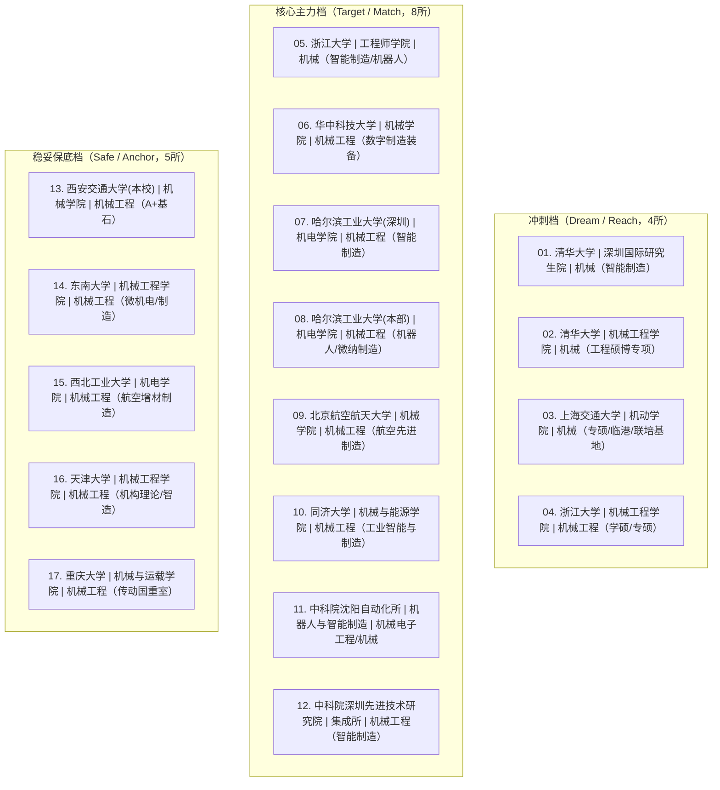

# 西安交通大学工科大类保研推免规划与院校专业推荐方案

---

## 一、 申请人背景综合诊断与推免定位分析

### 1. 核心基本面评估

| 评估维度 | 核心数据/状态 | 优势与竞争力分析 | 劣势与潜在风险 |
| :--- | :--- | :--- | :--- |
| **本科院校** | 西安交通大学（C9 / 985 / 双一流） | 顶尖老牌工科强校，机械工程学科在全国第四轮学科评估为 **A+**、国家“双一流”建设学科，全国各重点高校与科研院所对西交工科生源基本功认可度极高。 | 无院校层面的歧视劣势，属于推免体系内的最高生源梯队（C9联盟）。 |
| **成绩排位** | 工科大类 **前约15%**（前 **约15%**） | ① 西交大工科大类推免率通常在 **25% ~ 35%** 之间，前 约15% **100% 稳拿本校推免资格**，心态具有天然安全垫。 ② 属于优质生源段，满足绝大多数 985 高校夏令营入营要求（一般要求 985 前 15%~20%）。 | 冲刺清华本部、上交本部顶尖大牛团队的学术型硕士（学硕）时，面对各校前 3%~5% 的顶尖竞争对手存在一定位次劣势，需依靠专硕、工程硕博或特色校区破局。 |
| **外语水平** | CET-6 **450–499 分** | 超过了 425 分的及格线，**已满足 95% 以上高校夏令营的硬性报名门槛**（工科大部分要求六级通过 425 分即可）。 | 属于中等分数段，未达 480/500 分档位。在部分采用“综合量化机筛初审”的高校（将六级成绩按比例折算加分）中拿不到外语溢价分。 |
| **专业与方向** | 大类待分流；科研偏机械与智能制造 | 目标明确且具备早期科研经历，在推免面试（侧重实际科研潜力、工程动手能力、解决工程问题思维）中具有突出优势。 | 尚未正式分流，需确保后续分流专业与目标申请方向紧密衔接，并妥善在文书中解释大类培养与科研聚焦的关系。 |

---

### 2. 核心申请策略制定

1. **分流选择建议**：
   - 建议在正式分流时，首选 **机械工程**、**机械工程及其自动化** 或 **智能制造工程**；若大类包含相关交叉学科，亦可选机电、智能装备等专业。保证毕业专业名称与申请目标专业高度一致，规避跨大类审查摩擦。
2. **六级 450–499 分化解方案**：
   - **简历呈现**：在简历与个人陈述中，标注“大学英语六级（CET-6 已通过）”或如实填写 450–499 分，不作过分强调；
   - **学术反哺**：重点展示专业英文文献阅读量、国际学术论文检索与阅读笔记，在面试英文自我介绍和专业问答中强化流利度和工程专业词汇，彻底打消考官对外语水平的顾虑。
3. **科研优势最大化打法**：
   - 将现有研究经历按 **“项目背景 $\to$ 核心技术痛点 $\to$ 个人承担模块（软硬件/仿真/算法） $\to$ 成果转化与阶段性结论”** 结构化整理，突出 CAD/SolidWorks/UG 建模、MATLAB/Simulink 仿真、ANSYS 有限元分析、PLC/ROS/C++/Python 控制算法及机加工实操等硬核工程素养。
4. **梯队配比原则（冲、稳、保）**：
   - **冲刺档（4 个）**：以清华、上交、浙大本部的优势特色项目/专硕/工程硕博/优质校区为主，力拼高平台；
   - **核心主力档（8 个）**：学科评估 A/A+ 的顶级工科名校（华科、哈工大本部及深圳、浙大工程师学院、北航、同济等）及中科院顶尖智能制造研究所，全面拿优营并锁定核心导师；
   - **稳妥保底档（5 个）**：以本校 A+ 机械工程学院为绝对底座，搭配华东、华北、西南老牌工科强校（东大、西工大、天大、重大），确保推免全程零风险。

---

## 二、 17个院校、学院与具体专业（项目）组合详细推荐

---

### 第一梯队：冲刺档（Dream / Reach —— 4个组合）

#### 01. 清华大学 | 深圳国际研究生院 (SIGS)
* **学院全称**：深圳国际研究生院
* **具体专业与项目**：机械（专业型硕士，代码：`085500`），智能制造 / 数据与信息研究院先进制造方向
* **学科优势**：清华大学顶尖工科师资结合大湾区高端装备与智能制造产业链，拥有清华-伯克利深圳技术创新研究院等高水平平台，科研经费充沛，注重工程实践与前沿交叉。
* **录取难度与匹配诊断**：
  * **六级适配**：清华 SIGS 报名硬性要求为六级通过（425 分即可），450–499 分符合报名门槛。
  * **排名与背景**：清华 SIGS 对 C9 高校认可度极高，西交前 约15% 拥有较高的初审入营几率。相较清华本部学硕，SIGS 入营门槛更加友好。
* **考核要点与申请建议**：
  * 考核偏好工程落地能力、英语口试、跨学科项目经历；
  * 建议在个人陈述中重点强调智能制造产学研应用与智能装备控制开发经验；提早联系 SIGS 智能制造实验室导师。

---

#### 02. 清华大学 | 机械工程学院
* **学院全称**：机械工程学院
* **具体专业与项目**：机械（专业型硕士，代码：`085500`），国家卓越工程师学院“工程硕博专项”（智能制造与高端装备方向）
* **学科优势**：全国顶尖机械学科（A+），摩擦学国家重点实验室、高端装备界面科学与技术全国重点实验室。工程硕博专项深度依托中车、航天科技、中国一汽等国家重点领军企业，实行校企双导师制。
* **录取难度与匹配诊断**：
  * **六级适配**：卓越工程师专项看重工程实践素养，六级 425 分满足基本要求。
  * **排名与背景**：清华本部常规学硕统考推免生源多卡各校前 3%~5%；但国家工程硕博专项面向 C9 前 15%~20% 开放且名额充裕，该生前 约15% 加智能制造科研背景正好契合项目选拔画像。
* **考核要点与申请建议**：
  * 面试包含高校导师和企业专家联合评审，重点考察解决复杂工程技术难题的潜质；
  * 准备 1~2 个完整的工程项目全流程介绍（从需求分析、方案设计、三维建模到样机装配与调试）。

---

#### 03. 上海交通大学 | 机械与动力工程学院
* **学院全称**：机械与动力工程学院
* **具体专业与项目**：机械（专业型硕士，代码：`085500`），智能制造与精密制造领域（临港智能制造专项 / 联培基地专项）
* **学科优势**：全国机械工程顶尖 A+ 学科，机械系统与振动全国重点实验室。临港智能制造基地承载国家智能制造重大科技基础设施，科研直接面向重器制造与产业前沿。
* **录取难度与匹配诊断**：
  * **六级适配**：上交机动学院夏令营要求英语六级成绩达到 425 分（符合条件）。
  * **排名与背景**：上交机动本部学术型硕士竞争激烈，但临港专项、四川/重庆等基地联培专硕名额多、对 C9 前 15% 生源认可度极高，入营概率较大。
* **考核要点与申请建议**：
  * 上交机动夏令营非常看重综合面试中的专业基础考察（机械设计、控制工程、数控原理等）与个人科创展示；
  * 提前在官网上研读临港基地导师课题方向，文书中注明愿意调剂或优先考虑临港专项/基地培养。

---

#### 04. 浙江大学 | 机械工程学院
* **学院全称**：机械工程学院
* **具体专业与项目**：机械工程（学术型硕士 `080200` 或 专业型硕士 `085500`），流体动力基础件与机电系统全国重点实验室、智能制造与数控技术方向
* **学科优势**：浙大机械学科底蕴极深（全国评估 A 档顶尖），在电液伺服控制、盾构装备、智能工业软件与先进机电系统领域位列全国翘楚。
* **录取难度与匹配诊断**：
  * **六级适配**：浙大机械夏令营硬性六级门槛为 425 分，450–499 分符合报名资格。
  * **排名与背景**：夏令营对 C9 院校生源给予位次倾斜（通常放宽至前 15%~20%），前约15% 刚好切中其初审通过的核心分数段。
* **考核要点与申请建议**：
  * 浙大考核看重数理功底、流体/机电系统建模能力及机械原理；
  * 申请时可根据当年政策同时关注直博或专硕，若志在硕士，优先填报专硕或流体机电联合团队。

---

### 第二梯队：核心主力档（Target / Match —— 8个组合）

#### 05. 浙江大学 | 工程师学院
* **学院全称**：工程师学院（杭州主院区 / 宁波分院）
* **具体专业与项目**：机械（专业型硕士，代码：`085500`），智能制造工程 / 机器人与智能装备项目
* **学科优势**：首批国家卓越工程师学院，办学资源丰富，依托浙大机械、控制、信电优势师资，建有高端工程实训中心与产教融合联合实验室。
* **录取难度与匹配诊断**：
  * **六级适配**：六级 425 分即可报名，450–499 分稳过初筛。
  * **排名与背景**：该学院对 C9 前 15% 的学生视为优质生源，初审通过率高，优营获取概率极大。
* **考核要点与申请建议**：
  * 面试重在考查项目落地能力与解决工程实际问题的方案设计能力；
  * 此组合是学生进入浙大体系内确定性最高、性价比极强的上佳选择。

---

#### 06. 华中科技大学 | 机械科学与工程学院
* **学院全称**：机械科学与工程学院
* **具体专业与项目**：机械工程（学术型硕士 `080200` / 专业型硕士 `085500`），数字制造装备与技术全国重点实验室、智能制造与数控技术方向
* **学科优势**：华科机械同样位列全国 **A+**（“机械四小龙”核心校），数字制造装备与超精密加工全国闻名，国内智能制造领域公认最强学府之一。
* **录取难度与匹配诊断**：
  * **六级适配**：六级要求 425 分，450–499 分完全达标。
  * **排名与背景**：华科机械对西交大认可度极高，历年夏令营针对 985 高校前 20% 开放，该生 约15% 处于初审优势区，优营率极高。
* **考核要点与申请建议**：
  * 面试考核非常规范，重点考察数控技术、机械制造技术基础及现场科研答辩；
  * 建议及早阅读数字制造装备国重室相关团队的研究论文并提早邮件联系意向导师。

---

#### 07. 哈尔滨工业大学（深圳） | 机电工程与自动化学院
* **学院全称**：机电工程与自动化学院
* **具体专业与项目**：机械工程（学术型硕士 `080200` / 专业型硕士 `085500`），智能制造与微纳制造方向
* **学科优势**：哈工大机械学科全国 A+，哈工大（深圳）享有哈工大规格与深圳大湾区区位双重优势，科研与大湾区智能硬件、无人系统产业紧密相连，就业薪资常年领跑工科。
* **录取难度与匹配诊断**：
  * **六级适配**：六级 425 分即合规。
  * **排名与背景**：机电学院对 C9 工科前 15% 给予高度重视，入营率高，且优营政策明确。
* **考核要点与申请建议**：
  * 考核偏重科研潜力与工程编程（C/C++、Python、MATLAB）能力；
  * 建议在材料中突出自己在智能制造中的软件与硬件协同调试经验。

---

#### 08. 哈尔滨工业大学（本部） | 机电工程学院
* **学院全称**：机电工程学院
* **具体专业与项目**：机械工程（学术型硕士，代码：`080200`），机器人技术与系统全国重点实验室、精密与超精密加工研究所
* **学科优势**：国内机器人与尖端国防机械装备发源地之一，宇航空间机构、特种机器人、精密加工国家战略科技力量，底蕴极其雄厚。
* **录取难度与匹配诊断**：
  * **六级适配**：六级 425 分即可。
  * **排名与背景**：哈工大本部对西交生源认可度拉满，前 约15% 几乎稳入营，且非常容易锁定学硕优营名额及国家级重点实验室核心导师。
* **考核要点与申请建议**：
  * 考核重视专业基本功（机原、机设、控工原理）；若意向机器人所，面试需准备运动学/动力学基础知识。

---

#### 09. 北京航空航天大学 | 机械工程及自动化学院
* **学院全称**：机械工程及自动化学院
* **具体专业与项目**：机械工程（学术型硕士 `080200` / 专业型硕士 `085500`），智能制造与复杂装备数字化制造方向
* **学科优势**：北航机械学科实力强劲（A 档），在航空航天复杂结构数字化制造、数字化工艺规划（CAPP）、智能装配技术处于全国领跑地位。
* **录取难度与匹配诊断**：
  * **六级适配**：六级要求 425 分，450–499 分符合要求。
  * **排名与背景**：北航机院认可西交 C9 工科大类生源，前 约15% 初审入营概率高。
* **考核要点与申请建议**：
  * 重点考查制造工程基础、工业软件开发及数字化制造概念；
  * 适合对高端国防装备、航空发动机先进制造有志向的学生。

---

#### 10. 同济大学 | 机械与能源工程学院
* **学院全称**：机械与能源工程学院
* **具体专业与项目**：机械工程（学术型硕士 `080200` / 专业型硕士 `085500`），工业智能与智能制造 / 机器人与智能装备方向
* **学科优势**：同济机械深度对接工业 4.0 与中德联合培养体系，智能制造、工业机器人与智慧物流仓储系统特色鲜明，地处上海，就业前景极优。
* **录取难度与匹配诊断**：
  * **六级适配**：六级 425 分达标。
  * **排名与背景**：对 985 高校前 15% 生源非常友好，西交 C9 排名 约15% 处于入营且高概率拿优营的核心区间。
* **考核要点与申请建议**：
  * 综合素质面试风格严谨，注重考察逻辑分析能力与实际项目参与度，优营具有很高的转正保障。

---

#### 11. 中国科学院沈阳自动化研究所
* **培养单位**：中国科学院沈阳自动化研究所（中国科学院大学）
* **具体专业与项目**：机械电子工程（学术型硕士 `080202`）/ 机械（专业型硕士 `085500`），智能制造系统与工业机器人方向
* **学科优势**：中国工业自动化与机器人技术的“国家队”，机器人学国家重点实验室所在地，牵头多项国家智能制造重大研发专项，科研经费充足，工程实战量大，全额奖学金与津贴丰厚。
* **录取难度与匹配诊断**：
  * **六级适配**：六级 425 分达标。
  * **排名与背景**：中科院沈自所极度青睐 C9/985 工科背景扎实、有实际动手能力的生源，西交大排名 约15% 基本稳入夏令营。
* **考核要点与申请建议**：
  * 极其重视科研项目实战、现场动手能力考核（如嵌入式软硬件调试、控制算法实现、机构设计实操），是工科科研型学生的绝佳去处。

---

#### 12. 中国科学院深圳先进技术研究院 (SIAT)
* **培养单位**：集成技术研究所
* **具体专业与项目**：机械工程（学术型硕士 `080200` / 专业型硕士 `085500`），智能制造技术与微纳机电系统
* **学科优势**：体制机制灵活，产学研结合极紧密，毗邻深圳先进制造业产业集群，装备及自动化实验室条件先进，与高新科技企业深度合作。
* **录取难度与匹配诊断**：
  * **六级适配**：六级 425 分符合报名要求。
  * **排名与背景**：对 985 生源包容度高，初审通过率高，考核节奏快，优营发放相对充分。
* **考核要点与申请建议**：
  * 导师自主招生权重高，务必在夏令营报名前完成与心仪课题组（如智能装配、工业机器人团队）的邮件学术联络。

---

### 第三梯队：稳妥保底档（Safe / Anchor —— 5个组合）

#### 13. 西安交通大学 | 机械工程学院（本校基石）
* **学院全称**：机械工程学院
* **具体专业与项目**：机械工程（学术型硕士 `080200`），精密工程研究所、高端装备协同设计制造、增材制造（3D打印）方向
* **学科优势**：本校机械学科是全国评估 **A+**、第四轮排名第一档的殿堂级工科，拥有机械制造系统工程国家重点实验室，蒋庄德院士微纳制造团队、卢秉恒院士增材制造团队均为国际顶尖水准。
* **录取难度与匹配诊断**：
  * **本校绝对优势**：排名 前约15%（前 约15%）在工科大类推免中**百分之百锁定本校名额**，可凭借排名优势直接保送学硕。
* **考核要点与申请建议**：
  * **推免战略核心“压舱石”**：尽早联系本院院士/杰青团队名师，锁定心仪课题组；进可冲刺外校，退可直接在本校享用全国最顶级 A+ 机械资源，从容不迫。

---

#### 14. 东南大学 | 机械工程学院
* **学院全称**：机械工程学院
* **具体专业与项目**：机械工程（学术型硕士 `080200` / 专业型硕士 `085500`），微机电系统与智能制造、机械制造及其自动化
* **学科优势**：东南大学工科底蕴深厚（机械评估 A-），微机电系统技术、智能感知与测试仪器方向特色鲜明，长三角制造产业辐射力强。
* **录取难度与匹配诊断**：
  * **六级适配**：六级 425 分达标。
  * **排名与背景**：西交大前 约15% 申请东大机院属于优质生源，初审入营极稳，拿优营概率极高。
* **考核要点与申请建议**：
  * 适合作为长三角江浙沪地区的稳妥型保底选择，考核风格侧重机电综合测试及机械制造基础。

---

#### 15. 西北工业大学 | 机电学院
* **学院全称**：机电学院
* **具体专业与项目**：机械工程（学术型硕士 `080200` / 专业型硕士 `085500`），航空航天先进制造技术、智能增材制造技术方向
* **学科优势**：同城 985，机械学科 A 档，凝固技术国家重点实验室、3D 打印激光增材制造全国领先，国防三航制造业资源极其丰沛。
* **录取难度与匹配诊断**：
  * **六级适配**：六级 425 分达标。
  * **排名与背景**：同城生源认可度极高，西交前 约15% 投递基本稳入营，且优营政策对 C9 生源非常优待。
* **考核要点与申请建议**：
  * 可作为无后顾之忧的高质量稳妥备选，能提前挑选顶尖学术团队与国防大课题组。

---

#### 16. 天津大学 | 机械工程学院
* **学院全称**：机械工程学院
* **具体专业与项目**：机械工程（学术型硕士 `080200` / 专业型硕士 `085500`），机构理论与装备设计、先进制造技术
* **学科优势**：中国近代工业第一所大学，机械工程评估 A 档，机构学、并联机器人及内燃装备研发底蕴深厚，北方工科龙头。
* **录取难度与匹配诊断**：
  * **六级适配**：六级 425 分达标。
  * **排名与背景**：天大夏令营对 985 高排名生源敞开大门，前 约15% 拿优营确定性强。
* **考核要点与申请建议**：
  * 专业考核中机构学与动力学基础考察偏多，可作为北方地区极佳的防风险组合。

---

#### 17. 重庆大学 | 机械与运载工程学院
* **学院全称**：机械与运载工程学院
* **具体专业与项目**：机械工程（学术型硕士 `080200` / 专业型硕士 `085500`），机械传动国家重点实验室、智能制造与工业智能方向
* **学科优势**：机械“四小龙”之一，学科评估 A 档，机械传动国家重点实验室是齿轮传动与重型装备领域的国家战略高地。
* **录取难度与匹配诊断**：
  * **六级适配**：六级 425 分达标。
  * **排名与背景**：重大对 C9 高水平工科生提供“绿色通道”优营政策，西交前 约15% 基本属于直接锁定优营序列。
* **考核要点与申请建议**：
  * 是西南地区乃至全国最稳固的顶级保底项之一，科研经费充足，导师名额有保障。

---

## 三、 推荐组合横向对比与选拔矩阵

| 序号 | 学校名称 | 学院全称 | 具体专业（项目）及方向 | 学位类别 | 梯队属性 | 六级要求 | 录取难度系数 |
| :---: | :--- | :--- | :--- | :--- | :--- | :---: | :---: |
| **01** | **清华大学** | 深圳国际研究生院 | 机械（智能制造/先进制造领域） | 专业型硕士 | **冲刺档** | $\ge 425$ | ★★★★★ |
| **02** | **清华大学** | 机械工程学院 | 机械（卓越工程师学院工程硕博专项） | 专业型硕士 | **冲刺档** | $\ge 425$ | ★★★★★ |
| **03** | **上海交通大学** | 机械与动力工程学院 | 机械（智能制造 / 临港专项 / 联培基地） | 专业型硕士 | **冲刺档** | $\ge 425$ | ★★★★★ |
| **04** | **浙江大学** | 机械工程学院 | 机械工程（智能制造 / 机电系统） | 学硕/专硕 | **冲刺档** | $\ge 425$ | ★★★★☆ |
| **05** | **浙江大学** | 工程师学院 | 机械（智能制造工程 / 机器人系统） | 专业型硕士 | **核心主力** | $\ge 425$ | ★★★★☆ |
| **06** | **华中科技大学** | 机械科学与工程学院 | 机械工程（数字制造装备全国重点实验室） | 学硕/专硕 | **核心主力** | $\ge 425$ | ★★★★☆ |
| **07** | **哈尔滨工业大学(深圳)** | 机电工程与自动化学院 | 机械工程（智能制造与微纳制造） | 学硕/专硕 | **核心主力** | $\ge 425$ | ★★★★☆ |
| **08** | **哈尔滨工业大学(本部)** | 机电工程学院 | 机械工程（机器人技术与系统国重室） | 学术型硕士 | **核心主力** | $\ge 425$ | ★★★☆☆ |
| **09** | **北京航空航天大学** | 机械工程及自动化学院 | 机械工程（复杂航空装备智能制造） | 学硕/专硕 | **核心主力** | $\ge 425$ | ★★★★☆ |
| **10** | **同济大学** | 机械与能源工程学院 | 机械工程（工业智能与智能制造） | 学硕/专硕 | **核心主力** | $\ge 425$ | ★★★☆☆ |
| **11** | **中科院沈阳自动化所** | 机器人与智能制造培养点 | 机械电子工程 / 机械（工业机器人） | 学硕/专硕 | **核心主力** | $\ge 425$ | ★★★☆☆ |
| **12** | **中科院深圳先进技术研究院** | 集成技术研究所 | 机械工程（智能制造与微纳系统） | 学硕/专硕 | **核心主力** | $\ge 425$ | ★★★☆☆ |
| **13** | **西安交通大学(本校)** | 机械工程学院 | 机械工程（现代设计制造 / 增材制造） | 学术型硕士 | **稳妥基石** | 本校资格 | ★★☆☆☆ (稳保) |
| **14** | **东南大学** | 机械工程学院 | 机械工程（微机电与智能制造） | 学硕/专硕 | **稳妥主力** | $\ge 425$ | ★★★☆☆ |
| **15** | **西北工业大学** | 机电学院 | 机械工程（航空航天增材制造） | 学硕/专硕 | **稳妥保底** | $\ge 425$ | ★★☆☆☆ |
| **16** | **天津大学** | 机械工程学院 | 机械工程（机构理论与装备数字化） | 学硕/专硕 | **稳妥保底** | $\ge 425$ | ★★☆☆☆ |
| **17** | **重庆大学** | 机械与运载工程学院 | 机械工程（机械传动国家重点实验室） | 学硕/专硕 | **稳妥保底** | $\ge 425$ | ★★☆☆☆ |

---

## 四、 2026推免全流程实操与落地备战指南

### 1. 文书与材料包装策略（扬长避短）
1. **弱化外语短板，强化专业能力**：
   - 简历（CV）版面上，个人信息栏简写“英语水平：大学英语六级 CET-6（通过）”；若系统强制填报分数填 450–499 分即可。
   - 在专业技能栏中，具体列出“熟练查阅 IEEE Transactions、ASME、Elsevier 等机械与智能制造顶刊专业文献”，在面试自述中提及“曾精读并复现多篇英文顶刊的控制/动力学模型”。
2. **大类分流的阐释话术**：
   - 在个人陈述（PS）中明确写道：“本科前阶段依托西安交通大学工科大类宽口径培养，打下了扎实的数理基础与工程力学底蕴；个人兴趣与科创实践始终聚焦于机械与智能制造，已深度参与实验室课题/科创竞赛，具备成熟的软硬件综合开发能力。”
3. **科研经历结构化呈现**：
   - 将研究经历按 **STAR 原则** 编写成 1~2 页精美 PPT（复试/夏令营汇报必备）：
     * **情境（Situation）**：制造过程中的关键痛点（如振动超标、装配误差、加工精度退化等）；
     * **任务（Task）**：负责的独立子模块（如动力学仿真分析、传感器信号采集卡开发、机器视觉缺陷检测算法）；
     * **行动（Action）**：采用了什么理论方法，使用 MATLAB/ANSYS/SolidWorks 进行了哪些实证计算；
     * **结果（Result）**：误差降低了百分之几，发表论文/申请专利/样机调试通过。

---

### 2. 导师邮件套磁全攻略（工科导师沟通技巧）
1. **套磁节点**：
   - **第一轮（5月中下旬 ~ 6月上旬）**：针对冲刺档（清华、上交、浙大）导师，表达对课题组方向的向往，附上 CV 并询问是否招收 2026 届推免生（特别说明希望参加夏令营）；
   - **第二轮（夏令营拿到优营后当天）**：向心仪导师汇报已获优营成绩，预约线上或线下 1 对 1 面谈，锁定实际课题组名额；
   - **第三轮（预推免期间 8~9月）**：针对前期储备导师更新科研进展。
2. **邮件正文模板架构**：
   - **标题**：`2026推免申请-西安交通大学工科大类(排名前约15%)-姓名-申请您的硕士研究生`
   - **第1段**：亮明身份（西交大工科大类、排名前 约15%、CET-6已通过、保研资格已稳）；
   - **第2段**：介绍机械与智能制造科研项目（150字内概括最拿手的 1 个项目，突出独立解决问题的工程技能）；
   - **第3段**：阐述对导师课题组近期 2 篇具体论文的研读心得与研究兴趣；
   - **结尾**：谦逊表达交流意愿，附件附带 1 页 PDF 简历、成绩单及科研代表作支撑材料。

---

### 3. 夏令营与推免实战全周期时间轴

| 时间阶段 | 核心任务 | 具体执行动作 |
| :--- | :--- | :--- |
| **3月 - 4月** （信息摸底期） | 材料准备与分流确定 | ① 确定大类分流专业（锁定机械/智造）； ② 梳理已有科研项目代码、工程图纸、仿真文件，整理成果集； ③ 准备中英文简历、个人陈述、专家推荐信模版。 |
| **5月 - 6月** （夏令营申报期） | 批量投递与首轮套磁 | ① 密切关注各校夏令营通知，推荐的 17 个组合中分批投递 8~12 个； ② 针对清华 SIGS、上交机动、浙大、华科等核心院校启动首轮导师套磁； ③ 提前联系西交大本校机械学院意向导师，完成保底沟通。 |
| **7月 - 8月** （夏令营考核期） | 参营考核与锁定优营 | ① 积极参加各校夏令营线上/线下笔试面试，重点演练项目汇报 PPT； ② 若出现参营时间冲突，优先保“冲刺档 SIGS/工程硕博”与“核心主力档 华科/浙大/哈工深”； ③ 拿到优营第一时间与导师签署接收意向协议。 |
| **8月下旬 - 9月中旬** （预推免攻坚期） | 查漏补缺与二次冲击 | ① 若夏令营结果未达预期，立刻报名上述高校的“预推免/九月推免”系统； ② 重点发力浙大工程师学院、同济、北航、中科院所等名额释放较多的预推免考核。 |
| **9月下旬** （国家系统确认） | 填报国家研招网系统 | ① 9月28日前后国家推免服务系统开放； ② 严格按照前期达成的承诺与导师协议，第一志愿填报并接受待录取通知，圆满完成推免上岸。 |
