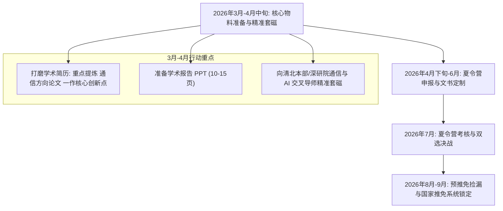

# 一所985高校通信工程保研深造决策咨询与多平台影响深度评估报告

---

## 一、 个人核心背景定位与清北本部冲刺竞争力剖析

### 1. 核心硬实力与软背景画像盘点
* **院校层次与专业声誉**：一所985高校（985高校、双一流建设高校），通信工程专业为传统优势工科，在全国信息类学科评估中具有扎实基础。
* **学业排名**：前约1%（前 约1%，专业前 1%）。绝对的顶尖绩点（Top Rank），在各大高校初审筛选算法中处于最前列梯队，能稳妥通过清华大学、北京大学绝大多数院系的夏令营初审门槛。
* **外语水平**：六级 500–549 分。
  * **国内效力**：全面通过清华、北大绝大多数工科院系的夏令营报名硬性门槛（清华电子系通常要求六级≥425或450分；北大信科/电子学院通常要求六级≥450或480分）。
  * **短板提示**：属于合格通关分数，但在清北营员动辄 550–599~630+ 或有托福/雅思高分映衬的背景下不属于亮眼加分项。
* **学术科研硬通货**：**一篇以第一作者身份发表/录用的 通信方向期刊（具体名称已概括） 论文**。
  * **含金量解析**：这是你个人简历中最具杀伤力、最核心的差异化竞争王牌。IEEE 通信方向论文 为 通信领域相关学术期刊，属于 [具体刊物分区与分类已概括]，在无线通信学术界具备极高的同行公认度。
  * **本科生维度的稀缺性**：在清华、北大招收推免生的夏令营中，哪怕是本校或 C9 院校的顶尖学生，在本科大三阶段能以独立第一作者完成一篇完整 IEEE 权威期刊/Letter 的审稿并被录用，也是极少数（通常不足 5%）。这直接向导师证明了你具备：扎实的通信与应用数学建模能力、熟练的英文论文写作能力、完整的学术发表闭环与较强的自主科研驱动力。
* **实践与科创**：国家级大创项目主持人 + 多项竞赛奖项。
  * 证明了你在科研之外具备工程落地、团队协作与项目牵头能力，综合履历结构无明显盲区。

---

### 2. 冲刺清北本部的定位、名额现实与培养类型权衡
对于目标瞄准“通信或AI交叉方向”并“关注企业研发就业”的你，冲刺清华大学本部（主要为电子工程系、自动化系，或计算机系、交叉信息院网络方向）及北京大学本部（电子学院、计算机学院、智能学院、集成电路学院）时，需要清晰认知当下的保研政策与名额格局：

#### （1）学位类型选择的客观现实：本部“学硕”极度稀缺，主力名额为“直博”
* **清北本部学硕现状**：近五年来，清华大学电子工程系、计算机系以及北京大学电子学院、计算机学院大幅削减面向内地推免生的高校统招学术型硕士（学硕）名额，部分核心方向甚至将校外学硕推免名额压缩至极低或基本清零，仅保留极少数专项或留给本校拔尖本科生。
* **名额实际流向**：本部招收外校顶尖推免生时，绝大多数统招名额为**本科直博生（直博，5年制）**；专硕名额则主要划拨至非本部校区（如清华深圳 SIGS、北大深圳深研院）或各类交叉联合培养专项中。
* **你的胜率研判**：
  * **若执着于清北本部硕士**：竞争不仅是纯实力的比拼，更面临名额极度稀缺带来的偶然性与高滑档风险。
  * **若选择清北本部直博**：凭借本校 Top 1%（前约1%）的顶尖排位，加上极具说服力的 **通信方向一作**，你在清北本部直博考核中的综合竞争力处于 **第一梯队（T1）**，只要夏令营机试/专业笔试稳定发挥，提前联系契合的通信/AI 交叉团队，拿到拟录取 Offer 的概率极高。

#### （2）培养类型与“企业研发就业”目标的战略匹配
你能接受“学硕、直博、硕博连读”，但在规划时必须看清直博与硕士在企业研发就业上的真实分水岭：
* **若攻读硕士（学硕/专硕，2.5~3年）**：
  * **就业路径**：适合快速进入工业界主流研发岗位（如华为、中兴、腾讯、阿里、字节跳动、大疆、芯片设计企业等公司的算法工程师、协议栈开发、系统架构工程师）。
  * **核心优势**：时间成本低、沉没成本小、试错空间大。硕士阶段完成 1~2 段顶尖大厂核心实习，毕业时凭借清北平台即可在校招白菜/SP/SSP 档位中占据极强优势。
* **若攻读直博（5~6年）**：
  * **就业路径**：直博的目标绝不仅是“进企业做研发”，而是要冲刺“企业战略级核心研究团队”的高门槛岗位（例如：华为“天才少年”/2012实验室中央研究院、各大互联网大厂 AI Lab/研究员、高通/联发科/海思的前沿通信标准与算法专家岗）。
  * **关键要求**：直博期间需要产出顶级论文（如 IEEE TWC/TSP/JSAC/TIT 或 CCF-A 类顶会），一旦顺利毕业，起薪、职级定级（如华为 17~18 级）和技术上升通道将显著超越普通硕士研发岗；但若博士期间缺乏顶尖突破，花费 5 年从事基础工程开发，机会成本则相对偏高。

---

## 二、 四大平台/项目的本质特征与全景横向对比

针对你提到的**清华深圳（SIGS）**、**北大深圳（PKUSZ）**、**鹏城实验室（PCL 联培）**与**清华—JHU 联合项目**，虽然都依托顶尖名校光环，但其培养模式、学位属性、科研生态、资金成本及职业出口存在本质差异。

### 四大平台核心维度横向对比表

| 评估维度 | 清华深圳国际研究生院 (SIGS) | 北大深圳研究生院 (PKUSZ) | 鹏城实验室联合培养 (PCL) | 清华—JHU 联合培养项目 |
| :--- | :--- | :--- | :--- | :--- |
| **办学与机构性质** | 清华大学二级学院（异地全日制研究生院） | 北京大学二级学院（异地全日制研究生院） | 国家实验室（新型科研机构，非高校） | 中外合作双硕士学位项目（清华+美国名校） |
| **学位授予与证书** | **清华大学**硕士/博士毕业证与学位证（**证书不体现“深圳”**） | **北京大学**硕士/博士毕业证与学位证（**证书不体现“深圳”**） | **合作高校**毕业证与学位证（如清华/北大），附实验室联培证明 | **清华大学**硕士学位 + **约翰斯·霍普金斯大学 (JHU)** 硕士学位 |
| **主流招生类别** | **电子信息专硕**为主，少量学硕/直博 | **电子信息专硕/学硕**、直博均有设点 | **主要招收直博生**，极少招收专硕/学硕 | **全日制硕士双学位**（自费/奖学金） |
| **外语门槛要求** | 六级通过（425/450+ 即可） | 六级通过（450/480+ 即可） | 六级通过（按合作高校标准） | **必须提供托福 (100+) 或雅思 (7.0+)**，六级无效；部分要求 GRE |
| **经济成本与津贴** | 常规学费，深圳市与学院津贴优厚，宿舍条件极佳 | 常规学费，南山补贴与学院津贴优厚 | **津贴极高**（博士津贴常达 10,000~15,000+ 元/月） | **经济成本极高**（需自付 JHU 海外学费与生活费，50~80万+ 人民币） |
| **科研算力与环境** | 偏向产学研结合、AI与信息技术交叉，依托大湾区实验室 | 偏向硬工科、芯片、智能多媒体、音视频标准（AVS团队） | **国家级算力怪兽**（鹏城云脑II/III），主打国家重大 6G/通信网络科研 | 国际化视野、JHU 生医工/数据科学顶级，海外实验室环境 |
| **企业研发就业优势** | 地处深圳南山科技核心区，大湾区大厂实习与校招天花板级优势 | 紧邻深圳科技园，大湾区大厂与芯片/金融科技认可度极高 | 面向国家战略攻坚与龙头企业（华为2012等）高精尖研发岗位 | 面向跨国外企研发（高通/苹果/英伟达/微软等）或出海业务 |

---

## 三、 四大平台对你的实际影响深度剖析

结合你的**一所985高校通信背景、一作通信方向论文、企业研发导向**，以下逐一剖析每个平台对你的具体实质性影响、潜在优势与现实掣肘：

---

### 1. 清华深圳国际研究生院（Tsinghua SIGS）
* **学院与方向归属**：
  * 主要涉及信息科学与技术学部、智能制造与海洋工程学部、数据与信息研究院等。通信与 AI 交叉主要落在**电子信息工程硕士（专硕）**与部分控制/计算机相关专业。
* **对你的实际正面影响**：
  1. **学历效益等同本部**：毕业证、学位证与学信网注册信息均为“清华大学”，用人单位 HR 与国家机关同等对待，享受清华本部完全一致的校招户口政策与顶级大厂投递绿卡。
  2. **企业研发实习的天然温床**：学院位于深圳南山区西丽大学城，距离腾讯滨海大厦、华为坂田/松山湖基地、大疆创新、中兴通讯等企业研发总部仅半小时至一小时车程。研二及研三期间，导师普遍支持或默许企业实习，在大湾区通信/IT 研发领域的校友网络极深，是**以硕士身份入职顶级企业研发岗的最优跳板之一**。
  3. **录取概率显著提升**：相比清华本部电子系直博的高难度与本部硕士名额的极度稀缺，清华 SIGS 的专硕统招规模相对充足。凭借你的985高校排名前约1% 绩点与 通信方向论文 论文，入营初审通过率极高，复试面试中也能占据绝对优势。
* **潜在限制与注意点**：
  * **专硕占比大**：若你内心非常看重“工学学术型硕士（学硕）”身份，SIGS 近年基本以电子信息专硕为主（但对于企业研发就业而言，学硕与专硕已无任何实质差别）。
  * **学术沉淀相比本部**：部分课题组年轻 PI 较多，顶级纯通信理论（如纯信息论、基础通信数学建模）的学术积淀相较清华本部四号楼（信科院/电子系本部老牌国家重点实验室）稍显年轻化，但产学研落地与 AI 交叉项目更为密集。

---

### 2. 北大深圳研究生院（PKUSZ）
* **学院与方向归属**：
  * 主要落在**信息工程学院（School of Electronic and Computer Engineering, ECE）**。学科涵盖电子科学与技术、计算机科学与技术，包含集成电路、多媒体与通信、人工智能、物联网等方向。
* **对你的实际正面影响**：
  1. **纯正北京大学学历背书**：双证均为北京大学，不体现任何异地办学校区字样，享有北京大学全球校友网络与国内企业求职的顶级通关特权。
  2. **方向与通信/AI高度契合**：北大信工院在**智能视频通信编码（高文院士团队、AVS国家标准体系）、边缘智能计算、物联网无线传输、集成电路与硬件加速**方向沉淀深厚。你的通信方向论文证明了无线数学与传输层能力，若在信工院向**AI 辅助视频传输、无线多媒体通信、软硬件协同设计**等方向延伸，契合度极佳。
  3. **校区与产业融合度高**：与清华 SIGS 同在大学城，共享西丽与南山的顶级高新产业集群。企业研发吸纳力度极大，毕业生在芯片大厂（华为海思、壁仞、地平线）、通信设备商及互联网大厂的系统/算法研发岗非常活跃。
* **潜在限制与注意点**：
  * 北大整体工科规模相比清华稍小，传统蜂窝网络无线物理层（3GPP标准、大规模MIMO等）纯通信组数量不及清华或成电/北邮丰富，多偏向计算机视觉、芯片硬件与通信多媒体交叉。

---

### 3. 鹏城实验室（Peng Cheng Laboratory, PCL）
* **体制与项目属性**：
  * 鹏城实验室是中央批准成立的**网络通信领域国家实验室**，是国家战略科技力量的核心载体。**实验室本身没有独立的高校学位授予资格**，推免生均通过其与一流高校（清华大学、北京大学、哈尔滨工业大学、南方科技大学、中山大学等）的**联合培养专项计划**招生。
* **对你的实际正面影响**：
  1. **通信与网络领域的国家终极平台**：鹏城实验室的主攻方向正是**网络通信、网络空间安全与人工智能**。它牵头国家 6G 关键技术攻关、未来网络试验设施等国家重大专项，与你通信工程底色及 通信方向论文 研究方向是**四大选项中相关性最强、契合度最高**的。
  2. **算力与硬件资源降维打击**：拥有“鹏城云脑 II/III”超级算力基础设施（全自主昇腾算力底座，算力达到千 P 级乃至 E 级）。在高校做 AI 交叉通信，往往受限于算力卡（几张 A100/A800 需排队），而在鹏城实验室，算力充沛程度对于做通信大模型（Communication Large Models）、语义通信、AI 赋能未来无线网络等前沿方向具有压倒性优势。
  3. **极高规格的薪资与资源**：联培博士生的月度津贴普遍在 10,000~15,000 元以上，并配备高规格科研实验条件与国际会议资助。
  4. **顶尖研发就业直通车**：因承担国家重大前沿项目，与华为（华为 2012 实验室在鹏城有极深合作）、中国移动研究院、中兴通讯等头部通信巨头合作极其紧密。从这里毕业的博士生，往往是华为“天才少年”计划、央企国家重点实验室、大厂前沿架构师的核心招募目标。
* **重大风险与实际掣肘（务必谨慎评估）**：
  1. **学制高度锁定为“直博（5年）”**：鹏城实验室联合培养的统招名额绝大多数为**博士/直博**，硕士名额极少或主要面向特定校企工程硕士。如果你最终想在 3 年内快速拿到硕士文凭就业，鹏城实验室大概率不是主要通道。
  2. **“双导师制”的协调与博弈压力**：学生由高校导师（如清华/北大教授）与鹏城实验室导师（内聘专家/研究员）共同指导。
     * *高校侧要求*：毕业必须满足大学的硬性学术指标（要求发表顶刊 IEEE Transactions 甚至 CCF 推荐期刊会议）。
     * *实验室侧要求*：要求全职投入国家重大工程交付、原型系统打磨或涉密系统开发。
     * *潜在冲突*：部分国家涉密或工程化成果无法公开见刊发表，容易导致学生在“工程交付任务繁重”与“高校毕业论文指标”之间两头受压，毕业时间与心理压力显著增大。

---

### 4. 清华—JHU联合项目（Tsinghua - Johns Hopkins University Dual Degree）
* **项目属性与背景**：
  * 清华大学与美国约翰斯·霍普金斯大学（Johns Hopkins University, JHU）联合设立的双硕士学位项目，通常由清华大学（医学院/生物医学工程学院/电子系/SIGS）与 JHU 怀廷工程学院（Whiting School of Engineering）联合举办，毕业分别获得**清华大学硕士学位**与 **JHU 理学硕士学位**。
* **对你的实际正面影响**：
  1. **顶峰级的中美双校光环**：同时获得清华与全美 Top 10（其生物医学工程世界第 1，应用数学、数据科学全美顶尖）的双硕士学位，在跨国科技巨头（如苹果、高通总部、微软、谷歌、英伟达）、外企驻华核心 R&D、涉外高端研发机构中拥有无与伦比的海外背景认可度。
  2. **国际化视野与交叉研究平台**：能深入感受世界一流私立研究型大学的教学与科研模式，对于开拓全球前沿视野、提升英文高阶交际与跨文化研发协作能力帮助巨大。
* **决定性的现实阻碍与性价比评估（对你可能最为不适用）**：
  1. **严苛且不可逾越的外语门槛（严重致命点）**：
     * **现实冲突**：你目前仅有六级 500–549 分。JHU 作为美国顶尖私立名校，其研究生院对国际生有**强制性的标准化英语成绩要求**：通常要求**托福 iBT ≥ 100 分**（且单项有单项要求）或**雅思 ≥ 7.0~7.5 分**，部分工科学位还要求或强烈建议递交 **GRE** 成绩。**中国大学英语六级成绩在 JHU 的审核系统中完全无效**。
     * **时间窗口**：保研夏令营在 2026 年 5~6 月启动，你在大三下学期若无现成的托福 100+ 成绩，根本无法满足该项目的外方录取前提。短时间内突击语言考试将极大消耗你准备夏令营机试与复试的精力。
  2. **高昂的个人自费财务成本**：
     * 与国内研究生免学费（有全额学业奖学金冲抵）且每月发放津贴不同，该项目在 JHU 就读期间（通常为 1~1.5 年）需按美国私立大学标准自行承担学费与生活费。怀廷工程学院学费每年约 6 万余美元，加上巴尔的摩及全美生活成本，**全自费预算需 50~80 万人民币**。
  3. **研究方向与就业诉求错位**：
     * JHU 最顶尖的王牌是**生物医疗、生物医学工程、医学影像、公共卫生及应用数学**，在纯通信工程（蜂窝网络、无线物理层/MAC层标准、6G大容量通信）领域的工业界统治力远不如传统的全美通信强校（如 UC Berkeley、UT Austin、USC、UIUC），也不如清华电子系本身。
     * **企业研发 ROI（投资回报率）低**：你的目标是**国内主流企业研发（如通信设备商、互联网、芯片大厂）**。国内大厂对于“清华硕士”已经给予顶格免筛与最高级笔面通道，“清华+JHU 双硕士”在国内招聘中的薪资涨幅与晋升起跑线相较于纯清华硕士几乎没有本质差距，难以抵扣 50~80 万元的高额支出与语言准备风险。

---

## 四、 核心诉求匹配度与多平台横向决策矩阵

针对你的四项核心诉求：
1. **清北本部优先**；
2. **通信或 AI 交叉方向**；
3. **接受学硕/直博/硕博连读**；
4. **关注企业研发就业**。

四类平台及本部的匹配度量化评估如下（满分 5 星）：

| 选项与平台 | 清北本部愿望 | 通信/AI 匹配度 | 企业研发性价比 | 录取确定性与可行性 | 综合推荐指数 |
| :--- | :--- | :--- | :--- | :--- | :--- |
| **清华/北大本部（冲刺直博）** | ★★★★★ | ★★★★★ | ★★★★★ | ★★★★☆ (通信方向论文一作强力加持) | ★★★★★ (绝对首选) |
| **清华深圳国际研究生院 (SIGS)** | ★★★★☆ | ★★★★★ | ★★★★★ | ★★★★★ (硕士极佳选择) | ★★★★★ (硕士主攻首选) |
| **北大深圳研究生院 (PKUSZ)** | ★★★★☆ | ★★★★☆ | ★★★★★ | ★★★★★ (芯片/AI多媒体) | ★★★★☆ (优质硕士梯队) |
| **鹏城实验室联合培养 (PCL)** | ★★★★☆ | ★★★★★ | ★★★★☆ (偏长期顶尖学术/架构) | ★★★★☆ (双导师需甄选) | ★★★★☆ (若读博强烈推荐) |
| **清华—JHU 联合项目** | ★★★☆☆ | ★★★☆☆ | ★★☆☆☆ (国内研发ROI偏低) | ★☆☆☆☆ (卡死在托福与费用) | ★★☆☆☆ (建议果断放弃) |

---

## 五、 为你量身定制的保研实战策略与行动路线图

### 1. 梯队式志愿填报与精准定位策略

#### 【第一梯队：清北本部战略冲刺（锁定“直博”）】
* **目标院系**：
  * **清华大学电子工程系**（直博，通信与信息系统、AI+信号处理团队）
  * **北京大学电子学院 / 计算机学院 / 智能学院**（直博，无线通信与智能网络团队）
* **战术逻辑**：
  * **绝不要把全部希望压在本部外校学硕上**，因为名额极少且极易撞车。既然你**完全接受直博**，直博就是你以本校 前约1% + 通信方向论文 一作打开清北本部大门的最强抓手。
  * 寻找清华电子系、自动化系或北大电子学院中研究“AI for Wireless / 6G 物理层智能化 / 语义通信 / 大模型网络架构”方向的博导进行点对点精准套磁，你的通信方向论文是叩开大牛导师团队的敲门砖。

#### 【第二梯队：大湾区清北硕士（锁定“高质量企业研发”）】
* **目标院系**：
  * **清华深圳国际研究生院（SIGS）**：电子信息专硕
  * **北大深圳研究生院（PKUSZ）**：信息工程学院电子信息硕士
* **战术逻辑**：
  * 若在夏令营复试中直博志愿遇到不可抗力，或者你在暑期决定更倾向于“早点进入企业研发（3年毕业）”，SIGS 和 PKUSZ 是你的最强蓄水池与护城河。
  * 享受同等清华、北大招牌，无语言加试风险，且身处大湾区，实习研发优势完全碾压国内绝大多数 985 本部。

#### 【第三梯队：顶尖国家级科研高地（鹏城实验室联培直博专项）】
* **目标院系**：清华-鹏城联培直博、北大-鹏城联培直博。
* **战术逻辑**：
  * 若目标锁定在未来成为国家级通信大厂（如华为 2012、中兴通讯算法架构）或科研院所的顶级领军人物，对算力与国家重大工程有极高追求，且能接受 5 年高强度学术攻关，可将清北-鹏城联培专项作为高能级战略选择。
  * **关键前提**：在联培面试前，务必深入了解**高校校内导师**与**实验室导师**的科研协作模式，优先选择两位导师有深度且稳定合作课题的团队，规避论文与交付冲突。

#### 【第四梯队：清华—JHU 联合项目（建议战略性放弃）】
* **战术逻辑**：
  * 除非家庭具有极其充裕的自费留学资金（准备 80 万无压力），且你能在 2026 年 5 月底前轻松斩获托福 100+ 成绩，否则**果断放弃该选项**。
  * 强行备考托福将严重挤占你准备专业课机试、高数/线性代数基础复习及清北导师套磁的核心黄金时间，得不偿失。

---

### 2. 大三下学期保研冲刺时间表（2026年3月~9月）

* **阶段一：3月至4月中旬（物料打造与早期导师套磁）**
  * **学术物料准备**：制作一份 1~2 页的精美中英文学术简历，重点将你的 **IEEE 通信方向论文 论文的系统模型、数学推导贡献、仿真算法及工程意义**做清晰可视化提炼；准备国家级大创项目的结项/进展成果展示。
  * **锁定目标导师池**：梳理清华电子系、清华 SIGS、北大电子学院、北大深研院及鹏城实验室从事“通信+AI”（智能反射面 RIS、无线大模型、语义通信、生成式 AI 无线资源分配、高能效多天线系统）的教授名单。
  * **启动精准邮件套磁**：附上个人成绩单、通信方向论文 论文 PDF 与精心撰写的自我陈述邮件。邮件内容切忌大而化之，必须指出你读过该导师近两年发表的某篇代表作，并结合你的 通信方向论文 经验提出 1~2 点潜在的研究设想，展现学术主动性。
* **阶段二：4月下旬至6月（夏令营申请与复试笔试通关储备）**
  * **网申投递**：密切跟踪清华电子系、清华 SIGS、北大信科/电子学院、北大深研院的夏令营通知，确保材料按院校要求严谨归档盖章。
  * **硬核专业课复习**：
    * *专业课底座*：通信原理、信号与系统、概率论与数理统计、线性代数与矩阵分析（清北面试对数学基本功考察极其严苛）。
    * *AI 交叉素养*：深入掌握 PyTorch 框架、常见深度学习骨干网络（CNN/Transformer/GNN/扩散模型）在通信物理层/网络层的应用机制，确保被问及 AI 与通信交叉细节时能对答如流。
    * *英文能力备考*：虽无需托福，但需准备流畅的英文专业问答与 通信方向论文 论文 3 分钟英文陈述。
* **阶段三：7月至8月（夏令营决战与 Offer 锁定）**
  * 参加清华/北大各院系夏令营。重点在综合面试、专业问答及上机考核中展现扎实功底。若获得“优秀营员（优营）”或拟录取资格，第一时间与此前建立联系的心仪导师确认名额锁定。
* **阶段四：9月（国家推免系统填报与最终圆梦）**
  * 按照推免志愿梯度依次锁定国家推免服务系统，顺利完成推免录取。

---

## 六、 总结与结语

你目前拥有**一所985高校前 1% 的顶尖绩点**、**极具含金量的本科一作 IEEE 通信方向论文 权威论文**以及**国家级大创主持**的全面背景，在 2026 届推免生中属于稀缺的高质量工科苗子。

* **最佳突破点**：在于敢于亮剑，以**直博**为战略支点直冲**清北本部**的通信与 AI 交叉实验室；
* **最强避风港**：在于以**清华深圳（SIGS）**或**北大深圳（PKUSZ）**的电子信息硕士作为高质量企业研发的主力托底；
* **极具诱惑的前沿平台**：**鹏城实验室联培直博**适合追求万卡算力、国家战略攻坚与未来大厂顶级科学家路线，但需谨慎甄选导师协同模式；
* **坚决规避的弯路**：是**清华—JHU 联合项目**，切莫因名校光环而陷入外语死线、高昂学费与方向错位的内耗。

以核心优势为矛，做好夏令营前期的精准导师对接，你完全具备在 2026 年保研季中斩获清北顶尖科研团队录取的硬实力。祝保研圆满成功！
