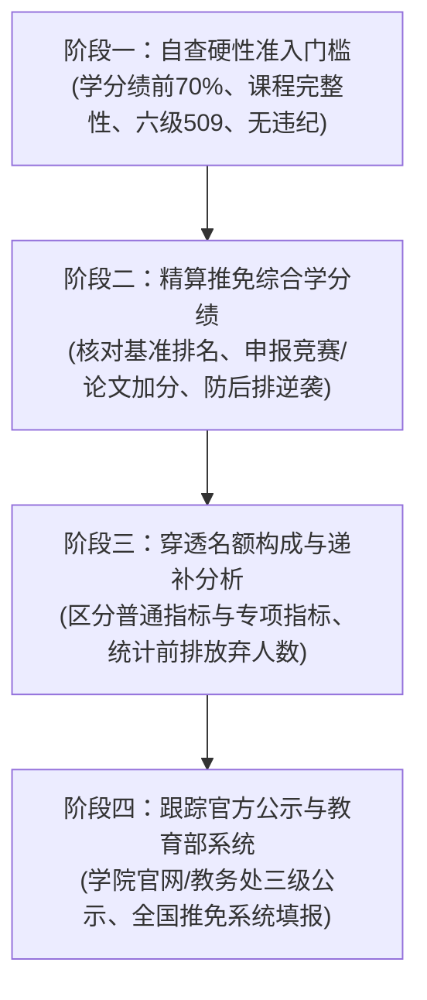
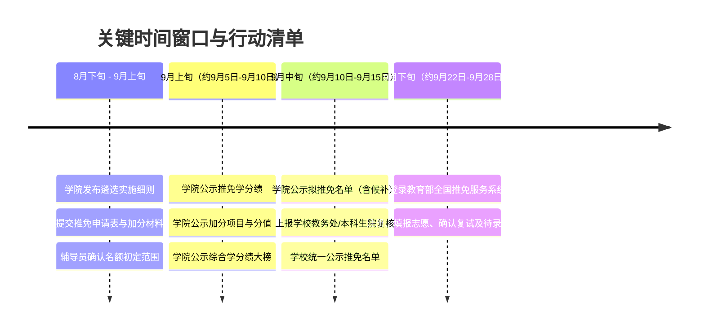

# 华东地区一所985高校人工智能专业推免资格评估与确认指南

---

## 一、对“前约45% 以为自己比较稳”判断的客观评估

### 1. 核心结论
**这个判断非常不靠谱，甚至存在极大的误判风险，绝对谈不上“比较稳”。**

以专业排名 **前约45%（前 约45%）**、六级 **500–549 分** 的条件，你在华东地区一所985高校（华东五校之一）本科学院属于典型的**“压线临界区 / 边缘博弈区”**。如果抱有“稳获推免”的乐观预期而放松准备，极可能在最终名单出炉时因名额微调或综合加分逆袭而遭遇滑铁卢。

---

### 2. 为什么该判断“不靠谱”？四大核心风险剖析

#### （1）认知误区一：混淆了“学业成绩排名”与“推免综合学分绩排名”
* **资格门槛 ≠ 入选门槛**：华东地区一所985高校（华东五校之一）本科学院的推免基本条件通常要求“原则上学位课程学分绩排名在专业前 70%”。前约45% 确实跨过了这一**申请门槛**，但这仅仅意味着你拥有“报名竞争”的资格，绝不代表能直接拿到名额。
* **综合加分会引发剧烈洗牌**：本校推免最终排序的唯一依据是**“推免综合学分绩（含推免加分）”**，而非教务系统的纯课程学分绩。
* **高水平竞赛与科研加分的冲击**：本科学院同学综合实力极强，在各类学科竞赛（如全国大学生数学建模、ACM/程序设计竞赛、程序设计竞赛、中国软件杯、挑战杯、互联网+等）以及高水平学术论文（CCF A/B 类会议或期刊）上成果密集。若排在你身后（如 44～70 名）的同学拥有重磅竞赛或论文加分，其综合学分绩极易实现大幅逆转；若你自身没有充足的加分支撑，你的位次极有可能被大幅后推，跌出入围圈。

#### （2）认知误区二：误读了“上一届名额（具体人数已概括）”的含金量与构成
* **推免名额分类多样**：高校推免名额并非全部属于面向全员自由竞争的“普通推荐免试（普通 A 类）名额”。
* **专项计划挤占普通指标**：所谓的“上届名额（具体人数已概括）”中，往往包含了多种**单列专项计划**，例如：
  * 本校直博专项 / 拔尖人才专项；
  * 研究生支教团（研支团）；
  * 卓越工程师计划 / 科教融合联培专项；
  * 辅导员专项（保研行政）等。
* **普通名额的真实边界**：如果扣除上述定向、专项或限定去向的名额，真正留给自由排序的普通推免名额通常仅有 **35～45 个左右**。如果当届纯普通推免指标仅有 40 个，[当前专业名次] 名在第一阶段就直接落入替补或出局区间。

#### （3）认知误区三：轻视了政策与名额的年度动态波动
* **教育部指标下达具有动态性**：推免总指标每年由教育部根据高校办学规模、学科建设等统一下达，再由华东地区一所985高校（华东五校之一）本科生院在各学院之间进行加权分配。
* **名额并非只增不减**：学院每年的推免指标受应届生总基数、升学率考核、学校学科资源倾斜等影响。如果当届分配给本科学院的名额收紧 2～3 个，位于第 [当前专业名次] 位的同学首当其冲面临被挤出的风险。以“上一届传闻数据”套用当届，缺乏制度依据。

#### （4）认知误区四：安全缓冲极其狭窄
* 即便本届总名额依然达到[具体人数已概括]，[精确名次及差额已概括]（缓冲区间仅有 12.5%）。面对加分逆袭、专项分流等变量，该位次根本不具备任何抗风险弹性，容错率极低。

#### （5）关于英语六级 500–549 分的定位
* 华东地区一所985高校（华东五校之一）本科学院推免的英语门槛一般为“通过全国大学英语六级”（≥425 分）或通过学位英语。
* 500–549 分已经**达标**，满足校内推免的资格准入条件；但在冲击外校顶级夏令营/预推免（如清北、人华五等）时属于常规达标成绩，并不具备显著的拉分优势。

---

## 二、怎样确认自己的推免资格？全流程实操指南

确认推免资格不能依赖口头传言，必须建立在严谨的官方文件比对、材料核验、位次测算和官方渠道追踪之上。具体应按以下四个阶段分步落实：

---

### 阶段一：自查硬性资格门槛（排查一票否决项）

对照《华东地区一所985高校（华东五校之一）本科毕业生免试攻读研究生推荐工作实施办法》及本科学院最新遴选细则，逐一排查硬性指标：
1. **学业成绩准入门槛**：
   * 确认教务系统学位课程学分绩排名是否在专业前 70%（前约45% 约为 约45%，符合准入要求）。
2. **课程修读完整性**：
   * 核查是否已修完培养方案中前三学年开设的通修课、学科平台课、专业核心课；
   * 学院通常明确要求“保研必修核心课（如培养方案规定的 7 门核心课中至少修读 6 门）”必须按期修读完成；
   * 核实是否存在课程不及格、重修尚未消除或学分未达标的情况。
3. **纪律与品德红线**：
   * 思想品德良好，无受处分记录，无考试作弊等违纪记录（一票否决项）。
4. **外语资格**：
   * 确认六级成绩单已妥善归档（500–549 分已过 425 分门槛，符合要求）。

---

### 阶段二：精算推免综合学分绩（防范位次逆袭）

最终决定能否入选的是**“综合学分绩”**，其计算公式通常为：
$$\text{推免综合学分绩} = \text{推免课程学分绩} + \text{推免加分（折算值）}$$

1. **核定学业基准分**：
   * 登录华东地区一所985高校（华东五校之一）教务系统，向教务老师核实 前约45% 的具体分值口径（确认是“推免课程首修学分绩”而非含有通识选修的通用绩点），明确自己与前排第 35～42 名以及后排第 44～[往届传闻名额] 名同学的绝对分差。
2. **全面盘点并申报个人推免加分**：
   * 仔细研读学院当年度发布的《推免加分细则》（重点关注学术竞赛、学术论文、国家发明专利、社会实践与荣誉表彰等加分目录）；
   * 严格按照学院时间节点，提交《推免信息表》及加分证明原件与复印件。
   * **严重警告**：学院明确规定，逾期未提交加分材料者视为自动放弃加分；未按规定提交推免申请表者，将视为自动放弃推免资格。
3. **密切关注推免加分与综合学分绩公示**：
   * 学院通常会在 9 月上旬先后公示两张关键表格：
     * ① **《推免加分（项目和分值）公示》**；
     * ② **《推免综合学分绩（含加分）公示》**。
   * **复核重点**：不仅要核对自己加分是否漏记，更要逐一排查第 44～70 名同学是否有大幅加分入账，精准测算自己在加分后的动态位次变化。

---

### 阶段三：穿透名额构成，把握“分子”与“递补空间”

明确自己的排位后，必须弄清楚分母（名额）的真实边界：

1. **对接最权威的信息源**：
   * **学院本科教学秘书（教务老师）与年级辅导员**是获取当届保研政策和名额分配的官方渠道。
   * 应礼貌、主动向辅导员或教务老师咨询：
     * 本届学院正式下达的推免总名额是多少？
     * 其中纯**普通推荐（A类）名额**具体是多少？
     * 是否有单列的专项计划（直博专项、工程硕博、研究生支教团等）？
2. **摸排前序同学的放弃情况（争取递补顺延）**：
   * **出路分流**：华东地区一所985高校（华东五校之一）本科学院每年均有部分优秀学子选择**申请海外名校留学（出国）**、**直接进入业界高薪就业**或参加工作；
   * **严格的放弃承诺机制**：华东地区一所985高校（华东五校之一）推免纪律极其严肃，符合条件但自愿放弃推免资格的同学，必须在规定期限内提交**学生本人及家长共同签字的《放弃推免承诺书》**。若在规定时间内未提交申请表且未提交放弃承诺书，将按自动放弃处理；推免名单一旦公示上报，严禁私自放弃。
   * **名额顺延效应**：排在前面的 42 人中，每有一人正式签署《放弃推免承诺书》，推免入选线就会向后顺延一位。若有 3～5 位同学出国或就业放弃，你的排位将直接进入相对安全区。

---

### 阶段四：盯紧官方公示窗口与教育部系统联动

推免工作具有极强的时效性和法定程序，必须按日历紧密跟踪：

1. **官方信息发布阵地**：
   * **华东地区一所985高校（华东五校之一）本科学院官网**（`[本科院校官方来源；原始链接私有保留]`）通知公告栏目；
   * **华东地区一所985高校（华东五校之一）本科生院 / 教务处官网**通知栏；
   * 年级官方 QQ/微信通知群（关注辅导员、教务老师下发的工作台账）。
2. **确认候补递补次序**：
   * 若学院公示的正式名单恰好卡在第 40 或 42 名，务必在《拟推免公示名单》中确认自己的**候补顺位（如候补第 1、第 2）**；
   * 一旦前序拟推免学生在公示期内因审核未过、违纪核查或申请转入专项而腾出指标，学院将严格按照候补顺序依次递补。
3. **教育部“推免服务系统”最终确认**：
   * 只有在学校推免公示无异议、并成功被学校教务处上报至教育部“全国推荐优秀应届本科毕业生免试攻读研究生信息公开暨管理服务系统”后，推免资格才具有国家法定效力。
   * 9 月下旬必须在该系统中完成注册，并在系统开放填报当天确认推免生资格。

---

## 三、当下关键行动策略：攻守兼备，防范踏空

针对你目前所处的敏感边缘位置，切忌盲目等待，必须采取“三管齐下”的应对策略：

### 1. 守住退路：考研复习绝不能停（做好双轨准备）
* 临界排位的最大风险在于“以为能保研而放弃考研复习，最终落选两头踏空”。
* 必须保持公共课（数学、英语、政治）与专业课的每日复习节奏。9 月中旬推免名单落定之前，把考研作为保底防线；一旦推免顺延入围，随时可收拢战线；若不幸落选，亦能无缝切换为全力冲刺考研状态。

### 2. 主动进攻：预推免 / 夏令营考核照常推进
* 不要因为校内推免名额尚未正式公示就放弃投递夏令营和预推免。
* 8 月至 9 月初各高校（包括华东地区一所985高校（华东五校之一）本院、计算机系、软件学院以及外校知名科研所）的预推免考核要积极报名并全力参面，争取锁定拟录取或候补 Offer。
* 确保一旦校内推免资格压线出线，能立即有心仪的院校志愿可以填报，避免“有了推免指标却没有院校接收”的尴尬。

### 3. 多元突围：主动关注专项计划与直博通道
* 如果最终普通学术型/专业型硕士名额十分紧张，应主动向辅导员了解本年度学院是否有**本博贯通 / 直博生专项指标**、**卓越工程师硕博专项**或**领军人才培养计划**。
* 在顶尖高校中，很多学业前列的同学出于毕业年限考量更倾向于保硕，直博专项的竞争门槛和排名要求往往相对更具弹性，是边缘位次同学实现高质量保研的有效破局路径。
