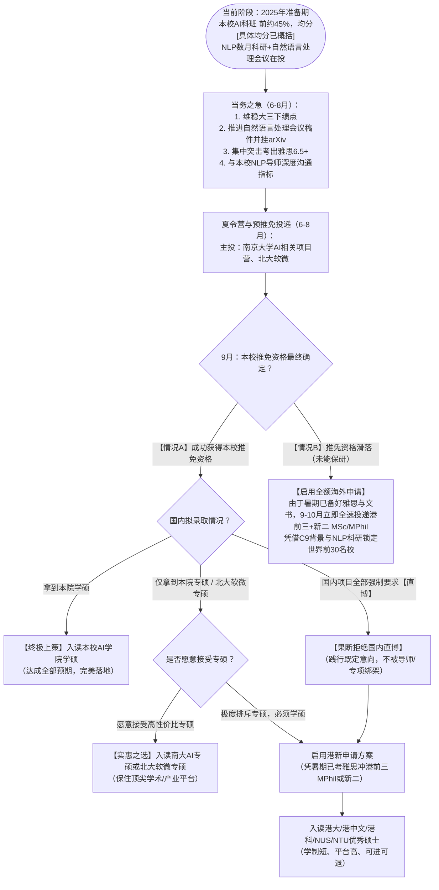

# 华东地区一所985高校（华东五校之一）的人工智能专业升学与保研定位咨询答卷

---

## 目录
1. [背景综合评估与推免资格风险研判](#一背景综合评估与推免资格风险研判)
   - 1.1 [学业成绩与推免资格概率研判](#11-学业成绩与推免资格概率研判)
   - 1.2 [软性背景三态剖析（已有经历、在审/在投状态、未来计划）](#12-软性背景三态剖析已有经历在审在投状态未来计划)
2. [待比较项目深度剖析与适配性评估](#二待比较项目深度剖析与适配性评估)
   - 2.1 [华东地区一所985高校（华东五校之一）本科学院（本院）](#21-华东地区一所985高校（华东五校之一）本科学院本院)
   - 2.2 [南京大学计算机相关项目（计算机系等）](#22-南京大学计算机相关项目计算机系等)
   - 2.3 [北京大学软件与微电子学院（北大软微）](#23-北京大学软件与微电子学院北大软微)
   - 2.4 [清华大学自动化/电子相关工程硕博（工硕/工博）](#24-清华大学自动化电子相关工程硕博工硕工博)
   - 2.5 [南京大学工程管理学院金融项目（金融专硕）](#25-南京大学工程管理学院金融项目金融专硕)
   - 2.6 [待选项目横向综合对比矩阵](#26-待选项目横向综合对比矩阵)
3. [港新（香港/新加坡）申请定位与战略协同分析](#三港新香港新加坡申请定位与战略协同分析)
   - 3.1 [港新研究生体制辨析：MPhil vs MSc](#31-港新研究生体制辨析mphil-vs-msc)
   - 3.2 [申请竞争力与核心短板剖析](#32-申请竞争力与核心短板剖析)
   - 3.3 [与9月保研的时间线冲突与“双轨并行”策略](#33-与9月保研的时间线冲突与双轨并行策略)
4. [最终适配度排序与决策树推荐](#四最终适配度排序与决策树推荐)
   - 4.1 [项目适配度梯度排序](#41-项目适配度梯度排序)
   - 4.2 [全流程动态决策树（Decision Tree）](#42-全流程动态决策树decision-tree)
5. [2025申请准备阶段关键行动指南](#五2025申请准备阶段关键行动指南)

---

## 一、背景综合评估与推免资格风险研判

### 1.1 学业成绩与推免资格概率研判

- **硬性数据**：
  - 本科高校：华东地区一所985高校（华东五校之一）（985 / C9 / 华东五校）
  - 本科专业：人工智能（科班出身）
  - 成绩表现：专业排名 前约45%（前 约45%），加权均分约 [具体均分已概括]
  - 上届参考：上届推免人数（具体人数已概括）（该届总人数未知）

- **推免资格风险评估**：
  > [!WARNING]
  > **核心预警**：学生当前排名处于**推免资格的“中后段边缘区间”**，绝不能盲目乐观，必须保持高度的危机意识。
  
  1. **名额裕度较薄**：虽然 原专业名次于 [往届推免名额传闻]以内，但在本届总人数（已概括）的体量下，具体名次（已概括）已接近前约45%。如果本届普通推免指标缩减（例如受全校指标重新分配影响）至 45~48 人左右，或推免比例下调，位次将直接滑入危险边缘。
  2. **专项挤占风险**：保研名额通常包含“普通推免”与“专项推免”（如研究生支教团、思想政治辅导员专项、高水平学科竞赛破格、本硕博贯通拔尖计划等）。若上届的“[往届推免名额传闻]”为包含各类专项在内的总推免人数，则纯按成绩排名的普通保研名额可能仅在 40~45 人左右，此时 前约45% 极可能卡在推免淘汰边缘。
  3. **大三下学期绩点波动**：保研最终排名的计算截点为前六个学期（即大三下学期结束后）。大三下仍有高学分核心专业课，若出现松懈导致单科失误，位次下滑 3~5 名就可能彻底丧失推免资格；反之，若大三下全力提分，位次上升至前 35 名左右，保研资格才会真正稳固。
  4. **结论与定位原则**：**推免资格尚在争取中，具备获得资格的可能，但存在明确的滑落风险**。本阶段所有选校方案必须做好“成功获推免”与“未能获推免（转战港新）”的两手准备。

---

### 1.2 软性背景三态剖析（已有经历、在审/在投状态、未来计划）

为确保升学定位的客观真实与精准匹配，根据当前阶段（2025年准备期）的信息，严格区隔背景经历的三种状态：

#### 1. 【已有经历】（已完成且确定的客观事实）
- **教育背景**：华东地区一所985高校（华东五校之一）的人工智能专业。C9/华五顶级生源背景，在全国各高校夏令营初审中具有极高的基础品牌认可度。
- **科研经历**：已在校内自然语言处理研究团队科研实习数月。熟悉 NLP 领域基础模型架构、实验流程与论文代码复现，完成了学术规范与科研基本功的初步训练。
- **英语水平**：四级成绩（已概括），CET-6 500–549 分。六级超过 500–549 分，已满足国内绝大多数顶级高校保研夏令营报名的硬性语言门槛（国内高校通常卡 425、460 或 480 分）。
- **实习经历**：暂无正式企业实习经历。

#### 2. 【在审/在投状态】（正在进行中、结果未定的学术与竞赛事项）
- **论文状态**：已有一篇 NLP 方向学术论文即将完稿，目前导师正在指导修改，**准备投稿 自然语言处理会议**。
  - *客观定性*：该论文**尚未录用、亦未正式发表**。在夏令营初审机筛与网申打分中，不能作为“正式录用顶会”折算硬性加分；但在入营后的专业面试中，可作为展现科研能力深度、学术训练完整度的核心材料。
- **科研进展**：第二段科研正在推进中，尚处于实验探索与积累阶段。
- **竞赛状态**：已参加 2025 年美国大学生数学建模竞赛（MCM/ICM），目前**结果待出**（尚未公布获奖等级，暂不可计入保研加分）。
- **英语考试**：此次定位评估时**无雅思（IELTS）或托福（TOEFL）成绩**。

#### 3. 【未来计划】（下一步推进的行动目标）
- **学业行动**：全力完成大三下学期各门专业课期末考核，严守前六学期综合 GPA，确保守住并提升专业排名至推免线绝对安全区。
- **科研行动**：积极配合导师节奏，争取在 2025 年夏令营/预推免全面开启前完成 自然语言处理会议 投稿流程；即使未出录用结果，计划将成稿整理为清晰规范的工作论文（Working Paper / arXiv 预印本），并在个人学术主页与夏令营申请文书中进行重点陈述。
- **语言行动**：针对港新留学申请计划，在 2025 年暑期（6~8月）集中备考并取得符合要求的雅思或托福成绩，消除境外申请的核心卡点。
- **保研沟通**：主动与当前 自然语言处理 实验室导师进行保研意向沟通，探寻课题组推免名额属性（学硕/专硕/直博指标情况）。

---

## 二、待比较项目深度剖析与适配性评估

针对学生“**我想读人工智能或计算机方向的学硕**”、“**学硕优先**”、“**排斥直博（国内需直博则转向港新）**”的核心诉求，对待选的 5 个项目进行逐项深度剖析。

---

### 2.1 华东地区一所985高校（华东五校之一）本科学院（本院）

- **项目类型**：南京大学人工智能学院（计算机科学与技术 / 人工智能学术型硕士、电子信息专业型硕士、直博生）。
- **学科与方向契合度**：**极高（100% 契合）**。人工智能纯正科班，完全覆盖 NLP、机器学习、模式识别等学生熟悉的学术研究方向。
- **学硕性质与录取可行性剖析**：
  1. *学硕名额极度稀缺*：南大 AI 学院学硕指标全院非常有限，大牛导师的学硕名额往往优先倾斜给专业排名前 10%~20% 的尖子生，或直接配置为直博名额。
  2. *位次博弈劣势*：学生当前专业排名 前约45%，在推免生序列中位于后 1/3 区间。在本院推免生内部按综合顺位挑选录取类型时，**直接拿到“学硕”的难度极大**。
  3. *专硕可争取，直博存在压力*：以 原专业名次的排位，若想留在本院，大概率会被分流至“电子信息专硕”；或者导师可能提出以“直博生”身份接收。
  4. *师承优势*：学生已在 自然语言处理 实验室实习数月，若现任导师在院内掌握名额且高度认可学生的科研表现，存在导师动用自身指标破格接收的可能。但需明确：导师手里是否有学硕指标。
- **适配度结论**：
  > [!NOTE]
  > **核心矛盾**：方向完全契合，留在本校科研连续性最好；但学生**“学硕优先”的诉求与当前排名在院内的学硕竞争难度存在严重冲突**。若必须死磕学硕，本院落选风险高；若愿意接受“本院专硕”，则是可行性与综合收益极高的核心归宿。

---

### 2.2 南京大学计算机相关项目（计算机系等）

- **项目类型**：南京大学计算机科学与技术系（学硕、专硕、直博）。
- **学科与方向契合度**：**极高（100% 契合）**。国内顶尖 A+ 计算机学科，NLP 所在的自然语言处理与软件新技术国家重点实验室实力雄厚。
- **学硕性质与录取可行性剖析**：
  1. *学硕竞争白热化*：本校 CS 学硕是全国计算机推免竞争最激烈的项目之一。计算机系本系优秀生源（前 20%~30%）对学硕名额有极高优先权，外院跨申名额凤毛麟角。
  2. *跨院考核硬核门槛*：AI 学院学生跨报计算机系，需走外院/外校考核流程。计算机系推免极其注重机试（CSP 认证或南大自命题机试）与专业课基础，初审对排名卡得很严（外校/外院通常要求前 10%~15%）。
  3. *排位劣势显著*：前约45% 的排名在计算机系夏令营初审中大概率无法入围，即便入营，争夺学硕也将面对全校乃至全国顶尖高手的挤压，几乎无胜算。
- **适配度结论**：
  > [!CAUTION]
  > **严重不适配**。学生想读“计算机学硕”的意愿非常美好，但 前约45% 的排位在南大计算机系学硕考核中处于绝对劣势，不具备实际操作空间，切忌盲目主报而浪费志愿。

---

### 2.3 北京大学软件与微电子学院（北大软微）

- **项目类型**：北京大学软件与微电子学院（位于北京大兴，设有人工智能、软件工程等专业方向）。
- **学科与方向契合度**：**高（85% 契合）**。院内建有人工智能系、软件工程系等，研究方向涵盖深度学习与 NLP。
- **学硕性质与录取可行性剖析（关键定性！）**：
  1. *【核心事实】北大软微无学硕*：**北大软微全部招收全日制“专业型硕士”（电子信息专硕，专业代码 0854），不设立学术型硕士（学硕）招生！** 这一点与学生“学硕优先”的初始目标存在**根本性的制度冲突**。
  2. *院校平台顶格*：虽然是专硕，但毕业证书与学位证书为标准的“北京大学硕士研究生”，顶级名校声誉对未来就业（尤其是体制内选调、外企核心、互联网大厂算法岗）赋能极强。
  3. *录取难度与生源喜好*：北大软微招生规模较大，且在夏令营和预推免中**对 C9 / 华东五校科班生源有极强的认可度与政策优待**。学生本校 AI 科班背景、六级过线、拥有数月 NLP 科研训练，在软微的考核（面试考查专业基础与代码综合素质）中非常吃香，**入营与最终拟录取的概率较高**。
- **适配度结论**：
  > [!IMPORTANT]
  > **重大战略抉择点**：该项目**完全不能满足“学硕”属性**。但如果学生愿意做出战略妥协——以“专硕”换取“北京大学顶级名校光环”，北大软微是所有待选项目中冲刺清北名校**可行性最高、回报最稳妥的选择**。若学生坚决只要学硕，该项目必须直接排除。

---

### 2.4 清华大学自动化/电子相关工程硕博（工硕/工博）

- **项目类型**：清华大学自动化系/电子工程系国家卓越工程师学院专项（工程硕博培养改革专项）。
- **学科与方向契合度**：**中等偏低（50%~60% 契合）**。虽然自动化/电子系有人工智能方向，但工程硕博专项紧密绑定国家重大工程任务，研究课题多为工程落地、系统集成与硬科技攻关，与纯学术性、顶会导向的 NLP 前沿基础算法研究存在明显差异。
- **学硕性质与录取可行性剖析（致命冲突！）**：
  1. *【核心事实】工程专业学位，绝非学硕*：工程硕博改革专项全部为**专业型硕士（工程专硕）或专业型博士（工程专博）**，根本不是传统意义上的学术型硕士。
  2. *【致命冲突】指标多为直博，直接触碰底线*：清华自动化系、电子系的工程硕博专项中，**绝大多数推免名额为“直博生（工程硕博直博）”**，工程硕士名额极其有限。学生明确表示“如果国内方案需要直博，则倾向考虑港新”，该项目会直接将学生推向“被调剂直博”的尴尬境地。
  3. *培养模式差异*：该专项要求实行校企“双导师制”，学生有 1~2 年需进驻联合培养企业（如中国电科、航天科技等企事业单位）进行现场工程研发，毕业要求偏向工程报告与专利技术，非纯学术论文体系。
  4. *初审门槛极高*：清华自动化与电子系夏令营对本科排名卡位极其严苛，华五生源通常要求前 10%~20%，前约45% 在初审材料筛选阶段基本无法通过。
- **适配度结论**：
  > [!CAUTION]
  > **极度不适配，坚决不推荐**。既无学硕名额，又大概率强制绑定直博（违背个人意愿），且培养模式偏离 NLP 学术科研轨迹，初审入围概率极低。

---

### 2.5 南京大学工程管理学院金融项目（金融专硕）

- **项目类型**：南京大学工程管理学院金融专业硕士（MF，专业代码 025100）。
- **学科与方向契合度**：**严重背离（0% 契合）**。属于经济学/金融学学科门类，虽然课程涉及量化投资与金融工程，但根本不是人工智能或计算机科学。
- **学硕性质与录取可行性剖析（双重冲突！）**：
  1. *【方向彻底脱离】*：学生明确声明“我想读人工智能或计算机方向”，工管金融是彻底的跨门类转行，放弃了本科学积攒的人工智能专业底蕴与数月的 NLP 科研成果，沉没成本极其巨大。
  2. *【学位属性不符】*：该项目为标准的应用型金融专硕（MF），培养年限通常为 2 年，完全不属于学术型硕士（学硕）。
  3. *录取难度*：本校本校跨保金融专硕虽然有一定校内协同渠道，但金融专硕当前就业市场竞争白热化，且学生无经管辅修、无券商基金核心量化实习，纯靠工科背景跨入并不占绝对优势。
- **适配度结论**：
  > [!CAUTION]
  > **坚决排除**。与“计算机/AI 方向”和“学硕优先”两大核心原则完全相左，纯属方向漂移，毫无报考价值。

---

### 2.6 待选项目横向综合对比矩阵

| 待选项目 | 培养学位类型 | 专业方向契合度 | “学硕优先”契合度 | 初审/录取可行性 | 核心矛盾与风险点 | 综合适配度等级 |
| :--- | :--- | :---: | :---: | :---: | :--- | :---: |
| **南大人工智能学院** | 学硕 / 专硕 / 直博 | **极高 (100%)** | **中低 (受限)** | **中等 (专硕希望大)** | 学硕指标极稀缺，原专业名次排名在院内争学硕几率低；专硕机会大 | **★★★★☆ (主推该院专硕)** |
| **本校计算机系** | 学硕 / 专硕 / 直博 | **极高 (100%)** | **极低 (排位落后)** | **极低 (<10%)** | 跨系门槛极高，机试硬核，学硕为本系顶尖生源包揽，初审极难通过 | **★☆☆☆☆ (不建议报考)** |
| **北大软件与微电子学院** | **仅专硕 (0854)** | **高 (85%)** | **完全不符合 (无学硕)** | **较高 (60%~75%)** | 无学硕属性；但 C9 科班认可度高，是换取北大平台的最优专硕选择 | **★★★☆☆ (若妥协专硕可冲)** |
| **清华自动化/电子工程硕博** | **工程专硕 / 工程专博** | **中 (50%~60%)** | **完全不符合 (无学硕)** | **极低 (<15%)** | 无学硕，且名额大量为“直博”，直接触碰排斥直博底线；校企联培偏工程 | **☆☆☆☆☆ (坚决回避)** |
| **南大工管学院金融项目** | **金融专硕 (MF)** | **背离 (0%)** | **完全不符合 (无学硕)** | **中等** | 跨学科转金融，完全背离 AI/CS 方向，沉没成本极大，专业完全脱节 | **☆☆☆☆☆ (坚决排除)** |

---

## 三、港新（香港/新加坡）申请定位与战略协同分析

学生已表达“已了解港新申请意愿”、“如果无法保研，或国内方案需要直博，则倾向考虑港新”的明确诉求。港新高校是化解学生“保研边缘风险”与“国内直博挤压”的最强后盾。

---

### 3.1 港新研究生体制辨析：MPhil vs MSc

在香港和新加坡高校的研究生体制中，学位体系分为两类，其培养目标与申请难度截然不同：

1. **MPhil（Master of Philosophy，研究型硕士）—— 对应国内“传统学硕”**：
   - *学制与资助*：通常为 2 年制，享受全额奖学金（如香港 PGS 约 1.8 万港币/月，新加坡约 2800 新币/月），纯科研导向，毕业需完成正式学术大论文。
   - *【现实困境】名额极度稀缺，难度堪比顶尖 PhD*：港前三（HKU、CUHK、HKUST）和新二（NUS、NTU）的计算机/AI 学院，政府与大学的公费全奖指标几乎 90% 以上直接分配给 4 年制 PhD（直博生）。导师招收 MPhil 需要消耗同等的奖学金名额，因而普遍倾向于招收能够长期产出的 PhD，极少招收 MPhil。申请 MPhil 的竞争烈度往往甚至高于 PhD，通常要求申请者手握已发表的顶级会议论文（如已录用 ACL/自然语言处理会议/CVPR）。
   - *定位建议*：以学生目前“前约45% + 自然语言处理会议 在投未录用”的背景，直接申请港新 MPhil 成功率偏低。

2. **MSc（Master of Science，授课型硕士）—— 对应国际通用应用硕士**：
   - *学制与资助*：通常为 1~1.5 年制，自费（学费约 18~30 万人民币，总预算约 35~50 万人民币）。主要以修课为主，但多数项目允许学生自主选择跟随导师完成毕业设计或独立科研课题（Independent Research Project）。
   - *衔接读博与科研*：本校本科生在港新读 MSc 期间，若主动联系教授进入实验室跟组科研，表现优异者可在毕业后直接申请本校或其他世界名校的 PhD，其申博跳板效应显著。

---

### 3.2 申请竞争力与核心短板剖析

- **【生源优势】核心背景处于港新申请的极高优先级（Tier 1）**：
  - *学校背景*：华东地区一所985高校（华东五校之一）（C9 华五）在香港大学（HKU）、香港中文大学（CUHK）、香港科技大学（HKUST）、新加坡国立大学（NUS）、南洋理工大学（NTU）的录取名单中属于最高等级梯队（Priority List）。
  - *专业与均分*：纯正的人工智能科班，均分 [具体均分已概括]（对应 GPA 约 [具体GPA已概括]）。在港前三和新二的 MSc Computing / AI / Data Science 项目中，完全达到并略超录取基准线（通常对华五要求均分 80~82 分以上即可过初筛）。
  - *科研加成*：数月 自然语言处理科研经历及 自然语言处理会议 投稿经历，在授课型硕士网申中属于降维打击的强力加分项。
  - *录取预期*：港前三（HKU/CUHK/HKUST）的 MSc 计算机与人工智能相关项目**录取概率非常高（可达 80% 以上）**；新二（NUS/NTU）的 MSc 项目属于**极具竞争力的强力冲刺与稳妥区间**。

- **【致命卡点】缺乏语言成绩（无雅思/托福）**：
  > [!WARNING]
  > **核心瓶颈**：港新申请属于**硬性语言门槛制**。
  > - CET-4 [英语背景已概括]、CET-6 500–549 在国内好用，但在境外申请中绝大多数项目不予认可（港中文极个别冷门文商科个别年份认六级，但计算机/AI 主流项目全部强制要求雅思或托福；新二 NUS/NTU 更是绝对不认六级，部分项目还建议提供 GRE）。
  > - 申请港前三通常需要雅思 6.5（小分不低于 6.0）或托福 85~90+；新二建议雅思 7.0 或托福 95+。
  > - 若此时没有语言成绩，港新申请系统即便开放也无法提交完整审核。

---

### 3.3 与9月保研的时间线冲突与“双轨并行”策略

- **时间线潜在冲突**：
  - 港新申请（2026年秋季入学批次）普遍在 **2025 年 9 月至 11 月**全面开放第一轮（Round 1）。港新高校采取 **Rolling Basis（先到先审、先到先得、录满即止）** 机制。
  - 如果学生抱持“完全等 9 月底国内保研结果彻底尘埃落定后，再决定要不要考雅思准备港新”的心态，将产生灾难性后果：9 月底若遭遇保研资格滑落或国内只能调剂直博，此时再备战雅思，最快也要 11~12 月出分，将彻底错过港新黄金第一轮申请，导致被动轮候至第二轮/候补轮，录取概率骤降。

- **战略应对：务必执行“双轨并行”**：
  - **在 2025 年暑期（6 月至 8 月）前必须考出合格雅思/托福（目标：雅思 6.5~7.0 分）**。
  - 只要手握合格的语言成绩与文书底稿，学生在 9 月保研推免系统开放时将拥有绝对的主动权：
    - *若国内保上该目标学院满意的硕士*：直接放弃港新申请，损失仅为一次雅思考试费与少量准备时间，稳赚不赔；
    - *若国内保研名额滑落，或国内导师强行要求直博*：无需慌乱，9 月第一时间无缝直投港前三与新二第一轮，凭借本校 C9 招牌稳拿海外名校 Offer，实现高质量兜底与跃迁。

---

## 四、最终适配度排序与决策树推荐

### 4.1 项目适配度梯度排序

综合考虑学生“**人工智能/计算机方向**”、“**学硕优先**”、“**排斥国内直博**”、“**保研资格边缘危险**”以及“**各项目实际录取规则**”，得出最终梯队排序：

```
【第一梯队：核心最优解与本校落脚点】
  ├── 华东地区一所985高校（华东五校之一）本科学院（本院）—— 优先力争学硕；若学硕不可得，理性接纳专硕；绑定当前 NLP 导师
  └── 港新优质硕士（港前三/新二 MSc；若有匹配导师可兼申 MPhil）—— 破除直博绑架与防范保研滑落的最强后盾

【第二梯队：平台降维置换的优质备选】
  └── 北京大学软件与微电子学院 —— 仅在学生同意“以专硕换取北京大学顶格名校平台”的前提下作为首选冲刺

【第三梯队：坚决回避与严重不匹配】
  ├── 清华大学自动化/电子工程硕博 —— 坚决回避（无学硕、偏工程联培、大概率绑定直博触碰底线、初审门槛高）
  ├── 南京大学计算机系学硕 —— 放弃报考（跨系竞争残酷，排位劣势过大，学硕几乎无入营可能）
  └── 南京大学工管学院金融项目 —— 坚决排除（方向完全背离 AI/CS，专硕且学科断层，沉没成本巨大）
```

---

### 4.2 全流程动态决策树（Decision Tree）



---

## 五、2025申请准备阶段关键行动指南

为了将定位方案切实转化为最终的升学胜果，建议在接下来的时间节点内分步推进以下具体行动：

### 阶段一：当前至 2025 年 6 月（学业维稳、论文收官、名额摸底）
1. **成绩与排名攻坚**：
   - 全力以赴应对大三下各门核心课程期末考试，杜绝任何一门功课出现 70 分段的“拖后腿”现象，力争把专业排名前移至 38 名以内，直接消灭推免资格滑落的隐患。
2. **论文成果固化**：
   - 紧密配合导师修改在投 自然语言处理会议 的论文。无论夏令营前能否收到录用通知，在导师同意的前提下，**务必将完稿上传至 arXiv 作为预印本**，生成正式的论文链接与摘要。在夏令营简历、个人学术主页中作为重点科研经历展示。
3. **本校导师意向探底（最关键一步）**：
   - 主动找目前带教的 自然语言处理 实验室导师进行一次正式面谈。
   - 委婉而诚恳地表达留组意愿，同时明确探询：“*老师今年您课题组预计有几个硕士指标？是否有学硕指标，还是主要是专硕或直博？以我目前专业排名前约45%的情况，留在组里读硕士的机会有多大？*”
   - 此举能够彻底摸清导师的底牌。若导师承诺给专硕或学硕，本校基本盘即可锁定；若导师明确表示“组里只有直博名额，不招硕士”，则必须立刻将重心转向外推与港新申请，避免后期被动。

### 阶段二：2025 年 6 月至 8 月（语言速成、夏令营出击）
1. **集中突破语言考试（绝不可拖延）**：
   - 制定 1~2 个月的雅思/托福封闭备考计划，在 7 月底前至少参加一次正式考试，力争达到 **雅思 6.5（单项 6.0）或托福 90** 的基准线。这是解锁港新名校大门的钥匙。
2. **夏令营精准投递策略**：
   - **必投主力**：华东地区一所985高校（华东五校之一）本科学院（本院营，争取直接拿到优秀营员或候补优营）。
   - **名校专硕冲刺**：北京大学软件与微电子学院（充分利用 C9 背景红利，争取拿到专硕保底 Offer）。
   - **精简投递**：放弃清华工程硕博和南大工管金融，避免无效精力耗费；若南大计算机系初审入围，可抱学习心态参营，但不作核心押注。

### 阶段三：2025 年 9 月（推免决战与港新网申无缝联动）
1. **保研推免系统最终决断**：
   - 9 月中旬学校推免名单公布：
     - 若顺利取得推免资格：结合手头夏令营考核结果，如果能拿到本院学硕则直接签约；若仅有本院专硕或北大软微专硕，根据个人对“专硕 vs 港新”的心态进行最终决断；**坚决不签任何违背意愿的直博协议**。
2. **港新申请全面触发**：
   - 若保研出现意外滑落，或国内只给直博选项，9 月底系统开放第一时间提交港大（HKU）、港科大（HKUST）、港中文（CUHK）及新二（NUS、NTU）的第一轮申请，稳妥收获境外顶尖名校录取。
