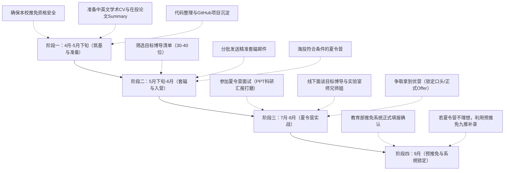

# 郑州大学生物信息学推免申请综合评估与规划方案

> **学生基本背景画像**：
> - **本科院校及专业**：郑州大学（双一流 / 211）生物信息学
> - **学业排名**：[个人排名已概括]（[个人排名已概括]，位列专业[个人排名已概括] 临界线）
> - **英语成绩**：大学英语六级 425–449 分（刚过 425 分合格线）
> - **科研经历**：一篇生信方向 SCI一作在投（Under Review / 未录用）；具备湿实验操作经历；主持/参与校级大创
> - **申请诉求**：未来继续深造生信干实验，尤其看重导师，优先考虑高水平学校的直博（Direct PhD）

---

## 一、 核心结论与申请定性

你的综合背景呈现出**“专业能力强项突出、硬性筛选题板明显”**的鲜明特征：

1. **核心优势**：
   - 郑州大学作为顶尖 211 / 双一流建设高校，生信专业在国内具有良好的学科认可度；
   - 本科期间能够作为**第一作者**完整跑通一篇 SCI 论文的选题、数据清洗分析、代码实现及英文写作全流程，并且具备**“干湿结合”**（湿实验 + 大创 + 生信干实验）的复合科研经历，这在申请高水平院校直博时是导师非常看重的硬实力。
2. **核心短板**：
   - **六级 425–449 分**处于及格线边缘，在高校材料初审机筛与综合测评中处于劣势；
   - **SCI 一作在投**在绝大多数高校官方打分体系中“不计正式成果分”，无法直接弥补六级与排名的分数差距。
3. **定位总体策略**：
   - 针对你的“直博”诉求与“看重导师”的倾向，你**绝不能走常规的“海投机筛拼背景分”路线**，而必须走**“以学术产出为筹码、精准套磁为主导的导师驱动路线（导师强推/内推入营）”**。
   - 只要导师认可你的干实验实操能力并愿意给出博士指标，六级 425–449 分与在投论文的负面影响将在很大程度上被对冲，冲刺 Top 985 及顶尖中科院院所直博完全具备可行性。

---

## 二、 英语六级 425–449 分的具体影响分析与化解方案

大学英语六级成绩在保研中通常承担两个角色：**初审资格门槛（硬门槛）**与**综合素质评价依据（软指标）**。425–449 分对你的影响可细分为以下四个层面：

### 1. 初审资格门槛影响（过线 vs. 筛除）
- **绝大部分院校（安全）**：国内 80% 以上的高水平大学（包括多数 985 高校与中科院院所）对六级的报名资格门槛设定为 **425 分**。你的成绩为 425–449 分，已经跨过了这一硬性及格线，**在绝大多数院校中不会因为“未过六级”而被系统直接一票否决**。
- **高门槛院系（受限）**：部分顶尖高校的热门交叉学院、计算机学院、生命科学学院或医学院在夏令营报名条件中设置了更高的硬性标准（如六级要求 $\ge 450$、$\ge 460$ 或 $\ge 480$，个别甚至要求 $\ge 500$）。例如北京大学某些生命科学联合项目、清华大学某些院系、复旦大学部分生科/医学生信项目等。对于明确标注高门槛的项目，425–449 分在系统机筛阶段会直接被系统拦截。

### 2. 材料评审与机筛排名的折损效应
- 夏令营和预推免初审入营名额通常竞争激烈。在材料机筛或专家初审量化评分表中，“英语水平”往往单独占 5%～15% 的权重（分档赋分，如：600+ 为满分，500+ 为高分，425～450 为及格分或基础分）。
- 425–449 分处于最低赋分档，在没有顶级竞赛（如国际生信竞赛金奖）或已见刊顶会/高分文章直接加持的情况下，总评分容易被其他六级 500+、550+ 的 985/211 竞争对手拉开差距，从而**增加在夏令营初筛阶段卡在边缘被淘汰的风险**。

### 3. 面试考核阶段的考官心理与针对性考查
- **生物信息学干实验高度依赖英语能力**：日常科研需要频繁查阅英文最新前沿文献、研读 GitHub/Bioconductor 英文官方文档、使用全英文统计分析包与命令行工具、撰写全英文 SCI 论文。
- 导师和面试评委在看到 425–449 分时，容易对你的“英文文献阅读速度”和“独立撰写学术论文能力”产生顾虑。因此，在面试的专业英语环节（如英文文献朗读并即兴翻译、英文专业问题问答、全英文自我介绍及学术问答），考官很可能会对你进行**重点测试与深度考察**。

### 4. 直博培养维度的影响
- 直博培养周期为 5～6 年，毕业硬性指标通常包含多篇高水平 SCI 论文发表。部分高校研究生院对博士毕业或学位授予有英语免修要求（例如六级需达到 480 或 500 以上免修公共英语，否则需要修读博士公共英语课程）。这属于入读后的学业要求，**只要通过学院复试录取，学院通常不会因 425–449 分拒发直博 Offer**。

### 【六级劣势的应对与化解对策】
1. **用科研成果打破“英语差”的刻板印象**：
   - 在个人陈述和简历中，突出“能够全英文撰写 SCI 论文初稿，熟练阅读生物信息学前沿英文文献与开发文档”。
   - 强调在投 SCI 论文为**全英文独立撰写**，这本身就是最直接有力的实际英语应用能力证明。
2. **提前打磨英文面试基本功**：
   - 准备一段 2～3 分钟具有学术深度的英文自我介绍（切忌泛泛而谈爱好，重点讲述生信技术栈、课题背景与直博规划）；
   - 针对你的在投论文，提炼出中英文版本的 Abstract、核心算法逻辑、生物学结论，熟练背诵相关专业词汇（如 differential expression, batch effect correction, survival analysis, single-cell clustering, biomarker 等）；
   - 准备 1～2 篇本领域顶刊（如 *Bioinformatics*, *Briefings in Bioinformatics*, *Nucleic Acids Research*）的精读汇报，确保面试文献抽测翻译时流畅自如。
3. **若有时间窗口，可考虑刷新成绩**：
   - 如果未来仍有六级考试机会（如大三下学期 6 月），务必全力再考一次，争取刷新到 450–499～500+，后续可在预推免（9 月）更新简历。

---

## 三、 SCI一作“在投未录用”的具体影响与双刃剑效应

对于本科生而言，“生信[具体论文分区已概括]一作在投”是一把极具特色的**双刃剑**。它在不同的选拔环节具有截然不同的权重和效应：

### 1. 官方材料初审与加分层面：无法计入正式成果（零硬性加分）
- **官方规则严格限制**：所有高校夏令营及推免招生简章中均有明确规定——科研成果必须提供**“录用证明（Acceptance Letter）”**或**“DOI 检索号/在线发表链接（Online/Published）”**，处于“投稿（Submitted）”、“同行评议中（Under Review）”或“修改（Revision）”状态的一律**不计入正式科研加分**。
- **严守学术诚信底线**：在填报各高校官方报名系统时，**严禁**将在投文章勾选为“已录用”或“已发表”。材料中必须规范标注状态为 `Under Review`，并如实注明期刊名称、稿件编号（Manuscript ID）以及作者顺位（First Author）。一旦发现虚假标注，将被直接判定为材料作假取消资格。

### 2. 导师联系（套磁）层面：极其珍贵的核心“敲门砖”
- **直博导师的真实用人需求**：
  - 生信干实验导师招收直博生最核心的痛点是：**担心学生没有编程与数据处理能力，进组后需要从 Linux 基础、R/Python 语法、基本生信分析流程手把手教起**。
  - 本科生能独立完成一篇 SCI文章，证明你已经具备了：
    1. **完整的研究闭环能力**：从公共数据库（TCGA, GEO, ICGC, 10x Genomics, UK Biobank 等）的数据获取、质量控制、清洗、归一化与批次消除；
    2. **核心编程与算法分析能力**：熟悉 R / Python / Shell，能跑通差异分析、富集分析、机器学习建模、生存分析或单细胞标准流程；
    3. **科研作图与学术写作能力**：掌握 ggplot2、ComplexHeatmap 等生信可视化工具，且具备将生物学发现整理为严谨英文论文的基本功。
- **导师对“[具体论文分区已概括]在投”的态度**：
  - 导师深知本科生能在毕业前搞出一篇完整投稿的论文非常不易。哪怕文章目前仍在审稿，甚至分区只是中科院[具体论文分区已概括]，在导师眼里，**你的上手可用程度（“即战力”）远超那些只有高绩点但一行代码不会写的纯课本型学霸**。
  - 在邮件套磁时附上论文 Abstract、核心图表（Figure Summary）以及你个人的 GitHub/Gitee 代码仓库，导师的回复率和面试邀请率会呈指数级上升。

### 3. 面试答辩考核层面：强力展示工具 vs. 专家深度质询（技术与机制双重审视）
- **正面效应**：在夏令营或直博面试的 5～10 分钟科研 PPT 汇报中，你可以以这篇在投文章为核心，完整展现你的科研逻辑体系。相比大多数同学只能汇报“参与的实验打杂”或“空泛的文献综述”，你的汇报结构清晰、有图有数据、有自己的深度思考，很容易获得高面试分。
- **潜在风险与被挑刺的雷区**：
  - **警惕“生信套路水文”质疑**：当前很多生信[具体论文分区已概括]文章属于纯公共数据挖掘的“套路分析”（如纯 TCGA 差异分析 + WGCNA + LASSO 预后模型构建 + 免疫浸润打分），国内高水平 985 高校（尤其是头部顶尖组）的专家对纯套路、无实验验证、无机制深挖的生信文往往持审慎甚至苛刻态度。
  - **面试考官高频拷问点**：
    1. *“这篇论文的数据和代码完全是你自己独立跑出来的吗？还是导师/师兄师姐给的分析流程？”*
    2. *“为什么选择这个特征筛选算法？模型是否存在严重的过拟合现象？独立验证集验证效果如何？”*
    3. *“做出的关键生物标志物（Biomarker）或通路，有没有做过湿实验验证（如 qPCR, WB, 细胞实验）？机制是什么？”*
    4. *“既然你做过湿实验，为什么这篇文章没有加入湿实验验证结果？”*
  - 如果被专家问及核心代码参数、统计学检验假设（如 FDR 校正、多重假设检验原理）时回答卡壳，容易被专家怀疑文章是由他人代笔或套用商业分析公司流程，造成严重扣分。

### 【在投论文的最大化利用与动态应对方案】
1. **规范呈现学术成果**：
   - 简历写作规范范例：
     > *[在投论文]* **张三(一作)**, 李四, 王五(通讯). *Identification of Novel Biomarkers in [Disease] using Single-cell and Bulk RNA-seq Analysis*. 投稿期刊：*[Journal Name]* (SCI ), 状态：Under Review (Manuscript ID: XXXX-XXXX).
2. **动态跟踪论文进度（时间节点策略）**：
   - **若在夏令营前/预推免前录用（Accept）**：立即第一时间向目标院校招生秘书和已联系的意向导师更新简历与录用通知。一旦录用，成果直接从“在投证明”跃升为“正式硬指标”，竞争位次将产生质的飞跃；
   - **若遇到大修（Major Revision）**：说明文章质量获得期刊编辑和审稿人高度认可，录用概率极大。在与导师交流时，可作为利好消息主动提及审稿人的正面反馈；
   - **若被拒稿（Reject）**：切勿灰心，不要在简历中删去该经历，可将其调整为“Working Paper / Manuscript under revision”，重点强调所掌握的技术栈和数据分析过程。
3. **强化干湿结合的思考**：
   - 结合你的湿实验经历，在科研陈述中强调：*“虽然本研究目前为干实验在投，但我具备湿实验操作技能，未来规划正是希望结合课题组的湿实验平台，对生信挖掘出的靶点开展分子生物学机制验证。”* 这将精准契合现代顶级生信课题组对“系统生物学 / 干湿互证”人才的迫切需求。

---

## 四、 综合背景全景剖析与推免资格风险预警

| 维度 | 学生现状 | 竞争实力评估 | 关键提示与潜在风险 |
| :--- | :--- | :--- | :--- |
| **本科出身** | 郑州大学（双一流 / 211） | **良好**。学科声誉稳定，在大部分 985 及中科院系统被广泛认可。 | 面对 C9 顶尖高校时，背景分略低于 985 本科生，需依靠学术产出弥补。 |
| **专业排名** | [个人排名已概括]（[个人排名已概括]） | **中上**。符合绝大多数高校推免申请基本条件（通常要求前 15% 或 20%）。 | **【最高优先级风险】必须死守本校推免资格！** 若学院推免比例为 10%，[精确名次已概括]刚好卡在线上，务必注意综合素质加分与最终排名。 |
| **英语六级** | 425–449 分 | **劣势**。刚过 425 及格线。 | 无法报考对六级有高门槛（$\ge 450/480$）的项目；机筛综合打分被拉低。 |
| **科研产出** | SCI一作在投 | **突出（导师视角）/ 一般（系统机筛）**。 | 系统机筛无加分；但导师套磁极为加分，证明具备独立闭环科研与全英文写作能力。 |
| **综合素养** | 湿实验基础 + 校级大创 | **优秀复合型**。 | 干湿结合是现代生信导师非常青睐的背景，大创经历证明具备项目组织与探索能力。 |

> [!WARNING]
> **生死线警示：请务必核实并确保郑州大学本校的“推免资格（保研名额）”！**
> 很多同学将全部精力放在向外冲刺夏令营上，却忽视了本校的推免名额排位。
> - 郑州大学生命科学/生物信息相关专业每年的常规保研率一般在 **10%～12%** 上下。
> - 在 [专业人数已概括]的基数下，[个人排名已概括] 刚好处于能否拿到保研指标的**临界线边缘**（[个人排名已概括] 对应约 6～7 个名额）。
> - 务必立刻向上一届学长学姐或辅导员核实：你们专业往年实际下达的保研名额是多少？是否存在推免加分（科研论文、大创、竞赛、学生干部等）的综合测评排位调整机制？
> - 必须确保自己的综合加分能够稳稳锁定在推免名额之内。没有母校的推免指标，外部拿到的所有直博 Offer 都将归零！

---

## 五、 “看重导师”与“高水平学校直博”的专项实战策略

既然你**极其看重导师**且**优先考虑直博**，这一偏好正是你突破“六级不高”与“论文在投”限制的最佳着力点。

### 1. 为什么“直博”是你的最佳破局路径？
1. **招生体制差异**：
   - **硕士（学硕/专硕）**：招生名额归学院统筹，普遍采取“材料机筛定入营 $\rightarrow$ 学院大组统一面试 $\rightarrow$ 按综合成绩从高到低录取 $\rightarrow$ 入学后再双选导师”。这种模式下，六级 425–449 分和在投论文在初筛和算总分时极易吃亏。
   - **直博生（Direct PhD）**：**博士招生是高度“导师负责制”的**。一个博导每年只有 1～2 个宝贵的博士指标，招直博相当于“导师拿出自己未来 5 年的科研经费和指标来赌一个学生”。导师拥有极大的拍板权。
2. **破局机制**：
   - 只要目标导师深度认可你的编程能力、论文手稿和科研态度，认定你进组就能直接干活，导师可以通过**“课题组内推”**、**“向学院争取优质生源指标”**或在面试环节给予**高面试分**，直接帮你跨过六级带来的劣势。

### 2. 生信干实验导师的“四维避坑与优选法则”
读直博选对导师关系到未来 5～6 年的身心健康与学术生涯。挑选导师时切忌只看“顶戴头衔”，重点考察以下四点：

1. **科研方向与技术栈匹配度**：
   - 生信干实验细分方向差异巨大：
     - *算法与工具开发类*：偏数学建模、深度学习架构、底层 C++/Python，对数学和代码要求极高；
     - *多组学数据挖掘与系统生物学类*：偏机制探索，与临床疾病（肿瘤、免疫、神经退行性疾病）结合紧密，需要干湿结合；
     - *前沿单细胞/空间多组学/宏基因组类*：当前科研热点，发高分文章较快，但对计算资源和前沿包的理解要求高。
   - 务必选择与你的在投论文技术栈有重合、且你真正感兴趣的细分领域。
2. **算力资源与数据自主性（极其关键）**：
   - 考察课题组是否拥有**充足的高性能计算集群（Server / GPU 集群）**，是否有专门的生信存储架构；
   - 考察课题组是**纯靠公共数据库（GEO/TCGA）二次挖掘**，还是**有自己的湿实验合作团队/自主建库测序经费**。拥有持续产出自主未发表测序数据的课题组，博士毕业发高分文章的难度远低于纯挖二手数据的课题组。
3. **指导风格与带组模式（学术人品与培养精力）**：
   - *青年优青/杰青（35～45岁）*：学术上升期，拼劲足，亲自指导多，组会频繁，对文章产出要求极高（较 push 但成才快）；
   - *顶极大院士/大领导*：行政事务繁忙，通常由组内小导师（副教授/博士后）实际指导，需打听小导师的水平与人品；
   - **核心避坑指南**：通过小红书、知乎、研友群或直接联系该组已毕业/在读博士师兄师姐，探听实验室氛围、延期毕业率（是否普遍延毕至 6-7 年）、有无卡毕业卡文章现象。
4. **毕业出路与论文要求**：
   - 关注该组近 3 届直博毕业生的去向（去高校任教、做博后、进知名药企/大厂做算法工程师、去生信分析服务公司等），了解实验室是否支持学生按时毕业与实习。

---

## 六、 精准套磁操作全流程指南

提前套磁（5 月初至 6 月初）是直博申请的核心战役。

### 1. 邮件撰写核心结构
- **邮件标题规范**：
  `【直博申请】郑州大学生信专业 [个人排名已概括] 具备干湿实验背景及一作SCI在投-张三`
  *(标题清晰明了，核心卖点一目了然)*
- **正文结构（四段论，控制在 400～600 字内）**：
  1. **基本背景介绍**：郑大生信大三在读，学业表现（具体排名已概括），六级已过，推免资格在握，立志攻读直博；
  2. **学术产出与技术栈匹配**：说明自己精读了导师近期发表的某篇论文（简要阐明启发），引出自己在投的 SCI一作论文（附带核心研究结论与所用技术：R/Python/Linux/单细胞分析等），说明已掌握生信干实验全流程，并具备湿实验操作经历；
  3. **读博意向与规划**：表达对导师研究方向的浓厚兴趣，阐明希望在直博阶段深入开展相关干实验研究的决心；
  4. **恳请交流与附件清单**：询问老师今年是否有直博招生名额，是否方便进行简短的线上交流（Tencent Meeting/Zoom），附上个人简历、在投论文摘要及成绩单。

### 2. 附件清单准备
1. **个人学术简历（CV，1～2 页 PDF）**：突出科研经历、代码能力、技术栈列表（熟练使用语言、包、算法流程）、大创经历；六级成绩写在教育背景处（如：CET-6 425–449），不要单独加粗标红，重点突出科研模块；
2. **在投论文手稿或研究概要（Research Summary，1～2 页 PDF）**：包含 Title, Abstract, Graphical Abstract / Main Figures，以及你的独立贡献说明；
3. **个人代码仓库链接**：在简历中附上 GitHub / Gitee 主页，放置你写过的数据清洗脚本、可视化代码或分析流程，这是展现真实代码能力的“大杀器”。

---

## 七、 分梯队择校建议与定位推荐（生物信息学干实验直博）

结合你的学校层级（211）、排名（[个人排名已概括]）、六级（425–449）及科研实际，建议采取**“强攻导师，梯次布局”**的选校策略：

```
                    ┌──────────────────────────────────────────────┐
                    │ 冲刺梯队 (Top 985 & 顶尖中科院)               │
                    │ 策略: 重点突破导师意愿强烈、六级门槛425的项目 │
                    └──────────────────────┬───────────────────────┘
                                           │
                    ┌──────────────────────▼───────────────────────┐
                    │ 核心主攻梯队 (中上游 985 / 知名国家级研究所) │
                    │ 策略: 性价比最高，直博名额充裕，生信平台顶尖 │
                    └──────────────────────┬───────────────────────┘
                                           │
                    ┌──────────────────────▼───────────────────────┐
                    │ 稳妥/保底梯队 (行业特色高水平 985/211/本校)   │
                    │ 策略: 确保推免 Offer 兜底，绝不滑档           │
                    └──────────────────────────────────────────────┘
```

### 1. 冲刺梯队（顶尖 985 高校 & 顶尖生信科研机构）
- **目标院校/机构**：
  - **中科院北京基因组研究所（国家生物信息中心 BIG）**：中国生物信息学国家队，科研资源、计算集群和国家级平台极为雄厚，更注重学生的实际生信分析与编程能力；
  - **复旦大学**（生命科学学院 / 复杂体系多尺度研究院 / 代谢与整合生物学研究院）；
  - **上海交通大学**（生命科学技术学院 / 医学院生信平台）；
  - **浙江大学**（生命科学学院 / 医学院）；
  - **中国科学技术大学**（生命科学与医学部 / 计算机交叉学科）。
- **申请建议**：
  - 这类院校机筛极为严苛，若直接报名夏令营容易被英语和综合排名挡在初审门槛外；
  - **破局点**：必须在 5 月初完成导师套磁。若大牛导师愿意接收并承诺直博名额，往往能通过导师特别推荐进入夏令营考核。

### 2. 核心主攻梯队（中上游 985 & 知名生信优势院所 —— 最推荐的落地档）
- **目标院校/机构**：
  - **中山大学**（生命科学学院 / 中山医学院 / 肿瘤防治中心）：生信科研产出极高，临床多组学资源丰富；
  - **华中科技大学**（生命科学与技术学院 / 同济医学院）：生信与系统生物学学科实力过硬；
  - **武汉大学**（生命科学学院 / 泰康生命医学中心）；
  - **四川大学**（生命科学学院 / 华西临床医学院生信团队）；
  - **山东大学**（生科院 / 基础医学院）；
  - **中科院各大研究所**：如**中科院广州健康院（GIBH）**、**中科院昆明动物所**、**中科院深圳先进技术研究院（SIAT）**。中科院院所招生相对更看重学生动手干活能力，计算平台优越，待遇普遍较好。
- **申请建议**：
  - 你的综合背景在这一档学校中具有非常扎实的竞争力；
  - 六级 425–449 分在这些学校绝大部分不会成为硬门槛；在投的一作文章和干湿实验经验很容易打动这一梯队的年轻优青/杰青博导。

### 3. 稳妥与保底梯队（行业强校 & 本校兜底）
- **目标院校/机构**：
  - **东南大学**（生命科学与技术学院，生物医学工程/生信国家一流学科）；
  - **华中农业大学 / 中国农业大学**（生物信息学、动植物基因组学全国顶尖）；
  - **吉林大学 / 中南大学 / 湖南大学**；
  - **郑州大学（本校兜底）**：本校导师通常熟悉你的底细，若有优秀生信导师，可作为最坚实的底线保底。
- **申请建议**：
  - 夏令营和预推免至少填报 2 所稳妥院校，确保在 7～8 月份手里握有至少一个直博或学硕优秀营员（Offer），以便心态平稳地冲击更高层次高校。

---

## 八、 全周期时间线与行动清单



### 1. 阶段一：当前至 5 月下旬（材料筑基与资格核验）
- [ ] **核验保研名额**：与辅导员及上一届学长学姐沟通，精确计算自己在 [个人排名已概括] 排位下的推免概率，确保完成所有可加分项；
- [ ] **规范学术简历与研究陈述**：完成中英文精美简历（PDF）、在投论文 1 页 Research Summary；
- [ ] **梳理在投论文与代码**：理清论文每一张图表背后的分析代码逻辑、统计学方法，防范面试专家的深度质询；
- [ ] **强化专业英语**：每天坚持朗读 1 篇生信顶级期刊 Abstract，熟练掌握专业词汇英文表达。

### 2. 阶段二：5 月下旬至 6 月底（精准套磁与夏令营填报）
- [ ] **建立导师信息库**：梳理冲刺档与主攻档院校的生信导师名单（重点关注博导、实验室算力、自主数据产出能力）；
- [ ] **开展精准套磁**：分批次向意向博导发送套磁信，争取线上交流机会；
- [ ] **夏令营大面积申报**：根据六级要求筛选夏令营，凡六级要求 425 分的院校均可合理填报（冲刺 3 所、主攻 5 所、稳妥 2 所）。

### 3. 阶段三：7 月至 8 月（夏令营实战与导师锁定）
- [ ] **科研汇报 PPT 打磨**：制作 10 分钟中英文 PPT，重点展示：背景科学问题 $\rightarrow$ 在投论文的核心分析管线与技术创新 $\rightarrow$ 湿实验结合与未来直博设想；
- [ ] **深入考察实验室**：入营期间，务必私下拜访意向导师，与组内研究生交流，核实实验室实际氛围与博士毕业年限；
- [ ] **争取优秀营员（Offer）**：争取拿下 1～2 个主攻档学校的直博拟录取资格。

### 4. 阶段四：9 月（预推免与最终国家系统填报）
- [ ] **动态调整**：若夏令营未取得理想直博 Offer，利用 9 月预推免窗口期进行第二轮补录冲击；
- [ ] **9.28 国家推免系统填报**：在全国推免服务系统开放后，第一时间完成志愿填报与录取确认，圆满上岸。

---

## 结语

在生物信息学这一高度依赖交叉复合能力的领域，**“能够独立写代码、处理复杂组学数据、并用全英文撰写出一篇完整文章”的实操能力，其含金量远高于六级卷面多出的几十分**。

六级 425–449 分是你的绊脚石，但绝非致命死穴；在投的一作 SCI 虽不能在系统表格中自动加分，却是你打动顶尖博导最硬核的王牌。只要你**守住本校保研名额底线，避开对英语有死卡标准的院系，坚定不移地以论文为敲门砖走导师深度套磁路线**，你完全有实力在高水平 985 高校或顶尖中国科学院院所锁定一个理想的直博席位！
