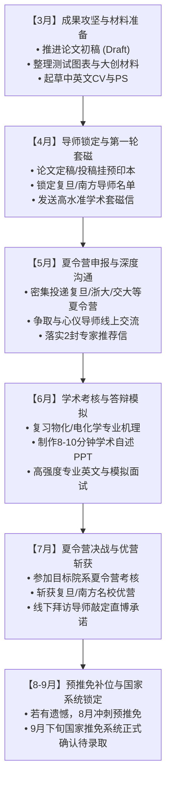

# 哈工大（威海）化工专业申请南方名校/复旦直博全方位冲刺战略规划与行动指南

---

## 一、 个人综合竞争力全方位诊断（背景评估与定位）

在正式展开行动之前，必须先客观、理性地建立“个人画像”。申请直博与申请硕士的底层考核逻辑截然不同：**硕士初审与复试更看重综合加权绩点与通用综合素质，而直博是典型的“导师负责制与学术潜力导向”，博导招收的是未来5年并肩作战的科研核心骨干，最看重的是科研独立性、研究方向契合度、逻辑与专业理论深度、抗压能力与学术自驱力。**

```
┌────────────────────────────────────────────────────────────────────────┐
│                        个人综合画像与优劣势对比分析                    │
├──────────────────────────────────┬─────────────────────────────────────┤
│             核心优势 (Strengths) │           薄弱环节 (Weaknesses)     │
├──────────────────────────────────┼─────────────────────────────────────┤
│ 1. 院校与成绩硬实力过硬          │ 1. 英语六级成绩（450–499分）偏弱        │
│    • C9/985背景，加权[课程成绩较好]分     │    • 虽然跨过普遍的425/460硬门槛，  │
│    • 专业排名 前约7%（前约7%）     │      但在顶尖C9直博竞争者中不算突出 │
│    • 校内保研资格十拿九稳        │ 2. 科研成果尚未实现“硬性闭环”      │
│ 2. 顶级学科竞赛与领导力拉满      │    • 论文“在写”、大创“推进中”       │
│    • 化工设计国家级及省级奖项（队长）  │    • 缺乏已见刊/已录用的代表性论文  │
│    • 数学建模类竞赛奖项（队长）             │ 3. 专业学科属性的差异与转换        │
│ 3. 科研方向前沿且契合度高        │    • 本科为化工（工科），复旦以化学 │
│    • 电池电池催化剂（ORR/OER）   │      材料（理学/交叉）为顶尖强项，  │
│    • 物化、电化学高分，理论底子好│      需展现理化机理与工科结合的深度 │
└──────────────────────────────────┴─────────────────────────────────────┘
```

### 1. 核心优势拆解
- **学业与出身基本盘扎实**：哈工大本科学历在全国各大高校（包括华东五校）具有极高声誉；前约7%（前7%）的排名和90+的加权，不仅确保了校内推免资格稳拿，也足以跨过复旦大学等顶尖名校夏令营的材料初审门槛。
- **竞赛含金量与领导力兼备**：化工设计竞赛是化工领域综合强度最大、对工程实践与模拟能力要求最高的顶级赛事；数学建模类竞赛奖项体现了出色的英文科技写作、数学建模与复杂问题解决能力。两次大赛均担任队长，说明你具有极强的抗压能力、协调组织能力与团队协作意识，这在博士课题组中是博导非常看重的特质。
- **科研方向紧跟学术前沿**：电池双功能氧催化剂（ORR/OER）属于当前新能源化学、材料与储能转化领域高度活跃的方向，与南方各大名校（尤其复旦大学化学系、先进材料实验室等）的重点研究团队契合度极高。同时，物理化学与电化学成绩优异，表明理论功底过硬，能够经受住直博深度面试中对热力学、动力学和电化学机理的严苛拷问。

### 2. 潜在短板与破局思路
- **六级450–499分竞争力平平**：虽然多数高校理化材料类夏令营硬性要求为六级≥425或≥460（450–499已满足报名硬性资格），但在顶级直博初审打分以及全英文文献考核、面试口语交流环节，无法提供加分效应。**破局点**：不再将精力耗费在刷六级上（6月考试7月出分，赶不上夏令营初审），而应将英语能力直接体现在全英文科研文书、高水平专业英文学术自述、流畅的文献精读和现场英文面试答辩中。
- **科研产出尚处于“半成品”状态**：简历上只写“论文在写”很容易被考官视作普通甚至未完成的本科生科研。**破局点**：在4月中下旬夏令营申报开启前，必须将“在写”推进为“高质量完整初稿（Manuscript ready）”，甚至提炼出图文并茂的“科研工作总结报告（Research Summary）”，化被动为主动。

---

## 二、 现阶段（2026年3月—5月）重点推进事项与执行路径

当前正处于大三下学期开学伊始（3月），距离夏令营报名（4月下旬-5月）仅剩1-2个月时间，是决定直博成败的黄金冲刺期。各项任务的推进应严格遵循以下优先级排序：

```
┌────────────────────────────────────────────────────────────────────────┐
│                   大三下学期（3月-5月）核心任务四维推进模型            │
├────────────────────────────────────────────────────────────────────────┤
│ 【最高优先级】科研成果变现：产出完整Manuscript + 凝练创新机制          │
│        ↓                                                               │
│ 【关键胜负手】学术精准套磁：复旦及南方名校博导前瞻性学术对接           │
│        ↓                                                               │
│ 【材料武器库】文书与作品集：中英文CV + 个人陈述 + 科研成果集(Portfolio)│
│        ↓                                                               │
│ 【答辩基本盘】知识底座巩固：物化/电化学机理穿透 + 英文学术面试演练     │
└────────────────────────────────────────────────────────────────────────┘
```

---

### 【第一要务】科研成果的“硬核变现”与深度穿透（优先级：最高）

直博考查的核心就是科研实战能力。3月到4月必须将手头的科研资源转化为可见、可查、可答辩的硬性资产：

#### 1. 全力冲刺论文完整初稿（Manuscript）
- **目标时间**：在4月中下旬之前形成一份结构完整、数据闭环的英文科技论文初稿（Draft）。
- **具体操作**：
  - 加快催化活性测试与微观表征数据的整理归纳，完成Origin规范制图（如XRD、XPS、TEM、BET、LSV极化曲线、Tafel斜率、EIS电化学阻抗谱、RRDE过氧化氢产率及电子转移数计算、电池电池充放电平台及功率密度曲线）。
  - 按照SCI期刊标准完成Abstract、Introduction、Results and Discussion各章节撰写，重点梳理清晰“催化机理与构效关系（Structure-Activity Relationship）”。
  - **投递策略**：若能在5月前由导师投稿，简历上即可规范标注为：`[Manuscript submitted to XXX / Under Review]`；即便尚未投出，也可在征得导师同意后挂载在ChemRxiv等预印本平台获取DOI，或者以规范的`[Manuscript in preparation, Draft completed]`呈现，并随时准备在套磁或面试中作为代表作递交。

#### 2. 大创项目的结项/阶段性成果沉淀
- 梳理大创项目的研究脉络，提炼出清晰的“科学问题”与“解决思路”。
- 明确你在项目中的**独立核心贡献**：拒绝泛泛而谈的“参与制备与测试”，要精准体现你所负责的攻关点（例如：优化了某种特定双功能活性位点的合成路线、设计了原位电化学电解池、解决了空气阴极三相界面的气液固传输阻力等）。

#### 3. 彻底穿透电化学基础理论与实验机理（筑牢面试防线）
博导面试最忌讳学生只做“实验搬砖工”而不懂底层原理。必须针对电池催化剂课题，做到以下理论层面的“问不倒”：
- **热力学与动力学机理**：ORR（氧还原反应）的4电子 vs 2电子反应历程、基元反应步骤与电位决定步（PDS）；OER（析氧反应）过电位居高不下的根本机理；火山型曲线（Sabatier原理）与吸附吉布斯自由能的关系。
- **实验测试规范细节**：三电极体系搭建规范；参比电极（如Ag/AgCl、饱和甘汞电极）转换为可逆氢电极（RHE）的换算公式与校准方法；内阻补偿（iR drop）的原理解释与补偿比例；Koutecky-Levich（K-L）方程的物理含义与拟合推导。
- **原位与微观表征原理解读**：XPS分峰拟合理据；为何选用某种特定掺杂或单原子配位结构；反应前后活性位的重构现象与真实催化机理探讨。

---

### 【关键胜负手】目标院校博导的精准调研与学术型“套磁”（优先级：高）

直博是“导师选人”。如果能在夏令营报名前或初审阶段获得目标导师的明确青睐甚至线上面试承诺，入营和拿到优营（优秀营员）的成功率将大幅提升。

#### 1. 绘制复旦大学及南方顶尖导师图谱（3月中旬-4月上旬）
建立《2026年直博申请目标导师调研数据库》（Excel表格），系统收录以下维度信息：
- 导师姓名、所在院系（重点关注**复旦大学化学系、先进材料实验室/FIST、材料科学系、高分子科学系**）。
- 课题组近3年最新研究成果（重点查阅导师在电催化、二次电池、空气电池、碳中和能源转化方向发表的顶刊文章）。
- 招生名额情况：课题组是否有稳定的博士/直博招生名额、实验室团队规模（大团队PI vs 青年拔尖人才优青/杰青）、近几年毕业学生的去向与成果。
- 团队氛围与指导风格（放养型、手把手指导型，是否鼓励直博生独立探索）。

#### 2. 开展高质量、定制化的“学术型套磁”（4月中旬-5月上旬启动）
- **杜绝模板式群发**：博导每天收到大量千篇一律的套磁信，群发邮件极易被直接忽略或归入垃圾箱。
- **高转化率学术套磁信黄金结构**：
  1. **开头（亮明身份）**：哈工大（威海）化工专业大三学生，综合排名前约7%，加权[课程成绩较好]，具备校内推免资格，拟申请2027级直博研究生。
  2. **契合度切入（读过导师文献）**：简要引用导师近期发表的1-2篇代表性工作，真诚表达你的学术理解，并指出导师的研究与你本科课题的共鸣点。
  3. **自身科研进展呈现**：简要陈述你在电池电池催化剂领域的具体进展（附带Manuscript核心摘要与关键测试数据），体现你的科研敏锐度、实验动手能力与自驱力。
  4. **工程竞赛与交叉潜质**：简要点出化工类国家级竞赛奖项队长、数学建模类竞赛奖项队长的背景，突出自己具备系统工程模拟、数据建模、严谨逻辑和团队协调能力。
  5. **结语与材料附件**：诚恳表达加入课题组攻读直博的强烈意愿，询问今年是否有直博考核指标，并附上制作精美的中英文简历（CV）与科研总结报告。
- **积极促成线上交流**：若导师回复“欢迎报考”、“材料已收到并初步看好”，应顺理成章、礼貌邀请：“非常感谢老师的肯定。如果您近期有空，不知是否有幸能向您进行一次10-15分钟的线上简要科研汇报，当面向您请教几个关于课题的想法？”

---

### 【材料武器库】高辨识度文书与学术作品集打造（优先级：中高）

必须在4月中旬前备齐一套能够打动评审专家的高规格申请材料：

```
┌────────────────────────────────────────────────────────────────────────┐
│                        申请材料核心组合设计清单                        │
├────────────────────────────────────────────────────────────────────────┤
│ 1. 个人简历 (CV)                                                       │
│    • 1-2页精炼版，排版清爽，模块分明（教育背景、科研项目、学术竞赛）   │
│    • 重点加粗：排名(前约7%)、加权([课程成绩较好])、物化/电化学高分、双队长头衔   │
├────────────────────────────────────────────────────────────────────────┤
│ 2. 个人陈述 (Personal Statement)                                       │
│    • 拒绝流水账叙事，围绕“学术兴趣萌发—工程系统训练—前沿科研沉淀—     │
│      未来博士规划”形成闭环故事线                                       │
├────────────────────────────────────────────────────────────────────────┤
│ 3. 代表性学术成果集 (Research Portfolio, 5-8页独立PDF)                  │
│    • 模块一：电池双功能催化剂课题进展（含结构示意图、核心测试图）│
│    • 模块二：化工类竞赛成果摘要（工艺流程PID、Aspen优化图） │
│    • 模块三：数学建模类竞赛奖项建模框架与成果提炼                                │
├────────────────────────────────────────────────────────────────────────┤
│ 4. 专家推荐信 (Recommendation Letters)                                 │
│    • 提前联系2位正高级职称教授（如本科研导师、物化/化工核心课程教授）   │
│    • 推荐信内容侧重评价：科研创新意识、动手与分析能力、学术道德与毅力  │
└────────────────────────────────────────────────────────────────────────┘
```

---

### 【答辩基本盘】知识体系沉淀与综合面试通关训练（优先级：高）

直博考核不仅看材料，更看现场“真刀真枪”的学术答辩与综合知识面。

#### 1. 专业课基础知识的横向贯通与深度复习
- **物理化学（理学根基）**：
  - 热力学三定律、化学平衡常数与范特霍夫方程、相律与相图分析。
  - 界面化学与胶体理论：表面张力、Young-Laplace方程、Kelvin方程、单分子层Langmuir与多层BET吸附等温模型。
  - 化学动力学：阿伦尼乌斯公式、活化能物理意义、过渡态理论、复合反应机理速率控制步骤。
- **电化学原理（核心杀手锏）**：
  - 界面电荷迁移理论：能斯特方程推导与平衡电位、电极极化分类（欧姆极化、活化/电化学极化、浓差极化）。
  - 双电层模型演进：Helmholtz模型、Gouy-Chapman模型与Stern模型的修正逻辑。
  - 经典动力学方程：Butler-Volmer方程的推导假设、Tafel公式的适用区间与电荷传递系数（$\alpha$）的物理本质。
- **化工传递与反应工程（工科差异化优势）**：
  - 化工三传（动量、热量、质量传递）基本定律及类比关系。
  - 反应器流动与混合：平推流（PFR）与全混流（CSTR）模型差异，扩散与本征反应速率的耦合。

#### 2. 专业英语与文献答辩强化
- **准备高水平英文自述**：不仅准备常规日常英文自我介绍，更要准备一份3分钟的**专业英文学术陈述（重点介绍催化课题的立项依据、核心手段和创新见解）**。
- **文献速读与批判性思维演练**：
  - 很多直博面试包含“现场阅读一篇英文顶刊Abstract并在5分钟内概述并回答评委提问”的环节。
  - 训练自己每天阅读1篇JACS、Angewandte Chemie或Advanced Materials中的电催化/储能顶刊摘要，迅速抓取研究痛点、创新设计、表征证据与结论。

#### 3. 直博PPT自述预备与模拟演练
- 制作一份标准8-10分钟的面试自述PPT：
  - 个人简介与学业背景（1-2分钟）
  - 核心科研工作与创新突破——电池催化剂（4-5分钟，重中之重）
  - 学科竞赛与综合工程素养——化设+美赛（1-2分钟）
  - 博士阶段研究构想与学术志向（1-2分钟）
- 组织室友或同组师兄师姐进行全真高压模拟提问，重点锤炼受到评委质疑时的情绪管理、逻辑自洽与应变能力。

---

## 三、 梦校复旦大学深度剖析与南方名校梯队搭建

### 1. 梦校——复旦大学相关院系深度拆解

复旦大学作为南方顶尖综合性大学，化学与材料学科实力位居全球前列。需要特别注意：**复旦大学没有独立的传统化工学院，你的化工与电催化背景，在申请复旦时主要对接以下院系：**

```
┌────────────────────────────────────────────────────────────────────────┐
│                    复旦大学电化学/催化相关院系矩阵                     │
├────────────────────┬───────────────────────────────────────────────────┤
│ 院系名称           │ 特色方向与优势解析                                │
├────────────────────┼───────────────────────────────────────────────────┤
│ 化学系             │ • 传统殿堂级强系，无机化学/物理化学全国顶尖        │
│                    │ • 拥有介孔材料、功能多孔材料、能源化学顶尖院士团队│
│                    │ • 电化学储能、电催化、多孔炭材料研究极其集中      │
├────────────────────┼───────────────────────────────────────────────────┤
│ 先进材料实验室     │ • 顶尖国家级交叉科研平台（FIST）                  │
│ (先材 / FIST)      │ • 聚焦新能源材料、柔性储能、光电催化等交叉前沿    │
│                    │ • 导师名额相对充裕，生源结构多元，高度欢迎工科资优│
├────────────────────┼───────────────────────────────────────────────────┤
│ 材料科学系         │ • 涵盖储能材料与器件、清洁能源转化、先进功能材料  │
│                    │ • 兼具工科工程属性与理科机理研究，对接化工背景顺畅│
├────────────────────┼───────────────────────────────────────────────────┤
│ 高分子科学系       │ • 聚合物分子工程国家重点实验室                    │
│                    │ • 智能高分子、纤维状电池/催化器件处于国际引领地位 │
│                    │ • 对高分子基催化剂载体、凝胶电解质研究深入        │
└────────────────────┴───────────────────────────────────────────────────┘
```

> **针对复旦申请的关键破局话术（理工融合）**：  
> 复旦化学系和先材的导师以理学研究见长（注重原子尺度配位、原位光谱机理与理论计算）。在面试和文书中，切忌把自己局限为“只懂传统化工操作”的工科生，要讲出你的**独特优势**：**“既有物化与电化学的扎实理论底子，能够深入微观机理；又具备化工系统工程与过程放大思维（化工类竞赛获奖队长），能够从传质、传热与电堆器件工程的角度审视催化剂的实际应用价值。”** 这种“懂机理、懂工程”的复合型博士候选人在大导师眼中极具稀缺性。

---

### 2. 南方名校择校择所梯度布局（冲稳保策略）

直博名额极其宝贵，且一个导师往往只有1个甚至几年才轮到1个直博指标，极易受到政策、导师招生资格或推免生源竞争的扰动。**绝不能把所有希望押在复旦单一院系上，必须建立“冲、稳、保”三级梯队：**

```
┌────────────────────────────────────────────────────────────────────────┐
│                        直博申请“冲-稳-保”三级梯队                      │
├─────────┬───────────────────────────────┬──────────────────────────────┤
│ 梯次    │ 目标高校 / 科研院所           │ 推荐院系与学科优势           │
├─────────┼───────────────────────────────┼──────────────────────────────┤
│ 冲刺层  │ 1. 复旦大学 (Dream)           │ 化学系、先进材料实验室(FIST) │
│ (Tier 1)│ 2. 浙江大学                   │ 化工学院(顶尖A+)、化学系     │
│         │ 3. 上海交通大学               │ 化学化工学院、材料科学与工程 │
│         │ 4. 中国科学技术大学 (华东顶尖)│ 化学与材料科学学院、微尺度   │
├─────────┼───────────────────────────────┼──────────────────────────────┤
│ 稳健层  │ 1. 南京大学                   │ 化学化工学院(物化/电化学极强)│
│ (Tier 2)│ 2. 厦门大学                   │ 化学化工学院(全国电化学泰斗) │
│         │ 3. 中科院南方知名研究所       │ 上海硅酸盐所、宁波材料所     │
│         │ 4. 华中科技大学 / 武汉大学    │ 化学与化工学院、材料学院     │
│         │ 5. 中山大学 / 华南理工大学    │ 化学学院、化学与化工学院     │
├─────────┼───────────────────────────────┼──────────────────────────────┤
│ 保底层  │ 1. 哈工大深圳校区 (南方偏好)  │ 理学院/材料学院(本校认可度极高)
│ (Tier 3)│ 2. 哈尔滨工业大学本部         │ 化工与化学学院(本校直博底牌) │
└─────────┴───────────────────────────────┴──────────────────────────────┘
```

- **浙大化工**：全国学科评估A+，工程与催化实力雄厚，对化工科班出身的学生认可度极高，若进入电催化大团队，平台资源极广。
- **厦门大学化学化工学院**：中国电化学的发源地与学术圣殿，在电化学理论、谱学电化学、能源催化领域具有无与伦比的深厚积淀，若志在深耕电化学催化，厦大是绝对的学术高地。
- **中科院宁波材料所 / 上海硅酸盐所**：科研经费充沛，仪器设备顶尖，博士生待遇丰厚，且聚焦储能电池与催化产业转化，直博名额相对综合性大学更充裕。
- **哈工大深圳校区**：满足南方地理偏好，母校血统在初审和复试中占尽优势，是绝佳的高质量安全垫。

---

## 四、 2026年3月—9月全流程时间轴与里程碑路线图



### 关键时间节点与交付物一览表

| 时间节点 | 核心战略目标 | 关键行动与具体交付物 | 风险预警与对策 |
| :--- | :--- | :--- | :--- |
| **2026年3月**<br>*(开学阶段)* | 科研成果转化与基础文书成型 | 1. 整理电催化全套数据，完成论文英文初稿（Draft）；<br>2. 制作中英文个人简历（CV）与个人陈述（PS）初版；<br>3. 开具前5学期成绩单、排名证明（前约7%）及获奖证书。 | 避免论文拖延；若实验尚需补充，优先补全核心电化学活性与稳定性数据。 |
| **2026年4月**<br>*(春季冲刺)* | 精准学术套磁与作品集打造 | 1. 完成论文Manuscript排版定稿，或形成精炼的Research Summary；<br>2. 建立复旦及南方院校目标博导信息库；<br>3. 4月中下旬发送首批学术套磁邮件，附CV与成果集；<br>4. 联系2位推荐人（导师/教授）确定推荐信意向。 | 若套磁信未获回复，切忌焦虑，隔7-10天可礼貌Follow-up一次，同时积极拓展其他意向导师。 |
| **2026年5月**<br>*(申报旺季)* | 夏令营全面系统投递与导师确认 | 1. 紧密关注复旦（化学系、先材、材料系）、浙大、交大、中科大等官网通知；<br>2. 按要求完成系统填报与纸质材料寄送；<br>3. 收到导师积极反馈者，主动争取15分钟腾讯会议线上交流。 | 严防错漏申请截止时间；直博夏令营入营后务必及时与对接导师报备。 |
| **2026年6月**<br>*(备战决战)* | 高强度学术面试模拟与知识串联 | 1. 深度复习物理化学、电化学原理核心考点；<br>2. 制作中英文学术面试PPT（涵盖课题机理与竞赛经验）；<br>3. 演练英文顶刊Abstract现场速读与问答。 | 避免死记硬背概念，注重结合自身催化课题融会贯通。 |
| **2026年7月**<br>*(夏令营期)* | 现场/线上考核，斩获优营资格 | 1. 参加复旦大学等高校夏令营，全力发挥；<br>2. 营期内争取到实验室与心仪博导线下面谈，确认直博意向；<br>3. 锁定“优秀营员（优营）”或拟录取资格。 | 若遇多所名校夏令营时间冲突，优先选择已建立强意向导师联系的夏令营。 |
| **2026年8月-9月**<br>*(收官锁定)* | 预推免捡漏与国家推免系统填报 | 1. 若夏令营已斩获心仪复旦直博优营，按导师要求保持科研跟进；<br>2. 若夏令营结果不及预期，8月中下旬全力参加预推免捡漏；<br>3. 9月下旬登录“全国推免服务系统”完成志愿填报与录取确认。 | 保持与拟录取导师的密切沟通，按部就班推进大四本科毕业设计。 |

---

## 五、 直博申请核心实战经验与避坑指南

### 1. 直博生与导师的“双向奔赴”与背景调研
直博是一场长达5年的学术长跑，选对导师的重要性往往大于选对学校。在向复旦或南方名校导师做出最终承诺前，务必通过以下渠道进行严谨的“背调”：
- **同门了解真实生态**：通过哈工大校友网、学术交友平台或学术社交网络，礼貌联系目标课题组的在读博士师兄师姐，了解真实的师生关系、指导频率、实验室考勤机制及毕业去向。
- **关注毕业硬性指标与延毕率**：了解该课题组博士毕业的硬性论文篇数与影响因子要求，以及往届博士生是否普遍存在严重延毕现象。
- **考察研究方向的发展前景**：确保导师给你安排或支持的方向符合你的志趣，避免进组后被分配到与你积累完全无关且产出周期极其漫长的边缘子方向。

### 2. 工科转投理学/材料时的面试答辩话术技巧
复旦面试专家常常由资深的理学专家组成，面试中可能会挑战：“你本科是学工科化工的，为什么来申理科化学/材料直博？理论深度跟得上吗？”
- **高分应答策略**：
  > “非常感谢老师的提问。我认为工科与理科并不是割裂的，而是相互促进的闭环。首先，我在本科阶段非常重视物理化学与电化学等理论课程的学习，这两门课的成绩在专业内名列前茅，为我理解微观反应机制打下了坚实的数理基石。其次，我在全国化工设计竞赛中担任队长并取得国家级奖项，培养了极其扎实的传递过程、质量与能量平衡、工艺模拟等系统工程思维。在实际的催化研究中，很多理科成果受制于界面传质阻力、电堆欧姆热损耗或电解液流动不均而无法走出实验室，而我的工程背景正好赋予了我独特的系统优化视角。我希望在未来的博士研究中，依托复旦顶尖的基础研究平台深入探究原子级催化机理，同时用工程思维加速催化体系的实用化与器件化开发。”

### 3. 面对六级450–499分的心态调试与应对
如果面试老师直接针对六级成绩提问：“你的六级成绩（450–499分）不算高，平时阅读前沿英文文献有困难吗？博士期间能写好高水平英文论文吗？”
- **成熟自信的化解话术**：
  > “感谢老师的指正。标准化英语考试确实反映了我大一、大二时在通用应试技巧上的不足。但在进入科研课题之后，我将英语完全作为学术生产力工具来高强度使用：目前我正在撰写全英文的催化剂学术论文，日常文献调研均以顶刊英文原文为主，并且在美赛中担任队长完成了数十页全英文建模论文的撰写并获得M奖。这证明我的专业英语阅读、科技写作与实际沟通能力完全能够适应高强度的国际学术研究。在接下来的时间里，我也将持续强化口语交流与学术汇报能力，确保博士期间的国际化科研产出不受语言阻碍。”

---

## 六、 总结与结语

你拥有**哈工大C9的优质工科底色、专业前约7%的前列名次、化工类竞赛获奖与数学建模类竞赛奖项的双队长领导力，以及极其契合前沿热点的电池电池催化剂课题**，整体硬件实力非常出众，完全具备冲击复旦大学及南方顶尖名校直博席位的资本。

在接下来的3-5月里：
1. **快马加鞭把科研成果固化为完整的可交付物（Paper Draft / Research Summary）**；
2. **带着扎实的科研沉淀与真诚的学术理解，精准套磁复旦大学心仪博导**；
3. **夯实物化与电化学理论根基，打磨一套高光申请文书**。

战略清晰、行动坚决、从容自信，你必定能在2026年夏令营中斩获梦校直博优营，顺利开启学术殿堂的大门！
