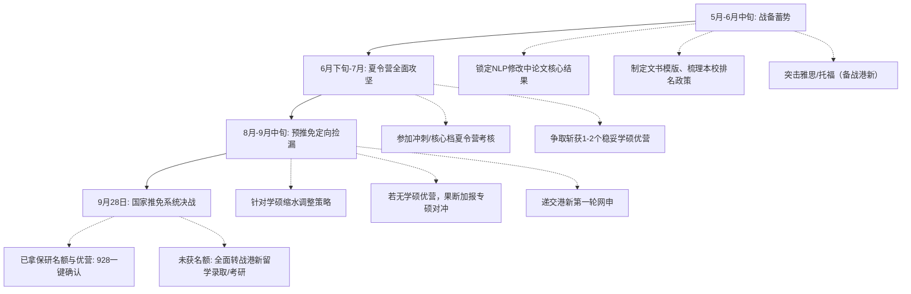

# 华东地区一所985高校（华东五校之一）的人工智能专业推免与升学规划方案

## 一、 申请人背景画像与综合竞争力深度剖析

| 评估维度 | 核心现状 | 竞争力分级 | 深度研判与战略影响 |
| :--- | :--- | :--- | :--- |
| **本科院校** | 华东地区一所985高校（华东五校之一）（C9 / 华东五校 / 985） | ★★★★★（顶尖优势） | 顶尖C9与华五声誉在全国各高校初审系统中享有最高权重，初审打分通常位列第一梯队，能够有效对冲排名的相对劣势。 |
| **就读专业** | 人工智能（本科学院） | ★★★★★（先发优势） | 本科学院的具体设立与平台线索已概括，课程体系严密且在学界认可度极高，专业背景契合度极佳。 |
| **学分绩/排名** | 前约45%（前 约45%） | ★★★☆☆（相对短板） | 排名居于中等偏后位置。在顶尖高校学硕初审中，45%的位次易受门槛限制；但在中上游985及特色院系中，依托C9背景依然具备较强穿透力。 |
| **英语水平** | 六级 500–549 分 | ★★★☆☆（达标偏平） | 越过了国内绝大部分985高校推免的硬性门槛（425/460/480/500分），但无法作为加分项，且不能直接用于港新顶尖名校申请。 |
| **科研经历** | 数月校内NLP科研，论文修改中未投稿 | ★★★☆☆（潜力良好） | 具备正规实验室科研训练与论文撰写全流程经验，但缺乏正式录用证明（录用通知/检索号），夏令营期间只能作为面试专业问答素材。 |
| **升学诉求** | AI或计算机“学硕”，港新备选 | ★★☆☆☆（难度极高） | 国内头部高校学硕指标近年来急剧缩减（多数转为直博或专硕），以45%位次纯申学硕存在严重落空风险，必须辅以科学策略。 |

---

### 1. 本科推免资格（保研名额）风险预警与应对测算
华东地区一所985高校（华东五校之一）作为教育部直属的顶尖C9高校，整体推免比例通常在35%~42%之间浮动。本科学院作为重点建设学院，指标相对充裕，但**前约45%（约45%）恰好处在保研名额的“临界生死线”附近**：
1. **名额测算逻辑**：
   - 基础保研名额：按学院常态化约35%~40%的分配比例，常规名额大约覆盖前34~38名。
   - 补充/专项名额：若加上拔尖计划补偿指标、交叉学科专项、国防/科研补偿指标、支教团或行政保研等，名额可能延伸至40~44名左右。
   - 前序放弃顺延：前40名中若有同学选择出国出境留学（放弃保研名额）或个人放弃，名额将向下顺延。
2. **行动纲领**：
   - 第一时间与学院教务老师、辅导员沟通近三年保研名额的最终顺延位次。
   - 梳理科研加分、竞赛获奖、综测加分政策，争取在最终推免综合排名中向前提升1~3个位次。
   - 做好“有保研名额”与“未获保研名额（转战港新留学或考研）”的两手准备。

---

### 2. “执着于学硕”的战略风险诊断与破局策略
在当前的国内推免大环境下，“非学硕不可”是导致高阶背景同学推免失利的最常见误区：
1. **学硕名额急剧收缩**：清北、华五、人大高瓴等顶尖院系的学硕名额已被大幅压缩（大量指标转为“直博”或“电子信息专硕”）。多数高校院系一个系仅有数个学硕指标，初审往往只对前10%~15%开放。
2. **专硕与学硕在就业和读博层面的真实差距**：
   - **就业**：互联网大厂、AI独角兽、外企及央国企在校招中对“工学硕士（学硕）”与“电子信息工程硕士（专硕）”完全一视同仁，考核核心只看技术水平、项目经历与实习成果。
   - **读博**：目前国内主流高校读博已全盘推行“申请-考核制”。导师考核的核心是申请者的学术论文产出、研究方向匹配度与学术潜质，学位类型（学硕/专硕）不构成实质壁垒。
3. **破局建议**：
   - 本方案严格响应需求，在主推的15个组合中全部匹配**学术型硕士（学硕）**项目；
   - **极重要策略修正**：在实际报名系统填报时，强烈建议申请者采取“学硕为主、专硕对冲”的报名组合。针对部分名校，若系统允许填报两个志愿，第二志愿务必勾选专硕（085400 电子信息），避免因指标结构性短缺导致初审直接被筛。

---

### 3. 数月NLP在研论文的高效转化与防坑指南
1. **材料包装**：
   - 严禁在简历中将“在修论文”模糊虚构成“已发表/录用”。应规范标注为：`Working Paper / Under Preparation`。
   - 将该项目作为简历的“核心项目（Featured Research Project）”进行呈现，清晰写出：**研究问题（Problem Definition）、核心贡献（Methodology & Innovation）、实验指标与Baseline对比（Empirical Results）**。
   - 准备1~2页的英文项目长摘要（Extended Abstract）或论文工作进展报告（Working Draft），在夏令营邮件套磁及面试展示中展现扎实的学术规范。
2. **面试防问与技术自洽**：
   - 重点掌握从底层原理到实验细节的推导：Transformer结构细节（Post-LN vs Pre-LN、FlashAttention机制、RoPE相对位置编码等）、分词器（BPE/WordPiece）、注意力计算复杂度及优化。
   - 面对面试官“既然做完了为什么还没投”的提问，务实回答：“该工作已完成主体模型架构设计与主实验验证，当前正补充消融实验（Ablation Study）与长文本鲁棒性测试，并进行语言润色，计划近期向CCF-B/C类会议或期刊投稿。”

---

## 二、 15个国内学校、学院与具体专业（项目）组合全景规划

针对华东地区一所985高校（华东五校之一）的人工智能专业、排名前约45%（约45%）、六级500–549、NLP在研论文的综合条件，按照**冲刺档（4个）**、**核心适中档（7个）**和**安全保底档（4个）**构建15个国内推免学硕组合。

### 推荐组合总览表

| 序号 | 院校名称 | 学院名称 | 具体专业名称及专业代码 | 学位类型 | 梯队划分 | 入营概率预估 | 录取难度系数 |
| :---: | :--- | :--- | :--- | :---: | :---: | :---: | :---: |
| **01** | 华东地区一所985高校（华东五校之一） | 本科学院 | 计算机科学与技术（081200）/ 人工智能（0812J1） | 学硕 | 冲刺档 | 85%（本校保护） | ★★★★★ |
| **02** | 中国人民大学 | 高瓴本科学院 | 计算机科学与技术（081200）/ 人工智能（0812J1） | 学硕 | 冲刺档 | 35%~45% | ★★★★★ |
| **03** | 复旦大学 | 计算机科学技术学院 | 计算机科学与技术（081200） | 学硕 | 冲刺档 | 40%~50% | ★★★★★ |
| **04** | 浙江大学 | 计算机科学与技术学院 | 计算机科学与技术（081200） | 学硕 | 冲刺档 | 35%~45% | ★★★★★ |
| **05** | 中国科学技术大学 | 计算机科学与技术学院 | 计算机科学与技术（081200） | 学硕 | 核心适中档 | 70%~80% | ★★★★☆ |
| **06** | 同济大学 | 电子与信息工程学院（计算机系） | 计算机科学与技术（081200） | 学硕 | 核心适中档 | 75%~85% | ★★★★☆ |
| **07** | 东本校学 | 计算机科学与工程学院 | 计算机科学与技术（081200） | 学硕 | 核心适中档 | 80%~90% | ★★★★☆ |
| **08** | 华东师范大学 | 数据科学与工程学院 | 软件工程（083500）/ 计算机科学与技术（081200） | 学硕 | 核心适中档 | 75%~85% | ★★★★☆ |
| **09** | 北京航空航天大学 | 人工智能研究院 | 人工智能（0812J1）/ 计算机科学与技术（081200） | 学硕 | 核心适中档 | 65%~75% | ★★★★☆ |
| **10** | 武汉大学 | 计算机学院 | 计算机科学与技术（081200） | 学硕 | 核心适中档 | 80%~90% | ★★★☆☆ |
| **11** | 中山大学 | 计算机学院 | 计算机科学与技术（081200） | 学硕 | 核心适中档 | 80%~90% | ★★★☆☆ |
| **12** | 华东地区一所985高校（华东五校之一） | 软件学院 | 软件工程（083500） | 学硕 | 安全保底档 | 90%~95% | ★★★☆☆ |
| **13** | 中国科学院自动化研究所 | 模式与智能系统 / 国科大南京学院 | 模式识别与智能系统（081104）/ 计算机（081200） | 学硕 | 安全保底档 | 60%~70% | ★★★☆☆ |
| **14** | 厦门大学 | 信息学院（人工智能研究院） | 计算机科学与技术（081200） | 学硕 | 安全保底档 | 90%~95% | ★★☆☆☆ |
| **15** | 西安交通大学 | 计算机科学与技术学院 | 计算机科学与技术（081200） | 学硕 | 安全保底档 | 85%~95% | ★★☆☆☆ |

---

### 三、 15个推荐组合详细拆解与报考攻略

#### （一） 冲刺档（4个组合）：顶级学术平台与名校突破

##### 组合01：华东地区一所985高校（华东五校之一） · 本科学院
* **具体专业与代码**：计算机科学与技术（081200）/ 人工智能交叉学科（0812J1）· 学术型硕士
* **院系与科研背景**：本科学院具体师资及研究平台线索已概括，相关AI团队在机器学习理论、弱监督学习、大模型演进方面处于国际前沿。
* **录取难度与匹配分析**：作为本校生，初审基本不存在被卡问题（本校保护机制），入营率极高。但本院学硕名额极度稀缺，绝大多数学硕名额优先保障直博生或排名前20%的顶尖同学，因此对原专业名次的学生而言属于本校“冲刺”层级。
* **考核特色与破局点**：面试高度侧重机器学习底层数学与算法理论推导（泛化误差界、VC维、SVM对偶、Boosting原理等）。破局点在于利用在校优势提前联系意向导师面谈，展示扎实的数理基础与科研态度。

##### 组合02：中国人民大学 · 高瓴本科学院
* **具体专业与代码**：计算机科学与技术（081200）/ 人工智能（0812J1）· 学术型硕士
* **院系与科研背景**：高瓴本科学院近年来在信息检索、NLP（如文继荣教授、赵鑫教授团队，在大模型与预训练语言模型领域产出极高）方向声誉卓著，是NLP方向学子的梦校之一。
* **录取难度与匹配分析**：高瓴对C9高校生源极为青睐，但学硕名额极少（大部分招收直博与专硕）。44%的排名入营具有一定挑战，但由于申请人来自本校AI且有NLP在研经历，凭借优秀的文书和科研报告完全值得全力冲刺。
* **考核特色与破局点**：考核涵盖专业笔试/机试与高强度学术答辩。面试官对NLP与大模型技术细节挖掘极深，需对预训练、指令微调、RLHF及自身修改中论文的Baseline细节了如指掌。

##### 组合03：复旦大学 · 计算机科学技术学院
* **具体专业与代码**：计算机科学与技术（081200）· 学术型硕士
* **院系与科研背景**：复旦自然语言处理科研（邱锡鹏、黄萱菁、张奇教授团队）是国内NLP领域的三驾马车之一，主导研发的MOSS大模型在学界具有重大影响力。
* **录取难度与匹配分析**：复旦对华东五校认可度极高，夏令营通常有专门通道。然而计算机学院学硕竞争白热化，44%排名的学生若仅报学硕，在综合评定中竞争压力极大，属高难度冲刺档。
* **考核特色与破局点**：复旦夏令营机试（Coding）要求较高，通常采用类Codeforces/LeetCode Medium以上难度；面试对代码实现能力与开源项目贡献十分看重。

##### 组合04：浙江大学 · 计算机科学与技术学院
* **具体专业与代码**：计算机科学与技术（081200）· 学术型硕士
* **院系与科研背景**：浙大计算机学科为国家A+，拥有计算机辅助设计与图形系统全国重点实验室、知识引擎与认知智能实验室，NLP与知识图谱领域实力雄厚。
* **录取难度与匹配分析**：浙大计算机学硕夏令营初审门槛高，极为看重PAT成绩或机试水准。对于C9学生，排名放宽幅度有限，入营概率处于35%~45%区间，但一旦进入机试，便进入技术定胜负环节。
* **考核特色与破局点**：浙大极为依赖PAT（甲级/顶级）成绩或现场机试，若持有高分PAT证书或机试获得高分，可大幅抹平本科GPA排名的不足。

---

#### （二） 核心适中档（7个组合）：主力战场与高概率攻坚

##### 组合05：中国科学技术大学 · 计算机科学与技术学院
* **具体专业与代码**：计算机科学与技术（081200）· 学术型硕士
* **院系与科研背景**：同属C9联盟与华东五校，合肥与南京交通极度便捷（高铁45分钟）。中科大在语音、自然语言处理与多模态AI领域底蕴深厚，与科大讯飞建有联合实验室。
* **录取难度与匹配分析**：中科大对C9兄弟院校同仁极具亲和力，夏令营规模较大，入营门槛对本校前45%学生非常宽容。学硕名额相对较充裕，录取确定性高，是极其优质的目标院校。
* **考核特色与破局点**：中科大考核更偏重理工科基础数学思维（概率统计、离散数学）与科研诚信，面试氛围务实严谨。

##### 组合06：同济大学 · 电子与信息工程学院（计算机科学与技术系）
* **具体专业与代码**：计算机科学与技术（081200）· 学术型硕士
* **院系与科研背景**：坐落上海，同济计算机系在自主智能无人系统全国重点实验室的牵引下，近年来获得了大量国家级科研资源倾斜，人工智能与智能算法方向发展迅猛。
* **录取难度与匹配分析**：同济对华东五校极为认可，初审通过率高。以本校前45%背景申请同济计算机学硕，入营概率在80%左右，面试发挥正常有极大把握斩获“优秀营员”。
* **考核特色与破局点**：侧重工程落地能力与科研成果理解，六级500–549分在此档院校无任何障碍，面试需重点展示工程实现代码量与架构设计能力。

##### 组合07：东本校学 · 计算机科学与工程学院
* **具体专业与代码**：计算机科学与技术（081200）· 学术型硕士
* **院系与科研背景**：同城顶级985高校，计算机学科评估A类，拥有知识图谱、自然语言处理、网络空间安全等优势团队（如漆桂林教授团队在知识图谱与语义Web方向位居国内前列）。
* **录取难度与匹配分析**：东本校学对本校学生天然认可度拉满，两校学分体系与学术水平互信度极高。前约45%的位次在东本校学计算机学硕夏令营中具有强劲竞争力，是极佳的“准保底/稳妥”大本营。
* **考核特色与破局点**：考核涵盖专业知识问答与综合面试，不设极端偏门机试，本地线下考核或线上考核均极为便利。

##### 组合08：华东师范大学 · 数据科学与工程学院（DaSE）
* **具体专业与代码**：计算机科学与技术（081200）/ 软件工程（083500）· 学术型硕士
* **院系与科研背景**：华东师大DaSE学院由钱卫宁、周傲英教授领衔，在新型分布式数据系统、数据智能与NLP应用领域处于国内顶尖水平，培养模式对接国际一线。
* **录取难度与匹配分析**：DaSE学院非常看重学生的技术纯粹性与探索精神，对华五生源偏爱有加。学院对综合排名的限制相对弹性，极度看重动手能力与科研自驱力，是极其优质的学硕选择。
* **考核特色与破局点**：学院自主命题的机试和项目答辩注重底层系统能力与数据思维，对于有扎实NLP科研开发经历的学生而言极具发挥空间。

##### 组合09：北京航空航天大学 · 人工智能研究院
* **具体专业与代码**：人工智能交叉学科（0812J1）/ 计算机科学与技术（081200）· 学术型硕士
* **院系与科研背景**：北航计算机/AI学科综合实力全国顶尖（A+梯队），人工智能研究院作为新兴交叉平台，独立招生且具备充沛的算力资源与国防/民用重大课题支持。
* **录取难度与匹配分析**：相比本部计算机学院的极度内卷，人工智能研究院入营门槛略具弹性。本校C9背景在初审中优势显著，入营概率约70%，学硕竞争激烈但完全具备入围冲刺资格。
* **考核特色与破局点**：通常含机试与综合面试，需提前准备机试刷题；面试会深挖数学算法推导与算法复杂度优化。

##### 组合10：武汉大学 · 计算机学院
* **具体专业与代码**：计算机科学与技术（081200）· 学术型硕士
* **院系与科研背景**：中部顶级985，计算机学科历史底蕴深厚，在多媒体处理、自然语言处理、复杂网络领域科研力量雄厚。
* **录取难度与匹配分析**：武大计算机夏令营对华五学子极为宽待，初审基本畅通无阻。武大学硕招生规模相对较大，前约45%排名拿下其学硕优营（优秀营员）的概率超过80%。
* **考核特色与破局点**：面试考官学术视野广阔，重视专业基础课程（操作系统、计算机网络、数据结构）基础问答与英语听说能力。

##### 组合11：中山大学 · 计算机学院
* **具体专业与代码**：计算机科学与技术（081200）· 学术型硕士
* **院系与科研背景**：地处粤港澳大湾区核心，计算机学科评估A-，深度依托天河二号超算中心，产学研资源丰沛，NLP与计算机视觉团队科研产出亮眼。
* **录取难度与匹配分析**：中大计算机学院对C9生源给出的优营政策非常慷慨，44%位次在初审中处于绝对优势区间，学硕指标储备相对健康。
* **考核特色与破局点**：重视计算机基础素养与工程落地能力，六级500–549分满足所有语言要求，面试答辩整体规范透明。

---

#### （三） 安全保底档（4个组合）：筑牢底线与高确定性防御

##### 组合12：华东地区一所985高校（华东五校之一） · 软件学院
* **具体专业与代码**：软件工程（083500）· 学术型硕士
* **院系与科研背景**：国家首批示范性软件学院，学科评估A类，拥有计算机软件新技术全国重点实验室。在软件工程化、智能化软件工程（AI for SE / LLM for Code）方向全国顶尖。
* **录取难度与匹配分析**：本校兜底的最坚实壁垒。作为本校本校AI专业学生，申请本校软院学硕/专硕，初审100%入营。虽然学硕名额同样需竞争，但本校互认度极高，是最安全的顶级保底港湾。
* **考核特色与破局点**：考核侧重软件架构、代码规范、算法设计，本校生在面试交流中享有充分的师资了解度与亲和度。

##### 组合13：中国科学院自动化研究所（CASIA）· 模式识别国家重点实验室 / 国科大南京学院专项
* **具体专业与代码**：模式识别与智能系统（081104）/ 计算机科学与技术（081200）· 学术型硕士
* **院系与科研背景**：国内AI与NLP领域的学术圣殿（宗成庆、刘康等专家所在单位），紫东太初大模型诞生地。在南京设有中国科学院大学南京学院智能软件/信息专项。
* **录取难度与匹配分析**：北京本部自动化所学硕竞争极激烈，但针对中科院南京学院专项或与本校联培专项，生源吸纳门槛高度向本校学子倾斜。将科研方向锁定在NLP，导师匹配度极高，是兼具学术地位与录取确定性的优选。
* **考核特色与破局点**：极其纯粹的科研面试，不卡机试死题目，全面围绕在研NLP论文的设计构思、实验瓶颈及学术逻辑展开深究。

##### 组合14：厦门大学 · 信息学院（人工智能研究院）
* **具体专业与代码**：计算机科学与技术（081200）· 学术型硕士
* **院系与科研背景**：985名校，信息学院在自然语言处理与机器翻译领域底蕴深厚（如史晓东、苏劲松教授等团队在机器翻译、大模型微调方向具有很高的学术活跃度）。
* **录取难度与匹配分析**：对C9/华五生源具备极高偏好，本校前45%位次在其生源画像中属于上位区间，学硕优营获得概率极高（90%以上），可作为极其踏实平稳的托底选择。
* **考核特色与破局点**：重视学生的科研意愿与基础专业功底，提前邮件联系NLP方向导师能快速获得口头肯定甚至预接收意向。

##### 组合15：西安交通大学 · 计算机科学与技术学院
* **具体专业与代码**：计算机科学与技术（081200）· 学术型硕士
* **院系与科研背景**：C9联盟成员，拥有视觉信息与应用全国重点实验室（郑南宁院士团队），在人工智能、认知计算、计算机体系结构方面积淀极深。
* **录取难度与匹配分析**：受地理区位影响，西交大对东部沿海C9高校的优秀学子求贤若渴。本校前约45%排名的申请者在其夏令营初审中优势显著，学硕名额相对充裕，拿下优营确定性极强。
* **考核特色与破局点**：面试考风端正扎实，侧重对计算机基础原理与工程科研潜力的考察，抗风险能力极佳。

---

## 四、 港新（新加坡、香港）备选方案深度规划

面对国内推免名额与学硕指标的双重博弈，将香港与新加坡顶尖院校作为备选路径是极具远见的“双保险”策略。

### 1. 港新与国内保研的“双轨运行”时间线与博弈规则

```
2024年5月-6月               2024年7月-8月               2024年9月28日            2024年10月-12月
   [国内] 夏令营申报与考核        [国内] 锁定夏令营优营         [国内] 全国推免系统开放     [港新] 提前批/第一轮发Offer
         │                           │                        │                     │
         ▼                           ▼                        ▼                     ▼
   [港新] 突击语言（雅思/托福）    [港新] 第一轮网申开放          [决策点] 保研成功则放弃港新； [兜底] 若国内滑标，
         准备推荐信/文书                提交申请材料                   若未获名额则全力走港新       直接承接港新优质Offer
```

* **留位费（Deposit）博弈**：港新秋季入学申请通常在9~10月开启第一轮，部分专业（如NUS/NTU提前批）会在7~8月甚至更早开放。国内“928系统”确定后，若成功保研，直接放弃港新申请即可（最多损失申请费）；若国内推免失利，港新第一轮申请正处于审理与发Offer黄金期，实现无缝衔接。

---

### 2. 背景短板弥补：语言考试与GRE硬性要求

* **六级500–549分的严重局限**：
  - **新二所（NUS / NTU）**及**港前三（HKU / CUHK / HKUST）**的绝大多数CS/AI项目**完全不认可中国大陆大学英语六级（CET-6）**。
  - **行动要求**：必须在**2024年7月至8月前考出受认可的语言成绩**：
    - **雅思（IELTS）**：总分 6.5分以上（单科不低于6.0分）；或
    - **托福（TOEFL）**：总分 90分以上。
  - **GRE要求**：
    - 新加坡国立大学（NUS）计算机学院对非新加坡本土生源强烈建议甚至强制要求GRE（建议V 152+，Q 165+，AW 3.5+）；
    - 南洋理工大学（NTU）AI项目有GRE通常作为强加分项。

---

### 3. 港新推荐项目矩阵

#### （1） 顶级冲刺档（需补充语言成绩）
* **新加坡国立大学（NUS）**：
  - `Master of Computing (MComp) - Artificial Intelligence Specialisation`（计算硕士-人工智能方向）：亚洲AI顶尖项目，业界声誉极高。
  - `Master of Computing - Computer Science Specialisation`（计算硕士-计算机科学方向）：课程硬核，选课自由度极高。
* **南洋理工大学（NTU）**：
  - `Master of Science in Artificial Intelligence (MSAI)`：专设AI硕士，依托NTU雄厚的AI科研师资。
* **香港大学（HKU）**：
  - `Master of Science in Computer Science (MSc CS)`：港大经典项目，含AI与大数据方向。
  - `Master of Science in Artificial Intelligence (MSc AI)`：理学院与工程学院合办，偏向算法基础。
* **香港中文大学（CUHK）**：
  - `MSc in Computer Science`：香港本土AI与计算机学术声誉最高的高校之一。
  - `MSc in Information Engineering`：多媒体处理与信息论底蕴深厚，对NLP支持度高。
* **香港科技大学（HKUST）**：
  - `MSc in Information Technology (MSIT)`
  - `MSc in Big Data Technology (BBDT)`：港科大计算机系王牌授课型硕士，工业界认可度顶尖。

#### （2） 可接受六级（CET-6）成绩的“特选保底/免雅思通道”
若时间紧张未能及时考出雅思/托福，以下项目可直接使用**CET-6 500–549分**作为合规语言证明递交：
* **香港城市大学（CityU）**：
  - `MSc Computer Science`（六级450分以上即可申请，审理快速，QS排名前百，保底价值高）。
* **香港中文大学（深圳）（CUHK-Shenzhen）**：
  - `数据科学理学硕士（MSc Data Science）` / `计算机与信息工程理学硕士（MSc CIE）`
  - **核心优势**：认可六级成绩（通常要求450+），全英文教学，共享港中文学术标准。地处深圳南山科技腹地，就业竞争力与国内顶尖985完全并驾齐驱，是无雅思条件下的最佳留路。

---

### 4. 授课型硕士（MSc）与研究型硕士（MPhil）的选择辨析
* **学术型诉求匹配**：申请人国内目标为“学硕”，理论上港新的**研究型硕士（MPhil）**在模式上最为对标（有津贴、全奖、偏学术）。然而港新顶校MPhil名额极度稀少（通常一个导师一年仅有0~1个名额，难度等同甚至超越直博），在无顶会一作论文与前10%排名的情况下极易全军覆没。
* **策略定调**：主申**授课型硕士（MSc）**作为备选保障。港新名校MSc学制1~1.5年，期间可进组跟导师做科研（可向导师申请写独立毕业论文/Master Thesis），毕业后既可无缝对接海外/国内Top博士申请，亦可进军工业界算法岗位，进退自如。

---

## 五、 全周期推免与申请行动路线图



### 关键阶段作战要领

1. **5月 – 6月中旬：材料打磨与战略海投**
   - **文书三件套**：提炼一份强调“C9底色 + AI科班 + NLP在研攻关”的学术简历（CV）；撰写针对NLP大模型领域的个人陈述（PS）；整理在修论文的图表摘要。
   - **夏令营海投**：不要拘泥于15个推荐组合，在申报系统开放期广泛投递20~25所院校（涵盖冲刺、适中与保底），通过海投筛选真实入营概率。
2. **6月下旬 – 7月：夏令营考核与确定性锁定**
   - **排期冲突管理**：夏令营考核时间集中撞车，遵循“保底优先稳住一个，随后全力冲刺上限”原则。
   - **目标底线**：在7月底前必须至少斩获1个“核心适中档”或“安全保底档”院校的学硕优营资格，获得免死金牌。
3. **8月 – 9月中旬：预推免回血与策略微调**
   - 很多顶尖高校（如华五、中科院）在预推免阶段由于部分拿到夏令营优营的大佬放弃，会出现宝贵的“二次补录/捡漏”机会。
   - 若在夏令营阶段学硕颗粒无收，必须在此阶段放下身段，同步申报“085400 电子信息专硕”，确保稳妥有学可上。
4. **9月28日：全国推免服务系统锁定**
   - **防鸽策略**：提前与意向导师保持紧密微信/邮件互通，明确表态“已获得推免资格，系统开放首日第一时间填报老师课题组”，获取老师的最终确定性承诺。

---

## 六、 专业面试技术攻防与科研答辩通关指南

### 1. NLP在研论文答辩话术架构
在面试自述或PPT展示科研项目时，采用学术界标准的五步论述法（STAR法则升级版）：

```
[背景与痛点] 介绍任务场景（如长文本上下文遗忘、幻觉生成、微调灾难性遗忘等），说明现有主流Baseline存在的核心缺陷。
      │
[核心创新点] 阐明你的模型架构调整（如改进注意力矩阵、引入特定Prompt机制、优化解码策略或重构损失函数）。
      │
[实验与论证] 列举核心评测数据集（如GLUE、SuperGLUE、MMLU等），对比指标（BLEU/ROUGE/F1/Exact Match），给出性能提升百分点。
      │
[消融与分析] 重点阐述消融实验（Ablation Study）：哪一个模块贡献了核心涨点，证明创新并非巧合。
      │
[当前进度]   诚恳说明：“目前正根据补充实验结果微调正文段落，已完成初稿润色，计划向CCF推荐会议投稿。”
```

### 2. 常见面试“死亡陷阱”提问与标准应对策略

* **高频问题1：“你的排名在44%左右，在前序专业课学习中是否有偏科？为什么成绩没有进入前20%？”**
  - **回答要领**：坦诚客观，切忌找借口。
  - **参考范例**：“本校人工智能专业高手云集，前期的基础必修课竞争非常激烈。大一、大二阶段我将较多精力投入到了课外算法编程实践与底层代码重构中，应试技巧上有所欠缺；但在大三进入专业核心课与自然语言处理科研后，我的专业自驱力得到了极大释放，后期的机器学习、深度学习专业核心课程与科研实践表现均呈现稳步上升趋势，这也让我坚定了在研究生阶段深耕科研的决心。”

* **高频问题2：“你在研的这篇论文中，你的实际贡献率是多少？代码是你独立写的吗？”**
  - **回答要领**：突出关键环节的不可替代性，展示真实代码量。
  - **参考范例**：“该课题由我和组内博士师兄共同推进，核心思路与算法设计由我们共同讨论确立。在具体落地中，从数据清洗预处理、构建Baseline Pipeline到核心模块的PyTorch代码实现与验证，全部由我独立操刀完成。实验过程中的消融实验对比脚本与评估指标计算均由我负责，我对该模型每一处超参数调整和代码实现细节均有完整掌握。”

* **高频问题3：“为什么一定要读学硕？如果最后学院名额调剂，专硕你接受吗？”**
  - **回答要领**：表明科研热忱，同时展现极佳的情商与务实态度。
  - **参考范例**：“我个人的长远规划是希望在学术或高精尖产业研发中深耕，学硕系统的学术训练和对理论底层的探索契合我的志趣。但我也深知当前国家专业学位培养改革的导向，如果贵院和意向团队在专硕培养上同样具备浓厚的科研导向与高水平项目支撑，我也完全服从学院的统筹安排，无论学位形式如何，我都将以产出高水平学术成果为唯一努力目标。”

---

## 七、 总结与执行建议

1. **底线思维**：立刻核实本校推免指标顺延细则，全力守护推免资格；同时在7月前完成雅思备考，筑牢港新备选跳板。
2. **阶梯布局**：紧握15个学硕组合中以**中科大、东南、同济、华东师大、武大、西交大**为代表的核心与保底基本盘，确保手握确定性Offer的前提下，全力向**本校本校、人大高瓴、复旦、浙大**发起学术冲击。
3. **弹性调整**：在申报过程中保持战略弹性，以“学硕为主攻、专硕为后盾”，彻底化解指标收紧带来的落空风险。祝愿同学充分发挥本校C9与AI科班底色，圆满斩获理想研究生录取！
