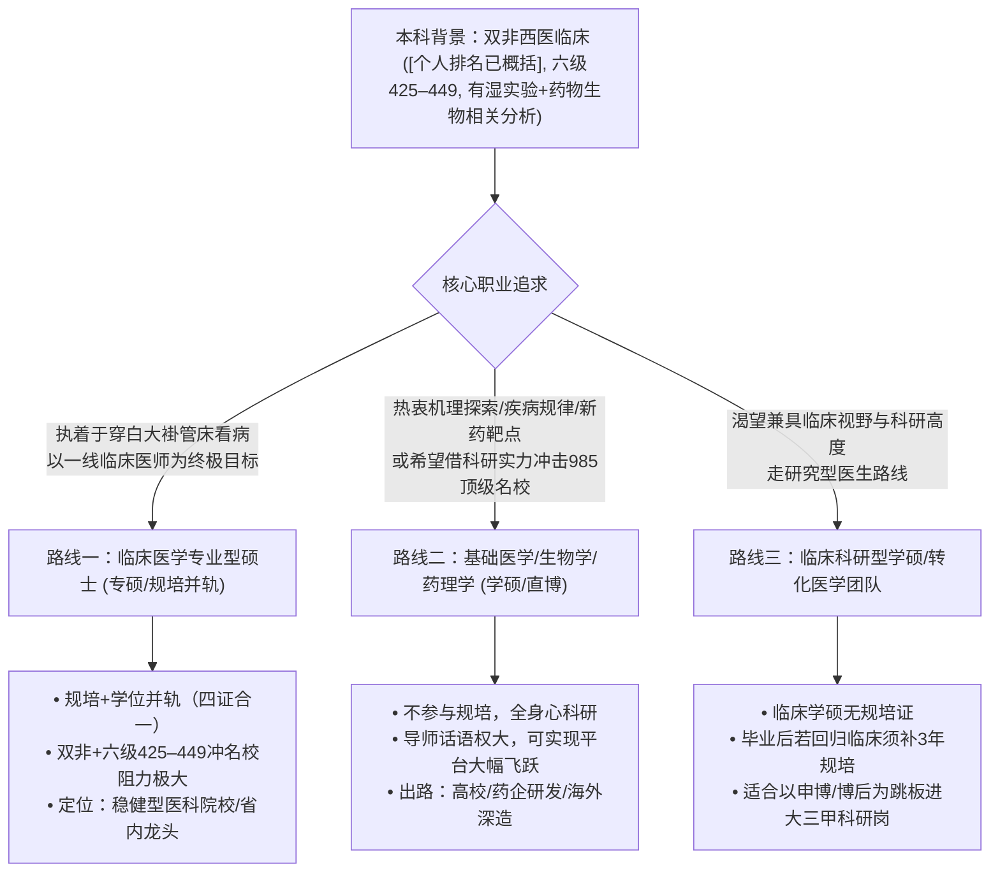
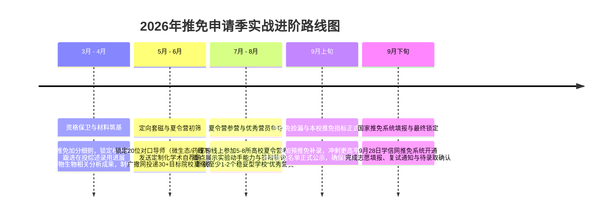

# 一所医药类高校临床医学专业2026推免深造与发展路线规划指南

> **规划对象背景画像**：
> - **院校与专业**：一所医药类高校 · 临床医学（西医五年制，代码1002）
> - **学业位次**：综合/学业排名 [个人排名已概括]（位列年级[个人排名已概括]）
> - **外语水平**：大学英语六级（CET-6）425–449 分
> - **科研实践**：微生物湿实验操作经历、临床病例分析、药物生物相关分析干实验分析；产出一篇共同第一作者（已发表）论文、一篇在投综述
> - **当前核心困惑**：临床医生路线（临床专硕/规培）与科学研究路线（基础学硕/直博）的选择与定位

---

## 一、 背景深度诊断与现状定盘：机遇与隐患并存

在制定具体路线前，必须先客观、冷静地对你的背景进行全方位“全息扫描”。你的综合背景具有极鲜明的**复合特质**，但同时存在**推免生死线边缘**与**外语短板**的双重挑战。

### 1. 优势资产（Strengths）
- **复合科研训练闭环（极为亮眼的加分项）**：
  很多本科生只有纯干实验（如仅做生信或药物生物相关分析数据挖掘）或仅参与基础湿实验（如配试剂、跑胶）。你同时具备**微生物湿实验**、**药物生物相关分析干实验**和**临床病例研究**经验。这种“临床问题提出 $\to$ 生信/药物生物相关分析靶点通路筛选 $\to$ 微生物/细胞湿实验功能验证”的综合思维，是各大医学院校导师极度青睐的学术潜质。
- **实质性科研成果加持**：
  本科期间拥有一篇已发表共一论文，加上一篇在投综述，足以证明你具备基本的学术写作、文献梳理和科研推进能力，超越了80%以上的同级医学推免生。
- **成绩位居头部梯队**：
  在专业人数已概括中排名[个人名次已概括]，展现了扎实的西医临床医学专业课基本功。

### 2. 劣势与瓶颈（Weaknesses）
- **院校背景属性的结构性局限**：
  一所医药类高校是一所以中医药学科为特色的省属重点高校（“双非”），其临床医学（西医）并非传统优势主干学科。在全国高水平医学院校（如协和、复旦、上交、浙大、华西、中大等）推免生初审筛选机制中，双非西医临床专业在机筛（Background Screening）中面临天然劣势。
- **英语六级 425–449 分：处于竞争临界点**：
  虽然通过了国家六级线（425分），满足绝大多数医学院校招收推免生的及格门槛，但在名校夏令营与预推免入营竞争中，425–449分往往不占优势。全国顶尖医学名校（尤其是临床专硕）夏令营入营初筛，六级通常默认为 480 分甚至 500 分以上。
- **药物生物相关分析研究的学术“双刃剑”效应**：
  药物生物相关分析近年来在医学学术界存在一定争议，部分顶尖高校学者将其视为“套路化灌水”。如果仅谈药物生物相关分析，面试时容易被专家针对其机制真实性进行尖锐提问；但若能紧密结合微生物实验验证，则可化劣势为优势。

### 3. 最紧急的第一要务：校内推免指标的“保卫战”
> [!IMPORTANT]
> **生死线警报**：
> 一所医药类高校作为省属双非医药院校，全校/各专业的推免指标比例通常在 **3% 至 5%** 左右浮动。
> 专业规模（人数已概括），推免名额通常在 **11 到 18 个** 之间。
> **[个人名次已概括]的位次恰好处在“推免指标边缘/临界线”（即俗称的保研水下或压线位置）！**
> 
> **首要行动策略**：
> 1. **吃透推免加分细则**：立刻研读《一所医药类高校推荐优秀应届本科毕业生免试攻读研究生工作管理办法》及第一临床医学院/相关教学单位的量化细则。
> 2. **全力打满科研与综测加分**：明确你的**已发表共一论文**在学校推免评分中的署名认定规则（部分学校只认第一作者第1位，或按作者位次折半加分）；全力催化**在投综述**，争取在推免资格终审前拿到正式录用通知（Acceptance/Proof），争取关键的0.5~1分加分逆袭。
> 3. **竞赛与荣誉补齐**：梳理是否有大学生创新创业训练计划（大创）、“挑战杯”、“互联网+”或医学技术技能大赛加分。
> 4. **做好双轨对冲**：在未拿到正式推免资格前，西医综合（306）的考研复习**绝不可完全停滞**，避免九月推免名单公布时若出现位次波动而措手不及。

---

## 二、 读研路线深度剖析：临床专硕 vs 基础学硕/直博

针对你“在临床工作和基础研究之间犹豫”的困惑，以下从国家医学培养政策、求职市场门槛、个人背景适配度三个维度进行对比与剖析：



---

### 路线一：临床医学专业型硕士（专硕，Master of Medicine）

#### 1. 培养路径与制度核心
- **“四证合一”模式**：研究生培养与住院医师规范化培训（住培/规培）紧密并轨。3年毕业时须同时取得：硕士研究生毕业证书、硕士专业学位证书、执业医师资格证书、住院医师规范化培训合格证书。
- **日常常态**：33个月以上泡在医院临床科室，管床、写病历、倒班、倒急诊、值夜班，临床实践压力大，实验室科研时间被极大压缩。

#### 2. 就业市场与晋升现实
- **硕士直接就业**：在地级市三甲医院、县域龙头三甲、或二级医院，专硕“四证合一”毕业即可直接独立执业，是性价比最高的实用行医途径。
- **顶尖大三甲门槛**：全国一二线城市省属核心大三甲（如郑州大学第一附属医院、河南省人民医院及北上广知名三甲），临床医生招聘门槛已全面抬升至**全日制博士研究生**。专硕如果未来想进核心大三甲，必须考取/申请**临床专业型博士（专博）**。然而，由于专硕在读期间疲于应付临床轮转，科研产出普遍不足，在如今全面推行“申请-考核制”的博士招录中，面临极大的科研硬指标压力。

#### 3. 与你当前背景的匹配度评估
- **入营难度大**：名校临床专硕夏令营名额极其稀缺，大部分被985/211/知名独立医科大学（如首都医科大学、南京医科大学）学生占据。受限于双非院校与六级425–449分，冲刺名校临床专硕极易在初筛阶段被筛下。
- **科研优势被稀释**：你的微生物实验与药物生物相关分析技能在专硕培养体系中利用率相对较低，因为你几乎没有完整的实验时间脱产进实验室。

---

### 路线二：基础医学 / 药理学 / 生物医学学术型硕士与直博（学硕/直博）

#### 1. 培养路径与制度核心
- **纯粹科研导向**：脱产进入实验室，开展疾病发生机制、免疫调控、微生物组学、药物靶点开发等前沿科学研究。
- **不参与临床规培**：**无法在就读期间获得住院医师规范化培训合格证书**。

#### 2. 发展通道与就业出路
- **学术与研发通道宽广**：硕士毕业后可直升博士或申请海外名校PhD，未来进入高等院校、国家级医学科学院（如中科院、医科院）、高水平三甲医院专职科研PI实验室、生物医药跨国公司（R&D研发、医学事务部MSL、生信分析专家）等。
- **平台层级实现“降维打击”**：在基础医学、药理学领域，导师拥有极大的招生自主权。你的微生物湿实验背景 + 药物生物相关分析数据分析 + 论文发表经历，恰好击中了导师对“能直接干活的研究生”的刚性需求。凭借这套组合拳，你有很大机会冲破院校背景壁垒，推免至**复旦、交大、浙大、中科院上海药物所、华中科大等985或顶尖院所**。

#### 3. 与你当前背景的匹配度评估
- **最大痛点——回临床的时间成本沉没**：
  > [!WARNING]
  > **重返临床的制度硬壁垒**：
  > 如果你读了基础医学学硕，未来突然反悔想做临床医生管床看病，你将面临极高的政策代价：
  > 1. 基础医学硕士无法报考西医临床专博；
  > 2. 凭借本科学历报考临床执业医师后，入职医院必须**全脱产补齐3年住院医师规范化培训**；
  > 3. 大医院临床科室招聘时，对基础医学硕士应聘临床医师岗位限制极严。
  > **因此，选择纯基础学硕，必须做好彻底告别一线临床看病工作的心理准备！**

---

### 路线三：破局折中方案——临床医学学术型硕士（临床学硕）或高水平转化医学团队

如果你既放不下临床医学的知识背景，又深刻意识到自己的科研优势在保研名校中更具杀伤力，可重点考虑“第三条路线”：

#### 1. 什么是临床学硕？
- 学位代码属于 **1002 临床医学（学术型）**，导师通常是大三甲医院的知名学科带头人（主任医师/教授）。
- 培养模式不进病房当苦力规培，而是依托附属医院的国家级重点实验室、医学转化中心进行**疾病机制与转化研究**（如肿瘤微环境、肠道微生物与重症感染、代谢疾病药理靶点等）。

#### 2. 核心战略价值
- **学术跳板与博士绿色通道**：临床学硕是通向“申请-考核制”博士的最强跳板。硕士期间集中精力产出高水平SCI论文，硕士毕业后顺理成章申请顶尖医院的博士学位。
- **规培政策在博士阶段化解**：
  - 目前许多省份和顶尖大三甲医院针对具有博士学位的医学科研人才，规培政策更加灵活（例如：进站做临床博士后期间完成规培，拿博士后丰厚年薪同时解决规培问题；或直接聘任为医院专职科研岗/特聘研究员）。
- **完全盘活你的现有优势**：你既懂临床病例的逻辑，又有微生物实验动手能力，还能利用药物生物相关分析生信工具，与大医院主任的临床转化实验室契合度高达 100%。

---

## 三、 黄金决策模型：如何找到属于你的终极答案

为了彻底消除你的犹豫不决，请对照以下**四个维度矩阵**与**灵魂自测三问**，按自己的真实心性进行打分权衡：

### 1. 四维权衡决策矩阵

| 评估维度 | 选择【临床专硕】 | 选择【基础医学学硕/直博】 | 选择【临床学硕/转化医学】 |
| :--- | :--- | :--- | :--- |
| **终身职业角色** | 一线临床医生（看门诊、做手术、值夜班） | 科研学者/大学教师/药企研发科学家 | 临床科学家（Physician-Scientist）/高层次医学研究者 |
| **保研择校平台上限** | 大概率止步于省内重点医科大或双非医科强校 | **上限极高，可强力冲刺985名校及顶尖科研院所** | 可争取中上游985医学院或顶尖医科大学附属医院 |
| **日常工作压力源** | 医患矛盾、病历书写、繁重夜班、繁琐事务 | 课题推进、实验失败、发不出高质量论文的焦虑 | 兼顾实验进度与临床课题设计的双重脑力挑战 |
| **学历天花板与破局** | 专硕可先就业；但若进顶尖大三甲必须后续脱产硬考专博 | 必须以“博士”为标配终点，硕士毕业就业竞争力相对局限 | 目标直指申请-考核制直博/博士后，学术上限极高 |

---

### 2. 灵魂自测三问（请依内心真实感受作答）

- **问自己第一题**：“如果让你未来三十年不再接触任何病人、不开医嘱、不做手术，只与移液枪、细胞间、动物房、高通量测序数据和论文打交道，你会觉得如释重负，还是充满深深的遗憾与不甘？”
  - *如果感到遗憾不甘 $\to$ 你的骨子里依然热爱临床，请选**临床专硕**或**临床学硕**。*
  - *如果感到如释重负 $\to$ 果断拥抱**基础医学/药理学**，不要在临床内卷中消耗自己。*

- **问自己第二题**：“你目前更渴望的是‘三年后立刻工作拿规培证独立执业’，还是‘愿意以时间换空间，坚定读博，争取更高的学术平台与平台跳板’？”
  - *若想短期稳定落地独立行医 $\to$ 选**临床专硕**。*
  - *若下定决心读博且追求顶级985名校声誉 $\to$ 选**学硕/直博**。*

- **问自己第三题**：“面对名校情结与专业执念，如果‘普通医科大学的临床专硕’和‘中科院/985高校的基础医学/药理学硕’同时摆在你面前，你更倾向哪一个？”
  - *倾向前者 $\to$ 坚守临床一线；倾向后者 $\to$ 科研路线更适合你。*

---

## 四、 科研背景与专业技能的“破局化”包装策略

在推免材料准备与面试过程中，你的科研经历必须进行**战术重塑**，扬长避短，规避学界偏见，凸显科研硬实力：

```
【原有表述 - 易遭质疑】
“做过药物生物相关分析、微生物实验，有一篇共一文章，有一篇综述在投。”
                ⬇️ 战术升级与逻辑重构
【升级包装 - 形成闭环】
“以临床耐药/微生态失衡等临床问题为牵引，熟练运用药物生物相关分析进行‘靶点-通路-成分’的计算机虚拟筛选；
更以此为线索，独立开展微生物分离培养、抑菌活性及相关表型功能验证的湿实验操作；
实现了‘临床病例洞察 ➔ 干实验高通量筛选 ➔ 湿实验表型机制确证’的干湿结合科研全流程闭环训练。”
```

### 1. 药物生物相关分析：“去套路化”叙事
- **痛点警惕**：近年来部分答辩专家对药物生物相关分析印象较差，认为“纯药物生物相关分析即是动动鼠标拼凑数据”。
- **破解方案**：在个人陈述和简历中，**绝不要将药物生物相关分析作为主角**，而要将其定义为**“前期的计算辅助与高通量筛选工具”**。重点阐述你如何通过药物生物相关分析锁定了关键通路，随后如何通过**微生物实验**进行真实世界的检验。将重点放在“筛选后的生物学意义分析”上。

### 2. 微生物实验：夯实“湿实验”技术基本盘
- 面试时导师最看重的是进组能否直接上手实验。
- 将你的微生物实验经历细化为具体的**实验技能清单**：如厌氧/需氧菌培养纯化、微量肉汤稀释法测定MIC/MBC、生物被膜（Biofilm）形成与结晶紫染色、生长曲线测定、PCR扩增与电泳、微生物耐药机制探究等。
- 强调自己在实验操作中的规范性、无菌观念、实验记录完整性以及解决意外污染或实验失败的实际排错能力（Troubleshooting）。

### 3. 临床病例与在投综述：证明学术视野与学术写作成熟度
- **共一论文**：准备好1分钟中英文核心摘要阐述。明确说明自己在共一中的具体分工（如：负责湿实验操作、数据图表绘制、初稿撰写），展示你的团队协作与科研贡献。
- **在投综述**：综述体现了你对某一细分领域的全面文献把控能力。明确该综述聚焦的科学前沿（如中药活性成分调控肠道菌群与宿主免疫交互），夏令营前将综述的思路大纲制作成PPT汇报中的“前沿展望”部分。

---

## 五、 2026推免全流程阶梯式备战方案与择校策略

### 1. 梯队式择校择导战略（根据路线分类推进）

#### 方案 A：坚定选择临床路线（专硕为主）
鉴于双非西医背景及六级425–449分，必须采取**“田忌赛马、稳扎稳打、立足区域医药强校”**的策略：
- **冲刺层（博弈前沿）**：
  - 传统中上游医科大学的部分相对冷门科室或外省综合性大学：如天津医科大学、哈尔滨医科大学、中国医科大学、重庆医科大学的非热门临床专科。
- **主力攻坚层（高匹配度与高性价比）**：
  - **省内区域龙头**：郑州大学医学院（一附院、省人民医院专硕名额多，作为河南本地生源有地域认同优势，六级要求通常425即可）。
  - **省外优质独立医科院校**：大连医科大学、温州医科大学、安徽医科大学、河北医科大学、江西医科大学等。这些学校临床实力过硬、在全国认可度高，且对双非优秀生源开放度大。
- **保底层（守住底线）**：
  - 新乡医学院（西医专硕底蕴深厚，在河南省及周边极具行业口碑）、一所医药类高校本校直属附属医院临床专硕。

#### 方案 B：选择基础/转化医学科研路线（学硕/直博）
充分发挥你“干湿结合科研底色 + 论文加分”的优势，**大胆破圈，实现院校层级跃升**：
- **顶级冲刺层（985高校及国家级科研院所）**：
  - 中国科学院上海药物研究所、中国科学院上海营养与健康研究所、中国科学院微生物研究所。
  - 华中科技大学同济医学院（基础医学院病原生物学/药理学）、中南大学湘雅医学院、中山大学中山医学院、浙江大学基础医学院、复旦大学基础医学院。
  - **导师画像锁定**：专攻**“感染微生态”、“肠道菌群与免疫代谢”、“天然药物/中药活性单体抗耐药菌机制”**的PI。这些实验室与你的微生物背景和药物生物相关分析思路完美重合！
- **稳妥攻坚层（顶尖双一流药科/医学名校）**：
  - 中国药科大学（药理学/微生物与生化药学）、沈阳药科大学、南京医科大学（基础医学院）、首都医科大学（病原微生物方向）。
- **兜底与对冲层**：
  - 郑州大学基础医学院/药学院，或本校高水平中西医结合基础科研团队。

---

### 2. 备战时间轴与关键里程碑（2026推免季实战推进表）



#### 各阶段关键要点执行细则：

- **阶段一：3月 - 4月（校内指标保卫与科研文书筑基）**
  1. 找教务处/学院科教办彻底摸清加分截止时间节点，把“在投综述”催审催录用作为头等大事。
  2. 制作一份**“学术型”个人简历（1页纸）**：将专业排名（[个人排名已概括]）、CET-6（425–449）客观陈述，核心版面必须浓墨重彩展示：
     - ① 课题经历与实验技能树（湿实验：微生物分离、培养、药敏等；干实验：靶点筛选、分子对接、通路富集）；
     - ② 学术成果（已发表论文的发表年份、卷期、中科院分区、作者位次；在投综述的期刊层次与当前审稿状态）。
  3. 准备好个人陈述（中英文各一版）与专业PPT（5分钟学术汇报，浓缩你的科研全流程）。

- **阶段二：5月 - 6月（精准定位与首轮导师套磁）**
  1. 关注目标院校研究生院官网发布的夏令营通知，建立 Excel 追踪表（记录截止日期、六级门槛、报名材料要求）。
  2. **精准学术套磁**：
     - 不要广撒网群发，针对高度对口的导师（如研究肠道菌群与代谢、中药抗耐药菌机制的青年杰青/优青/教授）。
     - 邮件主题务必规范：`【推免自荐-学硕/专硕】一所医药类高校临床医学[个人排名已概括]-姓名-微生物与药物生物相关分析背景附简历`。
     - 邮件正文结构：简要自我介绍 $\to$ 阐述为何对老师近期发表的某篇代表作感兴趣 $\to$ 结合自己做过的微生物实验与药物生物相关分析经历谈谈自己的契合点与未来设想 $\to$ 礼貌请求夏令营考核指导。

- **阶段三：7月 - 8月（夏令营实战与考核制胜）**
  1. **专业英语考核突破**：利用碎片时间背诵医学专业核心词汇，准备好2分钟英文自我介绍，以及用英文阐述一段你的微生物实验流程（如：“How do you perform an antimicrobial susceptibility test?”）。
  2. **专业综合面试应对**：
     - 准备好被问及“药物生物相关分析靠不靠谱”、“共一论文你负责什么”、“为什么中医药院校西医专业想来我们组”等核心压力面试问题。
     - 面对提问始终保持：**谦逊的学术态度、严谨的实证精神、对基础研究的浓厚求知欲**。
  3. 至少在7月底前拿到一个**保底院校的“优秀营员”（优营）**资格，彻底解除后顾之忧。

- **阶段四：9月（预推免冲刺、校内指标落地与系统锁定）**
  1. 9月初是各校推免资格认定的最后关头，确保自己名字出现在学校教务处推免名单的“正选公示栏”中。
  2. 若夏令营结果不甚理想，9月中旬的**“预推免”**是绝地反击的良机（很多985高校的学硕甚至专硕在预推免阶段由于前期生源流失会出现补录名额）。
  3. 9月28日国家推免系统开放当天，迅速完成签约，稳妥锁定心仪院校。

---

## 六、 针对该同学的个性化行动建议清单（Actionable Checklist）

为确保你在未来的几个月内步步为营，请立即执行以下**五大行动指令**：

- [ ] **行动 1：完成本校往年推免位次与加分清算**
  立刻联络上届保研成功的学长学姐，调取上一届临床医学专业最终推免资格名单：最后一名拿到推免资格的综合排名是多少？你的共一论文按学院细则能加多少分？若加上论文分，你的综合位次能否从[个人名次已概括]跃进到前12名以内？
- [ ] **行动 2：推进在投综述的审稿周期**
  若综述已外审，注意关注审稿状态；一旦收到修回意见（Major/Minor Revision），以最高效率在3~5天内高质量修改并返修，全力争取在7月夏令营前或8月预推免前拿到正式录用函（Acceptance Letter）。
- [ ] **行动 3：重新撰写科研经历陈述模块（杜绝浮躁药物生物相关分析，立足机制与验证）**
  将个人简历与个人陈述中的科研经历重新整合为“基于高通量计算筛选与微生物表型验证的XXX探索”，重点提炼出你掌握的4~6项微生物湿实验核心技能。
- [ ] **行动 4：做出一套“梯队化导师备选库”（20人名单）**
  分两组建档：一组为**临床专硕导师（郑大、天医、哈医、大连医、温医等）**；另一组为**基础/药理学学硕导师（中科院药物所、华中科大同济医学院、浙大、中国药大等从事微生态/天然产物药理方向的课题组）**。
- [ ] **行动 5：制定考研西医综合（306）底线对冲计划**
  鉴于[个人名次已概括]处于推免资格边缘，切勿“全押保研”。保持每日至少2~3小时的西综生理、病理、内科核心考点复习节奏。进可稳夺名校推免，退可立足全国统考，彻底消除后顾之忧，立于不败之地。

---

> **结语寄语**：
> 拥有西医临床专业素养，同时兼具计算机虚拟筛选与微生物湿实验的复合背景，是你在推免浪潮中独一无二的闪光点。不必为双非身份和425–449分的六级过度内耗——在医学科学研究的浩瀚领域中，清晰的学术逻辑、扎实的实验动手能力与脚踏实地的执行力，永远比冰冷的数字更能打动真正求贤若渴的导师。锁定指标，找准赛道，扬长避短，你必将赢得属于你的理想彼岸！
