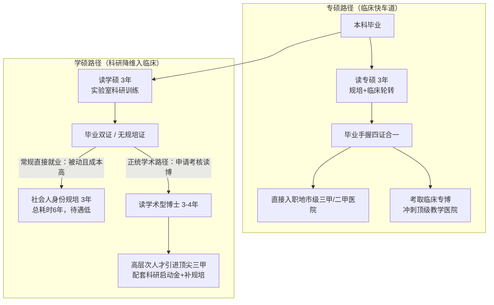

# 临床医学推免（内科方向）学硕与专硕选择及生涯发展深度规划指南

> **写在前面**：  
> 同学你好！恭喜你在本科阶段取得了非常优异的学业排名，并且早早积累了病例研究、微生物与药理实验经历，更斩获了极为宝贵的**共同一作已发表论文**。在本科阶段能具备这样“临床思维+基础湿实验+学术产出”复合背景的学生在推免群体中并不多见，这是你极具含金量的核心竞争优势。  
> 
> 针对你目前的背景（**一所医药类高校临床医学、排名前约5%、六级425–449分、共一论文已发表、意向内科方向**）以及在“学术型硕士（学硕）”与“专业型硕士（专硕）”之间的抉择困惑，本文将从**背景诊断、本质区别、临床/科研深远影响、决策矩阵、实战择校与文书套磁**等五个维度为你进行全景剖析与定制规划。

---

## 一、 同学个人背景综合诊断与优劣势评估

在做具体选型之前，首先要客观建立你在2026年推免大盘中的“个人画像”：

### 1. 核心优势（Strengths）
- **学术产出含金量极高（共一已发表论文）**：在推免申请中，“已录用/已见刊论著”的权重远高于“大创在研”或“仅有结题报告”。拥有一篇共同一作论文，直接证明了你具备严谨的科研逻辑、数据分析能力、学术写作功底以及与团队协作推进课题落地的完整经历，是打破院校壁垒的“重武器”。
- **科研经历兼具深度与交叉性（微生物+药理+病例）**：
  - **病例研究**证明你具备临床敏锐度和对疾病诊疗过程的观察力；
  - **微生物与药理实验**属于含金量极高的“湿实验（Wet Lab）”训练（细胞培养、菌种鉴定、给药代谢、机制验证等），这与内科众多亚专科（如感染内科、消化内科微生态、呼吸内科感染与耐药、心血管/内分泌药理与代谢）高度契合，深受内科大课题组导师欢迎。
- **学业成绩优异**：前约5%（位列前 **约5%**），在中医类院校的西医临床专业中属于第一梯队，正常情况下稳拿本校推免资格。

### 2. 现实短板与限制（Weaknesses & Threats）
- **院校生源标签的客观挑战**：一所医药类高校是中医药特色双一流高校，但你的专业是**西医临床医学**。在冲刺顶尖综合性985大学医学院或老牌西医强校（如同济、湘雅、复旦、中山等）时，部分院校招生办在初筛时可能存在对“非传统西医名校”的隐形壁垒。
- **英语六级425–449分**：
  - *优点*：顺利通过425分及格线，满足了全国绝大多数医科大学推免申报的硬性门槛；
  - *劣势*：分数位于440~450分区间，未达到部分顶尖医学院校夏令营材料初筛的隐形高门槛（部分顶尖名校机筛或内科热点专硕初筛偏好460分、480分乃至500分以上）。因此在文书和网申中，必须通过强大的科研成果来覆盖这一短板。
- **专硕大盘极端内卷**：全国临床专硕（尤其是大内科、大外科）保研竞争已呈现白热化，许多名校名额大幅向本校或顶级生源倾斜。

---

## 二、 临床医学“学术型硕士（学硕）” vs “专业型硕士（专硕）”全景对比

临床医学在我国属于双轨培养体系，两者的培养路径、毕业证书、培养周期有着本质不同：

| 比较维度 | 专业型硕士（专硕，代码 1051） | 学术型硕士（学硕，代码 1002） |
| :--- | :--- | :--- |
| **培养目标** | 高层次应用型临床医师 | 医学科学研究人员、高校教师、潜在学科带头人 |
| **毕业证书** | **“四证合一”**：硕士毕业证、硕士学位证、《执业医师资格证》、《住院医师规范化培训合格证书》（规培证） | **“双证”**：硕士毕业证、硕士学位证（**无规培证**；研二/研三可通过本科文凭或研究生培养资质考取执业医师证，但不能取得规培证） |
| **日常培养状态** | **33个月临床轮转**。白天管床、查房、开医嘱、值班抢救、写病历，科研时间严重碎片化（靠周末/下夜班）。 | **全脱产实验室/课题组研究**。从事分子机制、细胞动物实验、转化医学、生信分析等系统科研训练，无日常临床轮转负担。 |
| **毕业考核重点** | 临床专业技能考核、病历考核；学位论文多为临床回顾性总结、病例分析、Meta分析等，要求相对宽松。 | 严格的学术论文答辩；通常硬性要求发表高水平学术论文（SCI/CSCD论著），注重课题设计与科学假说验证。 |
| **读博发展通道** | 主要对接**临床医学专业型博士（专博）**；名额较少，竞争激烈；转学博难度较大。 | 无缝对接**学术型博士（学博）**；硕博连读、申请-考核制优势极为明显，导师极其偏爱有实验和文章基础的学硕。 |
| **当前政策趋势** | 临床执业医师的主流培养渠道；名额稳定但考录与推免门槛极高。 | 部分顶尖名校逐步缩招普通学硕，转向“直博化”和“硕博贯通”；培养愈发精英化、高端化。 |

---

## 三、 对未来“做临床”的深远影响与具体路径

你最关心的核心问题之一是：**“选学硕还是专硕，对以后做临床有什么区别？”**

答案是：**专硕是走临床的“直接快车道”，而学硕是走临床的“高阶学术迂回道”。二者对临床终点的平台层级和时间成本影响巨大。**



### 1. 专硕走临床：即战力强、沉没成本低、直接上岗无缝衔接
- **优势（核心竞争力）**：
  - **省去整整3年时间**：硕士毕业时即完成住院医师规范化培训，拿下四证。你可以直接参加各大医院的社会招聘或校园招聘，直接定级为住院医师，与医院签订正式劳动合同，工龄和职称晋升年限直接开始计算。
  - **临床综合素养过硬**：经历了33个月的系统轮转，你对内科各类常见病、多发病的诊治、病历书写规范、危急重症抢救、医患沟通等临床常规驾轻就熟，入职后能迅速“顶起一个班”。
- **现实天花板与挑战**：
  - **顶尖三甲医院的“博士门槛”**：如果你的目标是省会龙头三甲医院、国家/区域医疗中心（如郑大一附院、河南省人民医院，或北上广一线教学医院），目前内科各科室招聘的底线基本是**博士研究生**。仅凭专硕文凭，在顶级名院内科可能只能应聘非编制岗位、分院区或直接在简历初筛被卡。
  - **专硕毕业通常去向**：地级市核心三甲医院、省会普通三甲/二甲医院。如果对就职医院层级预期合理，专硕是毕业后快速做临床医生最安稳、风险最小的捷径。

### 2. 学硕走临床：切忌“硕士毕业直接就业”，必须坚定“学硕转博”
如果你选了学硕，但未来依然想做临床医生，请务必认清以下铁律：
- **致命陷阱：学硕硕士毕业直接找临床工作**
  - **无法直接执业**：由于没有规培证，99%的三甲医院在招聘临床医生时无法录取你，或者即使录取，你也必须以“社会人/单位人”身份重新在医院轮转规培整整3年。
  - **时间与经济成本巨大**：学硕3年 + 规培3年 = 6年。同龄专硕早已工作3年准备考主治医师，而你还在拿微薄的规培补助。**因此，医学界共识：临床学硕如果不打算读博，千万不要盲目选择。**
- **光明大道：学硕 -> 读博（学博） -> 进顶级大医院做“临床科学家”**
  - 顶尖三甲教学医院（如各大大学附属医院）的内科科室，本质上是“临床与学术并重”。科室主任和学科带头人不仅要能看病，更要有国家自然科学基金（国自然）、高分SCI论文、引领行业指南的临床科研能力。
  - **科研成果降维打击**：在学硕和博士期间受过严谨实验训练的学生，在申请进入头部大医院时极具吸引力。医院会把你作为“青年拔尖人才/后备科研骨干”引进，给你提供编制和安家费/科研启动经费。
  - **博士阶段规培政策红利**：很多省份和高水平教学医院对科研型博士有针对性政策，例如留院后参加规范化培训（部分地区专博/学博结合政策、科研博士规培可享受缩短或医院带薪专项培训政策），从而补齐规培短板。

---

## 四、 对未来“做科研”的深远影响与具体路径

内科是所有临床学科中**机制研究最深、药物研发最活跃、与基础转化结合最紧密**的学科。做科研在两个通道中的生态截然不同：

### 1. 学硕在科研维度的绝对主场优势
- **完整的科研闭环训练**：
  - 学硕期间你拥有整整3年时间浸泡在实验室。你可以系统建立假说、从事细胞与分子生物学实验、动物疾病模型构建、靶点筛选与药效评估，真正掌握“从分子机制到疾病表型”的科研方法论。
  - 结合你本科已有的**微生物与药理经历**，你进入学硕课题组后能够迅速接手国家级课题，在研一研二产出高水平SCI论著（影响因子5~10分+）。
- **申博通道极度顺畅（申请-考核制通关密码）**：
  - 目前全国主流医学院校博士招生已全面普及“申请-考核制”。博导挑选博士生时，最看重的硬指标就是：**① 已经发表的一作SCI论著；② 扎实的湿实验动手能力与实验平台经验。**
  - 学硕凭借丰硕的文章和实验技能，在申博时具有压倒性优势，可以非常轻松地申请到985高校、国家医学中心顶尖大牛导师的博士名额。
- **终身职业晋升的护城河（国自然与高级职称）**：
  - 在大型三甲医院，晋升副主任医师、主任医师，甚至竞聘科室副主任、主任、大内科教研室主任，**国家自然科学基金青年项目（国自然青基）和面上项目是决定性指标**。
  - 学硕出身的医生标书写作逻辑严密、机制探究深入，获批国自然的几率远超临床出身的纯专硕。

### 2. 专硕在科研维度的现实困境
- **时间严重被临床挤压**：
  - 专硕在医院轮转期间，每天面对的是无尽的写病历、贴化验单、术前/诊疗谈话、值夜班、收治新病人。下班后身心俱疲，根本无法支撑需要连续几天定期传代、观察、给药的湿实验。
- **论文产出类型受限**：
  - 绝大部分内科专硕受限于精力，只能做回顾性临床病历分析、Meta分析或生信挖掘。
  - *警惕趋势*：目前全国各大高校和医疗机构对“纯生信挖掘”、“套路化Meta分析”的认可度大幅跳水，很多高水平院校在博士招生初审、毕业要求或职称评审中已经明确规定不认可纯生信文章。
- **考博与学术竞争力面临壁垒**：
  - 专硕考博主要走“专博”。但各医学院校的专博名额非常紧俏，通常一个大内科博导一年只有1个甚至几年才轮到1个专博名额，往往还要照顾科室内部的骨干主治医师，竞争极其惨烈。专硕如果想跨考学博，又常常因为缺乏高水平机制文章和实验室技能而被博导拒之门外。

---

## 五、 为你量身定制的“决策模型与选型建议”

结合你的**具体背景**（一所医药类高校、西医临床前约5%、六级425–449分、共一论文、微生物药理实验经历、意向内科），我们建立以下决策矩阵：

### 决策树与三大路径抉择矩阵

```
【你的终极目标是什么？】
       │
       ├─► 诉求A：【稳妥务实】希望硕士毕业（26~27岁）立刻进入医院有一份稳定的医生工作，
       │          不想承受读博的延毕/学术压力，家庭或个人倾向于尽早经济独立。
       │          └──► 【坚定选择：专业型硕士（专硕 1051）】
       │
       ├─► 诉求B：【冲击顶峰】立志进入省会核心三甲教学医院或省外顶尖名院内科，
       │          有明确读博意愿（愿意读博至29~30岁），渴望成为临床与科研兼备的专家。
       │          └──► 【强烈推荐：学术型硕士（学硕 1002）】
       │
       └─► 诉求C：【两全其美/中庸策略】既想拿规培四证，又舍不得放弃自身的科研特长。
                  └──► 【策略性选择：顶级医科强校的“科研型专硕团队”】
```

### 深度剖析：为什么当前的你，选择“高平台学硕”是性价比极高的“逆袭破局解”？

从博弈论和推免录取概率的角度看，**学硕能最大化释放你的复合优势，避开你的劣势：**

1. **田忌赛马，降维打击**：
   - 如果你报**专硕**：面对的是全国各大医学院校尖子生的疯狂内卷，拼的是纯绩点、高六级（500+）和纯院校背景。你的六级425–449分和中医药院校西医背景容易在初筛机审中被卡，你的共一论文虽然有加分，但在专硕考核中只占一部分权重。
   - 如果你报**高水平医科院校内科学硕**：现在的保研大环境里，大量保研生因为害怕没有规培证而对学硕望而却步，导致部分985医学院校或独立医科强校的学硕生源竞争烈度相对专硕低很多。而这些院校的内科大PI、国家重点实验室急需**“进组就能上手干活、懂微生物和药理、能写SCI文章”**的得力助手！你带着“已发表共一论文+微生物药理背景”去联系学硕导师，你在导师眼里是极其抢手的“宝藏学生”。
2. **用学术平台跨越本科院校阶层**：
   - 读了高水平平台的学硕，紧接着转博/申博，博士毕业后你的最高学历直接跃升为名校医学博士，彻底洗刷本科背景壁垒，最终以高层次人才身份光明正大杀回顶级三甲医院内科，实现职业生涯的长远上限最大化。

---

## 六、 2026年推免申请季内科方向实战行动指南

在确定方向后，你需要在接下来的保研夏令营、预推免以及九月推免服务系统中落实执行策略：

### 1. 目标院校阶梯规划（冲/稳/保）

鉴于你的六级成绩（425–449分）跨过了425门槛，但在部分卡460/480的院校初筛上受限，建议重点瞄准**“对六级425分友好、综合实力强劲、内科强势”**的院校：

| 梯队 | 推荐院校及院系 | 申报建议与定位策略 |
| :--- | :--- | :--- |
| **冲刺层** | **中南大学湘雅医学院**<br/>**华中科技大学同济医学院**<br/>**吉林大学白求恩医学部**<br/>**山东大学齐鲁医学院** | **主攻学硕（1002）**。<br/>这些老牌名校的呼吸、消化、感染、肾内、心内实力雄厚，重点关注与微生物群落、药物靶向耐药机制密切相关的导师团队，提前套磁锁定。 |
| **核心稳妥层** | **郑州大学医学院（郑大一附院/省医）**<br/>**重庆医科大学**<br/>**首都医科大学**<br/>**南方医科大学**<br/>**南京医科大学**<br/>**天津医科大学**<br/>**哈尔滨医科大学** | **学硕专硕双管齐下**。<br/>• **郑大一附院**：省内绝对龙头，体量极大，你本省认可度极高，专硕学硕均有极佳机会；<br/>• **重医/南医大/首医**：全国顶尖独立医科大学，科研平台极佳，对科研成果突出的推免生认可度极高，六级425+即可过筛。 |
| **坚实保底层** | **一所医药类高校本校（一附院/人民医院培养）**<br/>**河南大学医学院**<br/>**新乡医学院** | 务必牢牢锁定本校内科专硕保底名额，确保推免绝对不滑档，立于不败之地。 |

### 2. 文书与简历包装：把“短板藏好，把王牌打爆”

- **论文置顶，打造“首屏杀手锏”**：
  - 在个人简历上方正中或第二栏设立【学术论著与代表作】模块。
  - 清晰列出论文标题、作者排序（**明确标注共同第一作者，标出自身排名，如：Co-first Author, 1/2**）、期刊全称、JCR分区、中科院分区、最新影响因子（IF）。
  - 用1~2行简要提炼你在文章中的**实质性核心贡献**（如：“独立负责小鼠给药动物模型构建与病理取材、主导qPCR与Western Blot实验验证、完成初稿撰写及Reviewer修回数据补充”）。
- **将经历串联为“转化医学（Translational Medicine）”的闭环故事**：
  - 巧妙融合你的三段经历：从**临床病例研究**中“发现临床治疗痛点与未被满足的需求”，进而运用**微生物学**（如菌群结构与微生态屏障）与**药理学**（药物协同、靶向干预机制）手段在实验室进行机理探究，最终产出**学术论文**。
  - 这种“临床问题驱动 -> 基础实验探究 -> SCI论文产出”的思维逻辑，是内科博导梦寐以求的研究生潜质。
- **弱化六级分数，强化专业外语实操能力**：
  - 简历中只需简洁注明：`大学英语六级（CET-6）：425–449分（通过）`。
  - 在语言能力栏重点强调：`熟练阅读英文内科指南（UpToDate、ESC/AHA、NCCN等）及顶级期刊文献；具备独立撰写并成功发表SCI论著的全流程英文学术写作能力。` 用白纸黑字的发表成果证明你的英语应用水平。

### 3. 导师套磁与面试突围战术

- **精准锁定交叉学科导师**：
  - 浏览目标院校内科（消化、呼吸、感染、内分泌、心内等）导师主页，重点寻找**承担国家自然科学基金重点项目、课题方向涉及“肠道微生态”、“感染与耐药机制”、“代谢性疾病靶向药理”**的导师。
  - 发送套磁信时，将信件标题拟定得严谨专业，例如：  
    `【推免申请】一所医药类高校临床医学（专业相应排名位次）+已发表共一SCI+申请内科学硕/专硕-姓名`
  - 邮件正文中附上个人简历及已发表论文的PDF全文。
- **面试考核通关要诀**：
  - **准备好5分钟学术汇报PPT**：系统阐述你共一论文的背景、假说、实验方法、关键数据结果及临床转化意义。务必对文章里的每一个实验细节（引物设计、对照组设置、统计学方法是t检验还是ANOVA）了然于胸，导师最喜欢追问细节以检验论文是否由你亲手完成。
  - **准备内科临床基础问答**：复习内科学常见急危重症（如急性左心衰、糖尿病酮症酸中毒、消化道大出血、呼吸衰竭）的诊断步骤、鉴别诊断及急救原则，展现扎实的临床基本功。

---

## 七、 总结与建议行动清单

最后，给你一份清晰的决策建议：

1. **如果你的人生规划倾向于“早工作、早成家、求稳扎根临床”**：
   - **选专硕**。利用你的综合成绩和共一文章优势，主打**郑州大学第一附属医院、首都医科大学、重庆医科大学、南方医科大学**等优质医科院校的内科专硕。三年毕业四证合一，直接进入心仪的三甲医院成为内科骨干。
2. **如果你的人生规划倾向于“走得更高、立志读博、追求学术与顶尖三甲医院内科名医”**：
   - **果断选学硕**。以中南湘雅、华科同济、山大齐鲁、吉大白求恩等老牌985院校为目标，直接投奔内科大牛实验室。三年产出高分文章，直通学术博士，在未来的主任医师竞聘和学科带头人角逐中占据制高点。

祝你2026推免申请季乘风破浪，一战成功，顺利进入理想的医学殿堂！
