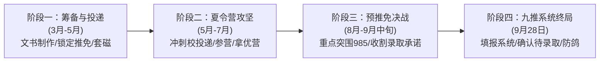

# 2026年推免申请季：内蒙古大学化工专业保研择校与定位规划方案

---

## 一、 考生推免竞争力全景画像与SWOT分析

### 1. 核心硬性指标与推免资格研判
- **本科院校层次**：内蒙古大学（“双一流”世界一流学科建设高校、“211工程”重点建设高校、部省合建高校）。在全国推免生源筛选池中，属于**区域重点211高校**。国内绝大多数985工科强校及中国科学院院所均对内大具有较高的生源认可度。
- **学业成绩与排名**：**前约15%（前 约15%）**。
  - **推免资格推断**：内蒙古大学理工科学院历年保研率大致在13%~16%区间波动。结合你拥有**EI会议一作、SCI合作作者（非第一作者，具体分区与位次已概括）**以及**化工学科竞赛经历**，在学院综合测评（综合素质加分）环节将带来显著加分，你的综合排名将进一步向前跃升，**稳获本校推免资格的概率极高**。
  - **外推竞争力定位**：在外校推免初审筛选中，15%左右的排名属于**中等偏上水准**。在少数只针对生源校排名前5%甚至前3%的超一流顶尖夏令营中会面临初审筛选压力，但在中坚985工科、行业顶级211及中科院研究所中，该排名完全处于有效竞争区间内。
- **英语六级水平**：**CET-6 450–499分**。
  - **门槛达标情况**：跨过了绝大多数985/211高校和中科院院所对于工科/化学化工类推免生的六级及格线（425分），不会在初审环节因英语“硬性不合格”而被一票否决。
  - **竞争劣势弥补**：450–499分虽然过线，但未达到500分以上的高分优势梯次。在面试环节，需注重展示专业英语阅读、文献调研与学术交流能力，以弥补六级分数的平淡。

### 2. 科研经历与软实力亮点剖析
- **项目经历针对性极强**：
  - **水系锌离子电池（AZIBs）**：当前国际电化学储能领域的热门前沿赛道，兼具本征安全与低成本优势。涉及电解液添加剂设计、正极宿主微观结构改性、锌负极枝晶与析氢副反应抑制等核心难点，是储能材料、电化学化工极其看重的即战力方向。
  - **催化研究项目**：催化领域经典且前沿的方向，涉及半导体能带工程、异质结构筑、光生载流子分离效率提升、光催化产氢/降解/CO₂还原等。该经历表明你具备扎实的材料合成、表征分析（XRD、SEM、XPS、UV-vis DRS、光电化学测试等）基本功。
- **论文与学术成果含金量**：
  - **本科阶段产出 EI 会议一作 + SCI合作作者（非第一作者，具体分区与位次已概括）**：在化工/材料类本科生中属于**极高含金量的加分项**。二作SCI说明你深度参与了完整实验与机理推导，EI一作证明你具备独立撰写英文论文并完成同行评议流程的能力。在夏令营和预推免面试中，能够直接将你与“纯高绩点但零科研产出”的应试型考生拉开代差。
- **化工学科竞赛经历**：
  - 拥有全国大学生化工设计竞赛（或其他化工类国家级/省部级竞赛）经历，展现了良好的化工工程素养、流程模拟（Aspen Plus）、CAD制图或工程实验动手能力，实现了“基础化工工程能力”与“前沿实验室科研能力”的复合。

### 3. 总体择校梯队布局策略
综合考量“211前15% + 六级450–499 + SCI/EI论文 + 化工竞赛”的背景特征，推免申请应遵循**“冲稳保梯次搭配、专硕学硕并重、院所与高校互补”**的原则，推荐策略如下：
- **冲刺档（Dream，3~4所）**：顶尖化工985、国内催化顶级科研院所、顶尖材料储能强校。重点通过夏令营冲刺，利用高契合度科研成果和提前联系导师争取突破。
- **核心主力/稳妥档（Match，7~8所）**：中坚工科985高校、电池/催化特色中坚中科院所、化工顶尖211。兼顾学硕与专硕（085600 材料与化工），初审通过率高，考核重点看科研，胜算极大。
- **兜底保底档（Safety，3~4所）**：行业特色211高校、化工A类优势学科高校及内蒙古大学本校，确保保研全流程零风险。

---

## 二、 15个具体学校、学院与专业（项目）组合推荐详表

| 序号 | 梯队定位 | 学校名称 | 学院全称 | 专业代码及名称 | 建议契合研究方向 / 团队实验室 |
| :---: | :---: | :---: | :---: | :---: | :---: |
| **01** | **冲刺档** | **天津大学** | 化工学院 | 081700 化学工程与技术 / 085600 材料与化工 | 工业催化研究所 / 先进能源材料与催化课题组（巩金龙团队等） |
| **02** | **冲刺档** | **中国科学院大连化学物理研究所** | 储能技术研究部 / 催化基础国家重点实验室 | 081700 化学工程与技术 / 070304 物理化学 | 水系电池储能系统（李先锋团队） / 洁净能源光电催化（李灿/张涛团队） |
| **03** | **冲刺档** | **华东理工大学** | 化工学院 | 081700 化学工程与技术（081705 工业催化） / 085600 材料与化工 | 化学反应工程国家重点实验室 / 绿色催化与清洁能源转换团队 |
| **04** | **冲刺档** | **大连理工大学** | 化工学院 | 081700 化学工程与技术 / 085600 材料与化工 | 精细化工国家重点实验室（人工光合成与光催化） / 先进碳材料与储能团队 |
| **05** | **核心稳妥** | **中南大学** | 冶金与环境学院 | 080600 冶金工程 / 085600 材料与化工 | 先进储能材料与器件团队（水系锌离子电池顶尖团队：周江/梁叔全团队等） |
| **06** | **核心稳妥** | **北京化工大学** | 化学工程学院 | 081700 化学工程与技术 / 085600 材料与化工 | 化工资源有效利用国家重点实验室（能源催化与先进二次电池，段雪/宋宇飞等团队） |
| **07** | **核心稳妥** | **华南理工大学** | 化学与化工学院 | 081700 化学工程与技术 / 085600 材料与化工 | 广东省燃料电池技术重点实验室 / 二次电池储能材料与多相催化团队 |
| **08** | **核心稳妥** | **湖南大学** | 化学化工学院 | 081700 化学工程与技术 / 070300 化学 | 化学生物传感与计量学国家重点实验室 / 先进电催化与储能材料（王双印团队等） |
| **09** | **核心稳妥** | **中国科学院兰州化学物理研究所** | 清洁能源化学与材料实验室 / 羰基合成与选择氧化国重室 | 081700 化学工程与技术 / 070304 物理化学 | 新型电化学储能材料（阎兴斌团队等） / 工业催化多相反应工程 |
| **10** | **核心稳妥** | **四川大学** | 化学工程学院 | 081700 化学工程与技术 / 085600 材料与化工 | 磷化工与先进电池电极材料 / 能源催化与反应工程课题组 |
| **11** | **核心稳妥** | **重庆大学** | 化学化工学院 | 081700 化学工程与技术 / 085600 材料与化工 | 洁净能源与资源化工 / 光催化转化与先进电池储能团队 |
| **12** | **核心稳妥** | **山东大学** | 化学与化工学院 | 081700 化学工程与技术 / 070304 物理化学 / 085600 材料与化工 | 胶体与界面化学教育部重点实验室 / 先进二次电池与光电功能材料 |
| **13** | **兜底保底** | **中国石油大学（北京）** | 化学工程与环境学院 | 081700 化学工程与技术（081705 工业催化） / 085600 材料与化工 | 重质油全国重点实验室 / 新能源催化转化与先进储能材料 |
| **14** | **兜底保底** | **南京工业大学** | 化工学院 | 081700 化学工程与技术 / 085600 材料与化工 | 材料化学工程国家重点实验室 / 膜电极电化学储能与先进催化工程 |
| **15** | **终极安全** | **内蒙古大学** | 化学化工学院 | 081700 化学工程与技术 / 085600 材料与化工 | 内蒙古自治区电化学能源材料重点实验室 / 资源综合利用与多相催化 |

---

## 三、 15个推荐组合深度解析与实战报考指南

### 【第一梯队：冲刺档（Dream，4所）】

#### 01. 天津大学
- **学院全称**：化工学院
- **专业代码与名称**：081700 化学工程与技术（学硕） / 085600 材料与化工（专硕）
- **优势方向与平台**：全国化工学科第一（长期A+档）。工业催化是首屈一指的国家重点学科，化学工程联合国家重点实验室拥有世界领先的科研平台。在能源催化、光电催化及先进电化学储能材料方向有巩金龙教授团队、张香文教授团队等。
- **竞争与匹配度剖析**：
  - 天津大学非常注重学生的工科实践能力，并且是“全国大学生化工设计竞赛”的发起高校和全国竞赛委员会秘书处常设地，对具有化工竞赛背景的学生认可度极高。
  - 六级450–499分满足天大工科425分的基本门槛。你的科研成果（SCI合作作者（非第一作者，具体分区与位次已概括）+EI一作）是重要敲门砖。
  - 夏令营因名额有限、全国985高绩点扎堆，初审存在一定竞争压力；建议夏令营海投，若夏令营未入营，**重点在8月中下旬冲击天大化工预推免**，专硕（085600）名额相对充裕，上岸希望更大。

#### 02. 中国科学院大连化学物理研究所（DICP，中国科学院大学）
- **培养单位**：中国科学院大连化学物理研究所（大连化物所）
- **专业代码与名称**：081700 化学工程与技术 / 070304 物理化学
- **优势方向与平台**：国内催化与储能领域的“国家队最高殿堂”。
  - **储能方向（绝配）**：储能技术研究部李先锋研究员团队，在液流电池、水系锌离子电池、水系钠电池等电化学储能前沿领域处于全球引领地位。
  - **催化方向**：催化基础国家重点实验室（张涛院士、李灿院士、包信和院士等），在多相催化、单原子催化、人工光合成与光催化产氢领域享有国际顶级声誉。
- **竞争与匹配度剖析**：
  - 中科院所与传统高校最大的不同在于其考核**“科研成果导向”极强**，不唯纯学校牌子和纯绩点。本科阶段拥有实质性实验经验、SCI论文和水系锌电池/光催化背景的学生正是导师最渴望的“即战力”。
  - 六级450–499分达到其常规招收标准（要求通过六级）。夏令营（“相约大连”夏令营）一定要积极报名并尽早通过邮件联系目标团队的年轻副研或导师，附上论文摘要。即便未能拿到夏令营优营，预推免仍有机动名额。

#### 03. 华东理工大学
- **学院全称**：化工学院
- **专业代码与名称**：081700 化学工程与技术（重点看 081705 工业催化、081701 化学工程） / 085600 材料与化工
- **优势方向与平台**：与天大齐名的“化工双雄”，化学工程与技术全国顶尖（A+）。化学反应工程国家重点实验室在工业催化剂工程、绿色反应工程与储能电极反应器设计方面底蕴极深。
- **竞争与匹配度剖析**：
  - 华东理工大学对211工程优质生源持极其开放包容的态度，六级425即可报名。
  - 你的专业排名前约15%在华理化工夏令营初审中具有较好的通过几率；加上化工竞赛和两篇论文加持，在专业面试中非常容易拿到高分。冲刺成功率明显高于华东地区的综合性985名校。

#### 04. 大连理工大学
- **学院全称**：化工学院
- **专业代码与名称**：081700 化学工程与技术 / 085600 材料与化工
- **优势方向与平台**：老牌工科强985，化工学科评级A档。拥有**精细化工国家重点实验室**，在染料光敏化、人工光催化产氢及太阳能转化领域全国顶尖；在先进多孔碳材料、二次电池界面工程方面（如邱介山、陆安慧等教授的科研团队体系）具有极高声望。
- **竞争与匹配度剖析**：
  - 大连理工对华北及内蒙古地区的211高校认可度极高，每年均稳定接收内蒙古大学的推免生。
  - 你的催化研究背景和电池相关研究池研究课题与精细化工国重室的科研主线契合度高达90%以上。六级450–499分完全合规，在夏令营和预推免中均属于主力冲击目标，冲刺转录取的概率较大。

---

### 【第二梯队：核心主力/稳妥档（Match，8所）】

#### 05. 中南大学
- **学院全称**：冶金与环境学院 / 化学化工学院
- **专业代码与名称**：080600 冶金工程（电化学冶金与先进储能） / 081700 化学工程与技术 / 085600 材料与化工
- **优势方向与平台**：
  - **国内“电池黄埔军校”**：水系锌离子电池领域全国当之无愧的科研重镇！
  - 冶金与环境学院及先进储能器件团队中，以**梁叔全、周江教授团队**为代表的科研力量，是国际上在水系锌离子电池（电解液调控、正极储锌机制、锌枝晶与副反应解决等）领域发表顶刊最多、学术影响力最广的领军团队之一；化学化工学院纪效波教授团队在先进二次电池与电化学储能领域亦处全国顶尖之列。
- **竞争与匹配度剖析**：
  - **专业契合度 100%**：你做的电池相关研究电池项目在中南大学会引起导师极大共鸣，几乎无需二次磨合即可无缝进组开展课题。
  - 中南大学夏令营对211排名前20%的工科生源十分友好，六级450–499分达标。非常建议提前给周江、梁叔全或纪效波团队的导师发送学术简历，锁定拟录取机会。

#### 06. 北京化工大学
- **学院全称**：化学工程学院 / 材料科学与工程学院
- **专业代码与名称**：081700 化学工程与技术 / 080500 材料科学与工程 / 085600 材料与化工
- **优势方向与平台**：化工一流学科建设高校。拥有**化工资源有效利用国家重点实验室**（段雪院士领衔），在层状双氢氧化物（LDHs）衍生催化材料、光/电催化、新型二次电池电极材料与水系储能系统方面享有世界级盛誉（如宋宇飞教授、孙晓明教授团队）。
- **竞争与匹配度剖析**：
  - 相比于顶尖985，北京化工大学对内大前15%且有SCI/EI成果的同学极其优待。夏令营与预推免入营门槛适中，考核重点考察学生科研潜质。
  - 坐拥北京核心区位，学术平台一流，成果产出率极高，是你最核心、最有把握夺得“优秀营员”的头部工科高校之一。

#### 07. 华南理工大学
- **学院全称**：化学与化工学院
- **专业代码与名称**：081700 化学工程与技术 / 085600 材料与化工
- **优势方向与平台**：华南工科龙头985，化工学科长期稳居前列（教育部评估A-）。拥有广东省燃料电池技术重点实验室，在新能源二次电池材料、工业催化与绿色化学工程领域实力雄厚，背靠珠三角庞大的新能源产业群（与欣旺达、宁德时代、比亚迪等企业紧密合作）。
- **竞争与匹配度剖析**：
  - 华南理工夏令营和预推免招生名额充足，尤其专硕（085600）接收外校推免生规模较大。
  - 考核注重考生的工程素养和英语阅读水平，你的化工竞赛背景加分明显。六级450–499通过初审，综合面试只要稳定发挥，录取概率极高。

#### 08. 湖南大学
- **学院全称**：化学化工学院
- **专业代码与名称**：081700 化学工程与技术 / 070300 化学 / 085600 材料与化工
- **优势方向与平台**：中部综合性老牌985，化学与化工为传统王牌学科。拥有**化学生物传感与计量学国家重点实验室**；在电催化、缺陷化学及新能源二次电池储能材料领域，王双印教授等领衔的团队具有极高的学术声誉。
- **竞争与匹配度剖析**：
  - 湖南大学推免考核机制非常规范，重视学术潜质，对211高校中上游学生有良好的倾斜政策。
  - 你的催化研究及电池双线背景契合其化学院“能源化学与催化”大团队的科研方向，六级450–499完全合规，预推免阶段录取确定性极强。

#### 09. 中国科学院兰州化学物理研究所（LICP，中国科学院大学）
- **培养单位**：中国科学院兰州化学物理研究所
- **专业代码与名称**：081700 化学工程与技术 / 070304 物理化学 / 085600 材料与化工
- **优势方向与平台**：
  - **催化王牌**：拥有**羰基合成与选择氧化国家重点实验室**，是我国催化化学领域的核心科研基地。
  - **储能前沿**：拥有清洁能源化学与材料实验室，在超级电容器、金属离子电池及新型储能材料（阎兴斌研究员团队等）方面成果丰硕。
- **竞争与匹配度剖析**：
  - 地处西部，生源竞争烈度相比东部985和京沪院所略小，但国家重点实验室的科研仪器、人均经费及津贴待遇丝毫不逊色于东部高校。
  - 极为看重动手能力与科研成果。作为内蒙古大学学生，地域认可度天然较高，且有一作/二作学术成果，是争取中科院系统推免中“命中率最高、含金量极足”的黄金选择。

#### 10. 四川大学
- **学院全称**：化学工程学院
- **专业代码与名称**：081700 化学工程与技术 / 085600 材料与化工
- **优势方向与平台**：西南综合强校985，化工学科底蕴深厚。依托教育部多相流反应工程重点实验室，在磷化工资源综合利用、二次电池正极储能材料、绿色催化与反应器工程领域特色鲜明。
- **竞争与匹配度剖析**：
  - 四川大学化工学院夏令营和预推免招生体量大，对综合测评排名前20%的211院校毕业生认可度高。
  - 六级450–499分满足川大推免工科线，面试考核偏重化工专业基础综合与实验逻辑，你的化工竞赛经历与实际科研项目能在综合面试中构建极佳的个人壁垒。

#### 11. 重庆大学
- **学院全称**：化学化工学院
- **专业代码与名称**：081700 化学工程与技术 / 085600 材料与化工
- **优势方向与平台**：工科985高校。化工学院重点布局洁净能源化工、光电催化转化与先进储能材料，设有多个省部级能源化工重点实验室。
- **竞争与匹配度剖析**：
  - 重庆大学近年来在推免招生中注重吸收北方优质211工科生源，考核流程透明规范。
  - 你的排名处于15%以内，加上论文成果支撑，在重大会被认定为高素质科研型生源，预推免录取的稳定性非常高。

#### 12. 山东大学
- **学院全称**：化学与化工学院
- **专业代码与名称**：081700 化学工程与技术 / 070304 物理化学 / 085600 材料与化工
- **优势方向与平台**：北方顶尖综合性985，化学学科为A类，拥有**胶体与界面化学教育部重点实验室**。在界面电化学反应、微纳结构二次电池材料、光催化能源材料改性方面积淀极深。
- **竞争与匹配度剖析**：
  - 山大化学与化工学院推免名额众多，风格严谨踏实，对本科阶段有扎实科研产出的学生高度偏好。
  - 六级450–499分无障碍通过，是985梯队中用于抗风险、稳拿Offer的中坚堡垒院校。

---

### 【第三梯队：保底/兜底档（Safety，3所）】

#### 13. 中国石油大学（北京）
- **学院全称**：化学工程与环境学院
- **专业代码与名称**：081700 化学工程与技术（涵盖 081705 工业催化） / 085600 材料与化工
- **优势方向与平台**：北京“双一流”及行业顶尖211，化工学科评级A-。建有**重质油全国重点实验室**，工业催化是其王牌立校方向，目前已全面拓展至低碳催化、光电制氢及电化学储能电池等新能源前沿领域。
- **竞争与匹配度剖析**：
  - 作为行业领头羊，中石大（北京）对化工专业竞赛经历非常青睐。
  - 你的“前15% + 论文 + 竞赛”配置在其夏令营/预推免中属于极具竞争力的头部生源，基本可以稳稳锁定优营或拟录取资格，是极佳的北京区位高质量托底校。

#### 14. 南京工业大学
- **学院全称**：化工学院 / 先进材料研究院（IAM）
- **专业代码与名称**：081700 化学工程与技术 / 085600 材料与化工
- **优势方向与平台**：**国内化工领域“双非顶流”**。化工学科在历次教育部学科评估中均位列全国第一梯队（与天大、华理同列A档或前茅）。坐拥**材料化学工程国家重点实验室**（徐南平院士团队领衔），在膜材料、催化反应工程及新型储能电池材料方面科研产出极高。
- **竞争与匹配度剖析**：
  - 虽非211高校，但其在化工学术界和产业界的认可度远超多数普通211甚至部分985高校。若你的目标是读博深造或追求顶级实验室硬件与CNS顶刊发表，南工大国重室是无可挑剔的高性价比选择。
  - 接收外校211推免生非常积极，提供丰厚的新生奖学金，入营和考核几乎无悬念，是实力远超名气的黄金学术保底。

#### 15. 内蒙古大学（本校兜底）
- **学院全称**：化学化工学院
- **专业代码与名称**：081700 化学工程与技术 / 070300 化学 / 085600 材料与化工
- **优势方向与平台**：内蒙古自治区电化学能源材料重点实验室、煤化工催化转化工程。熟悉本校实验平台、团队文化与导师人脉。
- **竞争与匹配度剖析**：
  - **终极安全网，零试错成本**：你的专业成绩前约15%加分后稳获推免名额，本校留校通道畅通无阻，且可提前选择学院最拔尖的学术带头人或院长/副院长团队进组。
  - 在外推冲刺的全过程中，本校保底能让你彻底放下思想包袱，放心大胆地向中坚985与中科院所发起冲击。

---

## 四、 电池与催化方向针对性材料准备与面试突围策略

### 1. 核心科研项目阐述模板与高频面试问答攻防
面试考核的核心在于“验证成果真实性”与“考察学术思维深度”。考官通常会在3-5分钟内对你的项目展开深度连环提问。

#### （1） 水系锌离子电池（AZIBs）项目阐释与应对
- **核心逻辑串联**：
  - **背景痛点**：水系锌电池具备高安全、高理论容量（820 mAh/g）及低成本特性，但商业化受阻于**锌负极枝晶生长、析氢反应（HER）与腐蚀副反应**，以及**正极材料结构不稳定/活性物质溶解**。
  - **你的工作与贡献**：清楚说明你是通过**电解液功能添加剂**还是**界面人工保护层/电极微观形貌设计**切入的。重点说明添加剂对溶剂化鞘层结构（Zn²⁺ solvation sheath）的重塑机制，或者保护层对Zn²⁺通量（Zn²⁺ flux）的均一化调控机理。
  - **关键表征与数据**：能脱口而出电化学循环寿命（如对称电池在 X mA/cm²、X mAh/cm² 下稳定循环超过多少小时）、库伦效率（CE）、XRD相变、SEM原位/非原位形貌对比及电化学阻抗谱（EIS）测试结果。
- **高频追问准备**：
  - *问：“水系锌电池目前最大的工业化瓶颈是什么？你的改性方法能否解决全电池自放电问题？”*
  - *答辩要点*：从水系电解液电化学稳定窗口（1.23 V理论极限）受限切入，解释寄生副反应引起的产气与自放电，再谈你的改性策略如何抑制自由水活性，并客观指出目前在低N/P比与高面容量测试条件下的挑战。

#### （2） 光催化项目阐释与应对
- **核心逻辑串联**：
  - **背景痛点**：半导体光催化面临**可见光吸收范围窄、光生电子-空穴对复合速率快、表面反应活性位点匮乏**三大瓶颈。
  - **你的工作与贡献**：说明催化剂体系（如TiO₂、g-C₃N₄、Bi系化合物、MOFs衍生材料等），是通过构筑**S型异质结/Z型异质结**、**掺杂工程调控能带**，还是通过**引入单原子/助催化剂**来优化反应自由能。
  - **关键表征与测试**：清楚掌握紫外-可见漫反射光谱（UV-vis DRS，测禁带宽度与Tauc plot）、光致发光光谱（PL，表征载流子复合速率）、瞬态光电流响应与阻抗谱（EIS）、产氢速率（μmol·g⁻¹·h⁻¹）或有机污染物降解动力学常数。
- **高频追问准备**：
  - *问：“你是如何证明催化研究过程中形成了异质结而不是简单的物理混合？载流子转移机制是I型、II型还是S型？”*
  - *答辩要点*：从高分辨透射电镜（HRTEM）的晶格交界、XPS能级位移（证明界面电荷转移）、原位开尔文探针力显微镜（KPFM）或功函数差异结合EPR/捕获剂实验进行机理反推。

#### （3） 针对“EI会议一作 + SCI合作作者（非第一作者，具体分区与位次已概括）”成果的质询防御
- **考官高频发问**：“这篇SCI合作作者（非第一作者，具体分区与位次已概括）文章中，你和一作师兄/导师的具体分工是什么？你的贡献体现在哪些具体图表？”
- **应对应答准则**：
  - **切忌贪功，实事求是**：诚实说明一作负责整体构思与文章框架撰写，而你**独立承担了X项关键实验操作、数据采集（如充放电测试、光催化反应平行实验）以及关键图表（如Figure 3、Figure 4）的数据分析与Origin绘图**。
  - **强调独立成长**：结合EI会议一作，说明在二作学习了完整的科研规范后，你在EI会议项目中独立承担了选题调研、实验执行与全英文初稿撰写，体现你的“学术成长闭环”。

### 2. 英语六级450–499分的现场逆袭策略
- **专业词汇突击背诵**：将电池与催化领域的关键词转化为口头肌肉记忆，避免在英文问答中出现卡壳：
  - *Aqueous Zinc-ion Batteries (水系锌离子电池), Solvation Structure (溶剂化结构), Dendrite Growth (枝晶生长), Hydrogen Evolution Reaction (析氢反应), Coulombic Efficiency (库伦效率)*；
  - *Photocatalysis (光催化), Charge Separation Efficiency (载流子分离效率), Heterojunction (异质结), Bandgap Engineering (能带工程), Reactive Oxygen Species (活性氧物种)*。
- **准备专业级英文陈述**：
  - 准备一份针对个人科研经历的 **1分钟纯英文项目概要（Abstract-style Pitch）**，在英文问答环节主动引导考官将话题拉向你最熟悉的论文和实验中，把“普通英语对话”升格为“专业学术交流”，淡化六级分数的刻板印象。

---

## 五、 2026年推免全流程时间线与战术规划

### 1. 阶段一：前期筹备与导师预套磁（3月 - 5月）
- **锁定推免名额**：向学院教学办确认往届推免名额分配比例及加分细则，将竞赛证书、论文录用证明准备齐备，确保加分算到极致。
- **文书工具箱打造**：
  - **学术简历（CV）**：单页PDF，排版紧凑。头部放置院校、排名（前约15%）、六级（450–499）；中间黄金区域高亮**“科研成果与发表（论文列表及DOI/状态）”**；随后展开“电池相关研究池与催化研究科研经历”；尾部列出“化工竞赛与工程技能（Aspen、Origin、CAD等）”。
  - **自荐信与个人陈述**：针对电池方向和催化方向分别定制专属版本。
- **导师学术套磁（4月下旬启动）**：
  - 优先筛选中南大学（电池团队）、大连化物所（储能/催化团队）、北化（国重室团队）的青年教授、优青或课题组骨干副研。
  - 邮件正文言简意赅（200-300字）：阐明本科背景、对导师近期代表作的理解、自己水系锌电池/光催化的具体技能点，并附带个人CV。

### 2. 阶段二：夏令营攻坚与初战突破（5月 - 7月）
- **海投法则**：夏令营审核不可控因素多，且不占名额，建议投递 15~20 所高校。
  - 冲刺档（天大、华理、大工、大连化物所）必须全部投递；
  - 稳妥档（中南、北化、湖大、华南理工、兰州化物所等）重点投递；
- **参营策略**：根据入营通知时间差，合理排期，主攻线上考核营，线下营选取契合度最高、最想去的目标校参营；务必在7月底前拿到 **1~2 个稳妥档高校的“优秀营员”** 作为底牌。

### 3. 阶段三：预推免决战与名额收割（8月 - 9月中旬）
- **预推免的决定性意义**：夏令营中很多顶尖985的生源因学生手握多枚Offer会出现大面积“鸽子”现象。**预推免是211中坚学子逆袭985名校名额的最核心战场！**
- **战术动作**：
  - 重点监控**天津大学、大连理工大学、华南理工大学、四川大学、重庆大学**的预推免通知。
  - 报名时强烈建议**学硕与专硕（085600 材料与化工）兼报，或优先填报专硕**。在工科领域，专硕与学硕在科研培养、课题要求和毕业去向上几无差别，但推免录取门槛相对友好，容错率极高。

### 4. 阶段四：国家推免系统开放与终局锁定（9月28日）
- **系统填报原则（9月28日0点）**：
  - 此时手里应已拥有保底Offer及心仪高校的预录取承诺。
  - 系统填报的3个平行志愿按照“已达成预录取意向的最优985/中科院所 + 稳妥主力学校 + 托底学校”配置。
- **接受“复试通知”与“待录取通知”**：在与目标导师和学院招生办充分沟通后，在系统规定时限内点击确认，圆满完成保研升学。
