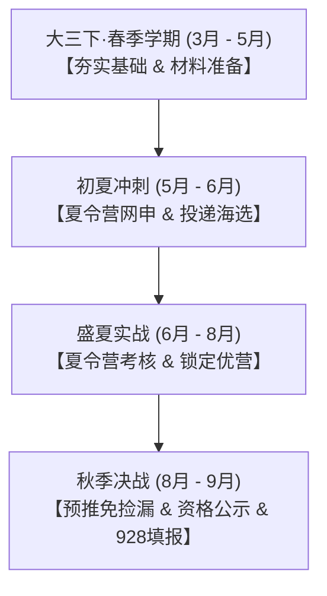

# 北京师范大学本科校区汉语言文学专业推免方向选择与全流程规划指南

同学你好！作为北京师范大学本科校区汉语言文学专业、正在争取推免并对**语言学**与**国际中文教育**感兴趣的同学，你在大三阶段产生方向选择的纠结是非常普遍且极为正常的。

北师大中文学科位列全国顶尖梯队（A+档），本科校区与北京校区同属于北师大一体化办学格局，你在院校背景上具备极高的起点与含金量。然而，“语言学”与“国际中文教育”虽然在本科阶段看起来都与“汉语言”密不可分，但进入研究生推免阶段，两者在**学科代码、培养性质（学硕 vs 专硕）、考核重点、未来发展路径（读博深造 vs 编制就业 vs 涉外教学）**上存在显著分野。

为了帮助你彻底拨开迷雾，找准最适合自己的方向，本指南从**专业内涵解构、关键维度对比、四步自我诊断法、院校梯队地图、推免考核备战、全周期时间线规划**六个维度为你提供全景式的决策与实战方案。

---

## 一、 核心方向深度拆解：你在纠结的究竟是什么？

在中文系的保研语境下，你的两个意向方向通常对应以下具体学科：

```
                    ┌─ 汉语言文字学 (050103，学硕)
    ┌─ 语言学方向 ──┼─ 语言学及应用语言学 (050102，学硕)
    │               └─ 交叉前沿 (计算语言学/神经实验语言学等)
选择┤
    │               ┌─ 国际中文教育专业硕士 (045300，专硕，原汉硕)
    └─ 国际中文教育 ─┼─ 语言学及应用语言学（对外汉语教学/二语习得方向，学硕）
                    └─ 国际中文教育交叉方向 (国际传播/智慧中文教育)
```

### 1. 语言学方向（学术型硕士，代码 0501）
通常分为两大二级学科：
- **汉语言文字学（050103）**：
  - **研究内容**：以汉语本体为核心。分为**传统小学**（文字学、音韵学、训诂学、古文字与出土文献）与**现代汉语言**（现代汉语语法、语音、词汇、修辞、汉语方言学、汉语史等）。
  - **学科气质**：重考据、重本体、重规律发掘。强调坐冷板凳的功力，分析语料的严密逻辑性。
- **语言学及应用语言学（050102）**：
  - **研究内容**：理论语言学（句法学、语义学、语用学）、社会语言学、实验语音学、心理/神经认知语言学，以及与人工智能紧密结合的计算语言学/自然语言处理（NLP）语料库建设。
  - **学科气质**：理论包容度大，方法论现代，常与心理学、认知科学、计算机科学交叉。

### 2. 国际中文教育方向（专业型硕士，代码 045300）
- **学科前身与演变**：原为“汉语国际教育硕士”（MTCSOL），新版学科目录更名为“国际中文教育”，并已试点设置专业博士（Ed.D）。
- **研究与培养内容**：以**汉语作为第二语言教学（TCSL/TCFL）**为核心，涵盖二语习得规律、对外汉语教学法、偏误分析、跨文化交际、中华文化传播、国际中文教学资源与数字化开发。
- **培养定位**：应用型、复合型、国际化人才。重视微格教学实训、海内外实习（语合中心公派志愿者、海外孔子学院、国际学校等）。

### 3. 不容忽视的“第三条道路”：语应学硕（对外汉语/二语习得方向）
如果你既热爱国际中文教育的研究课题（如二语语法习得、语音感知、偏误认知机制），又希望保留学术型硕士（0501一级学科）的身份与读博优势，那么申请**语言学及应用语言学（对外汉语教学/二语习得研究方向）学硕**是极佳的兼容方案（如北大对外汉语教育学院、北师大汉语文化学院、北语均有该类学硕）。

---

## 二、 语言学（学硕）vs 国际中文教育（专硕）多维对比透视

| 对比维度 | 语言学（学硕：050102 / 050103） | 国际中文教育（专硕：045300） |
| :--- | :--- | :--- |
| **学制与学费** | 通常为 3 年；学费 8000 元/年左右（享受全额/高额学业奖学金覆盖） | 通常为 2 年或 3 年；学费通常在 1.5万 - 3万元/年不等（部分高校专硕奖学金覆盖面略低于学硕） |
| **推免名额与录取难度** | **单所院校名额少，专业门槛极高**<br>单个方向推免名额往往仅 1~4 人，初审极度看重专业排名、代表作与本体功底 | **推免名额相对充裕，综合考察多元**<br>专硕招生体量大，初审更看重综合背景（英语/双语能力、教学实践、综合素质） |
| **学术训练与论文要求** | 极度偏向学术规范、理论建构、语料挖掘与实证实验；毕业论文为纯学术论文 | 偏向行动研究、教学实验、教材对比、教案与教学设计案例分析或调研报告 |
| **读博深造（攻博率）** | **顺畅自然（首选）**<br>海内外中文系、语言学系申请考核制博士高度认可，导师青睐度极高 | **相对受限（需补足学术产出）**<br>转申语言学学术博士难度较大；近年专博（国际中文教育博士）正在铺开，但名额有限 |
| **中小学教师考编** | **通用性最强（零门槛）**<br>完全符合各地教育局“中国语言文学类（0501）”岗位要求，无专业目录壁垒 | **部分地区存在专业目录限制**<br>部分严格限制“0501”的教师编制岗位可能因代码“0453”受阻；但大湾区多数中小学认可度已逐步提高 |
| **体制内公考/选调生** | 享受北师大名校选调生资格；符合绝大多数“中国语言文学类”岗位目录 | 同样享受北师大选调生资格；部分岗位需匹配“教育学类”或单独列出“国际中文教育”代码 |
| **涉外/国际化就业** | 主要是高校、科研所、跨国科技企业语言数据岗位 | **优势极其显著**<br>语合中心公派教师、海外中小学孔子课堂、IB国际学校中文项目（PYP/MYP/DP）、涉外文教机构 |

---

## 三、 四步自我诊断决策法：测测你究竟属于哪个方向

面对选择，请依次回答以下四个核心问题：

```
[步骤1: 研判学术志趣]
你更享受坐冷板凳分析句法树、音韵演变、语料标记；还是热衷于设计生动课堂、跨文化交流、与中外学生打交道？
 ├── 前者 ──> 倾向【语言学（学硕）】
 └── 后者 ──> 倾向【国际中文教育（专硕）】

[步骤2: 锚定三年后毕业终局]
毕业后的第一诉求是什么？
 ├── 坚定读博走高校教职 / 稳定考入头部公办名校高中语文教师编 ──> 坚定选【语言学（学硕）】
 └── 尽早就业（2年制） / 渴望海外公派任教经历 / 志在国际学校或大湾区教育行业 ──> 倾向【国际中文教育（专硕）】

[步骤3: 盘点当前推免软硬件资产]
 ├── 核心主干课成绩极高（现汉、古汉、语纲 90+），有学术论文或大创课题立项 ──> 冲击【语言学学硕】底气充足
 └── 英语能力突出（六级 550+/雅思 7+/托福 100+），普通话一级乙等/甲等，有丰富支教/中外辅学/志愿经历 ──> 冲击【国际中文教育专硕】优势拉满

[步骤4: 权衡推免风险与录取概率]
 ├── 排名位于专业前 5%，愿意承担学硕名额竞争风险以冲刺顶级学府 ──> 【语言学学硕】
 └── 排名处于推免边缘或中段（10%~20%），希望稳妥上岸 985/顶尖名校 ──> 【国际中文教育专硕】是极佳的稳妥避风港与冲名校跳板
```

---

## 四、 针对北师大本科校区学生的择校与梯队地图

你在北京师范大学校区就读，享有以下**三大独特天然优势**：
1. **北师大本校底蕴与主场优势**：北京校区与本科校区同属北师大一体化统筹。北师大文学院、汉语文化学院、国际中文教育学院在推免考核中对本科校区学生有极高的认可度与亲近感。
2. **本科校区地缘与多语文化生态**：[具体所在地已概括]，拥有极丰富的粤方言、客家话、闽南方言田野资源，以及横琴粤澳深度合作区广阔的国际中文教学与涉外教育需求。
3. **985名校资质**：在全国绝大多数高校夏令营初审中，北师大毕业证享有顶级文科名校的初审背书。

### 推荐申报院校梯队矩阵：

```
┌─────────────────────────────────────────────────────────────────────────────┐
│ 第一梯队：超一流顶尖冲刺（C9 / 中文与语言学学术最高殿堂）                        │
│ • 北京大学：中文系（汉语言文字学/语应学硕）、对外汉语教育学院（语应学硕/国中专硕）    │
│ • 复旦大学：中文系（汉语言文字学/语应学硕）、国际文化交流学院（国中专硕/学硕）      │
│ • 南京大学 / 浙江大学：文学院语言学学硕                                       │
├─────────────────────────────────────────────────────────────────────────────┤
│ 第二梯队：本校核心主场 & 顶尖专精名校（重点攻坚、认同度极高）                    │
│ • 北京师范大学（本校主场）：                                                │
│   - 文学院（北京校区）：汉语言文字学（传统小学与现代汉语全国顶尖，王宁先生等学派脉络）│
│   - 汉语文化学院（北京校区）：语言学及应用语言学学硕、国际中文教育专硕（全国黄埔军校）│
│   - 国际中文教育学院 / 文理学院（候选项目；本科校区关联已概括）：[就读关联已概括]，名额政策利好，地缘极佳         │
│ • 北京语言大学：语言学系、国际中文教育研究院（“小联合国”，专业度极高）            │
│ • 中国人民大学：文学院（汉语言文字学）、国际文化交流学院（国中专硕）                 │
│ • 华东师范大学：国际汉语文化学院（国际中文教育发源地之一，实力雄厚）                 │
├─────────────────────────────────────────────────────────────────────────────┤
│ 第三梯队：大湾区与南方综合强校（地缘高度协同，稳妥托底）                          │
│ • 中山大学：中国语言文学系（大湾区本土最高学府，方言与现代语法扎实）                  │
│ • 暨南大学：华文学院（海外华文教育与方言学领军院校，与东南亚/港澳紧密连接）          │
│ • 厦门大学：中文系 / 海外教育学院                                            │
│ • 华南师范大学：文学院 / 国际文化学院（大湾区教师编就业口碑极佳）                   │
└─────────────────────────────────────────────────────────────────────────────┘
```

---

## 五、 推免考核实战备考指南与核心书单

无论你最终选择哪一方向，推免复试（夏令营/预推免）的考核往往包含**专业笔试、专业综合面试、外语口语听力、微格试讲/论文答辩**。

### 1. 语言学方向备战策略（学术型硕士）

#### （1） 必读核心参考书目
- **现代汉语与语法学**：
  - 黄伯荣、廖序东《现代汉语》（通读夯实基础）
  - 朱德熙《语法讲义》《语法答问》（现代汉语语法研究经典基石，面试高频提问来源）
  - 陆俭明《现代汉语语法研究教程》（掌握层次分析法、变换分析法、语义特征分析法、认知语法等现代研究工具）
- **古代汉语与文字训诂**：
  - 王力《古代汉语》（前两册文选必须能准确标点、翻译；掌握通假、假借、古今字、使动意动等）
  - 王宁《古代汉语》或裘锡圭《文字学概要》（汉字构形学说、古文字演变基础）
- **语言学理论**：
  - 叶蜚声、徐通锵《语言学纲要》（深入理解语言符号性、语音演变规律、语法范畴、语言接触等）

#### （2） 考核高频考点与应对技巧
- **析句与语法分析**：考官常给出具有歧义或特殊句式（如“把”字句、“被”字句、存现句、双宾语句）让你做层次分析或解释歧义机制。
- **古汉断句与字词考释**：现场给出一段未标点的先秦/两汉文献，要求现场句读，并解释其中某个冷僻字词的本义、引申义及音韵关系。
- **研究计划书（Research Proposal）**：语言学保研必须准备一份 3000~5000 字高质量的研读计划书。选题切忌假大空，建议从**微观语言现象**切入（例如：新兴网络用语的句法构式化分析、大湾区某方言语音/语法特征调查、留学生某类虚词的习得偏误与认知解释等）。

---

### 2. 国际中文教育方向备战策略（专业型硕士）

#### （1） 必读核心参考书目
- **二语教学理论**：
  - 刘珣《对外汉语教育学引论》（核心中的核心，掌握各种教学法流派、习得理论、偏误分析、大纲设计）
  - 赵金铭《对外汉语教学概论》
- **语言要素教学与偏误分析**：
  - 卢福波《对外汉语教学实用语法》、齐沪扬《对外汉语教学语法》
  - 周小兵《对外汉语教学入门》
- **文化与跨文化交际**：
  - 程裕祯《中国文化要略》（中华文化常识与当代文化阐释）
  - 祖晓梅《跨文化交际》（掌握跨文化敏感性、文化休克、刻板印象、案例分析框架）

#### （2） 考核三大王牌板块攻坚
1. **中文本体与偏误分析（专业深度）**：
   - 考题往往不会直接考名词解释，而是给出留学生的病句。
   - *典例*：“他昨天在图书馆借了一本看书。”“我明天要见面他。”“我不很喜欢吃辣。”
   - *作答结构*：①指出错误所在；②分析偏误类型（遗漏、误加、误代、错序）；③剖析偏误成因（母语负迁移、过度泛化、教学诱导、交际策略）；④给出课堂纠错与针对性操练方案。
2. **微格教学与试讲演示（教师仪态与技巧）**：
   - 考核形式：现场抽取一个语法点或词汇，准备 10~15 分钟，进行 5~8 分钟无生试讲。
   - *得分法则*：遵循“导入（情境激趣）→ 机械操练（形式掌握）→ 有意义操练（情境互动）→ 交际操练（任务产出）”闭环；坚决贯彻**精讲多练**原则，杜绝满堂灌术语。
3. **跨文化交际案例分析与外语口语（跨文化情商）**：
   - 考题多为情境设问（如：留学生在课堂上提出具有文化冲突、宗教禁忌或敏感话题时，教师如何应对？）。
   - *答题基调*：保持文化包容性（文化相对主义视角）、相互尊重、求同存异，巧妙将文化争议转化为教学与交流契机。
   - *外语面试*：准备极其地道的英文自我介绍、教育背景阐述，能用英语流利回答“你为什么想教外国人汉语”、“你如何向外国学生介绍中国茶文化/节日”等问题。

---

## 六、 2026年推免申请全周期备战时间线与行动方案

推免是一场长达大半年的“信息战、心理战与实力战”。建议按照以下节奏推进：



### 1. 大三下·春季学期（3月 - 5月）：夯实基底与材料塑型
- **保研资格锁定**：严密关注本学期期末成绩与绩点，确保专业排名稳稳落在校区推免线以内；核对加分项（竞赛、科研论文、荣誉称号）。
- **外语成绩刷高**：若六级未过 550 分，建议报名 6 月六级或突击考一次雅思（6.5~7.0），外语高分在夏令营初审中具有一票通过/筛选优势。
- **打磨核心文书**：
  - 中英文个人简历（突出北师大背景、GPA排名、学术/实践亮点）。
  - 个人陈述（Personal Statement）500~800 字精修版。
  - **研究计划书（RP）**：完成初稿并找校区专业课老师审阅提意见。
- **导师摸底与联络**：浏览北师大本部文学院/汉院、以及意向外校官网，梳理导师研究方向与近期论文。

### 2. 初夏阶段（5月 - 6月）：夏令营海投与初审攻坚
- **信息监控**：密切关注各高校研究生院及文学院官网公布的夏令营通知（建立专属 Excel 表格，记录截止时间、所需材料、考核方式）。
- **梯度投递（海投策略）**：
  - 冲刺档（北大、复旦等）投递 1~2 所；
  - 核心档（北师大文院/汉院、人大、北语、华东师大、中大）投递 3~4 所；
  - 托底档（暨大、厦大、华师）投递 2 所。
  - *注：部分学校允许同时报学硕与专硕，或夏令营未入营可继续报预推免。*
- **联系导师（发邮件自荐）**：入营结果公布前后，可向极心仪的导师发送谦逊得体的自荐邮件，附上简历与 RP。

### 3. 盛夏阶段（6月 - 8月）：夏令营实战与锁定优营（Offer）
- **全力参营考核**：夏令营通常集中在 6 月下旬至 7 月中旬（线上或线下）。沉着应对专业笔试、全英文面试、微格教学与答辩。
- **争取“优秀营员”**：拿到“优秀营员（优营）”是推免上岸的最强安全垫。
- **复盘与复习**：若夏令营斩获满意优营，可保持状态准备 9 月推免系统填报；若夏令营未拿到理想结果，切勿气馁，立即转入“预推免”复习。

### 4. 秋季阶段（8月下旬 - 9月下旬）：预推免决战与系统录入
- **预推免全面申报**：很多名校（包括北师大各院系、人大等）会在 8 月底至 9 月初开放预推免报名，名额充裕度不亚于夏令营。
- **本校推免资格公示**：9 月中旬校区教务部门正式公示保研名单，确认拿到本校推免指标。
- **全国推免服务系统（9月28日前后）**：教育部推免系统正式开放，在规定时间内填报志愿，完成“复试通知”与“待录取通知”的确认，顺利拟录取！

---

## 七、 针对你当下的定制破局建议

1. **不要过早将自己“焊死”在一个方向上，采用“一体两翼”策略**：
   - 现阶段（大三下）的复习，现代汉语、古代汉语与语言学纲要是两者的共同基石。
   - 在投递夏令营时，你可以**组合申报**：例如，本校（北师大）既关注文学院的语言学学硕，也关注汉语文化学院的语应学硕或国际中文教育专硕；外校冲刺学硕，同时用优质 985/211 的专硕托底。在实战拿到入营资格后，根据具体入营学校和导师情况再做终极抉择。
2. **善用北师大本科校区的地缘与导师资源**：
   - 校区内有常驻及北京校区派驻的高水平语言学与国际中文教育学者。主动在课后向专业课老师汇报你的推免意向，请教老师他们手头是否有科研课题或论文可以参与。
   - 关注大湾区留学生教学、粤方言调查、跨文化交流项目，这些经历写在简历中能极大彰显本科校区学生的独特学术活力与国际化风貌。
3. **完成一件小成果来做“试水”**：
   - 在本周内尝试找一个你感兴趣的语言现象（比如网络流行语的语法演变，或者留学生说汉语的一个常见语法错误），尝试写一篇 1500 字的分析短文。如果你在查阅文献、推导规则时感到兴奋与专注，你内心真正偏爱的是**语言学**；如果你在思考“怎么教给外国人更明白、怎么设计情景更有趣”时更有成就感，你的心流就在**国际中文教育**。

祝你推免准备顺利，行稳致远，在 2026 年推免季顺利上岸理想学府！
