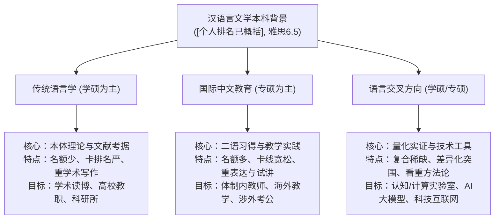
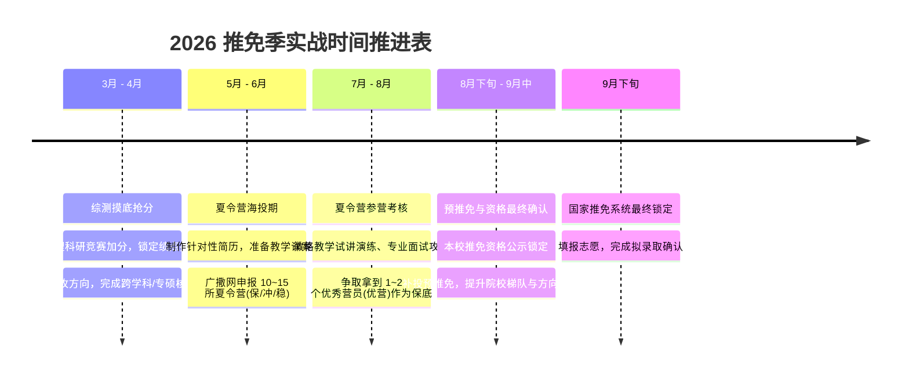

# [本科院校与校区已概括]汉语言文学专业推免策略与方向选择指南

---

## 一、 个人背景深度诊断与推免定位评估

在制定具体方向策略前，首先需要对你的各项背景指标进行客观、清醒的“全景体检”，明确你的比较优势与核心短板。

### 1. 核心背景剖析

| 评估维度 | 当前客观数据 | 推免竞争定位与实操影响 |
| :--- | :--- | :--- |
| **本科院校** | 原本科院校 | **顶级本科文科招牌（强优势）**。<br>原本科院校中国语言文学学科在历次教育部学科评估中均位列顶尖（A+梯队），文科声誉极高，毕业证、学位证公章均与北京校区完全一致。在绝大多数外校推免初审中均享受顶级本科生源待遇。<br>*注意点*：少数顶尖高校或部分院系在材料筛查时会区分北京本部与原本科校区办学主体，且本校推免指标通常在各校区院系内部独立核算。 |
| **专业排名** | [个人排名已概括]（约[个人排名已概括]） | **保研资格“边缘区” + 外推初审“卡线区”（最大风险点）**。<br>① **校内推免资格**：本科高校纯文科专业的常规保研率通常在 25%~32% 之间。[个人排名已概括] 处于保研指标的临界边缘，极易成为“守门员”或“候补第一位”，需高度重视综合测评加分与专项通道；<br>② **外推初审筛选**：头部本科（如清北复交人南等）纯语言学学硕夏令营通常将入营硬性门槛卡在前 10%~15%，此排名在传统学硕初审中极易被系统直接过滤。但在专硕（国际中文教育）或跨学科交叉方向中，排名的容忍度明显放宽（通常允许前 30%~40%）。 |
| **外语成绩** | 雅思 6.5 分 | **达标且具备良好功能性（中上平稳水平）**。<br>国内文科推免通常要求大学英语六级 425~500 分，雅思 6.5 分（对标六级约 550 分以上）已稳稳达到 99% 高校的推免外语初审门槛。在纯语言学中属于达标工具；在国际中文教育中属于涉外教学能力的有利佐证；在交叉学科中足以支撑阅读全英文前沿文献。 |

---

## 二、 三大备选方向深度对比：研究训练、培养模式与未来出口

“语言学”、“国际中文教育”以及“交叉方向”虽然均源于语言文字的母体，但其**底层学科逻辑、学术训练方法、考核评估标准与职业终局**存在根本性差异。



### 1. 语言学方向（汉语言文字学 / 语言学及应用语言学）

* **学科属性**：学术型硕士（050102 语言学及应用语言学、050103 汉语言文字学）。
* **研究训练体系**：
  * **本体深度钻研**：
    * *汉语言文字学*：重点训练音韵、文字、训诂三大学问，涉及甲骨金文考释、战国楚简、上古中古音构拟、词义引申规律、出土文献与传世典籍互证；
    * *语言学及应用语言学*：重点训练理论语言学流派（生成语法、功能主义语法、认知语法、构式语法）、现代汉语共时语法分析、方言田野调查（国际音标记音、方言接触、语音实验分析）。
  * **学术产出机制**：强调长周期的深度文献积淀与严密的思辨逻辑推演。研读大量专著与历代文献，产出标准的学术性论文，参与国家社科基金重大/重点课题。学制通常为 3 年，硕博连读及读博深造率高（通常在 30%~50% 以上）。
* **代表性去向**：国内高校汉语言文学专业教师（需读博）、科研院所（社科院语言所等）、辞书编纂机构、重点中学语文教研骨干、古籍出版社/学术期刊编辑。

---

### 2. 国际中文教育方向（专业学位代码：0453）

* **学科属性**：专业型硕士（原汉语国际教育硕士 MTCSOL）。
* **研究训练体系**：
  * **应用与实践导向**：核心围绕“如何教外国人学中文”及“中外文化交流”。训练重点在第二语言习得理论（SLA）、汉语要素（语音、词汇、语法、汉字）的微格教学法、课堂管理艺术、偏误分析与教学设计、跨文化交际突发情境应对。
  * **实践与实习考核**：要求必须完成海内外教学实习（教育部中外语言交流合作中心公派汉语教师志愿者、海内外孔子学院/课堂、国内高校留学生院、知名国际学校）。考取《国际中文教师证书》（CTCSOL）。
  * **学位论文形态**：学位论文通常强调应用价值，常见形式为教学案例分析、特定国别留学生偏误实证研究、教材对比评析、教学大纲与微课程设计，不强求高深形而上的本体理论创新。学制一般为 2~3 年。
* **代表性去向**：公立中小学语文教师（考编大户）、高中国际部/双语国际学校沉浸式中文教师、高校留学生办公室/国际合作交流处行政、语合中心海外公派教师/志愿者、涉外文旅企事业单位、考公选调生。

---

### 3. 语言交叉方向（三大主流细分赛道）

语言学的现代演进已经从纯思辨、纯描写快速向多学科实证与技术化拓展。汉语言文学背景同学能够切入的交叉方向主要有以下三类：

| 交叉细分赛道 | 核心交叉领域与依托机构 | 核心研究训练内容 | 关键技能栈与工具要求 |
| :--- | :--- | :--- | :--- |
| **赛道一：<br>心理语言学 / 神经语言学**<br>*(实验语言学)* | 心理学院、脑与认知科学研究院、外语/中文实验中心<br>*(北师大认知神经科学国家重点实验室为顶尖平台)* | 研究大脑加工语言的生理与认知机制：双语加工、句子理解的眼动轨迹、儿童语言获得障碍、失语症脑机制、语义加工的时空动态。 | ① 实验设计软件（E-Prime, PsychoPy）；<br>② 实验仪器操作（眼动仪 Eye-tracker、脑电 EEG/ERP、fMRI）；<br>③ 统计分析语言（R语言、Python、SPSS，重点为线性混合模型 LMM）。 |
| **赛道二：<br>计算语言学 / 智能语言工程**<br>*(NLP与人工智能)* | 计算机学院、人工智能学院、信息管理系、计算语言学教育部重点实验室（如北大） | 结合语言本体知识与计算机算法：大规模语料库构建与细粒度标注、大语言模型（LLM）微调与提示词工程（Prompt Engineering）、垂直领域知识图谱构建、机器翻译质量评估、机器语义对齐。 | ① 编程基础（Python 文本处理、数据清洗）；<br>② 算法与框架（NLP 基础库 NLTK/Jieba、PyTorch 基础、Transformer 架构认知）；<br>③ 语言学深层知识（文科生的优势在于句法语义规则、语用语境的精准把控）。 |
| **赛道三：<br>数字人文 (Digital Humanities) 与语言大数据** | 文史学院数字人文中心、信息管理学院、人文社科大数据实验室 | 用现代量化技术回答传统文史经典问题：历代典籍空间地理分布（GIS）、历史人际交往社会网络分析（SNA）、历代文学作品词频演变与情感挖掘、古籍自动断句与命名实体识别（NER）。 | ① 语料提取与清洗（正则表达式、网络爬虫基础）；<br>② 可视化工具（Gephi 复杂网络、ArcGIS/QGIS 历史地图、Tableau）；<br>③ 传统文史文献考据功底。 |

---

## 三、 三大方向推免申请要求与考核机制横向对比

了解不同方向在推免审核时的偏好，是避免“无效投递”、精准匹配材料的核心前提。

| 对比维度 | 传统语言学（学硕） | 国际中文教育（专硕） | 语言交叉方向（实证/量化） |
| :--- | :--- | :--- | :--- |
| **生源背景与排名门槛** | **极度看重专业排名与文科纯正度**。<br>通常硬性卡前 10%~15%；对于 [个人排名已概括] 的排名，头部本科文学院初审通过概率低，主攻目标应放在中坚本科、本科语言类强校。 | **门槛弹性大，招生规模广**。<br>排名通常放宽至前 30%~40%，本科高校背景优势在此方向能被成倍放大，[个人排名已概括] 入营几率显著提升。 | **重跨学科潜质，对纯文科排名包容度高**。<br>导师极度渴望具备扎实语言本体功底且愿意学习技术/实证方法的文科生，排名达标即可，更看重技能和学习意愿。 |
| **外语（雅思6.5）的权重** | **达标门槛**。<br>用于证明具备基本外语素养，初审合格即可，复试权重一般占比 10%~20%。 | **核心生产力与加分项**。<br>复试中占比较高（通常 20%~30%），重点考察中英双语口语表达、即兴跨文化交流与英文问答流畅度。雅思6.5完全足够。 | **文献研读刚需**。<br>交叉前沿顶刊（ACL, 自然语言处理会议, NeuroImage, Brain & Language 等）几乎全为英文，雅思6.5证明你具备无障碍研读前沿英文成果的基础。 |
| **核心申请材料要求** | ① 学术代表作（高质量课程论文或学年论文）；<br>② 研究计划书（RP，需有清晰的问题意识与文献脉络）；<br>③ 历年成绩单。 | ① 个人陈述（突出跨文化志愿经历、支教、教学实践）；<br>② 汉语教学设计或教案（详案）；<br>③ 中华才艺技能证明；<br>④ 普通话等级证书（建议二甲及以上）。 | ① 跨学科研究构想/实验设计（RP）；<br>② 技能清单（熟练掌握的软件、编程语言、数据分析工具）；<br>③ 参与过的定量课题、科研项目或数据分析成果。 |
| **复试/面试考核核心重心** | ① **语言学理论深度**（转换生成、认知语法、层次分析法、语义指向分析）；<br>② **古汉功底**（繁简转换、古书断句标点、文字六书、音韵反切）；<br>③ 论文提问（刨根问底考察逻辑闭环）。 | ① **教学技能试讲与说课**（5~10分钟即兴抽取语法点试讲，看教态、板书、导入操练）；<br>② **跨文化情境模拟**；<br>③ **第二外语口语日常问答**。 | ① **科学思维与方法论**（自变量/因变量控制、混淆变量排除、统计假设检验）；<br>② **学习迁移能力**（是否对代码、模型或仪器有畏难情绪）；<br>③ 文科本体与技术的结合点探究。 |

---

## 四、 个人抉择罗盘：三维评估模型与路径决断

结合[本科院校与校区已概括] [个人排名已概括] 排名与雅思 6.5 的实际情况，建议通过以下“三维坐标评估法”找到最优解：

```
                维度二：职业终局
               (学术科研 vs 就业实用)
                       ▲
                       │  传统语言学
                       │  (需读博/思辨重)
                       │
                       │          交叉学科
                       │          (文理融合/复合出路)
                       │
───────────────────────┼───────────────────────► 维度一：思维与技能偏好
文献考据/质性思辨      │         技术实证/数据实验
                       │
                       │  国际中文教育
                       │  (专硕就业/人际教学)
                       │
                       ▼
                维度三：保研安全性
               ([个人排名已概括] 排名的风险抵御)
```

### 1. 维度一：思维模式与技能偏好（自我禀赋自查）
* **思辨/文献型**：如果你热爱钻研古代典籍、沉浸在古今语法的细致描写与理论辩驳中，对数学、统计、代码天然抗拒，**坚决不碰交叉学科**，在语言学与国际中文教育中抉择。
* **教学/表达型**：性格外向开朗，亲和力强，喜欢与人打交道，讲台表现力好，富有跨文化好奇心，具备一定的文艺才艺特长，**毫无疑问首选国际中文教育**。
* **理性/工具型**：逻辑严密，对新技术（AI工具、脑科学实验、量化分析）充满探索欲，愿意从零啃下 R语言、Python、统计学基础或实验设计软件，**选择交叉方向将具有极其广阔的发展空间**。

### 2. 维度二：职业规划与终局导向（你想过什么样的生活）
* **如果目标是科研学者/高校教师**：必须以**学术型硕士**为跳板读博。优先选择：**交叉学科（实验语言学/NLP）> 纯语言学学硕**。
  > *警示*：当前国内文科高校教职门槛极高，纯文科博士面临严重的教职“非升即走”内卷；而实验语言学、计算语言学博士在海内外均有更充足的科研经费、更高频的顶刊产出（SCI/SSCI/EI）和更广泛的交叉学科教职机会。
* **如果目标是快速高质量就业（体制内/中小学/涉外/大厂）**：
  * **选国际中文教育（专硕）**：专硕学制短、实习经验足，在中小学编制招教考试、体制内考公选调、高中国际部等岗位上，与传统文学硕士几乎享受同等待遇；
  * **选交叉学科（NLP/数字人文）**：兼备文科内容理解力与技术素养，在互联网科技公司、大模型企业（如百度、阿里、字节、腾讯等的数据标注管理、大模型对齐评估、产品运营）、泛文化数字化平台具有不可替代的复合竞争力。

### 3. 维度三：保研安全度与博弈风险（针对 [个人排名已概括] 的战术定性）
* **投递纯语言学学硕**：**风险极高**。由于名额极少（单个院系推免名额常在 2~5 人）且卡死前 10%，极易在夏令营初审“全军覆没”；
* **投递国际中文教育专硕**：**基石保障**。招生体量大，北师大 985 牌子过硬，只要外语好、表现力强，拿 Offer 概率极高，是稳住保研底线的最佳承载盘；
* **投递交叉方向**：**破局奇兵**。只要有一份规范的跨学科研究计划书，或者展示出定量实证潜力，极易在以文科生为主的竞争池中形成降维优势。

---

## 五、 2026 年推免实战全流程作战方案（攻守兼备）

面对 [个人排名已概括] 的敏感排位，必须采取**“向内抢名额固防线，向外田忌赛马多轨推进”**的整体策略。

### 1. 阶段一：校内推免资格“保卫战”（大三下至大四初，决不能掉以轻心）

> [!IMPORTANT]
> **没有校内推免指标，外校所有预录取 Offer 均自动作废！**
> [个人排名已概括]（约 [个人排名已概括]）极其靠近保研线边缘，首要任务是在本校推免综合测算中全力抢分。

* **行动清单**：
  1. **吃透往年文件**：立即向大四保研学长学姐、辅导员调阅本科学院汉语言文学专业（具体院系已概括）前两年推免加分细则与实际获推人数。明确：纯绩点排名占比多少？综合素质（科研论文、竞赛获奖、志愿服务、荣誉称号）加分上限是多少？
  2. **地毯式抢分排查**：
     * **学术成果与大创**：核实名下有无立项但未结题的大创、科研项目，争取在大四开学前完成结项或拿到学术会议入选通知；
     * **学科竞赛加分**：关注“挑战杯”、“互联网+”、“全国大学生语言文字能力大赛”、“全国大学生英语竞赛（NECCS）”等学校认可加分目录内的赛事；
     * **荣誉与志愿服务**：将志愿时长、社会实践、优秀共青团员/三好学生等加分证明文件备齐。
  3. **关注特殊补偿通道**：留意学校“研究生支教团（研支团）”、“科技支教”、“思想政治骨干专项”等单列推免名额指标，作为备选安全兜底网。

---

### 2. 阶段二：院校梯队与方向组合打法（“田忌赛马”投递矩阵）

切忌在夏令营和预推免中“单押一个方向”。建议采取 **“专硕保底 + 交叉突围 + 学硕冲刺”** 的混合申报架构：

```
投递组合架构 (10~15所高校):
├── 冲刺层 (2~3所): 顶尖985交叉/优质专硕 (北师大本部、复旦、浙大、人大)
├── 主攻层 (5~7所): 行业顶级/中坚985/大湾区名校 (北语、华东师大、中大、暨大、华中师大、上外)
└── 保底层 (2~3所): 本校通道/优质本科强势学科 (原本科院校原本科校区项目、华南师大、陕师大)
```

#### 梯队院校针对性推荐

* **第一梯队（冲刺档）：顶级 985 高校**
  * **北京师范大学（北京本部）**：汉语文化学院（国际中文教育专硕）、心理学部（认知神经科学/语言认知交叉方向）；
  * **复旦大学 / 浙江大学 / 南京大学**：数字人文项目、现代语言学实证方向，利用本科文科背景冲刺；
  * **中国人民大学**：文学院国际中文教育、信息资源管理学院（人文大数据方向）。
* **第二梯队（主攻档）：行业顶尖名校 / 优势大湾区名校（重点攻坚）**
  * **北京语言大学（北语）**：**必投**！素有“小联合国”之称，国际中文教育与语言学（语言智能研究院、语言认知科学教育部重点实验室）处于国内绝对前沿。雅思 6.5 分在此极受欢迎，招生体量大；
  * **华东师范大学 / 华中师范大学**：师范类巨头，国际中文教育实力极强，学制与就业出口成熟；
  * **大湾区地缘优势高校（极度看重中大、暨大对省内 本科 生源的青睐）**：
    * **中山大学**：中国语言文学系、国际翻译学院（原本科校区同城协同，极具地缘便利）；
    * **暨南大学**：华文学院是全国海外华文教育的最高学府之一，海外影响深远；
  * **上海外国语大学 / 广东外语外贸大学**：语言智能、双语认知、语言数据科学交叉方向。
* **第三梯队（保底档）：稳妥安全阀**
  * **[本科院校与校区已概括]本校项目**：密切关注原本科校区的相关学院（具体院系已概括）、原本科校区各交叉研究院招收本校推免生的政策宣讲与本硕衔接通道；
  * **华南师范大学 / 陕西师范大学 / 南京师范大学**：211 师范顶尖，国际中文教育专硕，确保稳稳拿下 Offer。

---

### 3. 阶段三：差异化材料与复试专项攻坚

针对三大方向，必须量身定制三套不同的申请材料，并在面试中精准展示：

#### A. 针对国际中文教育（专硕）的备战清单
* **材料准备**：
  * **一份规范的汉语教学详案（Lesson Plan）**：选择一个极具辨析难度的语法点（如“把”字句、“了1/了2”、趋向补语“出来/起来”），按“导入—讲解—机械操练—交际操练—总结与作业”撰写，展示专业功底；
  * **一段中英双语的个人展示视频（3分钟）**：展示亲和力、发音标准度（普通话及英语发音）与跨文化沟通气度；
  * **中华才艺支撑材料**：如有书法、国画、茶艺、民族乐器、剪纸证书或作品照片，制作成折页附在简历后。
* **面试考核突破口**：
  * 猛练 **“无领导小组讨论”** 或 **“5~10分钟微格试讲”**：注意板书工整、精讲多练（教师说话时间占 30%，引导学生开口占 70%）、切忌用高深语法术语轰炸留学生；
  * 准备好高频英文问答：“Why do you choose International Chinese Education?”、“How to explain the difference between '刚才' and '刚' to an English native speaker?”。

#### B. 针对交叉方向（认知/计算/数字人文）的备战清单
* **材料准备**：
  * **跨学科研究计划书（Research Proposal）**：以文科问题为起点，引入现代技术方法。例如：《基于眼动追踪的留学生汉语介词短语加工认知负荷研究》或《基于大语言模型的唐宋词空间意象自动提取与情感分析》；
  * **技能清单背书**：即使没有深入编程，也可以在简历中列出：“掌握 Python 基础文本处理、熟悉 SPSS/R 基础统计分析、熟练使用 E-Prime/PsychoPy 编写实验范式、掌握 Jieba 分词与词云生成”；
* **面试考核突破口**：
  * 展现 **“不设限的学习渴望”** 与 **“文科母体优势”**：当导师问及工科/统计知识时，坦诚基础尚浅，但展示出已经正在学习的网课、读过的教材与实验逻辑；向导师强调自己深谙汉语字词句的本体特性，能弥补纯工科学生“懂代码但不懂语言学”的致命盲区。

#### C. 针对传统语言学（学硕）的备战清单
* **材料准备**：必须有一篇打磨极其精致、格式完全符合《中国语文》规范的课程论文或学年论文，对其中的每一个引注、语料出处了然于胸。
* **面试考核突破口**：恶补专业基本功——现代汉语八大语法结构、语义特征与指向分析、汉语史分期、平水韵与三十六字母、说文六书分析。

---

### 4. 2026 年推免全程推进时间线



---

## 六、 总结与终极建议

你手握**原本科院校 本科 顶级文科学科招牌**和**雅思 6.5 的达标外语**，这是非常坚实的底盘；唯一的短板在于 **[个人排名已概括] 的排名处于边缘区间**，这意味着你**不能盲目跟风去挤名额极少、卡排名极死的纯文科学术学硕通道**。

1. **稳妥且高性价比的黄金选择**：将 **国际中文教育（专硕）** 作为主力底盘与保底核心。你的 本科 背景在此赛道优势极大，雅思 6.5 分加持能让你在面试中脱颖而出，招生名额多，拿 Offer 概率最高；
2. **高端破局与学术冲刺的优选**：将 **语言交叉方向（心理语言学/认知语言学/数字人文）** 作为差异化突围利器。利用相关心理与认知研究资源，辅修或自学实证实验工具，在跨学科申请中以“文理兼备”的稀缺性实现逆袭；
3. **当务之急的一号行动**：立即找学院教务、辅导员和往届学长核准保研综测排名的安全红线，全力扫清加分死角，牢牢把校内推免名额锁死在自己手中！
