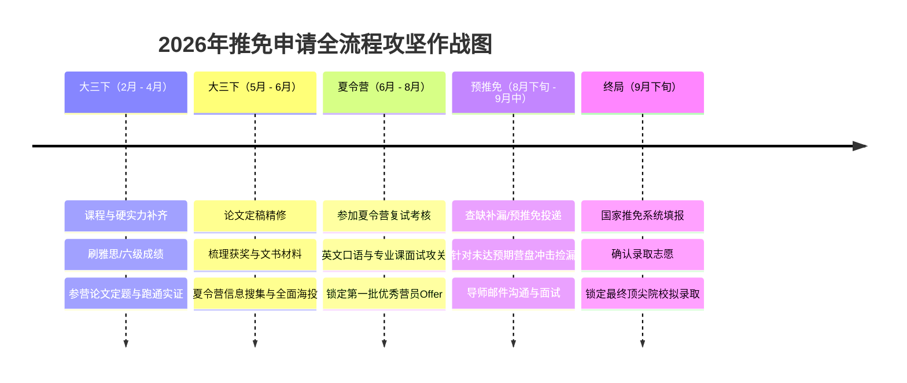

# 首都经济贸易大学商务英语跨保商科/数字经济全方位备战与补强指南

---

## 一、 个人背景深度诊断与优劣势剖析

在保研（推免）申请中，高校考核采用的是**“初审筛选（硬性门槛） + 复试考核（专业素养与学术潜力）”**的双重评价机制。你的整体画像是一份**“综合底色优异、具备复合潜质，但在经管专业硬核支撑与学术深度上仍有明显短板”**的典型跨保方案。

```
                  ┌──────────────────────────────────────────────┐
                  │       首经贸 商务英语专业（排名 前约2%）       │
                  └──────────────────────┬───────────────────────┘
                                         │
                 ┌───────────────────────┴───────────────────────┐
                 ▼                                               ▼
       【核心优势与杠杆】                               【核心痛点与风险点】
  ┌─────────────────────────────┐                 ┌─────────────────────────────┐
  │ 1. 排名 前约2%（专业前约2%）│                 │ 1. 院校背景为双非财经院校   │
  │ 2. 商务+数据+产品复合背景   │                 │ 2. 数学与经管硬核课程薄弱   │
  │ 3. 稳拿本校推免资格         │                 │ 3. 雅思6.5对英专生相对平庸  │
  │ 4. 具备业界实习实操经验     │                 │ 4. 缺乏经管/数经参营学术论文 │
  └─────────────────────────────┘                 └─────────────────────────────┘
```

### 1. 核心竞争优势（你的“基本盘”与“敲门砖”）
1. **排名 前约2%（最强核心杠杆）**：
   - 稳拿本校推免指标：外语学院推免名额通常极其有限，专业前约2%能彻底解除保研名额后顾之忧。
   - 跨越双非门槛的硬通货：在985/211经管夏令营初审中，非双一流高校生源普遍受到严格限制。但绝大多数名校会在简章中设置特例条款（如“双非院校学生综合排名前1%或前约2%名”）。**“专业前约2%”是你冲刺高层次院校入营资格的最大底牌**。
2. **复合型能力初具雏形**：
   - 已修过《商业数据分析》和《统计学》，做过数据分析和产品实习，表明你绝非“纯文科空谈”型选手，而是具备商业直觉（产品）和量化工具认知（数据分析）的复合型人才，与数字经济、商业分析（BA）的培养目标天然契合。
3. **英语基础具备基本保障**：
   - 商务英语科班出身，在全英文文献阅读、国际化视野和英文听说交流上具备先天优势。

### 2. 关键短板与潜在风险（初审与面试的最大阻碍）
1. **院校标签为“双非财经”**：
   - 尽管首经贸在北京市经管与外语业界知名度较好，但在全国推免系统中仍属于非双一流院校。头部顶尖985（如清北复交人、浙南财等）经管经院对双非卡关极严，择校必须科学分层。
2. **数学与经管专业课基础存在系统性缺口**：
   - 仅修过统计学和商业数据分析，缺乏高数/微积分、线性代数、概率论与数理统计，以及微观经济学、宏观经济学、计量经济学等核心底座课程。在夏令营初审中，导师会质疑你的量化推导和学术建模能力；在复试专业课笔试/口试中，容易被理论问题问倒。
3. **语言成绩对“英语专业”而言缺乏区分度**：
   - 对于理工科或普通文科，雅思6.5已达及格线；但**对于商务英语专业学生而言，雅思6.5无法形成“降维打击”**。经管学院面试导师对英专学生的预期往往在雅思7.5+、专四优秀或六级620+以上。6.5分不仅不能作为加分项，甚至可能引发对你本专业水平的质疑。
4. **学术科研成果与目标学科脱节**：
   - 目前仅有“英语研究”经历，缺少商科、经济学或数字经济领域的规范实证论文（Working Paper）、学术课题或高含金量学科竞赛奖项。在经管夏令营复试中，缺少一篇代表作（参营论文）将严重影响评分。

---

## 二、 关键补强清单：针对性破局方案

为了在夏令营和预推免中形成压倒性竞争力，你必须在**学术产出、量化与专业底座、语言成绩、文书故事线**四大维度进行深度补强。

### 维度一：学术产出补强——产出一篇跨学科参营论文（重中之重）

经管类夏令营（尤其是学硕及高质量专硕）的入营审查和复试答辩中，**参营论文（Working Paper）是决定能否拿优秀营员（Offer）的核心关键**。你必须利用未来数月，全力撰写一篇规范的实证研究论文。

#### 1. 选题策略：“英专背景 + 数据技术 + 数字经济/商科应用”的交叉创新
千万不要写纯理论推导或宏观宏大叙事，而应充分发挥你**文本理解（英语）+ 数据分析（Python/Stata/R）+ 商业理解（产品思维）**的比较优势，切入**文本挖掘型实证研究**或**微观企业数字化实证**：
- **备选选题方向 1（文本大数据 + 企业出海/跨境电商）**：
  - *《数字化转型对中国企业“出海”绩效的影响机制研究——基于上市公司年报英文披露与跨境数据的实证检验》*
  - 优势：结合商务英语专业词汇洞察，利用Python爬取上市公司年报或海外披露文本，构建数字化/国际化指标，切中数字贸易与数字经济热点。
- **备选选题方向 2（数据要素/算法 + 平台经济/产品治理）**：
  - *《平台算法透明度对消费者信任与购买意愿的影响研究——基于双边市场理论的实证分析》*
  - 优势：结合你的产品实习经历，探讨平台经济、算法治理与用户行为，紧密契合数字经济专硕/学硕前沿。
- **备选选题方向 3（ESG/企业数字化 + 国际商务）**：
  - *《数据资产入表对企业全要素生产率的赋能效应研究——基于因果推断的实证分析》*
  - 优势：紧扣2024–2026年数字经济最前沿的“数据资产入表”政策，采用双重差分法（DID），规范严谨。

#### 2. 实证研究标准范式与工具落地
- **规范结构**：引言（现实背景与研究价值） $\to$ 文献综述与理论机制假说 $\to$ 数据来源与变量设定 $\to$ 基准模型与回归分析 $\to$ 稳健性与内生性检验（工具变量法IV/PSM/安慰剂检验等） $\to$ 异质性与机制分析 $\to$ 结论与政策启示。
- **软件掌握**：至少熟练掌握 **Stata** 或 **Python/R** 中的一种进行因果推断计量分析，熟练跑出标准的回归三线表。

---

### 维度二：学科底座补强——补齐数学、计量与经济学常识

跨保学生必须向考官证明：**“我有能力学懂研究生阶段的定量课程，绝不会因数学差而无法毕业。”**

#### 1. 成绩单与课程补齐
- **校内选修/重修**：若大三下学期还能选课，务必选修《微积分/高等数学》、《线性代数》、《概率论与数理统计》、《计量经济学》、《中级微观经济学》等课程，争取高分（90+），让成绩单直接说话。
- **第二渠道证明**：若校内无法选课，可出具辅修成绩单、高质量MOOC（如北京大学CCER、清华大学学堂在线的经济学/微积分认证课程证书），或在个人简历中单列“核心自修/先修课程模块”。

#### 2. 必备经典教材研读（面试考点库）
| 学科领域 | 推荐核心教材 | 复习重点 |
| :--- | :--- | :--- |
| **微观经济学** | 范里安《微观经济学：现代观点》 / 曼昆《经济学原理》 | 弹性理论、消费者均衡、生产与成本、完全竞争与垄断、博弈论基础、外部性与公共品 |
| **宏观经济学** | 曼昆《宏观经济学》 / 高鸿业《宏观经济学》 | GDP核算、IS-LM模型、AS-AD模型、通货膨胀与失业、菲利普斯曲线、经济增长模型（索洛模型） |
| **计量经济学** | 伍德里奇《计量经济学导论：现代观点》 | OLS基本假设、多重共线性/异方差/自相关处理、内生性问题及解决方法（IV、面板固定效应、DID） |
| **数字经济通识** | 工业和信息化部/社科院等发布的《中国数字经济发展研究报告》 | 数据要素属性（非竞争性、零边际成本、协同性）、平台双边市场、算法监管、数据资产入表、数字鸿沟 |

---

### 维度三：语言与软实力补强——重塑英专核心竞争壁垒

你必须让语言能力从“及格项”转变为“碾压项”：

1. **刷高英语标化成绩**：
   - **雅思刷分**：争取在2026年4月前刷至 **7.0或7.5分**（写作/口语不低于6.5）。若雅思出分周期长，可考虑**托福（冲刺105+）**，或将**大学英语六级（CET-6）刷至600分以上**。
   - **专四专八成绩**：专业四级（TEM-4）必须出具“良好”或“优秀”证明；在材料中主动展示，表明自己在英语专业内部依然是顶尖水准。
2. **打磨中英文学术表达能力**：
   - 准备一段**3分钟高度专业化的英文学术自我介绍**。
   - 准备一段**全英文文献导读与论文陈述（Paper Pitch）**，能够用流利地道的学术英语介绍你的参营论文研究框架、变量定义和研究结论。

---

### 维度四：个人叙事重构——打造“无法被替代”的跨界定位

在文书（个人陈述、个人简历、自荐信）中，绝对不要流露出“我不喜欢外语才逃离到商科”的被动心态，必须重塑为你**基于长远学术/职业追求的主动跨界升级**：

```
                    【跨界个人叙事闭环模型】

        [专业根基] 商务英语（前约2%）
           │ 提供：跨文化商业沟通敏锐度、全球经贸前沿文献一手捕获能力
           ▼
        [能力跃迁] 商业数据分析 + 统计学 + 数据分析/产品实习
           │ 提供：指标拆解、用户行为建模、业务数据链路理解与实操工具
           ▼
        [进阶目标] 数字经济 / 现代商科（研究生阶段）
           │ 聚焦：数据要素赋能实体产业、平台经济运行规律与国际数字贸易治理
           ▼
        [最终定位] “懂全球商业规则 + 懂数字经济底层逻辑 + 具备定量分析实操”
                   的高素质复合型人才
```

- **实习经历的学术化转化**：
  - *产品实习*：不要只写“画原型、写PRD”，要提炼为“对平台用户留存机制、转化漏斗模型、算法驱动下的用户反馈闭环有深入产业理解”。
  - *数据分析实习*：强调“运用SQL/Python清洗数据、构建评估指标体系、通过A/B测试进行因果推断”，直接对标数字经济与商科专硕的能力画像。

---

## 三、 目标方向选择与学科契合度研判

“商科”和“数字经济”涵盖多个二级学科及专硕门类。结合你的背景特点，推荐以下四个梯队的专业方向：

### 1. 首选方向：数字经济（专硕/学硕）
- **契合度**：★★★★★
- **学科定位**：数字经济学（0202Z/交叉学科）或数字经济专硕（0258，自2024级开始全国招生）。
- **竞争优势**：该学科属于典型的新兴交叉学科，极度渴求**既懂计算机/数据分析、又具备国际视野和经管通识**的学生。传统纯经济学背景学生往往缺乏产品与业务敏锐度，你的“商英+数据实习+产品实习”在此赛道属于亮眼组合。

### 2. 次选方向：管理科学与工程 / 商业分析（BA）/ 信息管理
- **契合度**：★★★★☆
- **学科定位**：管理学门类（管科1201或图书情报专硕1255、大数据管理与应用）。
- **竞争优势**：管科历来欢迎跨专业生源（计算机、外语、数学均招收）。研究方向如“商务智能”、“社交媒体与文本挖掘”、“平台生态系统管理”，完全可以用你的文本处理与数据分析能力直接对接。

### 3. 对口方向：国际商务（MIB）/ 国际贸易学
- **契合度**：★★★★☆
- **学科定位**：经济学门类（专硕0254或学硕020206）。
- **竞争优势**：与商务英语本专业无缝衔接，考官对商英生源接受度极高。而你的“数据分析”能力在以文科生源为主的国商项目中，属于极强的非对称竞争优势（懂数据分析的国际商务人才是当前紧缺方向）。

### 4. 挑战方向：金融专硕（MF）/ 应用经济学学硕
- **契合度**：★★★☆☆
- **竞争优势与难点**：竞争极其惨烈，营员背景普遍为985纯经管或数学统计科班。初审和笔试对宏微观、货币银行学、投资学、高数线代考核极深。如果数学未能系统补齐，容易在初试或面试笔试中遭遇滑铁卢，建议作为适度冲刺或重点关注交叉项目。

---

## 四、 择校梯度体系定位（基于首经贸 前约2% 的精准锚定）

在推免中，必须实施“梯度申报、科学组合、底线托底”的策略：

```
┌────────────────────────────────────────────────────────────────────────┐
│                        推免择校金字塔布局                              │
├────────────────────────────────────────────────────────────────────────┤
│ 【冲刺层】顶尖985交叉学院 / 顶级财经头部项目                          │
│   • 中国人民大学（交叉科学研究院、环境学院数经项目）                    │
│   • 对外经济贸易大学（国际经贸学院、信息学院、统计学院）               │
│   • 中央财经大学（中国互联网经济研究院、创新发展学院、统计学院）        │
│   • 南开大学/厦门大学/武汉大学（经管交叉学科、数字经济学硕/专硕）      │
├────────────────────────────────────────────────────────────────────────┤
│ 【稳妥层】特色211经管强校 / 中坚985经管学院                            │
│   • 北京交通大学（经济管理学院 - 产业经济/物流/数字经济）              │
│   • 北京邮电大学（经济管理学院 - 信息黄埔数字经济/管科项目，极度契合） │
│   • 北京科技大学（经济管理学院）                                       │
│   • 中国社会科学院大学（应用经济学院 / 商学院）                        │
│   • 西南财经大学 / 中南财经政法大学（顶尖211财经主干学院）             │
│   • 吉林大学 / 湖南大学 / 华东师范大学（对专业第1认可度高的综合985）   │
├────────────────────────────────────────────────────────────────────────┤
│ 【保底与托底层】                                                       │
│   • 首都经济贸易大学本校（经济学院、统计学院数字经济方向，必拿优营兜底）│
│   • 区域重点211高校（如辽宁大学、福州大学等经管优势专硕项目）          │
└────────────────────────────────────────────────────────────────────────┘
```

> **特别提示**：
> 1. **对外经济贸易大学（UIBE）**：对首经贸的认可度较高，且其商务英语、国际商务在全国处于领军地位，非常认可商务英语+经管复合人才，应作为主力攻坚目标。
> 2. **北京邮电大学（BUPT）经管学院**：北邮的数字经济、金融科技和管科项目产业资源丰富，偏好懂产品、懂数据分析、综合素质高的学生，你的产品实习和数据背景极其符合导师胃口。

---

## 五、 全流程备战时间推进表（大三下至推免系统锁定）



### 阶段一：夯实与产出期（大三下学期 2月 – 4月）
- **核心任务 1**：**论文攻坚**。4月15日前，必须完成初稿，找校内经济学院或统计学院老师指导修改，跑通实证代码，形成格式规范的参营论文。
- **核心任务 2**：**刷出硬指标**。完成雅思二刷（冲刺7.0+）或专四复习；维持校内所有专业课成绩第一，确保大三下加权成绩不滑落。
- **核心任务 3**：**系统复习专业课**。通读高鸿业《微观/宏观经济学》或曼昆《经济学原理》，整理常考名词解释、简答题框架与思维导图。

### 阶段二：材料包装与夏令营海投期（5月 – 6月中旬）
- **核心任务 1**：**文书全套物料定稿**。
  - 中英文简历各1页（突出：前约2%排名、复合量化技能、产品数据实习产出、学术论文题目）。
  - 个人陈述（800–1500字，讲透跨专业动机与学术研究规划）。
  - 专家推荐信（联系2位副教授及以上职称老师，最好包括本专业老师及一位教过你统计/数据分析的老师）。
  - 参营论文排版（完全遵循《经济研究》或《管理世界》排版规范）。
- **核心任务 2**：**广泛海投**。
  - 建立夏令营申报跟踪Excel表（记录院校、项目名称、截止时间、报名条件、寄送材料要求、考核方式）。
  - 投递数量控制在 **20–25所**（冲刺:稳妥:保底比例为 3:5:2），不错过任何一个数字经济、商业分析、国际商务项目。

### 阶段三：夏令营作战与复试通关期（6月下旬 – 8月）
- **核心任务 1**：**论文PPT答辩打磨**。制作15页以内的参营论文汇报PPT（学术模板，严禁花哨），准备好10分钟学术陈述脚本与中英文问答防守策略。
- **核心任务 2**：**密集应试**。入营后全身心投入考核，保持自信，全力争取“优秀营员（优营）”称号，尽早落实保底与稳妥Offer。

### 阶段四：预推免冲刺与九推系统锁定（8月下旬 – 9月28日）
- **核心任务 1**：若夏令营拿到的Offer已达到最优预期（如央财、贸大、北邮优营），可安心准备提前联系导师；
- **核心任务 2**：若夏令营发挥失常或未达理想目标，利用8月下旬至9月中旬的**“预推免”**大批量捡漏（许多高校预推免会放开对双非排名的指标限制，且有夏令营鸽子腾出的空额）；
- **核心任务 3**：9月28日国家推免服务系统开放首日，12小时内完成志愿填报与录取确认。

---

## 六、 跨专业面试高频通关指南（破除偏见与防守反击）

跨专业学生在面试中90%会被问及以下四个“尖锐问题”，必须提前准备好标准化话术与心理防线：

---

### 问题 1：“你本科是商务英语的，为什么要跨考数字经济/商科？是不是因为语言学不下去了？”
> **【破解逻辑】**：**否定被动逃避 $\to$ 阐明主动探索的契机 $\to$ 展现跨学科不可替代的融合价值。**
>
> **【高分回答框架】**：
> “各位老师好。我转入数字经济领域并非因为本专业瓶颈，恰恰相反，我在商务英语专业始终保持专业前约2%。正是在深入学习跨国商业运作与国际经贸案例的过程中，我深刻认识到：**当今全球商业竞争的核心驱动力已经全面转向以数据要素和数字技术为核心的新型生产力**。
> 本科期间，我主动选修了《商业数据分析》和《统计学》，并在互联网公司的数据分析和产品岗位进行了深度实习。这让我真切体会到如何通过数据拆解业务、通过算法驱动商业增长。我渴望站在数字时代的前沿，探究数据要素如何赋能实体经济与全球贸易。商务英语赋予了我敏锐的国际文献捕获与全球商业洞察能力，而结合定量分析方法，我相信能为未来的数字经济前沿研究注入独特的跨学科活力。”

---

### 问题 2：“数字经济/商科需要很强的量化与数学基础，你修过的数学课并不多，怎么证明自己能跟上研究生的定量研究？”
> **【破解逻辑】**：**承认课程设置差异 $\to$ 用具体自学成果与实习实操佐证动手能力 $\to$ 表明已掌握工具与补足计划。**
>
> **【高分回答框架】**：
> “老师的关切非常切中要害。由于文科专业培养方案所限，校内官方数学课程确实相对偏少。但我早在两年前就意识到量化分析的重要性，并采取了三步行动来弥补：
> 1. **知识补齐**：我系统自修了《微积分》和《概率论与数理统计》，在校内修读的《商业数据分析》和《统计学》中均取得了优秀成绩；
> 2. **实操应用**：在数据分析实习中，我熟练使用Python和SQL进行复杂业务数据提取、指标建模与A/B测试因果分析；
> 3. **科研落地**：我的参营论文独立使用了计量分析软件进行了基准回归、内生性处理和机制检验。目前我正在研读伍德里奇的《计量经济学导论》，已做好在研究生入学前全面跟进高阶数学与高级计量的充分准备。”

---

### 问题 3：“请用英文简要介绍一下你的参营论文，并谈谈这篇论文最大的创新点与局限性。”
> **【破解逻辑】**：**纯正流畅的英语展示（英专杀手锏） $\to$ 逻辑清晰的实证汇报 $\to$ 客观严谨的学术态度。**
>
> **【高分回答框架】**：
> “Thank you for your question, Professor. The core objective of my research is to investigate how **enterprise digital transformation** influences the performance of Chinese multinational corporations in overseas markets. 
> - **Regarding innovation**: Unlike traditional literature that mainly relies on broad provincial-level indices, I applied **textual analysis with Python** to crawl and extract digital-related keywords from the annual reports of listed firms, constructing a micro-level multidimensional metric.
> - **Regarding limitations**: The main limitation lies in the endogeneity challenge—unobservable firm-level heterogeneity might lead to omitted variable bias. Although I utilized instrumental variables and the Difference-in-Differences method, dynamic panel estimation could be further refined with more extensive overseas revenue data in future research.”

---

### 问题 4：“谈谈你对当前‘数据资产入表’或‘平台反垄断’的认识，如何从经济学理论进行解释？”
> **【破解逻辑】**：**引入核心经济学概念（公共品、非竞争性、外部性、双边市场网络效应） $\to$ 结合现实案例深入剖析。**
>
> **【高分回答框架】**：
> “以数据资产入表为例，从经济学理论来看，这标志着**数据要素作为全新生产要素从‘费用化’向‘资本化’的历史性跨越**：
> 1. **要素特征**：数据不同于传统土地和劳动力，它具有‘非竞争性’、‘零边际成本’和‘强正外部性’。数据资产入表解决了数据资产的确认、计量与权利边界问题；
> 2. **企业层面**：入表能够降低企业资产负债率，增厚资产总额，为轻资产科技企业提供新型抵押融资渠道；
> 3. **市场治理**：但也必须警惕数据估值模型的主观性、数据合规流通与隐私侵权等治理风险。这正是未来数字经济学在资产定价与要素市场化配置中亟待突破的核心课题。”

---

## 七、 总结：致胜行动口诀

> **排名第一是王牌，双非门槛靠它拆；**  
> **雅思刷高显专长，数学计量速补强；**  
> **实证论文手中握，数据文本两开花；**  
> **夏令营前广撒网，首经贸里出栋梁！**

只要坚决执行上述规划，在2026年推免申请季，你完全有实力破除双非与跨专业壁垒，斩获心仪985/211经管强校或顶尖数字经济项目的保研录取！
