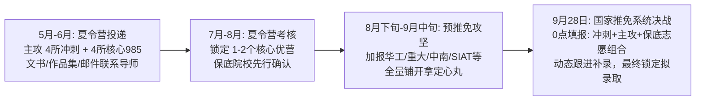

# 广州大学机械学子2026推免申请深度规划方案

---

## 一、 考生全维度背景深度诊断与SWOT分析

根据您提供的背景信息（**广州大学机械专业，排名 前约1%，六级 450–499 分，具备智能机器人及工程项目经历，意向方向为机械工程或智能制造**），以下为您进行保研定位的全面剖析：

```
+--------------------------------------------------------------------------------------------------+
|                                    考生综合画像 SWOT 分析                                         |
+--------------------------------------------------------------------------------------------------+
| 【优势 Strengths】                                 | 【劣势 Weaknesses】                          |
| 1. 专业排名 前约1%（Top 约1%）：绝对的第一名，是    | 1. 本科双非（非985/211）：部分顶尖名校本部学硕|
|    双非学子冲刺名校的“破壁利器”，绝大多数985高校   |    在夏令营初审系统设有本科门槛硬筛。        |
|    简章中“其他高校前1%或专业第1名”的硬性条件。      | 2. 六级 450–499分：达到基本线（425/450），但在名校|
| 2. 智能机器人实战背景：契合当前机械向机电、具身    |    优营考核与材料初审中不占优势，需规避对六级|
|    智能、智能装备转型的核心趋势，动手能力强。      |    有480/500+硬性排序淘汰的院校。             |
+----------------------------------------------------+---------------------------------------------+
| 【机遇 Opportunities】                             | 【挑战 Threats】                            |
| 1. 国家卓越工程师与专硕专项扩招：重工程实践与产教  | 1. 夏令营“海王”聚集，入营门槛逐年水涨船高。  |
|    融合，对动手实操强、排名第一的学生极度友好。    | 2. 928国家推免系统各校“鸽子”与补录博弈加剧， |
| 2. 大湾区科研院所与新兴高校红利：科研资源充沛，    |    必须设立梯度防线，防止无Offer或滑档风险。 |
|    看重工程落地，不唯高校出身。                    |                                             |
+--------------------------------------------------------------------------------------------------+
```

### 1. 核心破局思路
- **以“专业第1”叩开名校大门**：在简历、自荐信和邮件主题中，将“**Rank: 前约1% (Top 约1%)**”置于最显眼位置。
- **用“机器人硬核工程经历”击中导师痛点**：当前机械学科导师普遍偏爱具备 ROS、嵌入式控制、机构设计、机器视觉及传感融合等实操技能的工程型学生，这正是推免面试中超越高分低能生源的关键。
- **专硕与学硕并进，重点布局“智能制造专项”与“工程师学院”**：避开名额极少且唯本科出身论的基础学硕内卷，主攻国家重点支持的产教融合专业型硕士（0855）。
- **梯队化布局（4-7-5模型）**：4所顶尖冲刺、7所核心主攻、5所稳健保底，兼顾大湾区区位优势与全国知名工科强校。

---

## 二、 16个学校·学院·专业（项目）组合梯度全景速览表

| 序号 | 梯队定位 | 招生高校 | 培养学院/研究院 | 拟报专业及代码 | 学位类型 | 六级门槛 | 核心契合方向 |
| :---: | :---: | :---: | :---: | :---: | :---: | :---: | :---: |
| **01** | 冲刺档 | **清华大学** | 深圳国际研究生院 (SIGS) | 085500 机械（智能制造专项） | 专硕 | ≥425 | 智能装备/先进制造 |
| **02** | 冲刺档 | **哈尔滨工业大学（深圳）** | 机电工程与自动化学院 | 080200 机械工程 / 085500 机械 | 学硕/专硕 | ≥425 | 智能机器人技术 |
| **03** | 冲刺档 | **华南理工大学** | 机械与汽车工程学院 | 080200 机械工程 / 085501 智能制造技术 | 学硕/专硕 | ≥425 | 高端装备与智能制造 |
| **04** | 冲刺档 | **浙江大学** | 工程师学院 | 085500 机械（卓越培养项目：智能制造与高端装备） | 专硕 | ≥425 | 工业机器人/卓越制造 |
| **05** | 主攻档 | **华南理工大学** | 吴贤铭智能工程学院 | 085500 机械（智能机器人与自主系统） | 专硕 | ≥425 | 机器人技术与先进智造 |
| **06** | 主攻档 | **中国科学院大学** | 深圳先进技术研究院 (集成所) | 080200 机械工程 / 085500 机械 | 学硕/专硕 | ≥425 | 智能仿生机器人/医疗装备 |
| **07** | 主攻档 | **南方科技大学** | 自动化与智能制造学院 | 080200 机械工程 / 085500 机械 | 学硕/专硕 | ≥425 | 具身智能/系统设计智造 |
| **08** | 主攻档 | **中南大学** | 机电工程学院 | 080200 机械工程 / 085500 机械 | 学硕/专硕 | ≥425 | 智能装备与精密制造 |
| **09** | 主攻档 | **湖南大学** | 机械与运载工程学院 | 080200 机械工程 / 085500 机械 | 学硕/专硕 | ≥425 | 机器人控制/高效智能制造 |
| **10** | 主攻档 | **重庆大学** | 机械与运载工程学院 | 080200 机械工程 / 085501 智能制造技术 | 学硕/专硕 | ≥425 | 机械传动/智能装备系统 |
| **11** | 主攻档 | **大连理工大学** | 机械工程学院 | 080200 机械工程 / 085500 机械 | 学硕/专硕 | ≥425 | 精密制造/智能机器人 |
| **12** | 保底档 | **广东工业大学** | 机电工程学院 | 080200 机械工程 / 085501 智能制造技术 | 学硕/专硕 | ≥425 | 精密装备/工业机器人 (A-学科) |
| **13** | 保底档 | **深圳大学** | 机电与控制工程学院 | 080200 机械工程 / 085500 机械 | 学硕/专硕 | ≥425 | 光机电一体化/智能制造 |
| **14** | 保底档 | **合肥工业大学** | 机械工程学院 | 080200 机械工程 / 085500 机械 | 学硕/专硕 | ≥425 | 机械装备/机器人应用 (机械四小龙) |
| **15** | 保底档 | **西南交通大学** | 机械工程学院 | 080200 机械工程 / 085500 机械 | 学硕/专硕 | ≥425 | 特种机器人/智能机电系统 |
| **16** | 保底档 | **北京工业大学** | 材料与制造学部 | 080200 机械工程 / 085500 机械 | 学硕/专硕 | ≥425 | 微电子装备/先进制造技术 |

---

## 三、 16个精选组合详细适配理由与录取深度解析

### （一） 第一梯队：顶尖冲刺档（4所）

这一梯队院校属于国内顶级 985 或 C9 联盟平台，虽对本科出身门槛较高，但凭借您的 **前约1% 排名第一背书 + 扎实的机器人工程项目实战**，完全具备在夏令营或预推免入围并斩获 Offer 的现实可能。

#### 1. 清华大学深圳国际研究生院 (SIGS)
- **培养学院**：先进制造学部
- **专业与项目**：`085500 机械`（智能制造专项，专业型硕士）
- **适配理由**：
  1. **招生机制契合**：智能制造专项是清华大学深化专业学位研究生教育改革的核心试点，由深圳国际研究生院牵头，侧重产教融合与高层次工程应用。招录名额较校本部学硕充裕，为双非排名前1%的尖子生提供了冲刺清华最高可行性的通道。
  2. **英语与背景适配**：清华推免英语门槛通常要求通过 CET-6（≥425），450–499分已过门槛线。该项目重点考查综合工程素养与学术志趣，面试以工程研究背景与逻辑思维为主，六级分数不构成淘汰主因。
  3. **大湾区产业互通**：清华 SIGS 立足深圳，对接大湾区智能制造与机器人产业集群，对广州本地高校专业前列的生源认知度良好。若能展示出扎实的机器人样机制作、控制系统开发等成果，极受导师欢迎。

#### 2. 哈尔滨工业大学（深圳）
- **培养学院**：机电工程与自动化学院
- **专业与项目**：`080200 机械工程`（学硕）/ `085500 机械`（智能机器人技术方向，专硕）
- **适配理由**：
  1. **机械与机器人领头羊**：哈工大机械学科全国 A+（机械五虎之首），在机器人技术与系统全国重点实验室等国家级平台支撑下，空间机构、仿生机器人及特种装备技术实力拔群。
  2. **地缘与生源友好度**：哈工大深圳坐落于粤港澳大湾区核心区域，生源选拔中高度关注广东省内重点高校的拔尖学子。广大机械专业 前约1% 的绝对成绩，完全符合哈工大针对非双一流高校“成绩排名前 1% 或第 1 名”的报名通道资格。
  3. **实践匹配度极高**：机电学院导师科研项目极度繁重，高度青睐具备 ROS 开发、STM32 控制、传感器融合与机器视觉实战经验的学生。450–499分的六级成绩完全达标（校线425），夏令营或预推免中以项目为核心展开答辩，胜算极大。

#### 3. 华南理工大学
- **培养学院**：机械与汽车工程学院
- **专业与项目**：`080200 机械工程`（学硕）/ `085501 智能制造技术`（专硕）
- **适配理由**：
  1. **省内本土 985 顶级名校**：华工机械工程学科评估为 A- 类，建有国家金属材料近净成形工程技术研究中心、聚合物成型装备国家工程实验室等顶尖平台，是广东省乃至华南制造业高层次人才的摇篮。
  2. **本地认可度与历史沉淀**：同在广州大学城，华工对广州大学机械学院的人才培养质量知根知底。专业第 1 名在华工机汽学院初审中极具分量，通过夏令营或预推免材料关的概率极高。
  3. **专业高度对口**：学院设有智能制造与机器人化装备研究所，六级450–499分达到华工推免要求。专硕（085501）招收指标较多，是确保冲刺成功并留在广东省内的绝佳选择。

#### 4. 浙江大学
- **培养学院**：工程师学院（国家卓越工程师学院，院系代码 600）
- **专业与项目**：`085500 机械`（卓越培养项目：智能制造与高端装备工程 / 工业机器人工程，专硕）
- **适配理由**：
  1. **顶级 C9 平台的特设通道**：浙江大学机械工程学科为 A+ 顶流。浙大本部机械学院对本科生源院校要求极其严格，但浙江大学工程师学院专注于培养高层次工程技术创新人才，采取项目制招生模式，为具有硬核工程实战经验的“双非专业前列”开辟了黄金通路。
  2. **突出工程实践的考查导向**：工程师学院在推免复试中，极度看重考生解决复杂工程问题的动手能力、项目作品集及竞赛实践。您的智能机器人实操与工程项目经验在此处会获得极高加权。
  3. **门槛与规避优势**：六级 450–499 分满足浙大研究生院推免报名基本线（≥425 分），通过专项申报可规避纯学术学硕的高门槛竞争，实现以专硕弯道进入 C9 名校的目标。

---

### （二） 第二梯队：核心主攻档（7所）

这一梯队涵盖了专业底蕴极深的老牌 985 高校、国家级顶级科研院所以及新型高水平大学。凭借您的绝对排名第一与机器人工程项目，此梯队**入营概率极高，属于必须全力以赴并确保拿下 1~2 个拟录取资格（优营）的战役核心区**。

#### 5. 华南理工大学
- **培养学院**：吴贤铭智能工程学院（广州国际校区）
- **专业与项目**：`085500 机械`（智能机器人与自主系统 / 智能制造方向，专硕）
- **适配理由**：
  1. **国际化新工科前沿高地**：吴贤铭智能工程学院位于华工广州国际校区，与密歇根大学安娜堡分校等国际名校深度合作，全面聚焦人工智能、机器人、智能制造与自主无人系统，学科方向与您的意向完全吻合。
  2. **全周期科创支持**：学院拥有世界一流的智能制造与机器人实验室，师资力量均为海外顶尖学者及业内翘楚。广大 前约1% 的学分绩在省内极具说服力，预推免入选概率很大。
  3. **考核与应对**：该学院复试具有一定全英交流要求，六级450–499分虽达到报名线，但建议重点强化机器人工程相关的专业术语英文表达（如 Kinematics, SLAM, Actuator, Trajectory Planning 等），展现扎实的工程英语运用能力。

#### 6. 中国科学院深圳先进技术研究院 (SIAT / 中国科学院大学)
- **培养所部**：先进集成技术研究所（集成所）
- **专业与项目**：`080200 机械工程`（学硕）/ `085500 机械`（智能仿生机器人与智能装备方向，专硕）
- **适配理由**：
  1. **机器人领域的“国家队”主力**：集成所是中科院在机器人与智能装备领域最具实力的科研单元之一，在医疗手术机器人、外骨骼助行机器人、无人系统、工业协作机器人等领域技术底蕴深厚，科研经费极为充裕。
  2. **破除唯名校论，唯实操是瞻**：中科院系统推免不设严苛的生源学校壁垒，极其看重本科生的科研潜力和动手能力。广大机械专业前约1%叠加智能机器人项目研发经历，在集成所导师眼中属于“免培训即可直接进入课题攻坚”的优质种子选手。
  3. **待遇与就业辐射**：SIAT 研究生津贴待遇在国内首屈一指，且与大族激光、汇川、华为、大疆等机器人与先进制造头部企业建有联合实验室，留深就业及学术深造渠道畅通。

#### 7. 南方科技大学
- **培养学院**：自动化与智能制造学院（原系统设计与智能制造学院 SDIM）/ 机械与能源工程系
- **专业与项目**：`080200 机械工程`（学硕）/ `085500 机械`（具身智能与智能制造装备，专硕）
- **适配理由**：
  1. **前沿新工科办学模式**：南科大是国家“双一流”建设高校，近年来发展势头极为强劲。自动化与智能制造学院深耕具身智能机器人、多智能体协同、智能系统工程与先进制造，研究高度前沿。
  2. **开放包容的招生文化**：南科大完全打破传统生源等级标签，夏令营与推免选拔以“个人学术兴趣、工程创造力及综合素养”为唯一核心，非常乐于接收综合排名第一且具项目实干经验的双非拔尖生。
  3. **导师与硬件实力顶配**：实行全员导师制，实验设备全球领先，推免生奖学金丰厚。六级450–499分完全满足要求，若提前邮件联系学院具身智能或机器人课题组导师，极其容易获得提前锁定义务。

#### 8. 中南大学
- **培养学院**：机电工程学院
- **专业与项目**：`080200 机械工程`（学硕）/ `085500 机械`（智能装备与微纳制造方向，专硕）
- **适配理由**：
  1. **学科硬核的部属 985**：中南大学机械工程在教育部学科评估中位居 A-，建有极端服役性能制造全国重点实验室，在复杂装备智能设计、特种加工、微纳操作与智能控制领域声誉卓著。
  2. **明确的生源优待政策**：中南大学历年推免章程中均明确设立了针对非双一流高校“推免综合成绩排名专业前1%或专业第1名”的友好审核细则。您的 前约1% 是中南大学机电学院材料初审的“通关金牌”。
  3. **考核容错度高**：六级450–499分顺利通过门槛。机电学院推免复试偏重专业核心课（机设、机原、控工基础）及工程实践，与考生的优势完全吻合，是主攻院校中拿到优营概率极高的 985 选择。

#### 9. 湖南大学
- **培养学院**：机械与运载工程学院
- **专业与项目**：`080200 机械工程`（学硕）/ `085500 机械`（机器人与智能运载装备方向，专硕）
- **适配理由**：
  1. **底蕴深厚的“机械四小龙”**：湖南大学机械工程为 A- 学科，国家“双一流”建设学科，拥有国家高效磨削与智能制造工程技术研究中心，在智能制造装备、机器人磨抛加工及运载控制领域处于行业领头羊地位。
  2. **选拔偏重实操**：湖大在夏令营和预推免中非常重视学生的工科竞赛、机器人项目成果。专业前列名在资格审核中优势显著，复试以实际工程案例分析和专业综合问答为主，面试官对实操经验丰富的学生打分极高。
  3. **稳定性强**：六级450–499分无任何报名障碍，地理位置邻近大湾区，往年大量广深优秀学子前往深造，是核心冲刺稳固阵地。

#### 10. 重庆大学
- **培养学院**：机械与运载工程学院
- **专业与项目**：`080200 机械工程`（学硕）/ `085501 智能制造技术`（专硕）
- **适配理由**：
  1. **老牌西南工科霸主**：985工程大学，机械工程学科评估为 A-，建有机械传动国家重点实验室，在传动机械、精密机器人减速器、智能制造产线技术领域处于全国第一梯队。
  2. **专硕指标充裕**：重大机械学院体量大，085501 智能制造技术专硕招生名额较多，对非双一流高校专业前列名的学生持高度接纳态度，预推免阶段录取率高。
  3. **综合契合度高**：六级450–499分达标。学院复试考核标准规范透明，重视学生的基础知识扎实度与动手创新潜能，是获取 985 院校拟录取资格的极其稳妥的依托。

#### 11. 大连理工大学
- **培养学院**：机械工程学院
- **专业与项目**：`080200 机械工程`（学硕）/ `085500 机械`（精密制造与智能机器人系统方向，专硕）
- **适配理由**：
  1. **老牌四大工学院之一**：大连理工大学机械工程在教育部学科评估中位居全国 A 类，拥有精密与特种加工教育部重点实验室等顶尖平台，其机械学术声誉在全国制造业具备极高威望。
  2. **政策直通支持**：大工历年在夏令营及推免简章中均白纸黑字写明对“非双一流高校综合成绩排名前1%或专业第1名”学生开放同等资格入营与考核，政策透明度与兑现度极高。
  3. **工程导向强**：学院考核重实际工程开发与机械设计能力，您的机器人和工程项目经历可作为答辩核心亮点，能有效弱化六级450–499分的影响，性价比极高。

---

### （三） 第三梯队：稳健保底与高性价比档（5所）

这一梯队的作用是**构建不可击穿的安全底线**。涵盖了广东省内 A- 类学科霸主、特区顶尖资源高校以及机械底蕴深厚的直属 211 强校。这 5 所院校不仅能为您提供 100% 的录取确定性，其学科声誉或地域优势同样处于行业高位。

#### 12. 广东工业大学
- **培养学院**：机电工程学院
- **专业与项目**：`080200 机械工程`（学硕）/ `085501 智能制造技术`（专硕）
- **适配理由**：
  1. **学科实力极其强劲（A- 类顶尖学科）**：广工机械在教育部第四轮学科评估中位居 A-（与大连理工、湖南大学等中上游 985 并列），建有省部共建精密电子制造技术与装备国家重点实验室。在广东省乃至全国 3C 电子智能制造装备、工业机器人及半导体封装设备领域处于领军地位。
  2. **珠三角制造业绝对校友圈**：在珠三角机器人制造、智能产线及自动化行业，广工机电校友覆盖率极高，就业含金量丝毫不亚于普通 985。
  3. **保底优待政策**：同在广州，广大机械专业前约1%申请广工，基本可实现“秒批直通”，并享有优先自选院士/杰青团队、直拿一等学业奖学金的特权待遇，是省内最完美的“兜底王牌”。

#### 13. 深圳大学
- **培养学院**：机电与控制工程学院
- **专业与项目**：`080200 机械工程`（学硕）/ `085500 机械`（智能制造与机器人化装备方向，专硕）
- **适配理由**：
  1. **区位与高额投入优势**：地处深圳南山区科技核心腹地，科研经费投入巨大。学院依托广东省微纳光机电技术与装备重点实验室，与大族激光、汇川技术、优必选等机器人名企联合培养。
  2. **推免生丰厚奖助体系**：深大对优质推免生提供高额“拔尖推免生奖学金”（新生特等奖学金高达数万元，且学业奖学金全覆盖），对综合成绩第 1 名的同学极具吸引力。
  3. **绝对把握与高薪就业**：六级450–499分畅通无阻，专业第 1 名在推免中具有极高优先级，适合希望未来留在深圳高端智能制造与机器人企业发展的同学作为核心稳健志愿。

#### 14. 合肥工业大学
- **培养学院**：机械工程学院
- **专业与项目**：`080200 机械工程`（学硕）/ `085500 机械`（智能制造技术与装备，专硕）
- **适配理由**：
  1. **“机械四小龙”纯正行业血统**：教育部直属 211 工程高校，机械工程为其传统优势王牌学科（B+ 顶峰，接近 A- 级）。在长三角高端装备制造、新能源汽车装备、智能产线领域口碑极佳。
  2. **极度看重机械“硬实力”**：合工大考核侧重机械原理、机械设计、机械制造技术基础等底层工科素养，面试环节不唯名校，重在考察真实动手能力。凭借 前约1% + 机器人项目，面试极易斩获高分。
  3. **高确定性保障**：推免名额充足且对地方高校尖子生极为诚恳，是机械工程专业最具底蕴的全国性 211 保底首选。

#### 15. 西南交通大学
- **培养学院**：机械工程学院
- **专业与项目**：`080200 机械工程`（学硕）/ `085500 机械`（机器人与智能测控技术方向，专硕）
- **适配理由**：
  1. **国家重点平台依托**：教育部直属“双一流”、“211工程”强校，机械工程学科评估为 B+，拥有轨道交通运载系统全国重点实验室等国家级重大平台。
  2. **特种机器人方向特色突出**：在轨道巡检机器人、智能作业机器人、机电液一体化方向承接国家重大重点专项无数，科研经费极为充沛。
  3. **推免通道顺畅**：推免考核公平规范，六级450–499分完全合规，对西南及南方各省份第一名生源有极好的录取接纳政策，确定性极强。

#### 16. 北京工业大学
- **培养学院**：材料与制造学部（机械工程系）
- **专业与项目**：`080200 机械工程`（学硕）/ `085500 机械`（智能制造与微电子装备，专硕）
- **适配理由**：
  1. **北京市属唯一 211 / 双一流高校**：机械工程学科入选北京市高精尖学科建设，建有先进制造技术北京市重点实验室，在超精密微电子装备、工业机器人应用领域平台优厚。
  2. **跨区域拓宽格局**：为希望跳出华南、对接北方高端装备研发及科研院所生态的同学提供了高平台跳板。
  3. **录取概率 100% 稳妥**：北工大对地方高水平大学专业前列的工科学子极其渴求，初审秒过，复试重视综合工程素养，可作为跨地域兜底防线的坚实屏障。

---

## 四、 专项劣势弥补与优势放大策略

针对您的 **“六级450–499分”** 与 **“智能机器人工程项目”** 这一特定组合，在推免实战中必须执行“扬长避短”的战术：

```
+--------------------------------------------------------------------------------------------------+
|                              推免材料与面试考核攻防转换模型                                      |
+--------------------------------------------------------------------------------------------------+
|  【弱点规避：CET-6 450–499】                               【杀手锏放大：智能机器人项目】             |
|  * 策略1：弱化纯语言应试指标，强调专业工程英语阅读能力。  * 策略1：打造 2-3 页图文并茂的工程作品集(Portfolio)|
|  * 策略2：面试前强化英文自我介绍与项目英文述评。        * 策略2：拆解技术栈：ROS/嵌入式/机械结构/算法    |
|  * 策略3：避开对六级有 480/500+ 硬排序淘汰的中外合办。   * 策略3：准备 30-60 秒机器人实物运行视频随时展示  |
+--------------------------------------------------------------------------------------------------+
```

### 1. 六级 450–499 分的应对破局方案
1. **资质说明与达标证明**：在简历表格中如实填写 CET-6 450–499 分，无需遮掩；在个人陈述中，可注明“具备熟练阅读 IEEE、ASME 等机械与机器人领域英文技术文档和外文文献的能力”。
2. **规避硬性扣分坑点**：
   - 坚决避开对六级有硬性排名卡人的纯涉外学院（如部分中外合作大学要求六级 500+ 或雅思 6.5+）。
   - 本文推荐的 16 个项目均符合国家及各校研究生院推免基本门槛（≥425 分）。
3. **面试英语问答专项准备**：
   - 准备一段 2 分钟以内的精炼英文自我介绍，着重介绍个人专业前列的毅力与智能机器人项目开发经历。
   - 熟练背诵机器人与机械专业高频词汇：如 *Inverse Kinematics（逆运动学）、Autonomous Mobile Robot (AMR)、Sensor Fusion（传感融合）、PID Controller、Finite Element Analysis (FEA)、Trajectory Planning（轨迹规划）*。面试官提问专业英语时能张口就来，即可彻底打消考官对英语能力的疑虑。

### 2. 智能机器人项目的“吸睛化”呈现技巧
1. **制作专业级工程作品集（Engineering Portfolio）**：
   - 不要仅在简历中写“参与过智能机器人项目”寥寥数语。
   - 随简历附送一份 2~3 页的 PDF 作品集，内容包括：**机器人系统总体架构框图、SolidWorks/CATIA 机械 3D 渲染图、硬件驱动板/电路布局图、控制算法流程图以及样机实物照片**。
2. **STAR 原则深度梳理项目细节**：
   - **Situation（背景）**：该机器人面向什么应用场景（如物流巡检、全向移动底盘、分拣机械臂）？
   - **Task（任务）**：你在团队中承担的具体核心模块（负责机械结构选型与设计？负责底层 STM32 电机驱动开发？负责 ROS 激光雷达 SLAM 建图？）
   - **Action（行动）**：遇到了什么复杂工程问题？（例如：电机运动时振动过大如何进行结构刚度优化？SLAM 漂移如何通过 EKF 滤波融合 IMU 数据纠正？）
   - **Result（成果）**：样机是否完成？测试指标如何？是否申报专利/软著或参加 Robomaster、中国机器人大赛、挑战杯？
3. **准备“实物演示备用包”**：
   - 无论是线下答辩还是线上远程面试，在手机/U盘中备好 30 秒至 1 分钟的机器人实物运动/操作剪辑视频。如果面试官问及“你在项目中具体做了什么”，主动申请展示视频，这能瞬间在众多以理论为主的考生中脱颖而出。

---

## 五、 2026年推免申请季实战全流程时间线与攻防战术



### 1. 关键阶段实操策略
- **第一阶段：5月至6月（夏令营海投与导师套磁）**
  - **任务**：完成中英文简历、成绩排名证明（盖章）、六级证书、工程作品集制作。
  - **投递策略**：将上述 16 所院校中开放夏令营的高校全量投递。重点冲刺清华 SIGS、哈工大深圳、华工、SIAT、中南及湖大。
  - **导师套磁**：在各学院官网筛选从事“机器人控制、智能装备、智能制造”的副教授/教授，发送自荐邮件（附上简历与作品集）。邮件标题格式规范：`【推免自荐】广州大学机械专业前约1%- 申请攻读XX老师2026级硕士 - 姓名`。
- **第二阶段：7月至8月（夏令营实战与锁定保底）**
  - **任务**：参加夏令营考核，争取拿到 1~2 个“优秀营员（优营）”。
  - **心态把控**：若冲刺档高校未入营，切莫气馁，这是双非生源在夏令营初审的普遍现象；必须确保在广工、深大或合工大等院校中确立 1 个确定保底，卸下心理负担。
- **第三阶段：8月下旬至9月中旬（预推免生死大决战）**
  - **任务**：预推免是双非专业第 1 名成功逆袭 985 的主战场！因为大量 985 高校夏令营发放的优营会被清北华五“海王”放弃，预推免阶段学院急需补足生源。
  - **行动**：紧盯华工机汽、吴贤铭学院、重庆大学、大连理工、湖南大学、浙大工程师学院的预推免通知，第一时间提交材料并参加复试。
- **第四阶段：9月28日（国家推免系统终局操作）**
  - **志愿填报 3 席位策略**：
    - **志愿 1（冲刺）**：填报已通过预推免或有老师口头承诺的最高等级院校（如清华 SIGS、哈工大深圳或华工）。
    - **志愿 2（核心）**：填报已拿到确定优营/候补靠前资格的 985 高校（如中南、重大或 SIAT）。
    - **志愿 3（死保）**：填报已获稳妥录取的院校（如广工大、深大或西交大），确保系统开放 48 小时内必定有一个国家待录取通知锁定，万无一失。

### 2. 最终行动建议
您拥有 **前约1% 这一极具说服力的学业第一名身份**，并且具有**智能制造与机器人这一时代红利方向的工程经历**。只要战术上正视“双非”背景在夏令营筛查中的客观阻力，在文书中坚决打出“**专业绝对第一 + 强动手落地能力 + 专硕卓越工程师定位**”的王牌组合，您在 2026 年推免季中斩获知名 985 高校或顶级科研院所的拟录取通知是完全可以实现的现实目标！
