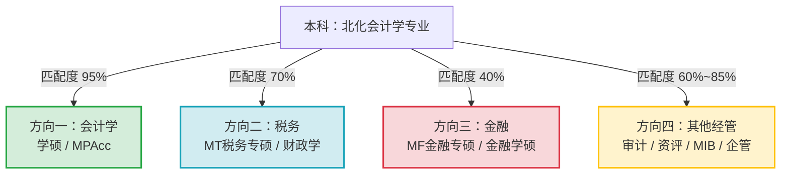

# 北京化工大学会计学推免生竞争力与课程基础评估指南（2026推免申请季）

---

### 背景画像与诊断概览

在进入系统评估前，先对你在2026年推免申请季所处的基准画像进行拆解：
* **本科院校**：北京化工大学（教育部直属全国重点大学、“211工程”、“双一流”建设高校，北京区位）。
* **本科专业**：经济管理学院 · 会计学专业（管理学学士）。
* **学业排名**：**前约5%（专业前 约5%，进入 Top 5% 黄金区间）**。
* **外语水平**：**大学英语六级（CET-6）550–599分**。
* **核心困惑**：在**会计学、税务、金融**以及**其他经管方向（审计、资产评估、国际商务、企管/管科等）**之间权衡，不知如何客观评估自身综合竞争力和跨方向的课程基础匹配度。

本指南分为五个维度，帮助你建立清晰的自我诊断体系、课程缺口清单、决策矩阵以及推免备战行动方案。

---

## 第一部分：推免综合竞争力多维评估模型（你在经管保研生态中的真实定位）

在经管类推免中，院校筛选分为两大阶段：**“初审入营筛选（硬指标主导）”**与**“营内考核/复试录取（专业底盘与综合软实力主导）”**。我们需要将你的背景指标放入全国竞争大盘中精确定位。

### 1. 硬件维度评估（初审“入营门票”）

#### （1）院校背景：理工类211在经管保研生态中的真实生态位
* **生态位分层**：全国经管类保研生源金字塔通常呈现如下梯度：
  $$\text{清北复交人/国发院} \succ \text{九校联盟及强985经管/两财一贸} \succ \text{中上游985/中南大/西财} \succ \textbf{理工及综合类211经管} \succ \text{双非财经/普通双非}$$
* **优势剖析**：北京化工大学作为教育部直属的“211工程”和一流学科建设高校，且地处北京，能为你**完全规避绝大多数985高校及顶级财经院校设置的“双非/非双一流一票否决”硬门槛**。
* **潜在制约**：北化优势学科集中于化工、材料等工科门类，经管学科虽有扎实积累（拥有管理科学与工程、工商管理等一级学科及专硕点），但非全国A类经管强校。在清北复交顶级金融/会计项目或部分极度看重经管学科声誉的高校初审系统中，理工类211相比“两财一贸”或中南财、西财等老牌财经211，系统赋分并不占优势。

#### （2）学业排名：前约5%（约5%）的含金量与分水岭效应
* **本校推免资格**：**绝对稳妥**。北京化工大学经管类专业的常规推免率通常在12%~18%区间，会计专业（人数已概括）推免名额预计在5~10个左右。排名前约5%稳获校内推免资格，无须担心指标掉落。
* **外校初审入营价值**：**跻身Top 5%黄金分段**。
  * 绝大部分985院校商学院与顶尖财经大学夏令营申请指南中，对“211工程”院校的硬性排名要求通常明确划定为“前5%”或“前10%”。你的 $前约5% \approx 4.92\%$ 刚好稳居前5%以内，这是拿到优质生源初审门票的极关键分水岭。
* **竞争边界警示**：你属于前5%，但**并非专业第一（精确名次/人数比较已概括）**。
  * 在清华经管、清华五道口、北大光华、北大汇丰、复旦管院、交大高金（SAIF）、人大商学院等顶尖项目中，对纯理工类211生源通常有极其严苛的潜规则（往往严格要求“仅限专业第1名”，甚至只招收专业第1且附带国家级硬核成果的候选人）。因此，在超一线顶尖项目中，前约5%的通过率较低；但在中上游985商学院与主流财经类院校中，前约5%具有极其扎实的杀伤力。

#### （3）外语水平：六级 550–599 分的实战价值
* **经管保研的英语档位**：通常425分为合格线，480-500分为常规线，520-550分为名校优势线，550分以上为优秀线。
* **竞争优势**：六级 550–599 分在理工类211经管生源中属于**突出亮点**。
  * 彻底通关对外经济贸易大学、复旦管院、中央财经大学、厦门大学等对六级有高分要求（如部分项目要求六级500/520分以上）的硬性审查。
  * 外语不会在任何院校初审中拖后腿，并且在面试的英文文献朗读翻译、专业英文问答环节中能建立正向心理预期。

---

### 2. 软件维度评估清单（营内考核与综合赋能）

初审通过后，各高校考核全面转向“笔试专业深度 + 面试综合素养”。请依据下表自查软件维度的储备：

| 评估维度 | 核心观察指标 | 竞争层级自测标准 |
| :--- | :--- | :--- |
| **学术科研** | 大创项目、学术论文、计量分析能力 | • **卓越档**：主持国家级大创结题；有正式发表或高水平Working Paper（中文核心/CSSCI或SSCI）；熟练使用 Stata/Python 进行因果推断（DID、IV、PSM、面板数据）。<br>• **合格档**：参与过校级/市级大创；有完整的课程实证研究报告；懂基础计量回归原理。<br>• **薄弱档**：无任何科研训练，完全不懂实证研究方法。 |
| **学科竞赛** | 商赛、数模、英语与综合赛事 | • **卓越档**：全国大学生“挑战杯”/“互联网+”国奖；全国大学生市场调查与分析大赛（正大杯）国奖；美赛M/F奖或国赛二等奖以上。<br>• **合格档**：正大杯省一/省二；尖烽时刻、案例分析大赛省奖；全国大学生英语竞赛（NECCS）二/三等奖；省数学建模奖。<br>• **薄弱档**：仅有校级一般竞赛或文体类奖项。 |
| **行业实习** | 事务所、投行/行研、大厂/国企财务 | • **卓越档**：四大会计师事务所审计/税务实习；头部券商投行部（IBD）或研究所（行研）高质量实习；知名咨询公司项目经历。<br>• **合格档**：内资八大所审计；商业银行分行/总行实习；大型央国企或知名互联网企业财务部门实习。<br>• **薄弱档**：无专业相关实习或仅有一般行政性兼职。 |

---

### 3. 目标院校梯队定位全景图

结合“北化会计本 + 前约5% (Top 5%) + 六级 550–599”的综合画像，你的院校申请梯队定位建议如下：

```
┌────────────────────────────────────────────────────────────────────────┐
│ 冲刺层 (彩票/梦想项目，占比 15%~20%)                                    │
│ • 清北复交人顶级金融/会计 (初审较严，建议结合夏令营开放度审慎试水)       │
│ • 上财会计/金融、复旦泛海/管院专硕、人大财金                            │
├────────────────────────────────────────────────────────────────────────┤
│ 核心主攻层 (门当户对、确定性高、重点投递，占比 50%~60%)                  │
│ • 头部财经高校：“两财一贸”(中央财经大学、对外经济贸易大学) 优势学院/专硕   │
│ • 优质985商学院/经管学院：                                             │
│   - 同城：北京理工大学经管、北京航空航天大学经管                        │
│   - 华北/东北：南开大学商学院/金融学院、天津大学经管、大连理工、山东大学│
│   - 华东/华中/东南：厦门大学、武汉大学、华中科技大学、东南大学经管      │
│   - 西部：四川大学商学院、重庆大学经管                                 │
├────────────────────────────────────────────────────────────────────────┤
│ 稳健保底层 (托底安全网，确保 100% 录取出线，占比 20%~30%)               │
│ • 强势财经211：西南财经大学、中南财经政法大学的主流方向                 │
│ • 同城优势211：北京交通大学经管、北京科技大学经管、中国政法大学商学院   │
│ • 终极保底：北京化工大学经济管理学院本校推免直升                       │
└────────────────────────────────────────────────────────────────────────┘
```

---

## 第二部分：课程基础与学科匹配度深度评估（Gap Analysis 知识图谱与缺口对照）

会计学专业通常具有鲜明的“强财务实务、强合规核算、弱数理推导、弱宏观理论”特征。针对你正在犹豫的四大候选方向，必须进行逐项的**课程重叠度与知识断层（Gap）剖析**。

### 1. 会计学本科的底层课程图谱拆解

北化会计学本科的标准培养方案通常包含以下四大模块：
1. **财务与会计核心线**：基础会计学、中级财务会计（上/下）、高级财务会计、成本会计、管理会计。
2. **财务管理与审计线**：财务管理学、高级财务管理、审计学、财务报表分析。
3. **经济与法商制度线**：微观经济学、宏观经济学、经济法、税法（中国税制）。
4. **数理与统计工具线**：微积分（经管类）、线性代数、概率论与数理统计、应用统计学（部分选修计量经济学）。

---

### 2. 四大候选方向的课程匹配度、知识盲区及考核深度对比



#### 方向一：会计学（会计学硕 / 会计专硕 MPAcc）——本专业纵向深耕

* **课程重合度**：**95%（天然无缝衔接，零跨考壁垒）**
* **考核与知识体系对照**：
  * **学硕（学术型硕士）**：
    * **考核重心**：中财深层理论、实证会计研究方法、微观经济学、计量经济学。
    * **主要知识缺口**：本科通常偏重“做账与实务”，学硕推免重点考核**实证研究思维**。例如：盈余管理度量（修正Jones模型）、审计质量代理变量、公司治理机制（委托代理理论、信息不对称理论）、内生性检验方法（DID/IV/固定效应）。此外，需关注前沿热点（ESG披露、企业数字化转型、数据资产入表、新租赁准则实操影响）。
  * **专硕（MPAcc）**：
    * **考核重心**：中级财务会计深度（新收入准则五步法、长期股权投资与合并报表抵销分录、金融资产重分类与减值模型）、财务管理（资本结构与MM理论、WACC估值折现、现金流分析、并购协同效应）、CPA专业阶段综合实务案例。
    * **主要优势**：会计本科生在案例面试中对准则和商业实质的理解，能全方位碾压跨考生。
* **自测关键问题**：
  1. 你的中级财务会计、财务管理期末成绩是否在90分以上？
  2. 是否能脱口而出新收入准则的核心确认条件，以及合营企业与联营企业在权益法下的顺流、逆流交易未实现内部损益抵销处理？

---

#### 方向二：税务（税务专硕 MT / 财政学税收学硕）——高性价比的近亲交叉

* **课程重合度**：**65% ~ 75%（高度亲和，会计本科极具优势）**
* **会计底盘的杀手锏优势**：
  * **“税会不分家”**：现代税收筹划、税务合规、税务稽查与企业重组涉税分析，其底层数据完全依托企业的资产负债表与利润表。各大高校税务专硕（MT）导师非常偏爱会计本科生，因为很多纯财政税收出身的学生往往不擅长做复杂的会计分录和财报勾稽。
  * 你在本科已经修过《税法》或《中国税制》，对增值税、企业所得税三大核心实体税种及递延所得税资产/负债的会计核算具备扎实认知。
* **知识缺口与短板清单**：
  1. **财政学基础理论（学硕及部分顶尖专硕必考）**：公共产品理论、外部性理论、公共选择理论、财政支出/税收乘数、财政赤字与国债效应。
  2. **税收经济学与政策分析**：税收的公平与效率原则、最优税制理论（Mirrlees模型逻辑）、税负转嫁与税收归宿分析。
  3. **国际税收与前沿反避税**：跨国企业转让定价、常设机构（PE）认定、税收协定范本、OECD“双支柱”方案（Pillar One 全球利润再分配规则、Pillar Two 15%全球最低税率规则）、BEPS（税基侵蚀与利润转移）行动计划。
  4. **小税种与税收征管法**：消费税核算、土地增值税清算、印花税、契税以及税收保全与强制执行措施、税务行政复议与诉讼法。
* **自测关键问题**：
  1. 你是否能清晰推导增值税留抵退税政策对企业现金流和利润表的传导路径？
  2. 你能否准确解释为什么企业所得税暂时性差异会形成递延所得税，而永久性差异只影响当期应交税费？

---

#### 方向三：金融学（金融学硕 / 金融专硕 MF）——热门跨考方向的壁垒透视

* **课程重合度**：**35% ~ 45%（核心重叠主要在公司金融模块）**
* **会计底盘的独有优势**：
  * 在《公司金融》（Corporate Finance）模块中，会计生具备天然壁垒：对财报三张表的勾稽关系、自由现金流（FCFF/FCFE）调整、营运资本变动、ROE杜邦分析、企业价值评估（DCF模型、可比乘数法）了如指掌。这在投行承做和股票基本面行研面试中是巨大亮点。
* **显著知识缺口与深层壁垒（跨考核心阻力）**：
  1. **宏观货币与国际金融体系**：
     * 货币银行学：货币创造机制、货币乘数推导、中央银行三大法宝、泰勒规则、利率期限结构假说、新凯恩斯与新古典货币传导机制。
     * 国际金融学：外汇与汇率决定理论（购买力平价PPP、利率平价CIP/UIP、资产市场说）、国际收支平衡表（BOP）拆解、蒙代尔-弗莱明模型与“不可能三角”。
  2. **微观投资学与资产定价理论**：
     * Markowitz均值-方差组合理论与有效前沿推导。
     * 资本资产定价模型（CAPM）的推导与前提假设、套利定价理论（APT）、Fama-French多因子模型（规模因子SMB、价值因子HML等）。
     * 有效市场假说（EMH）的三种形式及其异象（反转效应、动量效应）。
  3. **金融工程与衍生品定价（数学门槛高）**：
     * 远期与期货定价（持有成本模型）、掉期合约估值。
     * 期权定价：二叉树期权定价模型、Black-Scholes-Merton (BSM) 偏微分方程及其经济学含义、期权Greeks风险对冲参数（Delta、Gamma、Vega、Theta）。
  4. **数理与编程硬门槛**：
     * 金融专硕考核对经管类微积分/线性代数要求较高，部分名校（如清华五道口、北大光华、复旦泛海、交大高金、上财金融）笔试会考察难度接近“数学三”甚至更高的综合数学与金融计量（时间序列平稳性、ARMA、ARCH/GARCH）。北化会计本科的数学课若仅按文科经管标准开设，笔试将承受极大压力。
* **自测关键问题**：
  1. 你的高数/微积分、线性代数、概率论期末成绩是否都在90分以上？逻辑推导是否扎实？
  2. 你是否学过或自学过《投资学》与《货币金融学》？如果不查资料，能否准确解释 CAPM 中的系统性风险和非系统性风险的数学分解？

---

#### 方向四：其他经管方向（审计、资产评估、国际商务、企管/管科）

* **审计专硕（MAud）**：
  * **匹配度：90%**。与会计一脉相承。考核重点在审计学原理、内部控制规范体系、政府审计与国家治理、IT审计与大数据审计。
  * **定位**：竞争烈度远小于会计与金融，适合用作冲击985顶级院校（如南开大学、厦门大学、武汉大学等）或审计署直属渊源名校的高胜率跳板。
* **资产评估（MV）**：
  * **匹配度：80%**。核心考核中财、公司财务、资产评估原理与实务（资产评估途径与方法：成本法、市场法、收益法；不动产评估；无形资产与企业价值评估）。
  * **定位**：专业财经211（如央财、中南财、西财）的资产评估专硕性价比极高，会计生跨申优势明显，入营门槛相对亲民。
* **国际商务（MIB）**：
  * **匹配度：60%**。考核国际贸易理论、国际直接投资（FDI）、跨国公司战略管理、全球供应链与商业环境。
  * **定位**：对英语要求极高。你的六级 550–599 分在 MIB 申请池中具备巨大杀伤力，面试全程英文也能占得先机，是冲刺顶尖名校的极佳冷门/高胜率通道。
* **企业管理 / 工商管理学硕**：
  * **匹配度：65%**。考核管理学原理、战略管理、组织行为学、市场营销等。
  * **定位**：偏向定性研究与商业案例解析，需要良好的文献阅读能力和管理逻辑，竞争相对平缓。
* **管理科学与工程（管工）/ 大数据管理**：
  * **匹配度：50%**。若你在北化选修过Python、管理信息系统（MIS）、数据库或运筹学，可借力北化的工科特色，以“会计信息系统/大数据智能财务”交叉背景进行申报。

---

## 第三部分：科学自我评估操作指南（“四步落地自测法”）

为了让你从“模糊的直觉犹豫”转变为“精准的数据判断”，请严格按照以下四个步骤进行实操自测：

### 步骤一：成绩单深度审计（Transcript Audit）

拿出你前五学期的成绩单，建立如下三色分类分析表：

```
1. 绿色区域（专业优势资产）：
   [ ] 基础会计 / 中级财务会计（上/下） [得分：___]
   [ ] 成本会计 / 管理会计             [得分：___]
   [ ] 财务管理学                     [得分：___]
   * 诊断标准：若上述科目均 ≥ 88~90分，说明会计基本盘极其稳固，申请会计/税务/审计具备充足底气。

2. 黄色区域（数理工具与通用基础）：
   [ ] 微积分 / 高等数学 (经管类)     [得分：___]
   [ ] 线性代数                       [得分：___]
   [ ] 概率论与数理统计               [得分：___]
   [ ] 统计学 / 计量经济学             [得分：___]
   * 诊断标准：
     - 若数理类科目均 ≥ 90分，且对推导不抵触：具备跨考金融、量化经管的先决条件。
     - 若数理类在 75~85分之间：跨保金融专硕笔试风险极大，应果断避开强数理考核项目。

3. 蓝色区域（外延与交叉基础）：
   [ ] 税法 / 中国税制                [得分：___]
   [ ] 微观经济学 / 宏观经济学         [得分：___]
   [ ] 计算机 / Python / 数据库        [得分：___]
   * 诊断标准：税法成绩优秀者，税务专硕匹配度直接拉满；宏微观经济学基础决定金融学硕与财政学硕的入门阻力。
```

---

### 步骤二：目标院校考纲与复试大纲对照（Syllabus Mapping）

搜集5所代表性目标院校（例如：中央财经大学会计学院/财税学院、对外经济贸易大学金融学院/商学院、南开大学商学院/金融学院、北京理工大学经管学院、西南财经大学）上一年度推免笔试/面试考纲，建立三栏对照表：

| 考核科目与模块 | 个人掌握状态（完全掌握 / 接触过但生疏 / 完全盲区） | 突击补齐所需周期（周） |
| :--- | :--- | :--- |
| **模块A：财务会计与准则** | 例：中财核心及合并报表（已完全掌握） | 0 周 |
| **模块B：公司金融与估值** | 例：DCF模型与资本结构（完全掌握） | 0 周 |
| **模块C：货币金融与投资学** | 例：CAPM模型懂概念，BSM公式与宏观金融完全盲区 | 需 4~6 周专项自学 |
| **模块D：中国税制与国际税收**| 例：流转税/所得税熟悉，国际税收与税收经济学盲区 | 需 2~3 周专项补充 |

**决策法则**：
* 如果某方向需要突击的时间 **超过 6 周**，且严重挤占你准备文书、科研与核心专业课的时间，请务必将其降级为“辅助试水”或直接舍弃。
* 如果某方向的知识盲区 **仅需 2~3 周** 即可通过读完1~2本经典教材打通（如税务专硕），该方向属于“高投入产出比”的优质拓展选项。

---

### 步骤三：历年真题压力测试（Pressure Testing）

在不查阅任何资料的封闭状态下，针对各方向典型夏令营面试真题进行口头限时作答，检测知识调动反应：

* **测试题 1（会计方向）**：
  > “请解释新收入准则中‘控制权转移’的核心内涵；若某公司收到客户大额预付款但在期末未履约，财报应如何列报？与旧准则‘预收账款’有何区别？”
* **测试题 2（税务方向）**：
  > “结合企业所得税法，阐述研发费用加计扣除政策的计算逻辑，以及该项税收优惠为什么不会产生递延所得税？”
* **测试题 3（金融方向）**：
  > “请推导 CAPM 模型的经济学逻辑；如果市场上无风险利率上升，根据该模型，高Beta资产与低Beta资产的预期收益率会发生什么变化？”

**评估反馈**：
* 若能自如回答题1：你的会计核心能力过硬。
* 若能逻辑清晰回答题2：你完全具备无缝切换至税务专硕（MT）的潜质。
* 若面对题3完全无从下手或逻辑断层：说明金融微观理论尚未构建，切忌盲目主攻顶尖金融夏令营。

---

### 步骤四：四维综合实力雷达量化评分模型

请根据以下细则对自己进行客观打分（每项满分10分，总分40分）：

```
【维度一：硬件背景（满分10分）】
  • 院校平台：北京化工大学（211/双一流/北京） -> 基础分 7.5分
  • 专业排名：前约5% (Top 约5%，前5%) -> 附加分 1.5分
  • 英语成绩：六级 550–599分 -> 附加分 1.0分
  ★ 你的硬件得分：10.0 / 10.0（在该层次生源中已达到硬件顶格水平）

【维度二：专业课与数理基础（满分10分）】
  • 若中财、财管、税法核心课分数均在 88+，且高数线代概统无挂科/低分：建议自评 8.0 ~ 9.0分
  • 若存在核心专业课 80 分以下或数理短板：建议自评 6.0 ~ 7.5分

【维度三：学术科研与实证工具（满分10分）】
  • 有核心科研项目、掌握 Stata/Python、撰写过实证论文雏形：8.0 ~ 9.5分
  • 仅参与过一般大创，懂基础回归：6.0 ~ 7.5分
  • 纯科研空白：4.0 ~ 5.5分

【维度四：竞赛、实习与综合素养（满分10分）】
  • 有四大/内资头部所或知名券商投行/行研实习，有正大杯/数模/挑战杯省部级奖：8.0 ~ 9.5分
  • 实习仅普通行政，竞赛仅校级奖：5.0 ~ 7.0分
```

---

## 第四部分：推免多方向权衡决策矩阵与组合投递策略（如何打破纠结？）

很多同学在保研时陷入“既想要金融的高薪光环，又舍不得会计的稳妥底盘，同时还听说税务竞争相对温和”的内耗中。我们必须从**学科属性、竞争生态与职业终局**三个维度建立多方向对比矩阵：

### 1. 四大方向全维度权衡对比表

| 考察维度 | 方向一：会计学（学硕/MPAcc） | 方向二：税务（专硕MT/学硕） | 方向三：金融学（MF专硕/学硕） | 方向四：其他经管（审计/资评/MIB） |
| :--- | :--- | :--- | :--- | :--- |
| **你的入营胜率** | **高（80%~90%）** | **极高（85%~95%）** | **中低（30%~50%）** | **极高（85%~95%）** |
| **专业壁垒与难度** | 本专业，壁垒高，复习顺手 | 与会计同源，壁垒较高，容易上手 | 需大量跨专业补课，数理壁垒高 | 难度适中，重实务或商务分析 |
| **初审筛选偏好** | 看重排名百分比、六级、会计底子 | 偏好会计/法学/财税背景，竞争较温和 | 极卷，偏好985生源、专业第一、数理理工复合 | 偏好综合素质高、六级强（MIB）生源 |
| **复试考核核心** | 会计准则细节、财务管理、实证计量 | 增值税/所得税政策、国际税收、财税改革 | 公司金融、投资学、货币银行、金融工程 | 审计准则/资产估值模型/跨国战略/案例分析 |
| **毕业就业主要去向** | 央国企财务、四大/大所、“大厂”财务BP、投行中后台、选调生 | 国家/地方税务局、四大税务部、国企税筹、500强税务岗 | 券商投行/研究所、公募/私募买方、银行总行管培、外资投行 | 审计署/特派办、八大所、评估机构、外企管培 |
| **职业发展风格** | **高下限，极度稳健**，越老越吃香 | **高专业护城河**，体制内与涉税服务极强 | **高上限，周期性强**，看重平台与资源 | **特色鲜明**，特定领域（审计/外企）性价比极高 |

---

### 2. 个性化破局：“三轨并行”投资组合投递策略（Portfolio Strategy）

不要把所有筹码孤注一掷在单一方向上，应当采用现代资产组合理论的“核心-卫星”策略，将你的精力与投递院校划分为三个梯队：

```
                    ┌──────────────────────────────────────────────┐
                    │    弹性冲刺盘 (15% 精力)：金融专硕 (MF)       │
                    │    • 优选：中上游985综合类大学/公司金融特色   │
                    │    • 避开：清北复交纯量化金工金融神仙场       │
                    └──────────────────────┬───────────────────────┘
                                           │
                    ┌──────────────────────┴───────────────────────┐
                    │    高胜率突围盘 (25% 精力)：税务 (MT) / 资评 │
                    │    • 主攻：两财一贸 (央财/贸大)、南开等名校   │
                    │    • 逻辑：用扎实会计底盘跨考，降维打击纯外行 │
                    └──────────────────────┬───────────────────────┘
                                           │
                    ┌──────────────────────┴───────────────────────┐
                    │    核心基石盘 (60% 精力)：会计 (学硕/MPAcc)   │
                    │    • 主攻：主流985商学院与头部财经院校        │
                    │    • 逻辑：保住基本盘，无跨考成本，冲击名校   │
                    └──────────────────────────────────────────────┘
```

#### （1）核心基石盘（投放 60% 精力）：会计学（学硕 / MPAcc）
* **定位**：你的立身之本与基本盘。
* **策略**：
  * **学硕**：主投对实证研究感兴趣、注重学术声誉的985高校（如厦门大学管理学院、南开大学商学院、天津大学经管、武汉大学、山东大学、北京理工大学等）及央财、贸大。
  * **专硕（MPAcc）**：主投“两财一贸”及同城985/211项目。凭借 前约5% 和六级 550–599 的实力，你在中上游985和顶级财经院校的入营及拟录取概率极高。

#### （2）高胜率突围盘（投放 25% 精力）：税务专硕（MT）或 资产评估（MV）/ 审计（MAud）
* **定位**：“以巧破千斤”冲击更高名校平台的特种通道。
* **策略**：
  * 会计学专硕竞争极其惨烈，而中央财经大学、上海财经大学、对外经济贸易大学、南开大学的**税务专硕（MT）**和**资产评估（MV）**通常生源池竞争压力相对平缓，且极度渴望招收精通财务报表核算的会计专业本科生。
  * 你只需花 2~3 周时间突击补齐《税法》深度、税制改革热点与国际税收常识，便能在夏令营面试中展现出“既懂财务又通税法”的复合优势，以极高概率锁定顶尖名校专硕拟录取资格。

#### （3）弹性冲刺盘（投放 15% 精力）：金融专硕（MF）公司金融方向
* **定位**：满足金融情结的进取型探索，但严格控制试错成本。
* **策略**：
  * **精准避坑**：坚决避开清北复交、高金、泛海以及明确考察高级微积分、随机过程、纯量化编程的顶级MF项目（该类项目理工211非第一名初审难度极大，且营内笔试会被数学/物理/CS大牛碾压）。
  * **精准定位**：选择偏重**公司金融、财务分析、企业估值**的综合性985大学金融专硕（例如：北京理工大学、北京航空航天大学、南开大学金融学院部分偏应用方向、天津大学、重庆大学等）。在文书与面试中，重点展示你的“三大财务报表深度透视能力、估值建模能力”，将劣势转化为差异化优势。

---

## 第五部分：2026推免申请季实战筹备时间表与补短板方案

### 1. 2026推免备战四阶段时间轴

```
2025.11 - 2026.02             2026.03 - 2026.04             2026.05 - 2026.07             2026.08 - 2026.09
┌─────────────────────────┐   ┌─────────────────────────┐   ┌─────────────────────────┐   ┌─────────────────────────┐
│ 阶段一：夯实与自查期     │   │ 阶段二：成果冲刺与文书期 │   │ 阶段三：夏令营实战考核期 │   │ 阶段四：预推免与终局锁定 │
├─────────────────────────┤   ├─────────────────────────┤   ├─────────────────────────┤   ├─────────────────────────┤
│ • 成绩单审计与跨学科补课 │   │ • 优化简历与个人陈述    │   │ • 5-6月：海投30+项目    │   │ • 8月中：梳理未录院校   │
│ • 恶补货币金融/国际税收 │   │ • 梳理科研Paper/大创总结│   │ • 6-7月：参加入营考核   │   │ • 9月上：冲刺预推免考核 │
│ • 掌握Stata基础实证回归 │   │ • 争取一段高质量春季实习│   │ • 锁定1-2个优质Offer     │   │ • 9.28：研招网国家系统  │
│ • 保持大三上期末绩点稳居 │   │ • 联系目标院校推荐信导师│   │ • 结合手头Offer动态调整 │   │   最终确认填报录取      │
└─────────────────────────┘   └─────────────────────────┘   └─────────────────────────┘   └─────────────────────────┘
```

#### 阶段一：夯实与自查期（大三上学期末至寒假，当前至2026年2月）
1. **稳固核心绩点**：大三上学期期末考试务必全力以赴，力保《高级财务会计》、《审计学》、《财务管理》等高阶课程取得90+高分，确保推免总排名稳定在 前约5%（争取冲刺到前2名）。
2. **跨专业核心课程“极简恶补”**：
   * 按照后文书单，在寒假集中攻克跨考方向的核心理论缺口（重点是公司金融与现代税制前沿）。
3. **掌握一门实证研究工具**：
   * 突击学习 **Stata**（或 Python 数据分析），掌握数据清洗、描述性统计、OLS回归、双向固定效应模型命令，尝试复现一篇《会计研究》或《经济研究》的经典实证论文。

#### 阶段二：材料与成果冲刺期（大三下学期开学至4月，2026年3月-4月）
1. **学术成果物化**：将本科大创项目、课程论文整理成规范的学术论文格式（包含中英文摘要、引言、理论假说、实证模型、实证结果分析与稳健性检验），作为夏令营申请的 Representative Paper（代表作）。
2. **材料包装与差异化人设塑造**：
   * 准备一页纸中英文简历、个人陈述（针对会计、税务、金融分别定制3个版本）。
   * **人设提炼**：不要把自己包装成“普通纯会计生”，而要突出**“理工名校背景下的数智化/复合型商业分析人才”**，强调北化理工底蕴带给你的逻辑严密性与数据处理能力。
3. **联系推荐人**：提前联系本校2位教授或副教授（其中一位最好是带过你大创或教过你专业核心课的老师），准备好高质量推荐信初稿。

#### 阶段三：夏令营投递与实操考核期（2026年5月至7月）
1. **阶梯式海投（建议投递 25~35 个项目）**：
   * 5月中旬起，密切跟踪各校推免招生网、微信公众号（经管保研通、后保研等）。
   * 坚决执行“冲刺6所 + 主攻15所 + 保底8所”的阶梯投递法，覆盖会计、税务、金融与审计多个赛道。
2. **营内专业考核备战**：
   * 针对不同入营项目的笔试考纲进行针对性刷题，结合目标导师近三年的研究方向准备面试自述。
   * 模拟中英文双语问答，六级 550–599 分的优势必须在口语流利度上充分变现。

#### 阶段四：预推免与九推终局（2026年8月至9月）
1. **复盘夏令营战果**：若夏令营已取得满意985/顶尖财经Offer，可在预推免中以极低压力冲刺顶级梦想校；若夏令营战果不及预期，预推免是二次爆发的主战场。
2. **预推免快速捡漏**：8月中旬开始大量985高校会开放预推免系统，部分高校专硕（如税务、审计、资产评估）预推免补录机会极多。
3. **9月28日国家推免系统决战**：完成志愿填报与复试待录取确认，圆满锁定名校研究生席位。

---

### 2. 跨学科核心课程自学与突击精简书单

为实现用最小的时间成本补齐知识缺口，推荐以下经管推免界公认的经典教材与极简速成材料：

```
【方向一：会计深化与实证提升】
  1. 会计实务与准则：最新版注册会计师统一考试辅导教材《会计》（中国财政经济出版社）
     -> 重点研读：长期股权投资与合并财务报表、金融工具、收入准则、租赁准则。
  2. 实证研究启蒙：陈强《计量经济学及Stata应用》（高等教育出版社）
     -> 重点掌握：面板数据模型、内生性问题及工具变量法、双重差分法 (DID)。

【方向二：税务方向跨考速成】
  1. 中国税制实操：最新版注册会计师统一考试辅导教材《税法》（经济科学出版社）
     -> 重点研读：增值税法、企业所得税法、个人所得税法及税收优惠政策。
  2. 财政与税收理论：陈共《财政学》（第十版，中国人民大学出版社）
     -> 重点研读：公共产品、外部效应、税收原理、税收效应与最优税收。
  3. 国际税收前沿：朱青《国际税收》（中国人民大学出版社）
     -> 重点关注：常设机构认定、转让定价调整、OECD双支柱改革框架。

【方向三：金融方向跨考速成】
  1. 公司财务（你的强项，做知识迁移）：斯蒂芬·罗斯《公司理财》（第11/12版，机械工业出版社）
     -> 重点研读：资本结构与MM定理、加权平均资本成本 (WACC)、实物期权与资本预算。
  2. 投资学（必补核心）：滋维·博迪《投资学》（第10/11版，机械工业出版社）
     -> 重点研读：资产组合理论、CAPM模型、多因子模型、有效市场假说、固定收益证券久期。
  3. 货币银行与宏观金融：易纲《金融学》或黄达《金融学》（中国人民大学出版社）
     -> 重点研读：中央银行体制、货币供求平衡、货币政策传导机制、利率期限结构。
```

---

### 3. 终极行动建议（写在行动之前）

1. **摆脱“既要又要”的焦虑**：推免本质上是一场**“信息差 + 概率论 + 策略组合”**的博弈。排名前5%与六级550–599分保证了你的下限极高，你绝不会没有好学府可读。
2. **善用“近亲跨考”获取非对称竞争优势**：
   * 纯跨金融专硕，属于“以己之短（欠缺深入数理金融积累）搏他人之长（985理工/数理强手）”；
   * 主打会计学硕/MPAcc，属于“稳扎稳打，构筑基本盘”；
   * 适度布局税务专硕（MT）与资产评估（MV），属于“以己之长（精通会计与财报分析）击他人之短（跨考者不懂会计分录与底稿）”，往往能以意想不到的高性价比直通顶级名校。
3. **保持定力，立即执行**：
   * 从今天开始，审计成绩单，确定代表作，在寒假前补完第一轮核心知识缺口。2026推免申请季，属于准备最充分的长期主义者！
