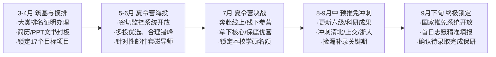

# 2026年推免申请季：西安交通大学工科大类（偏机械与智能制造）保研深度咨询与17个院校项目组合推荐方案

---

## 一、 申请人背景全景画像与竞争力SWOT诊断

根据你提供的信息，你的核心基本面如下：
* **本科院校**：西安交通大学（C9联盟、985工程、首批“双一流”A类高校，顶尖工科强校）。
* **学业排名**：工科大类 前约15%（约处于前 **约15%**）。
* **外语水平**：大学英语六级（CET-6）**450–499分**。
* **分流现状**：工科大类培养，正式专业分流尚未最终确定。
* **科研经历**：侧重**机械工程**与**智能制造**相关方向。

针对你在 2026 年推免（保研）申请季的实际情况，综合评估如下：

```
                    【申请人推免竞争力 SWOT 矩阵分析】
┌───────────────────────────────────────┬───────────────────────────────────────┐
│              优势 (Strengths)         │              劣势 (Weaknesses)        │
├───────────────────────────────────────┼───────────────────────────────────────┤
│ 1. C9 名校平台光环，全国各高校初审机筛    │ 1. 六级 450–499 分虽过线(425)，但在顶尖   │
│    均处于第一优先级（T1梯队）；        │    高校夏令营中属中游偏弱，且面临个别 │
│ 2. 排名 前约15% (约15%)，在本校推免资格 │    院校(如浙大机院450–499)硬性卡分风险； │
│    获取上非常稳固（大类保研率普遍较高）；│ 2. 排名未进前 5% 超级尖子梯队，外推  │
│ 3. 拥有机械与智能制造科研经历，符合制造    │    清北复交学硕竞争激烈；             │
│    强国战略热点，综合工程能力强。        │ 3. 分流未确定可能导致网申填报困惑。   │
├───────────────────────────────────────┼───────────────────────────────────────┤
│              机会 (Opportunities)     │              威胁 (Threats)           │
├───────────────────────────────────────┼───────────────────────────────────────┤
│ 1. 智能制造、机器人工程、交叉创新学院与  │ 1. 夏令营“海王”扎堆，头部高校入营与  │
│    国家卓越工程师学院专硕大幅扩招；    │    优营竞争白热化；                   │
│ 2. 本校（西交大）机械学科全国顶尖A+，  │ 2. 纯英文面试或文献翻译环节若表现不佳 │
│    留校兜底确定性极高，无后顾之忧；    │    可能放大六级短板；                 │
│ 3. 中科院顶尖院所重视工程动手与科研实战。│ 3. 预推免与九推锁定期名额缩水波动。   │
└───────────────────────────────────────┴───────────────────────────────────────┘
```

### 核心结论与战略方针
1. **推免资格无忧**：西交大工科大类推免名额充裕，前约15%（前约15%）基本确保能够锁定本校推免资格。
2. **梯队策略明确**：外推清北本部直博/学硕难度极大，但**清华深圳国际研究生院（SIGS）、上海交大机动专硕、浙大工程师学院等冲刺项目**具备很高的成功几率；同时以**华科、北航、哈工大、北理工、同济等机械顶尖强校**作为核心主力；以**西交大本校及顶尖中科院所**作为坚实保底。
3. **申报组合拳**：在学位类型上采取**“学硕冲核心、专硕冲顶尖、留校可直博/学硕”**的组合策略，最大限度发挥 C9 背景与智能制造科研优势。

---

## 二、 17个“学校 + 学院 + 具体专业（项目）”推荐组合总览

为实现“冲高有希望、稳妥有依靠、保底绝对安全”，特别制定以下 **17 个具体组合**，涵盖 3 大梯度（冲刺档 4 所、核心主力档 7 所、稳妥保底档 6 所）：

| 序号 | 院校名称 | 学院/研究院名称 | 具体专业/项目代码与名称 | 学位类型 | 梯队定位 | 六级要求参考 | 核心契合点 |
| :---: | :--- | :--- | :--- | :---: | :---: | :---: | :--- |
| **01** | 清华大学 | 深圳国际研究生院 (SIGS) | 085500 机械（先进制造/智能制造） | 专业学位 | **冲刺档** | 无硬性卡线(建议高) | C9生源青睐，湾区资源充沛 |
| **02** | 上海交通大学 | 机械与动力工程学院 | 085500 机械（智能制造与机电控制） | 专业学位 | **冲刺档** | ≥425分(满足) | 机械顶尖A+，C9同门高度认可 |
| **03** | 浙江大学 | 工程师学院 | 085500 机械（智能制造工程/移动机器人） | 专业学位 | **冲刺档** | 综合考察(避开机院450–499) | 卓越工程师专项，产教深度融合 |
| **04** | 清华大学 | 精密仪器系 | 080400 仪器科学与技术 / 085400 电子信息 | 学硕/专硕 | **冲刺档** | 综合考量 | 智能传感制造、微纳精密制造 |
| **05** | 华中科技大学 | 机械科学与工程学院 | 080200 机械工程 / 085500 机械 | 学硕/专硕 | **核心主力** | 良好(满足) | 数字制造装备全国重点，王牌学科 |
| **06** | 北京航空航天大学 | 机械工程及自动化学院 | 080200 机械工程 / 085500 机械 | 学硕/专硕 | **核心主力** | ≥425分(满足) | 航空航天高端智能装备、数字孪生 |
| **07** | 哈尔滨工业大学(深圳) | 机电工程与自动化学院 | 080200 机械工程 / 085500 机械 | 学硕/专硕 | **核心主力** | 良好(满足) | 深圳特区前沿产业，机器人与智造 |
| **08** | 哈尔滨工业大学(本部) | 机电工程学院 | 080200 机械工程（机器人与先进制造） | 学术学位 | **核心主力** | 良好(满足) | 机器人技术与系统全国重电实验室 |
| **09** | 北京理工大学 | 机械与车辆学院 | 080200 机械工程 / 085500 机械 | 学硕/专硕 | ≥425分(满足) | **核心主力** | 特种装备制造、智能微细加工 |
| **10** | 同济大学 | 机械与能源工程学院 | 080200 机械工程（工业4.0智能制造） | 学硕/专硕 | ≥425分(满足) | **核心主力** | 工业4.0中德合作，智能产线集成 |
| **11** | 西安交通大学 | 机械工程学院（本校主力） | 080200 机械工程（智能装备/增材制造） | 学术学位 | **核心主力** | 本校认定(满足) | 本校A+王牌，院士名师团队直通 |
| **12** | 西安交通大学 | 机械工程学院（本校保底） | 085501 机械工程（智能制造技术） | 专业学位 | **稳妥保底** | 本校认定(满足) | 本校绝对底线安全网，名额充足 |
| **13** | 中科院沈阳自动化所 | 机器人与智能制造学院(国科大) | 080200 机械工程 / 081100 控制科学 | 学硕/直博 | 良好(满足) | **稳妥保底** | 国家机器人国家队，项目津贴雄厚 |
| **14** | 天津大学 | 机械工程学院 | 080200 机械工程 / 085500 机械 | 学硕/专硕 | ≥425分(满足) | **稳妥保底** | 机构学与智能装备，对C9极其友好 |
| **15** | 大连理工大学 | 机械工程学院 | 080200 机械工程（高性能精密制造） | 学术学位 | 良好(满足) | **稳妥保底** | 高性能制造全国重点，院士团队 |
| **16** | 电子科技大学 | 机械与电气工程学院 | 080200 机械工程 / 085500 机械 | 学硕/专硕 | ≥425分(满足) | **稳妥保底** | 机电控算交叉深度高，电子制造业 |
| **17** | 中科院深圳先进院 | 先进集成技术研究所(国科大) | 080200 机械工程 / 085400 电子信息 | 学硕/专硕 | 良好(满足) | **稳妥保底** | 产业转化强劲，新型智能装备研发 |

---

## 三、 17个推荐组合深度解析与报考攻略

---

### （一） 顶峰冲刺档（Dream / Reach，4 个组合）

此档位高校代表国内工科天花板，竞争异常激烈。西交前 15% 排名与 450–499 分六级申请该档位时，**策略是避开本部传统高门槛学硕内卷，主攻顶尖专硕、前沿交叉学院及专项项目**。

#### 01. 清华大学 —— 深圳国际研究生院（SIGS）
* **院系与专业**：先进制造学部 / 材料与制造学部，**085500 机械（专业学位，智能制造与机器人方向）**。
* **学科与平台优势**：依托清华大学机械工程系与精密仪器系一流学科，坐拥粤港澳大湾区雄厚的新质生产力产业集群与高水平研发中心。
* **录取画像与适配分析**：清华本部机械学硕对外校通常要求前 3% 以内；而 SIGS 机械专硕招收体量较大，且特别青睐 C9 高水平工科背景学生。六级无全国硬性切分线，450–499 分过线即可参评。重点看重工科数学建模能力、机械设计基础及智能算法实践。
* **报考指引**：在个人陈述中重点强化“智能制造硬件设计 + 软件算法”的综合落地项目经验，提前在 5-6 月关注清华研招网及 SIGS 先进制造学部夏令营通知。

#### 02. 上海交通大学 —— 机械与动力工程学院
* **院系与专业**：机械与动力工程学院，**085500 机械（专业学位，智能制造与机电控制方向）**。
* **学科与平台优势**：全国机械工程评估顶尖A+，建有机械系统与振动全国重点实验室。交大机动是国内机械工程学科的泰山北斗。
* **录取画像与适配分析**：上交机动学院夏令营有明确硬性门槛：**英语六级 CET-6 ≥ 425 分**，你的 450–499 分完全达标。西交与上交同源同根，上交对西交生源认可度极高，大类前 15% 冲刺专硕或工程博士/直博具备入营资质，面试重在考察机电综合基础与科研领悟力。
* **报考指引**：密切关注其 5 月底发布的夏令营通知。因六级分数不占拔尖优势，面试时务必将英文自我介绍和专业词汇（如智能产线、数控机床、伺服驱动等）准备得滚瓜烂熟。

#### 03. 浙江大学 —— 工程师学院
* **院系与专业**：工程师学院，**085500 机械（专业学位，智能制造工程 / 移动机器人卓越培养项目）**。
* **学科与平台优势**：依托浙大流体动力与机电系统全国重点实验室、现代制造工程研究所，属于国家首批国家卓越工程师学院，实行“校企双导师制”，实训设备先进。
* **录取画像与适配分析**：**【重要避坑提示】** 浙江大学机械工程学院本部夏令营历年通常硬性卡**六级 CET-6 ≥ 460 分**，你的 450–499 分相差 2 分，存在被机筛直接过滤的极高风险！而**浙大工程师学院**对于六级门槛相对更为多元弹性，侧重工程项目实战。因此，选择浙大工程师学院智能制造方向是极具智慧的“避坑借道”策略。
* **报考指引**：夏令营报名时主选工程师学院“智能制造”专项，文书中突出本科工程实训、机械创新大赛及控制程序调试等硬核实操成果。

#### 04. 清华大学 —— 精密仪器系
* **院系与专业**：精密仪器系，**080400 仪器科学与技术 / 085400 电子信息（学术学位/专业学位，智能微系统制造与测控技术）**。
* **学科与平台优势**：拥有精密测试技术及仪器全国重点实验室、微米纳米技术研究中心，在微纳智能制造、智能感知装备领域居全国领先地位。
* **录取画像与适配分析**：智能制造的底层离不开高精度传感与测控系统。精仪系夏令营对外校生相对开放，考察形式综合。西交大工科大类数理功底扎实，若科研经历中包含传感器标定、精密运动控制或微纳加工，与精仪系导师需求高度重合。
* **报考指引**：建议作为“梦想冲刺”选项，重点联系从事“智能测控”、“微纳制造装备”方向的青年骨干导师或课题组。

---

### （二） 核心主力档（Target / Match，7 个组合）

此档位涵盖“机械五朵金花”与传统军工/工业巨擘，是西交工科前 15% 生源入营概率高、拿优营（优秀营员）机会极大的**最核心攻坚战场**。

#### 05. 华中科技大学 —— 机械科学与工程学院
* **院系与专业**：机械科学与工程学院，**080200 机械工程（学硕） / 085500 机械（专硕，智能制造方向）**。
* **学科与平台优势**：机械工程学科 A+，坐拥“数字制造装备与技术”全国重点实验室，丁汉院士、熊有伦院士领衔，智能制造工程为华科王牌中的王牌。
* **录取画像与适配分析**：对西交大工科极为认可，六级要求为“英语水平良好”（458分完全合规）。前约15% 的位次在华科初审中享有极高入营确定性。考核重视控制理论、机械原理及数控编程思维。
* **报考指引**：属于必须重点攻克的“战略制高点”。建议 5 月份提前研读数字制造装备实验室相关团队论文，夏令营填报时学硕专硕皆可稳步推进。

#### 06. 北京航空航天大学 —— 机械工程及自动化学院
* **院系与专业**：机械工程及自动化学院，**080200 机械工程（学硕） / 085500 机械（专硕，航空宇航先进制造与智能机器人）**。
* **学科与平台优势**：第五轮学科评估顶尖，航空航天高端复杂构件制造、数字孪生工业软件、智能微系统等方向引领全国。
* **录取画像与适配分析**：北航机械学院六级硬性线为 425 分，你的 450–499 分顺利通关。对 C9 生源优待显著，往年西交大前 15% 生源只要面试发挥稳定，获得优营的概率极大。
* **报考指引**：文书中若能体现数字化建模（CAD/CAM/CAE）、数字孪生系统或复杂装备机构设计，将大幅提升导师好感。

#### 07. 哈尔滨工业大学（深圳） —— 机电工程与自动化学院
* **院系与专业**：机电工程与自动化学院，**080200 机械工程（学硕） / 085500 机械（专硕，智能装备与机器人系统）**。
* **学科与平台优势**：哈工大王牌机电学科在深圳的国际化延伸，拥有高端制造业与机器人完整生态，科研经费充沛，珠三角大厂就业认可度顶级。
* **录取画像与适配分析**：近年哈工深热度极高，但非常看重 C9 纯正工科背景。大类 19 名的排名在哈工深机械初审中极具竞争力，六级 450–499 分符合基本标准。
* **报考指引**：夏令营通常开展较早（6月左右），考核多为机电综合口试（包含自动化控制、机械基础及代码能力），建议提前梳理机器人运动学或 PLC 控制项目。

#### 08. 哈尔滨工业大学（本部） —— 机电工程学院
* **院系与专业**：机电工程学院，**080200 机械工程（学术学位，机器人技术与系统全国重点实验室相关团队）**。
* **学科与平台优势**：中国机器人技术的发源地与摇篮，拥有机器人技术与系统全国重点实验室，航天特种机构与智能制造实力无可匹敌。
* **录取画像与适配分析**：哈工大机电学院规模大、优营名额多，对于同属 C9 兄弟高校的西交大学子感情深厚、初审极度包容。前 15% 排名在此档位稳拿学硕优营的确定性极强。
* **报考指引**：可大胆申报学硕乃至学术直博，重点挑选特种机器人、仿生机构或智能装配制造团队。

#### 09. 北京理工大学 —— 机械与车辆学院
* **院系与专业**：机械与车辆学院，**080200 机械工程（学硕） / 085500 机械（专硕，智能制造与数字化装备）**。
* **学科与平台优势**：兵器与国防智能制造领头羊，拥有激光微纳制造研究所、特种智能机器人实验室。
* **录取画像与适配分析**：六级要求 425 分（完全达标）。北理工机车学院考核风格严谨客观，偏好力学、机械设计与智能控制扎实的学生，西交工科背景初审稳过，面试胜率极高。
* **报考指引**：准备好 10 分钟以内的 PPT，重点讲解智能制造科研课题中的机构优化、控制闭环与实测数据。

#### 10. 同济大学 —— 机械与能源工程学院
* **院系与专业**：机械与能源工程学院，**080200 机械工程（学硕/专硕，工业4.0智能制造系统）**。
* **学科与平台优势**：中德工程教育深度结合，在工业 4.0 智能产线、数字孪生、智慧工厂系统规划方面国内拔尖。
* **录取画像与适配分析**：地处上海，产业应用与外企/高新企业实习资源顶级。六级 425 分达标，对西交大机械学子十分青睐。对于想去长三角从事高端制造业的同学性价比极高。
* **报考指引**：文书中可突出智能工厂、工业物联网（IIoT）、MES系统集成或自动化物流等交叉研究兴趣。

#### 11. 西安交通大学 —— 机械工程学院（本校主力冲刺优选）
* **院系与专业**：机械工程学院，**080200 机械工程（学术学位，高端制造装备与技术全国重点实验室）**。
* **学科与平台优势**：全国 A+ 顶尖学科，蒋庄德院士（精密微纳制造）、卢秉恒院士（增材制造/3D打印）、梅雪松教授（智能制造装备与工业机器人）等国家级智囊团。
* **录取画像与适配分析**：主场作战！前约15% 的大类排名在西交机械学院属于中坚骨干生源。本校老师对于本校前 15% 学生的学业质量极为信任，能够直接联系到院士、杰青大团队的核心学硕名额。
* **报考指引**：**务必提前进组！** 4-5 月即可在本校物色心仪导师，以本科毕设或科研助理形式提前跟进组会，提前锁定心仪的学硕接收函。

---

### （三） 稳妥保底档（Safety / Anchor，6 个组合）

此档位旨在构建**“坚不可摧的安全网”**，确保无论夏令营或预推免出现何种不可抗力，你都拥有全国一流的优质研究生就读机会。

#### 12. 西安交通大学 —— 机械工程学院（本校专硕兜底）
* **院系与专业**：机械工程学院，**085501 机械工程（专业学位，智能制造与装备技术）**。
* **学科与平台优势**：共享西交机械全套顶级师资、中国西部科技创新港顶级实验平台与千万级工程设备。
* **录取画像与适配分析**：**绝对底线保底**。前约15% 排名拿到西交推免资格后，报考本校专硕的录取概率接近 100%。即使外推全部失利，也能稳稳入读本校顶尖A+学科。
* **报考指引**：作为心理托底锚点，让你能够毫无后顾之忧地在外推冲刺档与主力档中放手一搏。

#### 13. 中国科学院沈阳自动化研究所
* **院系与专业**：机器人学国家重点实验室 / 智能制造系统研究室，**080200 机械工程 / 081100 控制科学与工程（国科大学籍，学硕/直博）**。
* **学科与平台优势**：中国机器人与智能制造的“国家队”，承办中国科学院大学机器人与智能制造学院，拥有机器人技术国家工程研究中心，国家重大科研攻关项目极为丰富。
* **录取画像与适配分析**：中科院研究所不以高校综合声誉自居，但科研补贴极高、项目硬核。沈自所对 C9 优质生源极度渴求，前 15% 加上智能制造科研背景，在沈自所夏令营中属于“重点招揽对象”，优营率极高。
* **报考指引**：沈自所推免政策常年开通提前批报名通道，建议 5-6 月直接邮件联系意向研究室导师，锁定学硕或直博席位。

#### 14. 天津大学 —— 机械工程学院
* **院系与专业**：机械工程学院，**080200 机械工程（学硕） / 085500 机械（专硕，智能制造与机构学）**。
* **学科与平台优势**：传统工科四大名校之一，机构理论与装备制造教育部重点实验室，机械综合实力常年位居全国前十。
* **录取画像与适配分析**：天大夏令营规模大，对 985/C9 院校学生极为友好，六级 425 分达标即可。西交 19 名的背景在天大机械基本属于免初审筛选的直通梯队。
* **报考指引**：夏令营优营通过率高，可作为 7 月份快速斩获第一个外校“大厂 Offer”以稳定军心的关键一站。

#### 15. 大连理工大学 —— 机械工程学院
* **院系与专业**：机械工程学院，**080200 机械工程（学术学位，高性能精密制造全国重点实验室）**。
* **学科与平台优势**：郭东明院士领衔，在精密加工、超精密制造、智能成形领域拥有国家最高科技奖励成果，底蕴极其雄厚。
* **录取画像与适配分析**：大工机械视 C9 生源为珍宝。你的 前约15% 排名与智能制造背景在此处于第一录取优先级，拿学硕优营几无悬念。
* **报考指引**：若对高性能零件加工、超精密装备制造有浓厚学术兴趣，大工的高精尖团队科研含金量极高。

#### 16. 电子科技大学 —— 机械与电气工程学院
* **院系与专业**：机械与电气工程学院，**080200 机械工程（学硕） / 085500 机械（专硕，智能制造与机器人工程）**。
* **学科与平台优势**：电子信息特色鲜明的机械学院，“机-电-算”一体化程度极高，在智能制造装备检测、机器人人机交互、工业软件方向特色鲜明。
* **录取画像与适配分析**：成电六级 425 分即合规。成电对于 C9 机械学生吸引力大且包容度高，非常适合希望未来向智能硬件、工业视觉算法、机器人企业转型的同学。
* **报考指引**：成电夏令营面试偏重算法与编程思维，准备好 C++/Python 以及控制算法的相关描述。

#### 17. 中国科学院深圳先进技术研究院（SIAT）
* **院系与专业**：先进集成技术研究所，**080200 机械工程 / 085400 电子信息（智能制造与微纳系统方向，国科大学籍）**。
* **学科与平台优势**：立足深圳先进制造业前沿，产业孵化与科技转化能力国内顶尖，师资年轻活跃、经费充裕、博士后与海外交流通道丰富。
* **录取画像与适配分析**：高度看重学生的实操动手与工程落地能力，对西交大工科学生提供高额奖学金与入营倾斜。面试考核强调个人在科研项目中的具体技术贡献。
* **报考指引**：对于未来有志于在深圳和珠三角高端制造、智能硬件独角兽企业就业的同学，此项目是极具发展前景的稳妥跳板。

---

## 四、 针对两大痛点的专项破局策略

### （一） 工科大类“尚未正式分流”的应对之道

目前处于“工科大类、正式分流未定”的状态，是近年许多高水平大学大类培养学生的常态。不必焦虑，请按以下实操规范处理：

```
                    【工科大类未分流材料处理流程】
┌───────────────────────────────────────────────────────────────┐
│ 1. 官方教务证明开具                                            │
│    · 申请开具《大类成绩排名证明》，注明：“该生在大类专业总人数     │
│      前五学期综合排名前约15%（精确名次及人数已概括）”加盖教务公章； │
│    · 附带一份《大类培养方案及修读说明》，阐明大类包含机械相关专业。 │
├───────────────────────────────────────────────────────────────┤
│ 2. 网申填报规范                                               │
│    · 本科专业栏：若系统支持，填“工科试验班（意向：机械工程/智能制造）”；│
│    · 若系统为下拉死菜单：直接选择“机械工程”或“机械类”，并在备  │
│      注栏备注“大类培养，意向分流机械/智能制造方向”。           │
├───────────────────────────────────────────────────────────────┤
│ 3. 个人陈述与简历重构                                          │
│    · 将已修读的数理、电工电子、程序设计、工程制图等核心硬核工科课程   │
│      高分成绩前置；                                           │
│    · 阐述“大类培养赋予我更为宽广的跨学科视野，为从事智能制造机电控  │
│      软交叉研究奠定了扎实底盘”。                               │
└───────────────────────────────────────────────────────────────┘
```

### （二） 英语六级 450–499 分的“扬长避短”战法

六级 450–499 分高于国家合格线（425分），但低于部分同学的 500+ 高分。务必做到**“避开硬雷、突出长板、强化口语”**：

1. **精准避开“硬卡分”项目**：
   * 严密排查目标夏令营公告中的硬指标。例如**浙江大学机械工程学院**历年夏令营往往白纸黑字要求“六级≥460分”，不可盲目硬冲以防初审浪费名额，应转向**浙大工程师学院**或其他 425 分门槛院校。
2. **2026年6月六级刷分与更新补录**：
   * 务必报名 2026 年 6 月的全国大学英语六级考试，全力冲刺 500+ 分。
   * 即使 6 月六级成绩 7 月中下旬才公布，错过部分早期夏令营初审，但能在 **8-9月的预推免阶段** 成为强有力的更新材料（不少顶尖院校预推免是决定最终录取的决胜战场）。
3. **面试中以“专业英语”扭转乾坤**：
   * 面试时老师不会过分苛求语法，核心考察你能否无障碍阅读专业论文。
   * 必须熟练掌握智能制造核心术语的中英文表达与定义：
     * **Digital Twin**（数字孪生）
     * **Additive Manufacturing / 3D Printing**（增材制造）
     * **Cyber-Physical Systems (CPS)**（信息物理系统）
     * **Computer Numerical Control (CNC)**（数控技术）
     * **Programmable Logic Controller (PLC)**（可编程逻辑控制器）
     * **Industrial Internet of Things (IIoT)**（工业物联网）
     * **Deep Learning & Computer Vision in Defect Detection**（表面缺陷检测中的深度学习与机器视觉）

---

## 五、 智能制造科研经历的文书与面试“STAR法则”包装

在工科推免考核中，老师最看重的是**“软硬兼备的工程闭环能力”**。智能制造正是机、电、控、算的高度整合。请将你的科研经历按 **STAR 法则**（Situation 背景、Task 任务、Action 行动、Result 结果）结构化重组：

```
                    【智能制造科研经历 STAR 表达架构】
┌───────────────────────────────────────────────────────────────┐
│ S (Situation 研发背景)                                        │
│ · 针对何种工业现场/实验室瓶颈？(如传统产线检测效率低、装配精度不足、加工变形等)│
├───────────────────────────────────────────────────────────────┤
│ T (Task 核心任务)                                             │
│ · 你个人在该课题中负责哪一部分具体的研发指标与工程任务？       │
├───────────────────────────────────────────────────────────────┤
│ A (Action 核心技术行动 —— 展现四大硬核能力)                    │
│ 1. 机构设计与仿真：三维建模(SolidWorks/UG) + 有限元受力分析(ANSYS/Abaqus) │
│ 2. 电气控制与传感：单片机(STM32/ESP32)、传感器选型、信号滤波与标定   │
│ 3. 算法与软件编写：运动控制算法、上位机界面(Qt/C#)、视觉检测(OpenCV/视觉模型)│
│ 4. 调试与实物闭环：软硬件联合调试、故障排查、实测数据采集与比对 │
├───────────────────────────────────────────────────────────────┤
│ R (Result 最终产出与指标)                                     │
│ · 定量数据：定位精度达到 xx mm、检测速度提升 xx%、误差降低 xx%；│
│ · 定性成果：发表论文、申请专利、竞赛获奖、完成实物样机验收等。 │
└───────────────────────────────────────────────────────────────┘
```

---

## 六、 2026年推免全流程时间线作战地图



### 关键阶段任务分解：
1. **3月 - 4月（信息搜集与材料筑基）**：
   * 到教务处办理正式大类成绩单及 前约15% 综合排名证明，盖章备用扫描；
   * 制作 1 页纸精炼简历、1 份详细个人自述、1 套通用的 5-8 分钟科研汇报 PPT；
   * 本校导师预接触：直接拜访西交大机械学院意向导师实验室，争取科研实习或毕业设计机会。
2. **5月 - 6月（夏令营拉网式填报与导师套磁）**：
   * 将上述推荐的 17 个组合逐一列入表格，监控各校研招网系统开放时间；
   * 实施**“冲刺 3-4 所 + 主力 4-5 所 + 稳妥 2-3 所”**的梯次报名策略；
   * 对冲刺档和核心主力档中的心仪导师发送专业学术套磁信（邮件正文附 200 字摘要 + 简历 PDF）。
3. **7月（夏令营线下/线上实战考核）**：
   * 合理规划参营时间，避免线下考核冲突，原则上**“主力档优选、保底档稳拿”**；
   * 争取在 7 月底前至少手握 1-2 个顶尖 985 或中科院所的“优秀营员”资质，彻底卸下心理包袱。
4. **8月 - 9月中旬（预推免冲刺与补录捡漏）**：
   * 夏令营未入营或未拿优营的高校，在预推免系统中再次填报（许多高校预推免录取人数并不亚于夏令营）；
   * 若 6 月六级刷分成功，立即在预推免系统中更新六级成绩单，重新冲击更高平台。
5. **9月下旬（国家推免服务系统最终决胜）**：
   * 9月28日前后国家系统开放，首日填报已确认意向且导师接收的项目，在规定时间内确认待录取通知，圆满收官！

---

## 七、 机械与智能制造专业面试高频硬核考点梳理

在复试专业口试环节，除科研项目外，评委最常考察的基础理论涵盖以下三大部分，请务必提前复习：

### 1. 机械工程核心基础
* **机构学与机械设计**：平面机构自由度计算与虚约束判断；四杆机构的死点位置与急回特性；齿轮传动正确啮合理论与根切现象；轴系结构设计的定位与固定方式。
* **制造工艺与力学**：基孔制与基轴制的选择原则；公差带与配合类型；金属切削三要素（切削速度、进给量、背吃刀量）对切削力与切削热的影响；机床夹具“六点定位原理”及欠定位/过定位判别。

### 2. 控制工程与机电一体化
* **自动控制原理**：传递函数的定义与性质；系统稳定性的代数判据（Routh判据）与频域判据（Nyquist判据）；PID 调节器各参数（比例P、积分I、微分D）对系统动态响应和稳态精度的调节机理。
* **微机与传感检测**：光电编码器测速原理（M法、T法与M/T法）；常见工业总线（CAN、Modbus、EtherCAT）的通信特点；步进电机与伺服电机的控制差异。

### 3. 智能制造前沿热点理解
* **数字孪生（Digital Twin）**：能够清晰阐述数字孪生的“物理实体、虚拟模型、虚实交互数据、服务功能”五维模型架构，并举例说明其在装备故障预测与健康管理（PHM）中的应用。
* **工业互联网与智能质检**：理解 MES（制造执行系统）与 ERP、SCADA 之间的交互层级；简述基于机器视觉深度学习（如轻量化目标检测模型）在精密零件表面缺陷在线检测中的工作流与面临的光照/反光挑战。

---

## 八、 总结寄语

作为西安交通大学（C9）工科大类的学子，你的**学校声誉是一块极具分量的金字招牌**，前约15%（前约15%）的学业排名奠定了极其扎实的基本盘。虽然六级 450–499 分与专业未正式分流在初期心理上带来些许顾虑，但只要善于**用规范的大类证明规避分流盲区、用精准择校避开语言硬卡、用扎实的智能制造科研实战展现工科硬核本领**，你在 2026 年推免季必将收获令人满意的顶级 Offer。

愿你运筹帷幄，沉着备战，推免大捷！
