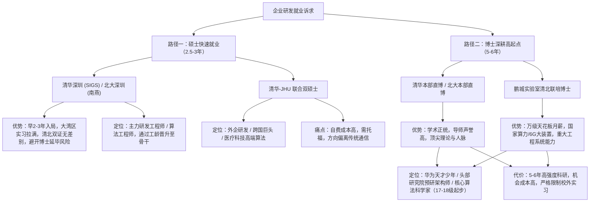
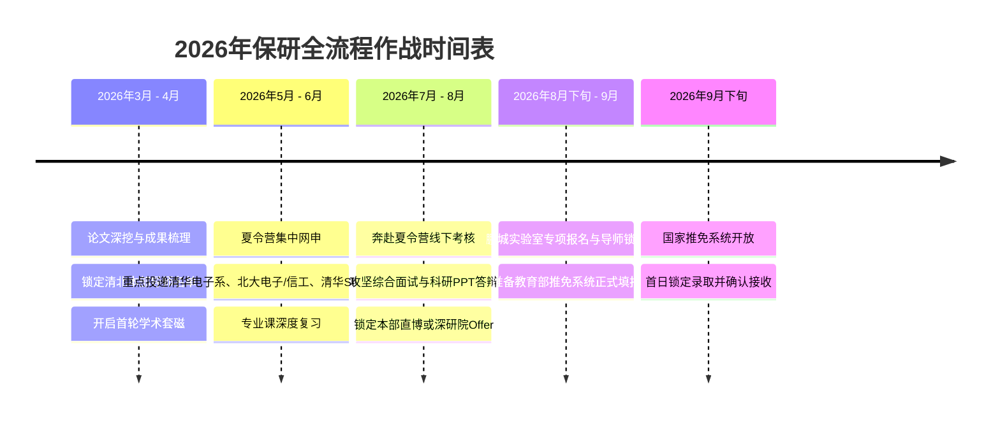

# 一所985高校通信工程保研清北及特色项目全景深度分析与决策指南

**评测基准时间**：2026年3月（大三下学期开学季）  
**学生画像**：一所985高校通信工程，前5学期推免排名 前约1%（前 约1%），六级 500–549 分，一作发表 通信类期刊（通信方向论文）无线通信期刊论文 1 篇，主持国家级大创 1 项，获多项学科竞赛奖。  
**目标取向**：优先清北本部、通信或 AI 交叉方向；学硕/直博/硕博连读均可接受；最终以高水平“企业研发”为就业导向。

---

## 一、 个人核心竞争力画像与清北本部定位评估

在深入对比各特色项目之前，首先需要对你的综合背景建立客观、精准的定位认知。

### 1. 核心优势（天花板级长板）
- **院校层次与绝对排位**：一所985高校为老牌“双一流”A类985高校，通信工程专业依托历史深厚的学科底蕴，在工科保研中受认可度极高。你的前5学期排名为 **前约1%（约前 约1%）**，处于年级最顶层，稳拿本校推免资格，并在清华本部电子系、网研院，北大本部电子学院、计算机学院、智能学院等各大顶尖院系的初审机筛中拥有极高的过审权重。
- **科研学术硬通货（致命吸引力）**：手握一篇**一作 通信类期刊 (通信方向论文)**。通信方向论文 是无线通信领域公认的权威高水平期刊（通信领域相关学术期刊，[具体刊物分区与分类已概括]）。在推免申请中，绝大部分本科生仅有课程设计、水会或者非一作挂名论文，能在大三下以第一作者独立完成通信数学建模、仿真推导并发表 通信方向论文，向导师直接证明了：
  1. 具备完整的英文学术论文撰写与国际同行评审应对经验；
  2. 具备扎实的通信物理层/信号处理/系统优化建模与推导功底；
  3. 具备成熟的代码复现与科学计算实验能力（MATLAB/Python）。
  这在清华电子系无线通信研究所、宽带通信团队或北大电子学院导师眼中属于**稀缺型优质科研苗子**。
- **大创与学科竞赛**：主持国家级大创体现了学术独立性与团队牵头能力；多项竞赛奖项则补足了工程落地、算法建模与综合抗压素质。

### 2. 潜在短板与约束考量
- **六级成绩（500–549分）**：
  - **国内保研完全达标**：清华电子系推免通常要求六级≥425或450分，北大电子学院/信科通常要求六级≥450或480分，你的 500–549 分已完全跨越国内各高校保研初审的硬性门槛。
  - **涉外/国际双学位受限**：对于涉及海外院校的双学位项目（如清华—JHU），海外高校不认可国内 CET-6 成绩，必须提供托福（TOEFL iBT 通常≥90~100）或 GRE 成绩。
- **企业研发诉求与学制博弈**：你“能接受直博”，同时“关注企业研发就业”。需要清醒认识到：**直博（5-6年）与硕士（2.5-3年）在企业研发就业上的路径和逻辑存在重大差异**，需要平衡时间成本与研发职级定位。

---

## 二、 四大特色培养项目核心维度横向对比矩阵

针对你所关注的**清华深圳国际研究生院（Tsinghua SIGS）**、**北大深圳研究生院（PKU Shenzhen）**、**鹏城实验室联合培养（PCL）**、**清华—JHU 联合项目**，其关键维度对比如下：

| 评估维度 | 清华深圳国际研究生院 (SIGS) | 北大深圳研究生院 (PKU Shenzhen) | 鹏城实验室联合培养 (PCL) | 清华—JHU 联合培养项目 |
| :--- | :--- | :--- | :--- | :--- |
| **机构属性与学籍** | 清华大学二级学院，学籍属清华大学 | 北京大学二级机构，学籍属北京大学 | 国家战略科技力量，无独立学位权，与高校联培（清北等） | 清华大学（电子系/医学院）与美国JHU联合项目 |
| **学位授予情况** | **清华大学**硕士/博士毕业证与学位证（无“深圳”字样） | **北京大学**硕士/博士毕业证与学位证（无“深圳”字样） | **合作高校**（如清华/北大）毕业证与学位证，附鹏城科研证明 | **清华大学**硕士学位证 + **美国 JHU** 工学硕士（M.S.）学位证 |
| **主招学位与学制** | 专硕为主（电子信息 085400 等），学制 2.5 ~ 3 年；含少量工程/学术博士 | 学硕/专硕并存（计算机、集成电路、通信），学制 3 年；含博士 | **直博为主（5~6年）**，极少量专项硕士 | **全日制双硕士（2~3年）**：1 年海外 JHU + 1~2 年国内清华 |
| **核心学科与研究方向** | 电子与通信工程、人工智能、低空经济、数据科学、智能制造 | 计算机科学、通信与信息系统、微电子/集成电路、AI 媒体智能 | 网络通信（6G/网络空间）、算力网络、超大规模 AI 大模型 | **生物医学工程（BME）、计算医学、医学数据科学、智能感知** |
| **导师与培养模式** | 清华 SIGS 全职师资 + 本部双聘导师，紧密结合湾区产业 | 北大信工院导师，产教融合，侧重算法系统与工程实践 | **双导师制**（高校主导师 + 鹏城副导师），第一年在高校，后续全职驻深 | 第一年赴美修读 JHU 课程，第二年回清华进实验室开展论文研究 |
| **外语门槛要求** | 国内六级过线即可（500–549分毫无压力） | 国内六级过线即可（450~500分门槛，已完全达标） | 国内六级过线即可（按合作高校标准执行，已达标） | **高门槛**：必须提交 **TOEFL**（通常≥90~100）/ 部分需 GRE，六级不可用 |
| **经济与成本支出** | 正常国内专硕学费（约 8000~10000元/年），奖助学金覆盖良好 | 正常国内研究生学费，提供学业奖学金及助研津贴 | **国内天花板待遇**：博士津贴通常 **8000 ~ 15000+ 元/月**，完全经济独立 | **自费高昂**：首年赴美需全额缴纳 JHU 学费及海外生活费（约 **50~60万人民币**） |
| **企业研发就业优势** | 珠三角科技产业集群，实习极其便利，大厂校招通吃 | 华南互联网、半导体、通信芯片大厂极度认可，校友网络强大 | 依托国家战略工程，直通国家通信巨头高阶研发岗、算力/网络实验室 | 跨国科技巨头、外企研发中心、医疗科技与高端仪器研发认可度极高 |

---

## 三、 四大项目对你的“实际影响”逐一深度解构

结合你自身**通信工程专业**、**一作 通信方向论文**、**六级 500–549 分**、**优先清北本部**、**能接受直博**、**瞄准企业研发**的实际情况，逐项剖析各项目对你的具体影响与深层制约。

---

### （一） 清华深圳国际研究生院（Tsinghua SIGS）

清华 SIGS 是清华大学在深圳的重要办学实体，信息学科主要依托数据与信息研究院（DII）及电子信息专硕项目。

#### 1. 对你的实际正面影响
- **“名校学历”与“快速就业”的最佳平衡点**：
  清华本部电子系、自动化系目前绝大部分名额已转为“直博”（学硕名额全系仅有个位数，竞争极度白热化）。如果你在夏令营阶段评估认为 5 年博士时间成本过长，清华 SIGS 的电子信息专硕（电子与通信工程方向、人工智能方向）是你**以硕士身份拿到清华大学单证/双证（毕业证书和学位证书与本部完全一致）的最稳妥通道**。学制 2.5~3 年，能比直博早 2~3 年进入企业研发，尽早积累工龄、晋升职级与股票期权。
- **珠三角产业腹地的地缘实习红利**：
  SIGS 坐落于深圳市南山区西丽大学城，周边紧邻华为、腾讯、大疆、中兴通讯、荣耀、深算院等顶尖通信与智能产业巨头。SIGS 的导师普遍非常支持产教融合，硕士期间进入头部企业进行为期半年至一年的深度研发实习非常普遍。这种“**清华双证 + 本地硬核大厂研发实习**”的组合拳，在企业研发招聘（如华为终端/无线、大疆算法、腾讯网络/云平台、半导体芯片等）中具备几乎无死角的竞争力。
- **与你背景的适配度极高**：你的本科排名前约1%、一作 通信方向论文 与六级 500–549，在清华 SIGS 的夏令营材料初审中是**顶级梯队**，入营并拿到优秀营员（Offer）的确定性极大，可作为清华梯队中的“极高确定性底牌”。

#### 2. 对你的潜在制约与代价
- **科研纵深的边际稀释**：专硕培养以工程应用和企业需求为导向，学术研究深度和纯理论环境相对弱于本部国家重点实验室。你拥有独立发表一作 通信方向论文 的扎实理论推导底子，如果去读专硕，这部分纯理论推导优势在求职时更多转化为“学习能力强”的佐证，而在科研成果的连续性上可能有所断层。
- **本部认同感与心理落差**：虽然证书完全一致，但在未名湖/清华园本部文化熏陶、本部综合性跨学科讲座及人脉网络的密度上，与北京本部仍有地理区隔。

---

### （二） 北大深圳研究生院（PKU Shenzhen - 信息工程学院）

北大深研院（南燕校区）的信息工程学院（ECE）是北大在华南的信息学科重镇，涵盖计算机应用技术、通信与信息系统、微电子学等方向。

#### 1. 对你的实际正面影响
- **传统通信向“通信+AI”或“纯AI研发”转型的理想平台**：
  北大信工学院的研究方向极度契合当前产业界的 AI 研发需求，其在智能媒体处理、计算机视觉、多模态大模型、智能计算架构等领域成果丰富。如果你未来进入企业研发不想局限在传统通信物理层（物理层研发岗位相对集中于华为、中兴、联发科、高通等少数设备/芯片商），而是希望**横向跨界至更广阔的 AI 算法研发（如推荐、视觉、端侧 AI、大模型系统）**，北大信工学院提供了完美的跨学科背书。
- **纯正的北京大学硕士光环**：
  发放北京大学全日制硕士毕业证与学位证，学制 3 年，在国内外科技企业研发招聘中享受北大最高规格的免筛特权。
- **初审门槛适配完全无阻碍**：北大深研院对六级的常规要求通常为 450~500 分，你的 500–549 分完全达标；同时本校通信专业前 1% 的绩点与 通信方向论文 论文能让你在面试中展现出远超同侪的逻辑与数理深度。

#### 2. 对你的潜在制约与代价
- **纯通信学科底蕴弱于清华本部与成电/西电**：
  北大的“通信与信息系统”在传统无线传输、天线射频、高频通信等领域，体量和行业垂直深耕度不如清华电子系通信所厚重，其优势主要在于偏向软硬件结合、系统与智能算法。如果你执着于纯粹的蜂窝通信物理层算法研发，需要精挑细选对口导师。

---

### （三） 鹏城实验室（PCL）联合培养项目

鹏城实验室是中央直接批复的网络通信领域**国家实验室**（我国战略科技力量第一梯队），由高文院士领衔，重点承担国家重大科研攻关任务。

#### 1. 对你的实际正面影响
- **方向与你的科研背景实现“点对点完全卡位”**：
  鹏城实验室的核心使命就是**宽带通信、6G、网络空间安全与网络智能**。你已经发表了一篇 IEEE 通信方向论文（无线通信主流期刊），你的专业方向、理论基础与模型积累，与鹏城实验室当前攻关的“6G 智简网络”、“太赫兹/毫米波传输”、“无线 AI”、“算力网络通信协议”等方向**契合度达到 100%**。在导师眼中，你是一个无需基础培养、进组就能直接上国家重大任务的即战力选手。
- **“清北学籍”与“国家实验室大装置”的双重红利**：
  鹏城实验室不独立授予学位，而是与清华、北大等顶尖高校联合招收**专项博士研究生**。这意味着：
  - 你最终获得的是**清华大学或北京大学的博士毕业证和学位证**；
  - 同时，你将依托清北校内难以企及的国家大科学装置——如算力规模顶级的“**鹏城云脑 II / III**”以及全国性网络通信试验场。这种算力资源和超大规模网络验证平台，在全国高校中都极其罕见。
- **博士津贴国内天花板（完全经济独立）**：
  相比高校本部博士通常 2000~4000 元/月的补贴，鹏城博士生的津贴通常达到 **8000 ~ 15000+ 元/月**（基本看齐海外或香港博士补贴），读博期间即可实现高水平的经济独立，毫无经济顾虑。
- **企业高阶研发岗位的极高认可度（直通高职级）**：
  博士毕业面向企业研发就业时，鹏城实验室培养的博士在华为（中央研究院、无线通信产品线、海思）、中国移动研究院、中国电信研究院、中兴通讯等顶级研发部门享有极高声誉。此类实验室经历能支撑你直接申报华为“天才少年”或顶格博士 Offer（通常定级在 17~18 级，年薪 80~150 万起），从事架构级算法或前沿协议预研，起点远超普通硕士。

#### 2. 对你的潜在制约与重大影响
- **学制锁定与时间成本（必须直博 5~6 年）**：
  鹏城联培绝大部分指标均为**直博生**。虽然你“能接受直博”，但必须清醒认知：5~6 年的博士是一场硬仗。如果你读博的内在动力不足以支撑高强度的重大科研攻关，中途退出的沉没成本极高；届时行业周期与企业研发招聘趋势可能发生变化。
- **重大任务牵引 vs 自由探索与论文发表周期**：
  国家实验室以完成国家重大工程任务和系统交付为第一准则。部分科研工作偏向大工程、大系统、甚至涉及涉密与团队协作，论文发表周期可能相对延长，不如纯高校学术组自由追求小而快的理论 Paper。
- **双导师协调成本与实习自由度受限**：
  需同时满足高校校内导师的毕业学术指标（清北的博士学位论文盲审标准极其严苛）与鹏城实验室的工程任务要求；同时，鹏城博士享有极高补贴并承担重要科研任务，**博士期间通常严禁私自离岗进行企业实习**，你只能依靠实验室项目本身的硬核实力去打动企业研发用人部门。

---

### （四） 清华—JHU 联合项目（清华大学—约翰斯·霍普金斯大学双硕士）

该项目主要依托**清华大学电子工程系、生物医学工程学院**与**美国 Johns Hopkins University (JHU) Whiting 工学院**（主要是 BME 生物医学工程系）联合办学。

#### 1. 对你的实际正面影响
- **“中美双顶尖”学历光环与全球化背书**：
  2~3 年内同时获得清华大学硕士学位与全球顶级名校 JHU 工学硕士学位。如果你未来关注的“企业研发”包含**跨国科技巨头海外研发中心（Google, Apple, Microsoft, NVIDIA）、跨国医疗与生命科技巨头（联影医疗、迈瑞医疗、GE Healthcare, Siemens Healthineers）、或外企驻华研发算法岗**，这一双学位具备不可替代的国际声誉和竞争力。
- **清华本部电子系的学硕正规入口**：
  清华本部电子系国内常规学硕指标极度紧缺，而该联合项目是极少数能以硕士身份进入清华电子系本部的保研路径之一。

#### 2. 对你的潜在制约与重大风险（关键卡点！）
- **语言硬性门槛与时间窗口冲突（最现实的危机）**：
  - **六级 500–549 分在此无效**：JHU 不认可 CET-6，项目申请通常要求 **TOEFL iBT（通常≥90~100）**，且部分专业需要 GRE 参考分。
  - **时间极其紧迫**：当前评测时间为 2026 年 3 月（大三下），夏令营报名集中在 5 月至 6 月。如果你目前尚未取得合规的托福成绩，在短短两个月内既要保持前列学分绩、应对大创结项，又要突击考出托福 100 分，难度和精力分散风险极大。
- **研究方向偏离传统无线通信**：
  - 清华—JHU 项目的核心结合点在于 **BME（生物医学工程）与电子信息交叉**（涵盖医学图像处理、生物医学数据科学、计算医学、神经工程、生理电信号检测等）。
  - 这与你目前的 **IEEE 通信方向论文 物理层无线通信、电磁传输、通信信号处理背景存在显著方向跨度**！你积累的通信信道建模、无线资源分配等学术优势在该项目中无法最大化发挥，相当于在研究生阶段转换至医工交叉/医学 AI 赛道。
- **高昂的自费经济成本**：
  - 第一年在 JHU 的学费按美国私立大学标准收取，外加美国巴尔的摩当地生活费，**第一年自费开销通常需 50~60 万元人民币**。相比国内免学费+丰厚补贴的直博（鹏城），属于纯自费投入，对家庭经济实力有硬性要求。
- **与国内主流通信大厂研发的性价比不匹配**：
  - 如果你的目标是去华为无线、华为海思、中兴、大疆等国内主流 ICT 大厂做通信算法或底层网络研发，企业看重的是通信专业深度与项目系统能力，JHU 的 BME 学位溢价极低，完全不如清华本部通信直博或清华/北大深圳的电子信息硕士更对口、更高性价比。

---

## 四、 核心决策维度：“企业研发就业”下的深层逻辑比对

你的最终诉求是“**企业研发就业**”。针对这一诉求，这四个项目背后的两条本质路径必须厘清：

### 1. 硕士路线（清华深圳 / 北大深圳 / 清华-JHU）
- **适合场景**：追求快速将名校学历变现，希望尽早在产业界积累项目落地经验，规避博士期间发顶会顶刊及大论文盲审延毕的巨大心理压力。
- **在企业研发中的定位**：应届校招进入华为、腾讯、阿里、字节、大疆等，初始级别通常为常规研发/算法工程师（如华为 13~14 级，阿里 P5/P6 对应职级），依托清北招牌与大湾区实习经历，在企业内靠敏捷的工程落地能力实现职级晋升。

### 2. 博士路线（清北本部直博 / 鹏城实验室清北联培）
- **适合场景**：真正热爱通信与 AI 交叉的前沿探索，愿意沉下心用 5 年时间打磨出业界无人能替代的技术护城河。
- **在企业研发中的定位**：直博毕业进入企业研发，通常直接进入**企业中央研究院、前沿预研实验室或核心技术攻关小组**（如华为 2012 实验室无线技术实验室、海思预研部、阿里达摩院、腾讯 AI Lab 等），初始职级为华为 15~17 级甚至更高，薪资直接拉开档次，且未来在技术路线规划上拥有更大的技术话语权。

---

## 五、 2026年保研决胜实战：定位梯队与全流程行动指南

结合你“**优先考虑清北本部**、**能接受直博**”的前提，切忌因备选项目繁多而盲目分散精力。以下为你制定最科学的梯度填报与攻坚策略：

### 1. 梯队定位与志愿优先级组合

*   **【第一梯队·核心攻坚首选】清华大学本部电子系直博 / 北京大学本部电子学院通信方向直博**
    *   **战略定性**：你的首选基本盘与最高目标。
    *   **入选依据**：一所985高校通信 前约1%（前 约1%）+ **一作 通信方向论文 论文**。清华电子系通信所（如王京、戴凌龙、周盛、沈渊等团队）与北大电子学院极其看重具有一作无线通信权威发表经历的本科生。清华电子系绝大部分指标是直博，既然你接受直博，本部直博的胜率远超去争夺个位数的学硕名额。
*   **【第二梯队·顶配战略替代】清华/北大—鹏城实验室联合培养博士（专项计划）**
    *   **战略定性**：享受清北同等学位与顶级学术血统，同时获取国家大装置与月薪破万的经济独立。
    *   **入选依据**：你的通信背景与鹏城国家重点实验室任务完全契合。若你在清北本部面试中遇到名额挤压，或目标导师在鹏城有联培博士名额，这是含金量与清北本部直博完全等价的超级备选。
*   **【第三梯队·确定性兜底与快速就业方案】清华深圳国际研究生院（SIGS 电子信息专硕） / 北大深圳研究生院（信工学院硕士）**
    *   **战略定性**：确保“清北学历兜底”，若放弃直博执念、想 3 年毕业快速进入企业研发的黄金通路。
    *   **入选依据**：以你的综合软硬件条件，进入清华 SIGS 或北大深研院的优秀营员录取名单概率极高。
*   **【特例评估·需慎重对待】清华—JHU 联合项目**
    *   **决策判定建议**：
        1. **若无托福成绩（≥100）**：果断放弃，不要在大三下关键备战期强行分散精力考托福；
        2. **若家庭无 50~60 万自费预算**：果断放弃；
        3. **若坚定看好传统无线通信与 ICT 企业研发**：无需选择该项目（其核心是医工交叉 BME）。

---

### 2. 2026年3月—9月关键时间线作战规划

#### 关键环节落地细节：
1. **立即启动导师精准“学术套磁”（3月中旬 - 4月）**：
   - 不要广撒网，重点筛选清华电子系、北大电子学院从事“无线通信”、“AI与通信交叉（如智能超表面 RIS、通感一体化 ISAC、大模型赋能无线通信）”的教授、副教授。
   - 邮件附件附上精美学术简历与**已发表的 IEEE 通信方向论文 论文 PDF 全文**。邮件正文重点用 3 句话凝练说明：本校通信 前约1%、你该篇 通信方向论文 的核心创新点（系统模型与算法核心优势）、以及你对该课题组近期代表作的阅读思考。
2. **打磨一份顶级的“代表作汇报 PPT”（3月 - 5月）**：
   - 清北直博考核的核心是 15~20 分钟的科研答辩。将你的一作 通信方向论文 论文做成 8~10 页极度清晰的专业 PPT，重点展示：背景动机 $\rightarrow$ 系统建模与数学难点 $\rightarrow$ 算法推导 $\rightarrow$ 仿真结果对比 $\rightarrow$ 未来研究延展。能够流畅推导公式并自信用英文回答专业提问，是通杀清北面试的关键。
3. **专业课与数理基底复盘**：
   - 重点巩固通信工程专业课核心：《信号与系统》、《通信原理》、《数字信号处理》；
   - 重点复习工科数学底层：《线性代数/矩阵论》、《概率论与随机过程》、《凸优化基础》（通信科研的灵魂）。清北面试极其偏好现场抽查数学推导与物理概念。

---

## 六、 总结与决断建议

你当前拥有非常出色的保研开局：**本校前 1% 的顶尖绩点稳保推免资格，一作权威通信 Letter（通信方向论文）构建了极深的技术壁垒，且能够接受直博**。

- **对你而言，性价比最低的是【清华—JHU项目】**：受到语言托福卡点、高昂自费成本、以及研究方向跨向医工（BME）的制约，与你当下的通信长板和国内主流企业研发诉求不完全匹配，除非有坚定的海外双学位情结且资金充足，否则不建议作为主攻方向；
- **对你最具有战略价值的硕士通道是【清华深圳 / 北大深圳】**：清北双证 + 3年学制 + 珠三角大厂近距离实习研发，是求稳和快速变现的王牌退路；
- **与你科研背景完美契合的国家级平台是【鹏城实验室清北联培博士】**：国内天花板津贴 + 顶级算力大科学装置 + 纯正清北博士学位，是未来问鼎顶尖通信研发领军人（如华为高阶预研岗）的强力跳板；
- **当前最应该全力以赴的是【清北本部通信/AI交叉直博】**：以一作 通信方向论文 为破局先锋，在大三下全面展开学术套磁与夏令营攻坚，你完全具备冲击清北本部顶尖课题组的核心硬实力！
