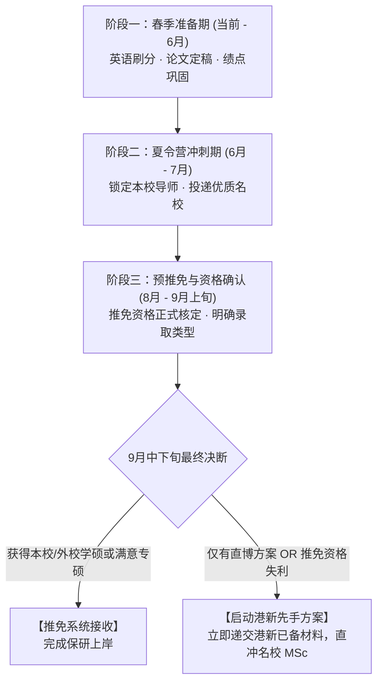

# 华东地区一所985高校（华东五校之一）的人工智能专业保研及升学定位评估报告

---

## 一、 背景梳理与综合定位分析

为确保升学策略的准确性与客观性，首先将您的个人背景严格按**已有经历**、**在审/在投/待出状态**与**未来计划**三个维度进行梳理，并结合推免政策与学科竞争态势进行多维度定位诊断。

### 1. 个人背景三维度梳理

| 维度 | 具体内容 | 核心特征评估 |
| :--- | :--- | :--- |
| **已有经历** | • **本科院校**：华东地区一所985高校（华东五校之一）（985、C9、华东五校），专业为人工智能。 • **学业成绩**：专业排名 前约45%（前 约45%），专业均分约 [课程成绩已概括]。 • **科研实习**：在华东地区一所985高校（华东五校之一） 自然语言处理科研（自然语言处理）科研实习约数月；另一段科研正在进行中。 • **英语水平**：CET-4 [英语背景已概括] 分，CET-6 500–549 分；目前暂无雅思/托福成绩。 • **竞赛实习**：无正式企业实习经历。 | • 顶尖 C9 本科学历，学术声誉与业界认可度极高。 • 成绩位列专业中段偏后，学分绩点相对吃紧。 • 有扎实的实验室学术训练基础。 • 六级已过绝大多数国内保研初审线（425/500 分）。 |
| **在审/在投/待出状态** | • **推免资格**：正在争取本科推免资格（上届推免 [往届推免名额传闻]，本届总人数与最终推免指标待定）。 • **论文成果**：一篇学术论文即将完稿，导师正在指导修改，准备投稿自然语言处理顶级会议 自然语言处理会议（尚未正式录用或发表）。 • **竞赛成果**：已参加 2025 年美赛（MCM/ICM），评审结果待出。 | • 推免资格处于“大概率可获，但处于指标边缘”状态。 • 科研成果具备高潜力，但在夏令营/预推免初审中尚未转化为具有硬性加分效力的“已见刊/已录用”成果。 • 竞赛暂无国家级或国际级正式落地奖项。 |
| **未来计划** | • **学位与方向意向**：以人工智能、计算机科学方向为主，**学硕优先**。 • **方案边界条件**：**排斥国内直博**；若国内院校要求直博或保研落空，倾向于申请中国香港与新加坡（港新）院校。 • **决断节点**：根据 9 月推免资格与最终录取情况，动态决定是否全面转向港新申请。 | • 诉求明确且边界清晰。 • “学硕优先 + 拒绝直博 + 成绩中段”在国内顶级高校 CS/AI 保研体系中存在客观的供给矛盾，需制定弹性方案。 |

---

### 2. 推免资格与核心竞争力客观诊断

#### (1) 推免资格获取概率：较有希望，但属于“边缘卡位”，需严防指标波动
- **排名与指标对照**：您的排名为 前约45%（约占 约45%）。参考上届推免人数（[往届推免名额传闻]），如果本届推免指标维持在 50~[往届推免名额传闻]区间，原专业名次理论上在推免安全线内。
- **潜在风险点**：
  1. 历年保研指标受教育部专项调控、卓越工程师计划倾斜、拔尖基地指标划拨等多重因素影响，基础推免指标可能出现微调；
  2. 华东地区一所985高校（华东五校之一）推免综合排名通常包含“综合素质评价加分”（涵盖科研论文、学科竞赛、荣誉称号等）。当前您的 自然语言处理会议 论文处于“准备投稿”阶段，美赛尚未出结果，因此在综合评价加分上暂无大额增量，需警惕后序同学因竞赛或已有论文加分实现反超；
- **定位结论**：具备较大概率取得推免资格，但绝非“稳操胜券”，必须做好“获得名额”与“未获名额转战港新”的双轨准备。

#### (2) 优劣势与核心矛盾深度剖析
- **优势（Strengths）**：
  - **顶级本科背书**：本校本科学院/计算机系在全国乃至国际上均具极高声誉，在夏令营初审中属于第一梯队生源。
  - **真实的硬核学术训练**：在本校 自然语言处理科研历练数月，且有成文中的顶级会议工作，科研敏锐度、代码能力和学术表达能力明显优于同梯队无科研经历的学生，在夏令营专业面试和机试考核中具备较强竞争壁垒。
- **劣势与制约（Weaknesses）**：
  - **均分与排名偏弱**：前约45% 且均分为 [课程成绩已概括]，在国内清北、华五等顶尖工科夏令营初审（通常偏好前 10%~20%，均分 88+）筛选中容易在机筛或初筛阶段处于劣势。
  - **论文未出录用结果**：高校保研政策及导师招收审核对“已发表/已录用（Accepted）”论文认可度极高，而在研或在投论文（Under Review/Draft）主要用于证明科研潜力，在硬性加分或免试破格上无法计入。
  - **英语缺乏留学标化**：六级 500–549 分可满足国内申请，但申请港新高校绝大多数需要托福或雅思成绩，若 9 月才开始备考将失去先手优势。
- **核心矛盾**：
  - **“学硕名额极度稀缺”与“拒绝直博”的结构性矛盾**：国内顶尖 CS/AI 学院目前普遍实行“压缩学硕、大幅扩招专硕、重点招收直博”的招生政策。学硕指标极少，基本被综合排名前 10% 或已有顶会成果的顶尖生源包揽；而导师手里富余的往往是“直博”名额。您坚持“学硕优先”且“拒绝直博”，直接排除了国内大部分顶尖导师最希望提供的直博渠道。

---

## 二、 待比较项目的逐一深度分析与适配度评估

围绕您关心的 5 个重点项目，结合其培养机制、招生结构、录取难度及与您个人诉求（专业对口、学硕、拒绝直博）的匹配程度，进行深度逐项剖析。

---

### 项目 1：南京大学人工智能学院

- **专业与学科匹配度**：★★★★★（极高）
  - 本院培养，学科实力顶尖（周志华教授领衔，机器学习与人工智能处于国际前沿），方向完全契合。
- **学位类型结构分析（学硕 vs 专硕 vs 直博）**：
  - **学硕现状**：南大 AI 学院学硕名额极少，竞争白热化。该院学生保研学硕通常优先保障综合成绩排名前列（通常前 10%~15%）的拔尖学生。
  - **专硕与直博**：专硕（电子信息-人工智能方向）名额相对充裕；同时，导师极为偏好招收直博生（五年一贯制深入科研）。
- **录取可行性与风险**：
  - **学硕难度**：以 前约45% 的成绩直接申请本院学硕，难度极大，除非在推免面试中表现极其惊艳且有学术大牛导师动用自主名额破格力保。
  - **专硕与直博博弈**：若申请专硕，凭借本院培养背景与科研潜力，录取概率可观；但若坚持学硕，导师极可能劝说您转为“直博”。由于您明确排斥直博，容易陷入“无学硕可录、专硕不愿委曲、直博不愿接受”的僵局。
- **综合评估结论**：
  - **方向与平台天花板，但“学硕”实现难度极高**。本院专硕是极具竞争力的保底选择，但学硕不可强求；需警惕直博动员。

---

### 项目 2：南京大学计算机相关项目（计算机系/计算机软件新技术全国重点实验室）

- **专业与学科匹配度**：★★★★★（极高）
  - 本校计算机系是全国顶尖计算机系之一（评估 A+）。您目前已在华东地区一所985高校（华东五校之一） 自然语言处理科研（自然语言处理）实习，该实验室多位知名导师编制隶属于计算机系。
- **学位类型结构分析（学硕 vs 专硕 vs 直博）**：
  - **学硕现状**：计算机科学与技术学硕指标稀缺，主要面向计算机系本系尖子生及外校顶尖推免生。
  - **科研连续性优势**：这是所有项目中科研延续性最好的选项。如果您当前实习的 NLP 导师认可您的科研表现及 自然语言处理会议 论文工作，导师的个人评价在面试考核中具有决定性影响。
- **录取可行性与关键考量**：
  - **导师意向与名额类型是唯一破局点**：您必须尽早与当前实习导师坦诚沟通，确认两点：
    1. 导师今年是否有推免硕士名额（是学硕还是专硕？）；
    2. 导师是否愿意接收您读硕士，还是只招收直博生？
  - 若导师仅有直博名额，则该项目与您的初衷直接冲突；若导师有硕士名额且愿意支持，即便只能给专硕，亦是极高性价比的发展路径。
- **综合评估结论**：
  - **最具现实操作空间的核心阵地**。科研环境熟悉、导师认可度高；能否实现学硕完全取决于当前实习导师的招生配额性质。

---

### 项目 3：北京大学软件与微电子学院（北大软微，PKU-SS）

- **专业与学科匹配度**：★★★★☆（高）
  - 设有软件工程、人工智能、计算机技术、大数据等方向，培养偏重工程实践与前沿应用，行业认可度高。
- **学位类型结构分析（学硕 vs 专硕 vs 直博）**：
  - **核心现实：北大软微几乎全部/绝大多数招生均为专业型硕士（电子信息专硕），极少甚至没有统招计算机科学与技术学硕指标**。
  - **诉求冲突**：该项目本质上与您“学硕优先”的诉求存在类型偏差。
- **录取可行性与生源定位**：
  - **录取胜率较高**：北大软微办学规模较大（大兴校区），夏令营与预推免对 C9/华五本科学历认可度极高。往年本校、浙大、中科大等华五排名前 30%~50% 的理工科学生，申请北大软微专硕初审通过率与综合通过率相当可观。
  - 您的 C9 背景加上真实的 自然语言处理科研科研经历，在软微的考核体系中非常占优。
- **综合评估结论**：
  - **顶尖高校光环与高性价录取概率的黄金结合，但与“学硕”诉求不符**。若您能适度放宽至专硕，北大软微是您走出本校、冲击顶级高校最稳妥、回报率最高的备选通路。

---

### 项目 4：清华大学自动化/电子相关工程硕博（清华工硕/工博专项、卓越工程师学院）

- **专业与学科匹配度**：★★★☆☆（中等，交叉偏工程）
  - 清华自动化系、电子系实力毋庸置疑，但近年推进的工程硕博专项多依托清华大学国家卓越工程师学院，偏向重大工程领域与校企联合培养。
- **学位类型结构分析（学硕 vs 专硕 vs 直博）**：
  - **核心现实 1：学位类型为工程专业学位（工程硕士/工程博士），绝无学术型硕士（学硕）可能**。
  - **核心现实 2：直博（工博）占比极高**。清华电子、自动化在此类专项中，大部分名额投放给工程博士（五年制直博，定向联合培养），工硕名额竞争极烈且指标受限。
  - **核心现实 3：培养模式偏差**。工程硕博强调在企业一线从事工程技术攻关（如联合航天、电科、华为等），与您目前在高校实验室从事 NLP 纯学术理论及大模型前沿研究（撰写 自然语言处理会议 论文）的路径存在明显分歧。
- **录取可行性与风险**：
  - 以华东地区一所985高校的前约45%且均分 [课程成绩已概括] 的条件，冲击清华自动化/电子本部的普通学硕初审几乎不可能通过；
  - 冲击工程硕博时，极大概率被引导或调剂至**工程博士（直博）**；一旦签署联合培养意向，将彻底违背您“拒绝直博”的底线。
- **综合评估结论**：
  - **严重不适配**。既无法满足学硕诉求，又面临极高直博捆绑风险，培养模式亦与纯学术研究偏离，建议审慎规避。

---

### 项目 5：南京大学工程管理学院金融项目（金融硕士/量化金融工程）

- **专业与学科匹配度**：★☆☆☆☆（严重偏离）
  - 属于管理学/经济金融学范畴（金融专硕 MF 或管理科学与工程）。虽然量化金融、金融科技欢迎计算机与人工智能背景学生，但这**彻底脱离了您“读人工智能或计算机方向”的学科主诉求**。
- **学位类型结构分析**：
  - 主流招生项目为金融专业硕士（MF，专硕）；学硕（管工）名额极少，且偏向运筹优化与管理科学理论。
- **录取可行性与职业路径**：
  - **降维打击但赛道异化**：本校 AI 学院学生申请校内管院金融项目，在数理与编程背景上具备极强的跨学科竞争力，拿 offer 概率较高；
  - **职业路径彻底转变**：毕业去向主要是证券公司、公募基金、商业银行金融科技岗或量化私募，无法继续从事计算机/AI 主流算法研发与学术深造。
- **综合评估结论**：
  - **极不推荐**。除用于“保研全线崩溃时的校内无条件兜底”或“主动放弃计算机转向金融行业”外，在现阶段院校定位中不应作为主力考虑对象。

---

## 三、 待比较项目综合对比矩阵与推荐梯队

为了帮助您直观做出取舍，将上述 5 个项目及关键决策指标汇总如下：

### 1. 核心维度对比矩阵

| 序号 | 待比较项目 | 专业方向契合度 | 主要招生学位类型 | 录取/达成难度 (针对前约45%) | 与“学硕/拒直博”诉求契合度 | 推荐指数 | 定位与角色建议 |
| :---: | :--- | :---: | :---: | :---: | :---: | :---: | :--- |
| **1** | **南京大学人工智能学院** | 极高 (AI核心) | 专硕为主 / 少量学硕 / 直博 | 学硕：极高 专硕：中等 | 学硕极难；专硕中等；直博易得但排斥 | ★★★★☆ | **核心大本营**：优先争取学硕，适度兼顾专硕，坚决回绝直博 |
| **2** | **南京大学计算机相关项目** | 极高 (CS/NLP核心) | 专硕为主 / 少量学硕 / 直博 | 学硕：高 专硕：中等 | 取决于当前实习导师名额性质 | ★★★★★ | **第一冲刺与落地阵地**：绑定现任 NLP 导师，锁定硕士名额 |
| **3** | **北京大学软件与微电子学院** | 高 (SE/AI工程) | 绝大多数为专硕 | 中等偏低 (C9生源优势显著) | 类型为专硕 (与学硕冲突)；无直博压力 | ★★★★☆ | **名校最高性价比备选**：用于外校冲名校，接受专硕前提下的首选 |
| **4** | **清华大学自动化/电子工程硕博** | 中等 (交叉工程) | 重点为工博 (直博) / 少量工硕 | 工博：中等 工硕：极高 | 极低（工博严重违背“拒直博”，工硕非学硕） | ★★☆☆☆ | **谨慎观望/不建议主攻**：避免深陷校企联合直博泥潭 |
| **5** | **南京大学工程管理学院金融项目** | 极低 (金融/经管) | 金融专硕 (MF) 为主 | 低 (工科降维优势) | 极低（非计算机/AI，非学硕） | ★☆☆☆☆ | **底线防守/非主航道**：仅作为跨行业转向或极端保底使用 |

---

### 2. 项目梯队划分

- **第一梯队（核心主攻·高度契合）**：
  - **南京大学计算机相关项目（现任 自然语言处理科研）**、**南京大学人工智能学院**。
  - *策略*：依托本校母体与科研经历，主攻两院的硕士指标。若能拿下学硕为最优解；若导师明确只有专硕名额，需客观评估专硕价值（参见下文第四节分析），切忌因盲目排斥专硕而被迫直博。
- **第二梯队（外校名校·退守专硕优质方案）**：
  - **北京大学软件与微电子学院（PKU-SS）**。
  - *策略*：作为夏令营/预推免外校投递的王牌备份。利用本校 C9 身份与高含金量科研经历锁定北大入场券，作为国内保研平台天花板的稳健抓手。
- **第三梯队（慎重考虑·诉求背离）**：
  - **清华大学自动化/电子相关工程硕博**（直博风险极大、培养偏工程实操）。
- **第四梯队（非核心不推荐）**：
  - **南京大学工程管理学院金融项目**（方向严重脱靶）。

---

## 四、 升学路径关键决断：保研 vs 直博 vs 港新备选

针对您“学硕优先、排斥直博、留有港新意愿”的三重特征，必须从国内研究生教育制度演变和国际申请规律出发，对以下关键现实进行理性推演。

### 1. 理性看待国内“学硕”与“专硕”的实质差异
您目前将“学硕优先”作为第一诉求，但在国内一流名校计算机与人工智能领域，必须认识到现实生态的转变：
- **学硕名额急剧收缩是全国性政策导向**：教育部近年来明确要求扩大专业学位研究生比例，清华、北大、本校、复旦、交大等校的 CS/AI 学硕招生计划大多只保留极少数（单院常在个位数或十余人），主要用于直博生生源过渡或国家级重大顶尖人才计划。
- **培养模式趋同，含金量无实质鸿沟**：在南大、北大等顶级高校，计算机/人工智能类别的学术型硕士与全日制专业型硕士（电子信息专业代码 0854）在**师资配置、实验室科研环境、学术论文发表要求、大厂校招与落户政策（如北京/上海落户加分）上已实现 100% 同等待遇**。两者的毕业证与学位证均受教育部完全认可。
- **结论与建议**：若仅因为执着于“学硕”名称而放弃本校或北大的优质专硕，最终被迫选择并不想去的院校或被动调剂直博，是极其不利的策略。**建议将目标微调为“学术型硕士最优；若为该目标学院/本系或北大软微等优质导师团队，全日制专硕同等重点考虑；坚决拒绝直博”**。

### 2. 港新（香港、新加坡）申请的可行性与定位画像
您提出“如果无法保研，或国内方案需要直博，则倾向考虑港新，具体结合 9 月保研情况决定”。港新申请的可行性分析如下：

#### (1) 项目类型差异（MPhil vs MSc）
- **MPhil（研究型硕士）**：2 年制，全额奖学金，最符合国内“学硕”概念。然而，港前三（HKU、CUHK、HKUST）与新二（NUS、NTU）的 MPhil **名额比博士（PhD）更加稀少**（全系每年往往仅有极少数指标），申请难度堪比直博，且同样需要导师强力背书，对您而言达成概率极低。
- **MSc（授课型硕士）**：1~2 年制，自费修读。无直博压力，学制紧凑，毕业获正规硕士学位（教育部留学服务中心均可认证）。对于想读硕士但排斥国内五年直博的学生而言，是体验极佳的替代方案。

#### (2) 申请优劣势与适配院校
- **背景评估**：华东地区一所985高校（华东五校之一） C9 标签在香港和新加坡高校认可度极高；均分 [课程成绩已概括] 处于可接受范围（稍显偏弱，但非硬伤）；在研的 NLP 科研经历与即将投递的 自然语言处理会议 论文是文书和导师套磁的显著加分项。
- **目标梯队推荐**：
  - **核心主申**：香港大学（HKU CS/AI）、香港中文大学（CUHK CS/IE）、香港科技大学（HKUST CS/IT）；
  - **高位冲刺**：新加坡国立大学（NUS SoC/Master of Computing）、南洋理工大学（NTU SCSE）；
  - **稳健保底**：香港城市大学（CityU CS）、香港理工大学（PolyU CS）。

#### (3) 关键短板与致命误区警示
- **致命误区：“等 9 月保研落空后再考虑港新”**。
  - 港新高校计算机类 Master 通常于 **9 月初至 10 月初** 全面开放申请，实行“先到先得、分轮审理（Rolling）”机制，第一轮（Early/Round 1）发放录取名额最多、背景容忍度最高。
  - 您目前**完全没有雅思或托福成绩**。如果等到 9 月底推免系统关闭才开始备考英语，一旦遇上考位紧张、出分延迟、甚至首考刷分未达标（通常需托福 90+ 或雅思 6.5+，单项有小分要求），将彻底错过港新前两轮黄金申请期，导致满盘皆输！
- **行动原则**：**必须“战术前置”**。无论保研走势如何，必须在 2025 年暑期前拿下合格的托福/雅思成绩，文书素材提前完成初稿。

---

## 五、 阶段性行动指南与时间线规划

从当前申请准备阶段（春季）到最终推免录取（9月），建议分为四个阶段推进：

---

### 阶段一：春季蓄力与双轨准备期（当前 - 2025年 6月）
1. **全力攻克语言大关（最高优先级）**：
   - 立即报名 5 月或 6 月初的雅思考试（目标总分 6.5~7.0，小分不低于 6.0）或托福（目标 95+）；
   - 这一步是保障“9 月一旦保研需要直博，能瞬间无缝出逃港新”的唯一安全绳。
2. **跟进科研与竞赛收尾**：
   - 全力配合 自然语言处理科研导师完成 自然语言处理会议 论文的最终打磨并正式投递，获取正式投稿证明（Submission Confirmation）；虽然未录用，但在夏令营申请中提交完整的在投文稿（Preprint/Manuscript）和导师推荐信，学术说服力远胜普通简历；
   - 持续跟进美赛结果出炉，第一时间更新简历。
3. **推免资格细节摸底**：
   - 向学院教务老师与往届学长了解本届推免指标测算细则、综合素质加分截止时间及认定目录，核准自身在 原专业名次左右的安全边际。

---

### 阶段二：夏令营申请与意向锁定（2025年 6月 - 7月）
1. **本校导师深度沟通（关键突破口）**：
   - 与目前实习的 NLP 导师（无论在计算机系还是 AI 学院）进行一次正式的升学意向面谈；
   - 诚恳表达对实验室方向的热爱与读硕诉求，礼貌探寻：“老师，我非常希望能在您的指导下继续攻读硕士学位，请问您今年是否有学术型硕士或专业型硕士的名额？”
   - **底线原则**：如果导师明确表示“只有直博名额，不招硕士”，切勿当场盲目承诺，需表达感谢并保留选择空间。
2. **夏令营梯队式投递策略**：
   - **本校项目**：华东地区一所985高校（华东五校之一）本科学院、华东地区一所985高校（华东五校之一）计算机系（必报）；
   - **外校冲刺与备选**：北京大学软件与微电子学院（重点投递）、中国科学院大学计算所/软件所/自动化所相关硕士组（可作为优质学硕/专硕尝试）；
   - **回避项目**：对明确绑定企业工程博士的专项（如清华工程硕博）谨慎填报，避免考核阶段被强制调剂直博。

---

### 阶段三：预推免考核与资格核定（2025年 8月 - 9月上旬）
1. **参加预推免面试与复试考核**：
   - 重点准备数据结构与算法、机器学习基础、NLP 专业领域问题及 自然语言处理会议 论文的技术细节；
   - 本校考核争取进入拟录取候选名单。
2. **正式推免资格公示**：
   - 学院前三年成绩排名及推免名单正式公示，确认推免资格最终归属。

---

### 阶段四：终局决断与系统填报（2025年 9月中下旬）
根据 9 月推免系统（教育部推免服务系统）开放前夕的实际录取意向，实行果断决策：

- **方案 A（保研理想落地·优先执行）**：
  - 成功获得本校 自然语言处理科研导师的学硕名额，或拿下本校/北大软微的优质专硕录取；
  - **决断**：在国家推免系统中确认接收待录取通知，圆满完成国内保研。
- **方案 B（启动港新申请·坚决避坑）**：
  - 若出现“国内导师均只给直博名额”或“推免资格意外受阻”的局面；
  - **决断**：坚决不违心接受五年国内直博。凭借 6 月考出的雅思/托福成绩、本校 C9 官方成绩单及已打磨完毕的 NLP 论文科研文书，第一时间投递港大、港中文、港科、NUS 等院校的 2026 Fall CS/AI 硕士项目，凭第一轮时间红利稳稳拿下世界百强名校硕士录取。
