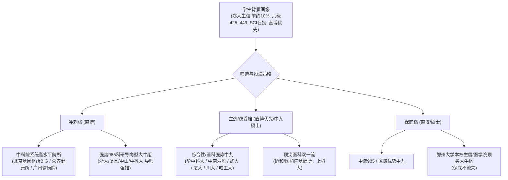

# 郑州大学生物信息学保研择优指导：导师与项目筛选全维度实战指南

针对你目前的背景——**郑州大学（211/双一流）生物信息学专业、排名 前约10%（前 约10%）、六级 425–449 分、干湿实验兼修、一篇[具体论文分区已概括] SCI 一作在投、校级大创进行中**，且明确**“继续走生信干实验、直博优先、能接受部分中九院校硕士”**，在筛选导师与项目时，你需要建立一套**兼顾“直博低容错率”与“生信学科生态特殊性”的立体化比较体系**。

直博是一场为期 5-6 年的“学术与职业深度绑定”，选错导师的代价极其高昂；而生物信息学干实验在国内不同实验室的生态两极分化严重。以下为你拆解核心比较维度、背调方法及择校应对策略。

---

## 一、 背景定位与优劣势诊断（SWOT）

在开始筛选前，必须清晰认知自己在推免市场上的博弈筹码：

| 维度 | 具体情况 | 优势与筹码 | 短板与风险应对 |
| :--- | :--- | :--- | :--- |
| **院校与专业** | 郑州大学（一流大学B类/211）生信 | 本科生信科班出身，数理与编程基础通常优于传统生科转生信生。保研名额极其稳固。 | 面对华五、顶尖中九纯计算机/生物生时，本科生源标签不占绝对优势，需用专业技能突围。 |
| **学积分流** | 前约10%（Top 约10%） | 排名靠前，处于郑大推免队列的前列，能拿到优质的推免推荐表。 | 冲击顶尖中九（如浙大、复旦、上交、华科）热门学硕时，机筛可能偏好前 5% 的学生；但**冲击直博则完全达标且有竞争力**。 |
| **英语水平** | 六级 425–449 分（刚过线） | 过了及格线，具备基本的免考/报考资格。 | **最大短板**。部分中九夏令营机筛严卡 450/480/500 分；需靠**提前联系导师“强推”**或**主攻看重科研的中科院系统**破局。 |
| **科研实践** | 干湿兼修、[具体论文分区已概括]一作在投、大创在研 | 1. 懂湿实验的生信人极受青睐（能理解实验误差、生物学机理与测序批次效应）； 2. 独立一作在投证明具备全流程科研驱动力与学术写作能力。 | “在投（Under Review）”在夏令营系统机筛中不加分或不计入论文分；必须在简历、个人陈述与面试 PPT 中展示核心图表与技术细节。 |
| **志愿诉求** | 直博优先，中九硕士兼顾 | 直博名额多、竞争烈度低于硕士，利用直博可以实现**平台跃迁**。 | 直博沉没成本极高，不能中途退学，必须对导师的“人品、经费、延毕率”做最高规格的严格排查。 |

---

## 二、 筛选导师与项目时应重点比较的核心维度

生物信息学干实验的实验室存在巨大的“生态分化”：有的组是国际一流的计算生物学团队，有的组则是把生信生当成给湿实验跑流程切图的“生物民工”。筛选导师时，应按以下六大维度进行逐一对比打分：

### 1. 课题组生态与定位：警惕“生信孤儿”与“跑图民工”陷阱（最高权重）
这是干实验直博生最容易踩、后果最严重的坑。必须严格区分以下三类实验室：

*   **陷阱 A：纯湿实验大组里的“生信独苗/生信孤儿”**
    *   *特征*：导师是传统生化、分子或农学大牛，组里 90% 以上是做湿实验的，因为测序数据多，招一个生信直博来“处理数据”。
    *   *弊端*：PI 自己根本不懂 Linux、Python、算法和统计，无法在代码、算法架构或模型调试上给你任何有效指导；你的日常工作沦为给湿实验师兄师姐跑标准化流程、画火山图、热图和富集分析，成为“公用制图工具人”；文章署名往往被排在并列一作靠后甚至挂二作；缺乏高年级生信同门的代码积累与传帮带，极难产出高质量纯干实验毕业论文。
    *   *对策*：**坚决避开此类课题组的直博！**
*   **模式 B：纯计算生物学/生物信息学实验室（算法/工具/数据挖掘主导）**
    *   *特征*：导师及整个团队全员做干实验，组内有成熟的代码规范、GitHub 维护机制、公共流程（Pipeline）和算法开发传统。
    *   *优势*：指导极其对口，组会讨论全是算法架构、模型评估、统计推断；有成熟的传帮带体系；适合立志在计算生物学、AI4Science、生物软件开发方向深耕的同学。
*   **模式 C：成熟且平等的“干湿结合”大型交叉团队**
    *   *特征*：团队内部干湿比例均衡（如 1:1 或有独立的计算生物学分部），有湿实验平台稳定产出一手前沿数据（如单细胞时空组学、长读长测序、自主临床队列），同时干实验拥有**独立的科研立项权**。
    *   *优势*：这类实验室发高分文章（Nature/Science/Cell 及子刊、Genome Biology、Nucleic Acids Research）的概率最高，干实验学生既有高质量数据喂养，又能将算法应用于真实生物学发现。
    *   *关键考察点*：干实验学生是否具有独立一作课题？干实验与湿实验学生在并列一作中如何排序？

### 2. 算力基建与数据源“造血能力”（干实验的硬件命脉）
干实验不需要试剂耗材，但极度依赖算力与数据：
*   **服务器与计算资源**：
    *   课题组是否拥有**自建的高性能计算集群（HPC）**？节点数、CPU 核心数、内存容量、GPU（如 A100/H100/4090 等显卡配置）如何？
    *   还是仅仅依托学校公共超算中心（排队严重、任务调度受限、经常因抢占资源导致分析中断）？
    *   如果做生信大模型（AI for Science / 基础模型），组里是否有充足的经费支持购买云算力（阿里云、华为云等）？
*   **数据造血机制**：
    *   *低维造血*：纯靠公共数据库（TCGA、GEO、ICGC、UK Biobank）挖掘。目前纯公共数据挖掘的边际效益已严重递减，三四区套路化灌水容易，但直博 5 年若全靠挖公共数据库，很难达到顶尖 985 博士毕业的高分要求，且顶级期刊审稿人往往硬性要求“实验验证”。
    *   *高维造血*：课题组拥有**持续产出一手测序数据的平台或临床合作资源**（如与顶尖三甲医院合作的大型罕见病/肿瘤临床队列，或拥有 10x Genomics、立体时空组学 Stereo-seq 平台）。这类组的直博生科研上限极高。

### 3. 导师特征与指导机制（青椒 vs 帽子大牛）
直博 5 年，导师的学术生命周期直接决定你的成长体验：
*   **青年 PI（优青 / 海外高层次青年人才 / 特聘研究员）**：
    *   *优势*：处于职称晋升和学术爆发期，追求高质量论文产出；自己通常尚未脱离科研一线，能亲自带读文献、改代码、调参、改论文，指导频率高（甚至是一对一指导）；对直博生倾注的心血极大。
    *   *代价*：往往考核压力大，Push 程度较高，周末/节假日可能要求在岗；抗压能力弱的学生容易焦虑。
*   **资深学术巨擘（院士 / 杰青 / 长江学者 / 院所领导）**：
    *   *优势*：学术声誉好、经费极其雄厚、平台与人脉资源顶级，毕业后进入体制内高校、研究所或行业大厂有强大的背书与人脉引荐能力。
    *   *风险*：事务繁多，常年出差开会，通常实行“多级管理制”——日常科研由团队内的小老板（副教授/讲师/大博士后）负责。
    *   *核心考察点*：**如果报大牛组，务必弄清实际负责带你的“二导师/小老板”是谁！** 其学术水平、人品和抢文章情况直接决定你的命运。如果小老板自己面临评职称压力，很容易出现“学生干活、小老板抢一作”的悲剧。

### 4. 毕业标准、延毕率与“退出安全网”（直博底线）
选直博必须有“底线思维”，直博不是硕士，一旦中途出现重大不可调和矛盾，代价是数年青春付诸东流：
*   **课题组的毕业硬性指标**：
    *   院校通常有基本博士毕业要求（例如 2 篇 SCI 或 1 篇一区/IF>5 等），但**很多强势导师有自己的“组规”**（如必须发 1 篇 10 分以上或中科院一区 Top 才能申请答辩）。必须查清该组往届直博生毕业的实际平均论文要求。
*   **历史延毕率与毕业年限**：
    *   近 5 年该组直博生是普遍 5 年准时毕业，还是常态化延毕至 6-7 年？
    *   延毕的原因是课题难度大（冲顶刊），还是导师卡毕业指标、把学生当廉价劳动力留着干横向/打杂？
*   **转硕机制（容错退路）**：
    *   该院校及该导师是否具备人性化的**分流转硕政策**？
    *   如果在博三中期考核评估发现科研受阻、身心难以维系，组里是允许转为硕士学位毕业走人，还是逼迫死磕到底甚至只能退学？**拥有宽容转硕通道的课题组，是直博生心理压力的巨大减震器。**

### 5. 科研技术流派：算法模型开发 vs 多组学应用挖掘
这决定了你未来 5 年的知识结构与毕业后的核心壁垒：
*   **技术路线 A：算法工具开发 / AI for Science（高壁垒型）**
    *   *内容*：生信新算法开发、单细胞/空间组学数据分析新工具（包）、深度学习预测模型（蛋白质结构、组学表征大模型、微环境建模等）。
    *   *特点*：数理和代码要求极高，前期开发周期长、见效慢，但一旦发表，引用量通常极高；在工业界（互联网大健康、AI 制药、生物医药核心算法岗）和学术界教职市场上具有极其强悍的技术壁垒。
*   **技术路线 B：多组学应用与机制解析（高产出型）**
    *   *内容*：利用现有主流工具包和自建流程，解析肿瘤耐药、免疫微环境、发育生物学机制或复杂疾病遗传变异。
    *   *特点*：产出节奏相对较快，影响因子可能较高，但如果不掌握核心计算代码底层，容易沦为“调包侠”，在工业界的可替代性相对较高。
*   *个人匹配建议*：鉴于你本科具备生信科班背景且懂湿实验，如果数学和编程功底扎实，直博建议优先选择**“兼顾算法开发与深度转化”**或**“AI 生物医药结合”**的前沿组；若数理编程偏向应用，则选择**高通量单细胞/空间多组学临床转化大平台**。

### 6. 毕业去向与行业资源辐射度
*   **学术界出口**：导师是否有稳定将毕业生推荐至海外顶尖名校（如 Harvard、MIT、Broad Institute、EMBL-EBI、Sanger 等）进行博士后深造的人脉网络？近几年是否有毕业生成功拿到国内高水平教职？
*   **产业界出口**：组内师兄师姐的去向分布：
    *   跨国与龙头创新药企（如百济神州、恒瑞、诺华、罗氏的计算生物学/靶点发现中心）；
    *   AI 制药与生物科技独角兽（如晶泰科技、英矽智能等）；
    *   高端测序与精准医学大厂（如华大、诺禾致源、燃石医学等）；
    *   还是大多数人因缺乏核心技能而转行做低端销售、售后技术支持？导师是否支持实习、是否愿意动用行业资源为学生写推荐信？

---

## 三、 结合“六级 425–449 + 排名 前约10%”的择校与择所梯队策略

六级 425–449 分是你的最大痛点，但“直博”和“在投一作+干湿结合”是你的对冲利器。必须制定差异化策略：

### 1. 巧妙避开“六级硬卡”，利用“中科院系统”降维突围
*   **为什么首选中科院？**
    *   高校（特别是教育部直属 985 高校院系）在夏令营初审时，行政教务往往实行“硬性机筛”（直接在系统里设六级 $\ge 450–499$ 或 500 分，低于该分数的简历直接被计算机过滤，连导师的面都见不到）。
    *   **中科院各研究所（现中国科学院大学各研究生培养单位）的选拔机制不同**：中科院极度看重实际科研动手能力、代码水平和干湿实验经验；各课题组 PI 拥有极大的招生自主权；只要导师认可你，六级过线（425分）即可，导师可以直接向教育处要名额录用。
    *   *推荐重点考察所*：
        *   **中国科学院北京基因组研究所（国家生物信息中心，BIG）**：国内生信最高圣殿之一，资源与算力顶级。
        *   **中国科学院上海营养与健康研究所（原上海生命科学研究院/计算生物学所）**：生信底蕴深厚，计算与生物结合极其成熟。
        *   **中国科学院广州生物医药与健康研究院（GIBH） / 深圳先进技术研究院（SIAT）**：经费充沛，单细胞与干细胞计算转化强，对技术流学生极度渴望。
        *   **中国科学院遗传与发育生物学研究所**：植物与农业生物信息学顶级，多组学资源丰富。

### 2. 目标高校梯队规划（直博与中九硕士匹配）
*   **冲刺档（直博目标）**：
    *   *目标院校*：浙江大学（生工食品学院/农生环/生科院）、复旦大学（生命科学学院/人类表型组研究院）、中科大（生命科学与医学部）、中山大学（中山医学院/生命科学学院）。
    *   *打法*：必须通过**学术邮件“提前套磁”**，不可直接盲目等夏令营机筛。将你的在投论文初稿、干湿实验分析流程代码附上，争取与导师一对一线上学术面试。若导师给出“强推（强 Offer）”，即可绕过夏令营英语机筛，在预推免通过导师指标直接拟录取。
*   **主流/稳妥档（直博主力 + 中九优质硕士）**：
    *   *目标院校*：
        *   **华中科技大学**（生命科学与技术学院 / 基础医学院）：生信底蕴极强，单细胞与表观遗传方向出色。
        *   **中南大学**（基础医学院/湘雅医院生物信息团队）：医学遗传学与医学大数据极强，临床资源雄厚。
        *   **武汉大学**（计算机学院交叉中心 / 生命科学学院）：算法与生信结合紧密。
        *   **四川大学**（华西医院系统医学与大数据中心 / 生命科学学院）：华西临床数据资源无与伦比。
        *   **哈尔滨工业大学**（生命科学与医学学部 / 计算机学院）：算法与计算生物学功底极其扎实。
        *   **厦门大学**（生命科学学院/公共卫生学院）：生信团队精悍，学术氛围优良。
*   **保底档（坚实防线）**：
    *   **郑州大学本校**：联系本校生科院、基础医学院或药学院最顶尖的生信学科带头人，提前锁定学硕或直博保底。有了本校底牌，外部冲刺心态将极其从容。

---

## 四、 导师与课题组“深度背调”实操方法论

很多坑导师在招生宣讲时口若悬河，表面温文尔雅，实则 PUA、卡毕业、抢文章。必须使用“反信息差”侦察技术：

### 1. 文献与学术轨迹反查（PubMed / Web of Science / Google Scholar）
*   **查近 3-5 年通讯作者与第一作者排位**：
    *   看发出来的论文中，**第一作者到底是不是本组的研究生**？
    *   是否存在“第一作者几乎全由导师本人、导师配偶、小老板或外部合作者占据，学生全在并列一作靠后或挂名第二三作”的情况？（**警惕论文压榨**）
    *   直博生在读期间平均发表论文周期是多久？毕业前是否有代表作上线？
*   **查基金与经费支持**：
    *   在科学网基金库（NSFC）查询导师在研项目：是否有国家自然科学基金（重大/重点/面上项目）、科技部重点研发计划？
    *   生信干实验虽然试剂费少，但高性能服务器购置、云算力租用、大型数据授权使用以及高水平测序原始数据的获取，全部需要巨额纵向经费支撑。

### 2. 代码库与开源审计（GitHub / Gitee 照妖镜）
*   检索课题组是否有官方 GitHub 组织或导师/核心成员的公开代码仓库。
*   *判断标准*：
    *   仓库是否有清晰的 Readme、规范的代码注释、持续的 Commit 记录、规范的 Docker 镜像或 Conda 环境配置？
    *   还是几年前建了一个空仓库就再无更新？
    *   **一个活跃开源、维护软件工具包的课题组，一定是货真价实的纯干实验或优质计算组；反之，若全网搜不到任何组内成员的代码轨迹，大概率是缺乏算法代码积累的伪生信组。**

### 3. 社交穿透：如何私聊在读/已毕业师兄师姐？
不要在公开场合询问，不要找导师指定的“招生宣传联络员”。通过已发表论文的第一作者邮箱、知乎、小红书、领英（LinkedIn）找到该实验室毕业 1-2 年的校友或在读高年级博士生。

> **提问心法**：切忌直接问“老师人品好不好/坑不坑”（别人有防备心理不敢说实话），要**询问客观事实**：
>
> 1. *“请问咱们组直博生通常几年毕业？近几年延毕率大概是怎样的？”*
> 2. *“平时大家的算力主要是自建的服务器集群，还是用学校超算排队？算力够用吗？”*
> 3. *“组会大概多久开一次？老师指导科研是亲自交流还是主要由小老板负责？”*
> 4. *“组里干实验和湿实验的同门是怎么分工合作的？论文一作排序一般遵循什么原则？”*
> 5. *“万一课题进展不顺，学院和组里对转硕是什么态度？”*
>
> **信号识别**：如果对方出现“**支支吾吾**”、“**建议你多看看其他老师**”、“**快跑**”、“**老师比较严格，抗压能力要很强**”，这通常是极度危险的红色预警（Red Flag）！

### 4. 导师评价平台检索
*   利用“导师评价网（历史镜像归档）”、知乎匿名专栏、小红书搜索“【学校名】+【导师姓名】”。
*   重点排查是否有克扣劳务费、辱骂学生、强制打卡早八晚十一（无意义加班）、强行要求做与科研无关的横向杂活、抢占学生一作等恶劣劣迹。

---

## 五、 简历优化与套磁面试实战攻防建议

### 1. 简历打法：化“六级 425–449 劣势”为“实战英语优势”
*   **论文板块置顶**：
    *   在简历最核心位置列出你的学术论文：
        > **[论文代表作]**  
        > **Your Name (1st Author)**, et al. *"Paper Title..."* (Under Review in *Journal Name*, SCI , IF: X.X).  
        > - *核心贡献*：独立完成生物信息学全流程分析架构（含数据清洗、多组学因果分析、机器学习模型预测）；独立撰写全英文手稿与机制图表绘制。
    *   **心理学对冲效应**：能以独立一作撰写全英文 SCI 论文并成功投稿，直接在事实层面粉碎了导师对你“学术英文读写能力不足”的担忧，让六级 425–449 沦为无足轻重的“应试分数”。
*   **突出“干湿贯通”的复合技术栈**：
    *   明确列出技能清单：
        *   *干实验*：Linux 运维、Shell 脚本开发、R / Python 数据科学分析栈（Seurat、Scanpy、Bioconductor）、Snakemake/Nextflow 流程搭建、机器学习/深度学习框架；
        *   *湿实验*：PCR、WB、细胞培养、文库构建等（强调具备深刻理解生物学机制的能力，能与湿实验团队无缝对话）。

### 2. 邮件套磁话术结构
套磁邮件必须精炼、专业，切忌群发假大空模版：
*   **第一段（亮明身份与意向）**：郑州大学生信本科、排名前 10%、手握推免资格、**明确表达直博意向**（直博对导师极具吸引力）。
*   **第二段（学术契合点）**：研读该导师近一年发表的 1-2 篇代表作，指出其研究亮点，并结合你目前在投的[具体论文分区已概括]论文，说明你在该方向已有一定技术积累。
*   **第三段（成果与附件）**：附件附上简历、在投论文的手稿摘要（Abstract）与代表性结果图（Figure），以及你个人 GitHub 链接或代码示例。
*   **行动号召**：恳请导师安排一次 15-20 分钟的线上交流（Zoom/腾讯会议），用面对面的学术交流彻底锁定拟录取名额。

---

## 六、 总结：筛选决策核对清单（Checklist）

在最终确认意向导师并签署拟录取协议前，请务必用下表逐项核验：

| 评估项目 | 达标合格线 | 理想优质线 | 踩雷红线（出现即撤） |
| :--- | :--- | :--- | :--- |
| **生信生态** | 组内有 2 名以上生信高年级博士/博后 | 纯生信组，或干湿对半且干实验有独立立项权 | 纯湿实验大组中的生信独苗/生信工具人 |
| **算力资源** | 学校超算排队可用，组内有基础图形工作站 | 组建独立计算集群（TB级内存 + 多块高端GPU），支持云算力 | 只有个人轻薄本，无任何服务器与超算支持 |
| **指导模式** | 每两周一次组会，导师或小老板可联系 | 每周定期一对一学术交流，导师手把手改代码与手稿 | 常年不见导师，小老板抢一作，缺乏学术指导 |
| **毕业前景** | 绝大多数 5-5.5 年毕业，毕业要求与学校齐平 | 毕业生手握多篇高水平代表作，推荐海外顶尖博后/大厂 | 普遍延毕 6-7 年，有博士退学历史，要求极端严苛 |
| **署名机制** | 学生主导的工作稳拿第一作者 | 导师仅通讯，干湿合作合理界定第一作者 | 导师抢一作，或把一作分给关系户/小老板 |
| **退路保障** | 政策允许博三转为硕士毕业 | 导师开明，支持因材施教与合理职业规划 | 严禁转硕，不达标直接按退学处理 |

保持自信，利用好你**“干湿结合”与“一作在投”的核心武器**，通过精准套磁击穿六级壁垒，在拥有充足算力与优良师德的平台开启你的计算生物学生涯！
